::: {.abstract title="О чём лекция"}
Лекция о деревьях поиска, которые устроены сложнее AVL-дерева и выбираются под конкретную нагрузку и носитель данных. Сначала разобрано, почему AVL-дерево хорошо для чтения, но дорого обходится при записи, и как красно-чёрное дерево ослабляет требование к балансу ради быстрых вставок и удалений: пять правил раскраски, перекраска и повороты при вставке, код поворотов на Python, коротко — удаление. Дальше вопрос масштаба: когда данные не помещаются в оперативную память, время поиска определяется числом чтений с диска, и на этот случай нужно B-дерево — широкое и низкое дерево с несколькими ключами в узле. Для него подробно показаны правила, вставка с разделением узла и удаление с заимствованием и слиянием. В конце кратко описаны префиксное дерево, дерево отрезков и splay-дерево и дана схема выбора дерева под задачу. Для чтения нужны двоичные деревья поиска, AVL-дерево с его поворотами (прошлая лекция), O-нотация и основы Python.

Организационной части в лекции почти нет. Вопросы из зала и чата вплетены в разделы, к которым относятся, и выделены серыми блоками — их можно пропустить при беглом чтении. Схемы со слайдов и кадры анимаций приведены прямо в тексте. Сноски с пометкой «Прим. составителя» — пояснения, которых не было в лекции.
:::

## Узкое место AVL-деревьев

*Таймкод: 00:00:16 · слайды 1–2*

Эта лекция про деревья поиска, которые оказываются удобнее AVL-деревьев в двух ситуациях: когда данные часто меняются и когда они не помещаются в оперативную память. Сначала коротко вспомним AVL-деревья и их слабое место, затем разберём красно-чёрные деревья и B-деревья. В конце в качестве бонуса посмотрим несколько интересных вариаций деревьев для частных задач.

Куда ведёт лекция, хорошо видно из сопоставления двух типов деревьев. Пока данные лежат в оперативной памяти (RAM), используются «глубокие» бинарные деревья высотой $O(\log N)$. Когда данные хранятся на диске и каждое обращение к нему стоит дорого, лучше подходят «широкие» B-деревья, узлы которых соответствуют страницам диска. Их высота равна $O(\log_B N)$, где $B$ — размер блока. Чем шире узел, тем ниже дерево и тем меньше переходов нужно, чтобы дойти до нужного элемента.

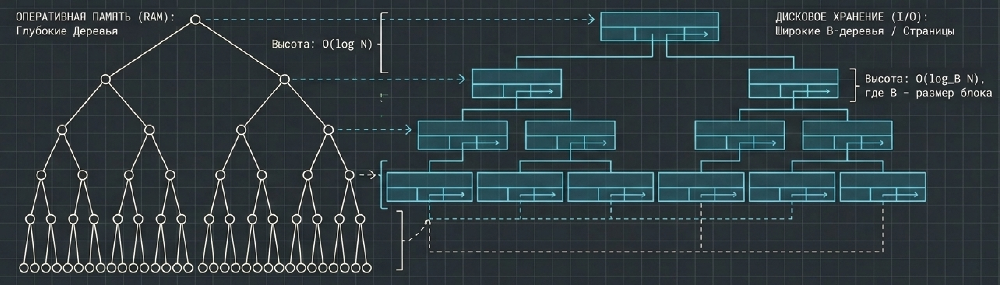

### Что даёт AVL-дерево

**AVL-дерево** — это самобалансирующееся дерево поиска. После каждого изменения оно само восстанавливает баланс. Поэтому дерево никогда не вырождается в линию, его высота $h$ остаётся логарифмической, а поиск, вставка и удаление, которые выполняются за $O(h)$, в итоге всегда стоят $O(\log N)$.

Баланс в нём строгий. **Инвариант строгой балансировки** требует, чтобы для **каждого** узла высоты левого и правого поддеревьев отличались не больше чем на единицу:

$$|h_L - h_R| \le 1,$$

где $h_L$ и $h_R$ — высоты левого и правого поддеревьев этого узла. Именно это условие гарантирует, что поиск всегда идёт по короткому пути.

### Чем приходится платить

Слабое место AVL-дерева — сам механизм автоматической балансировки. Условие проверяется в каждом узле, поэтому вставка или удаление листа может нарушить его у любого предка. Тогда приходится идти от листа вверх, восстанавливая баланс, и в худшем случае дойти до самого корня. Возникает цепная реакция: стоимость балансировки пропорциональна высоте дерева, то есть в худшем случае это $O(\log N)$ структурных поворотов на каждое изменение.[^n1a] Любая модификация, будь то вставка или удаление, обходится столько же.

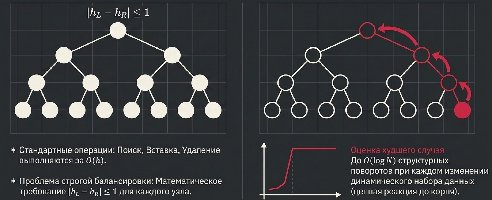

Пока данные в основном читаются, это не страшно. Но при частых модификациях строгий инвариант даёт неоправданно высокие накладные расходы.

**Важный вывод:** AVL-дерево очень хорошо подходит для чтения и заметно хуже для записи. Отсюда естественный вопрос: можно ли немного ослабить требования к балансу, чтобы поиск оставался почти таким же быстрым, а запись стала дешевле?

[^n1a]: Примечание составителя: точнее, при вставке в AVL-дерево хватает одного поворота (одинарного или двойного), но обновлять высоты и проверять баланс всё равно приходится вдоль пути до корня. Каскад поворотов, растущий с высотой, возможен при удалении. Так это и указано в сравнении AVL и красно-чёрных деревьев в разделе 4.


## Красно-чёрные деревья: компромисс ради быстрой записи

*Таймкод: 00:03:17 · слайды 3*

AVL-дерево хорошо читается, но дорого пишется: каждая вставка или удаление может запустить цепочку поворотов до самого корня. Как ускорить запись и при этом не потерять быстрый поиск? Для этой задачи есть готовое и широко распространённое решение — **красно-чёрное дерево (Red-Black Tree)**, или RB-дерево.

### Идея: баланс «примерно», зато дешёвые изменения

Красно-чёрное дерево — это **трейд-офф**, то есть сознательный компромисс: от одного свойства частично отказываются ради другого. Здесь жертвуют строгостью формы ради скорости модификаций. RB-дерево не сбалансировано полностью, зато работает с записью гораздо быстрее, чем AVL.

Почему так можно? Для эффективного поиска полная сбалансированность на самом деле не обязательна. Обязательно другое: дерево должно оставаться деревом поиска, то есть все узлы слева от текущего меньше его, а все узлы справа больше. Инвариант строгой балансировки AVL требует большего, чем нужно. Если заменить его более мягким правилом, при котором поддеревья лишь *примерно* совпадают по высоте, поиск останется почти таким же быстрым, как в AVL. Зато вставка, удаление и замена элемента заметно ускорятся, и это огромное преимущество.

Мягкое правило не означает, что дерево может выродиться. Высота красно-чёрного дерева из $N$ узлов ограничена:

$$h \le 2\log(N+1).$$

В худшем случае RB-дерево оказывается не более чем вдвое выше идеально сбалансированного, поэтому поиск по-прежнему идёт за логарифм и не деградирует[^n2a].

### Пять правил красно-чёрного дерева

Вместо условия на высоты поддеревьев каждому узлу приписывается цвет, а на цвета накладываются ограничения. Эти пять правил стоит выучить и запомнить:

1. **Цвет.** Каждый узел либо красный, либо чёрный.
2. **Корень.** Корень всегда чёрный.
3. **Листья.** Все листья фиктивные и чёрные. **Фиктивные листья (NIL)** — это пустые «нулевые» узлы, которые висят на месте отсутствующих детей и не хранят никакого реального значения. На рисунках их часто опускают для простоты, но подразумевается, что они есть и что они чёрные.
4. **Наследники.** У красного узла могут быть только чёрные дети. Два красных узла подряд (родитель и ребёнок) запрещены. Такое нарушение называют [**двойным красным**]{.gl key="Двойной красный"}.
5. **Чёрная высота.** Любой путь от узла вниз до его листьев содержит одинаковое число чёрных узлов. Это число называют **чёрной высотой** узла. Число красных узлов на разных путях при этом может отличаться.

Правила 4 и 5 вместе и задают «примерную» сбалансированность. Чёрные узлы распределены по всем путям поровну, а красные можно вставлять между ними, но не больше одного подряд. Поэтому один путь не может оказаться намного длиннее другого[^n2b].

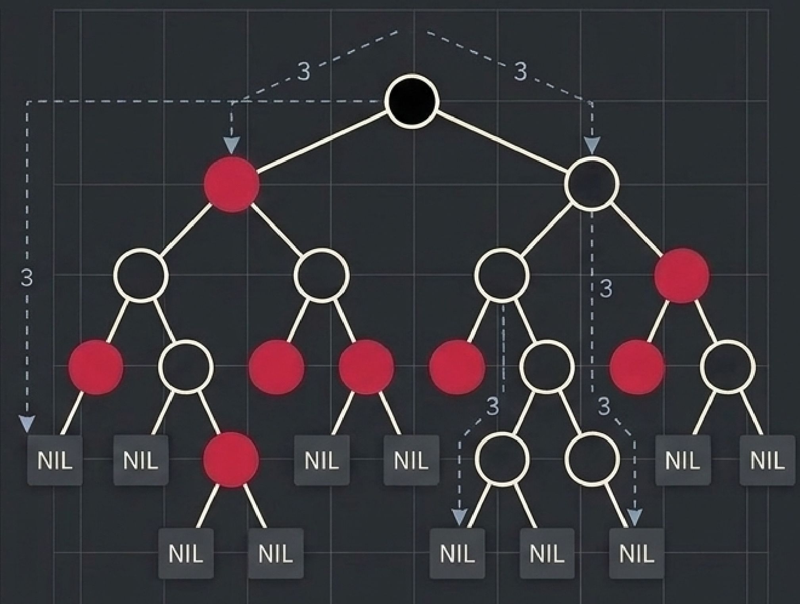

::: {.qa title="Вопросы из зала"}
**На иллюстрации к правилам у красного узла есть красный ребёнок. Разве это не противоречит правилу 4?** Противоречит: это ошибка самой иллюстрации, а правило верное. Двух красных узлов подряд в корректном красно-чёрном дереве быть не может. В примерах дальше такой ошибки нет.
:::

### Что это даёт

Все правила нужны ради одного: ускорить вставку, удаление и другие изменения дерева. Если после изменения правила нарушились, перебалансировать приходится не всё дерево, а только его часть — небольшой участок около места изменения, примерно до ближайшего красного узла. Как именно это делается, разберём на примере вставки.

[^n2a]: Примечание составителя: откуда берётся множитель 2. По правилу 5 на всех путях от корня к листьям одинаковое число чёрных узлов, пусть $b$. Самый короткий путь может состоять только из чёрных узлов, то есть иметь длину $b$. По правилу 4 красные узлы не идут подряд, поэтому на самом длинном пути они чередуются с чёрными, и его длина не больше $2b$. Значит, самый длинный путь не более чем вдвое длиннее самого короткого.

[^n2b]: Примечание составителя: на иллюстрации к правилам чёрные узлы нарисованы светлыми незакрашенными кружками, чёрным залит только корень. Пунктирные стрелки с числом 3 отмечают пути с одинаковой чёрной высотой.


## Вставка в красно-чёрное дерево: перекраска и повороты

*Таймкод: 00:07:48 · слайды 4*

Посмотрим, как правила красно-чёрного дерева работают на практике, на примере вставки. Вся логика вставки сводится к одной задаче: устранить двойной красный, если он появился.

### Новый узел всегда красный

Вставка начинается как в обычном дереве поиска: спускаемся от корня, сравниваем ключи и подвешиваем новый узел на место одного из фиктивных листьев. Новый узел **всегда окрашивается в красный**. Так правило чёрной высоты гарантированно сохраняется: красный узел не добавляет чёрных ни на один путь, и число чёрных узлов на всех путях остаётся одинаковым.

Конфликт возможен только в одном случае: у нового узла красный родитель. Тогда два красных стоят подряд, нарушено правило 4, и дерево надо чинить. Если родитель чёрный, баланс уже в порядке и делать ничего не нужно.

### Два сценария: всё решает дядя

Узлы вокруг конфликта называют по-семейному: N — новый узел, P — его родитель, G — дедушка (родитель родителя). Ещё один узел — **дядя (U)**, как в семейном дереве: это второй ребёнок дедушки, брат родителя. Он не лежит с N на одном пути от корня. Что делать с двойным красным, зависит от цвета дяди.

**Сценарий A: дядя красный — перекраска.** Например, G = 30 чёрный, его дети P = 20 и U = 40 красные, и к P слева добавился красный N = 10. Достаточно **перекраски** — смены цветов без изменения формы дерева: P и U становятся чёрными, а G — красным. На каждом пути через G один чёрный узел (G) заменился другим (P или U), поэтому чёрная высота не изменилась, а двойной красный под G исчез. Но теперь красным стал сам G, и если его родитель тоже красный, конфликт поднимается на уровень выше. Его решают точно так же, но уже для G. Конфликт «проталкивается вверх», пока не исчезнет или не дойдёт до корня. Корень по правилу 2 просто остаётся чёрным.

**Сценарий B: дядя чёрный — структурная перестройка.** Перекраской здесь не обойтись: если сделать P чёрным, на путях через P станет больше чёрных узлов, чем на путях через U. Приходится менять форму дерева поворотами. Различают два случая.

- **Зигзаг (внутренний внук).** N — внутренний внук: например, G = 30, P = 20 — левый ребёнок G, а N = 25 — правый ребёнок P. Путь G → P → N ломается. Сначала делается поворот в P, после чего N и P меняются ролями и получается прямая линия — следующий случай.
- **Прямая линия (внешний внук).** G, P и N лежат на одной линии: P — левый ребёнок G, N — левый ребёнок P (или оба правые). Делается поворот в G, и P поднимается на его место, а затем P и G перекрашиваются: P становится чёрным, G — красным.

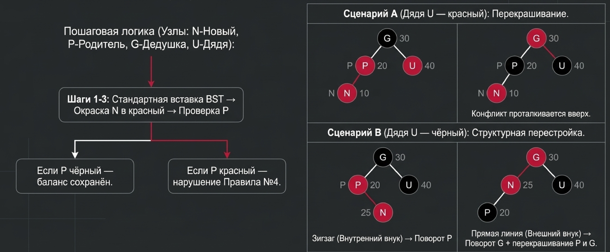

### Пример: вставка по шагам

Разберём последовательную вставку на анимации. NIL-листья на рисунках опущены для простоты, но они подразумеваются и они чёрные.

1. В дереве один чёрный корень 7.
2. Вставляем 3 и 18. Они красные, их родитель 7 чёрный, на всех путях одинаковое число чёрных — правила выполнены.
3. Вставляем 10. По правилу дерева поиска он попадает под 18 слева. Родитель 18 красный — появился двойной красный. Дядя узла 10 — это 3, и он тоже красный. Значит, это сценарий A: перекрашиваем 3 и 18 в чёрный. Дедушка 7 — корень, поэтому он остаётся чёрным, и все правила снова выполняются.
4. Вставляем 22 и 26. Получается «линия вправо» 18 → 22 → 26. Уже видно, что дерево не очень сбалансировано, и вдобавок 22 и 26 — два красных подряд. На панели правил горит нарушение «нет RR подряд», остальные четыре пункта выполнены. Чтобы это исправить, делается поворот влево и перекраска.

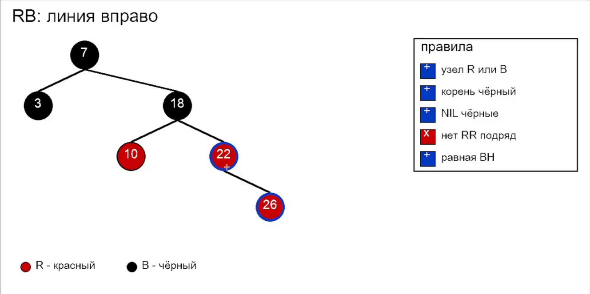

**Левый поворот** выглядит так: 22 поднимается на уровень выше, а 18 вместе с поддеревом (узлом 10) спускается на уровень ниже. Узел 18 становится левым ребёнком 22, а 22 — прямым ребёнком корня 7, на месте 18. Порядок ключей при этом не нарушается: 18 меньше 22 и по-прежнему стоит слева. **Правый поворот** — зеркальная операция: левый ребёнок поднимается, а узел спускается вправо. После поворота выполняется перекраска, и на итоговом кадре 22 стоит чёрным с детьми 18 и 26[^n3a].

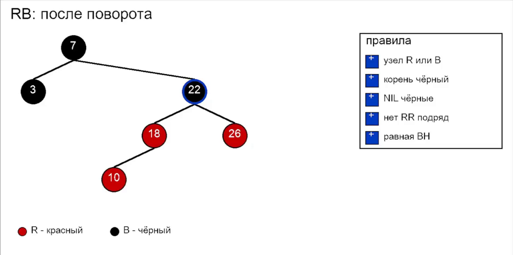

### Повороты в коде

В ноутбуке узел дерева `RBNode` хранит ключ, цвет (`"R"` или `"B"`), ссылки на левого и правого ребёнка и на родителя `parent`. Правила проверяются вспомогательными функциями.

`_check_no_rr` рекурсивно проверяет правило 4. Если узел красный и у кого-то из его детей цвет тоже красный, функция возвращает `False`. Иначе проверка спускается в детей, и так условие проверяется для всего дерева.

`_black_height` считает чёрную высоту, то есть число чёрных узлов на пути вниз, и заодно проверяет правило 5:

```python
def _black_height(node: RBNode | None) -> int | None:
    if node is None:
        return 0
    lh = _black_height(node.left)
    rh = _black_height(node.right)
    if lh is None or rh is None or lh != rh:
        return None
    return lh + (1 if node.color == "B" else 0)
```

Если у левого и правого поддеревьев чёрные высоты разошлись, функция возвращает `None` — правило нарушено. Итоговая функция `rb_verdict` по очереди проверяет, что корень чёрный, что нет двух красных подряд и что чёрная высота одинакова, и печатает вердикт.


Повороты реализованы функциями **`rotate_left`** и **`rotate_right`**. Им передаётся корень дерева и узел, в котором делается поворот, а возвращают они корень — он мог поменяться:

```python
def rotate_left(root: RBNode, x: RBNode) -> RBNode:
    y = x.right
    assert y is not None
    x.right = y.left
    if y.left:
        y.left.parent = x
    y.parent = x.parent
    if x.parent is None:
        root = y
    elif x is x.parent.left:
        x.parent.left = y
    else:
        x.parent.right = y
    y.left = x
    x.parent = y
    return root
```

Разберём по шагам, подставив пример выше: x = 18, y = 22.

1. Берём y — правого ребёнка поворачиваемого узла x. Это должен быть настоящий узел, а не NIL-лист, поэтому стоит `assert`.
2. Левое поддерево y переходит к x и становится его правым поддеревом: `x.right = y.left`. Ключи в нём больше x и меньше y, поэтому порядок сохраняется. В примере у 22 левого ребёнка нет, и правый ребёнок 18 становится пустым.
3. y занимает место x у его родителя: становится левым или правым ребёнком в зависимости от того, кем был x. В примере 22 становится правым ребёнком 7.
4. Отдельно обрабатывается случай, когда x был корнем и родителя у него нет. Тогда новым корнем становится y, и `root` нужно переприсвоить.
5. Наконец, x становится левым ребёнком y.

`rotate_right(root, y)` устроена зеркально: поднимается левый ребёнок `x = y.left`, его правое поддерево переходит к y, а y становится правым ребёнком x. Сама вставка `rb_insert` начинается с создания красного узла `RBNode(key, "R")`; если дерево пустое, узел сразу перекрашивается в чёрный, потому что он станет корнем.


**Акцент лектора:** разбирать все эти правила можно долго, но в первую очередь важно понять концепцию и то, что она даёт.

### Что даёт красно-чёрное дерево

Перебалансировка после изменения затрагивает лишь несколько узлов рядом с местом вставки, три-четыре узла. Это константная операция: число поворотов не зависит от размера дерева. Поэтому вставка и удаление в RB-дереве проходят намного быстрее, чем в AVL, где повороты могут каскадом подниматься до корня[^n3b].

При этом поиск не страдает. Правило «нет двух красных подряд» вместе с правилом чёрной высоты не даёт дереву выродиться: в худшем случае высота не превышает двух логарифмов, $h \le 2\log(N+1)$. Значит, поиск остаётся логарифмическим даже в худшем случае.

[^n3a]: Примечание составителя: в этой анимации, судя по кадрам, есть неточности. После вставки 26 его родитель 22 красный, а дядя — узел 10, тоже красный. По правилам выше это сценарий A, то есть нужна перекраска: 10 и 22 становятся чёрными, 18 — красным. Поворот здесь не нужен. Кроме того, на итоговом кадре красные 18 и 10 стоят подряд (10 — левый ребёнок 18), хотя панель показывает все правила выполненными. Корректное дерево после вставки 7, 3, 18, 10, 22, 26: 7 (чёрный) с детьми 3 (чёрный) и 18 (красный); у 18 дети 10 и 22 (чёрные); у 22 правый ребёнок 26 (красный). Сам механизм левого поворота анимация показывает верно.

[^n3b]: Примечание составителя: константа здесь относится к числу поворотов — при вставке их не больше двух, при удалении не больше трёх. Перекраска в сценарии A может проталкивать конфликт вверх, и в худшем случае она дойдёт до корня, то есть займёт $O(\log N)$ шагов. Но перекраска — дешёвая операция: она меняет только цвета и не трогает структуру дерева.


## Удаление в красно-чёрном дереве и выбор между AVL и RB

*Таймкод: 00:16:56 · слайды 5–6*

### Удаление: устранение «двойного чёрного»

Удаление в красно-чёрном дереве устроено по той же логике, что и вставка. Правила дерева нарушаются локально, и восстанавливают их те же два инструмента: повороты и перекраска. Отличается только сама угроза. При вставке это был двойной красный, а при удалении — **двойной чёрный**. Узел N, на котором возникла такая проблема, на схемах обведён двойным кольцом[^n4a].

Что делать, зависит от брата узла N. Обозначим через P родителя N, через S его брата (sibling), а через SL и SR — левого и правого детей S. Возможны четыре сценария:

1. **S красный.** Поворачиваем P влево и перекрашиваем. Проблема при этом ещё не решена, но сводится к одному из сценариев 2–4.
2. **S и оба его ребёнка чёрные.** Перекрашиваем S. Если P был красным, на этом всё. Если P был чёрным, «дважды чёрным» становится уже P, и та же процедура рекурсивно повторяется уровнем выше.
3. **S чёрный, его левый ребёнок SL красный.** Поворачиваем S вправо и перекрашиваем S и SL. Это сводится к сценарию 4.
4. **S чёрный, его правый ребёнок SR красный.** Поворачиваем P влево и перекрашиваем P, S и SR. Дерево снова корректно.

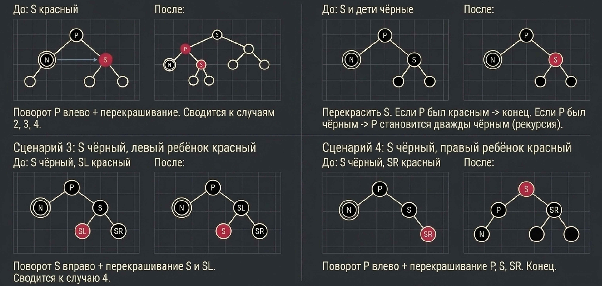

Например, если брат S красный, для восстановления баланса нужны поворот влево и перекраска — как и при вставке. Разобраться во всех этих случаях на слух очень трудно, поэтому их код и разбор отдельных случаев перенесены на семинар: там удаление нужно будет реализовать самостоятельно[^n4b].

### AVL или красно-чёрное дерево

У красно-чёрного дерева есть ряд преимуществ перед AVL-деревом, но идеальным его не назовёшь. Выбор между ними зависит от того, в каком соотношении система читает и пишет данные:

| Характеристика | AVL-дерево | Red-Black Tree |
|:---------------------|:--------------------------|:---------------------------|
| Строгость баланса | жёсткая: $\lvert h_L - h_R \rvert \le 1$ | ослабленная: $h_{\max} \le 2h_{\min}$ |
| Скорость поиска | максимальная (строго $O(\log N)$) | высокая (потенциально чуть дольше) |
| Скорость модификаций | медленнее (каскадные повороты) | очень быстрая (до 3 поворотов) |
| Худший случай | $O(\log N)$ поворотов при удалении | строго $O(1)$ поворотов |
| Применение | read-heavy системы, статические словари | write-heavy, `std::map`, CFS в Linux |

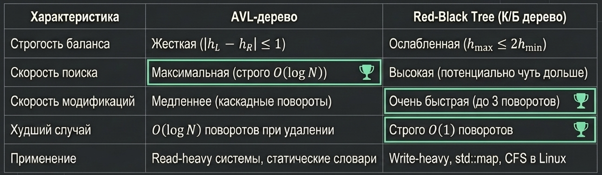

Условие $h_{\max} \le 2h_{\min}$ значит, что самый длинный путь от корня до листа не более чем вдвое длиннее самого короткого. Это та же граница $h \le 2\log(N+1)$: поиск в красно-чёрном дереве может оказаться чуть длиннее, чем в AVL, но остаётся логарифмическим. Зато любая модификация обходится константным числом поворотов, тогда как в AVL цепочка поворотов может дойти до корня.

Отсюда практическое правило. AVL-дерево подходит для **read-heavy** систем, где данные читают гораздо чаще, чем меняют, — например, для статических словарей. Красно-чёрное дерево подходит для **write-heavy** систем с частыми вставками и удалениями. Поэтому на нём построены, например, `std::map` в C++ и планировщик CFS в ядре Linux[^n4c].

Обе структуры прекрасно работают, пока данные лежат в оперативной памяти и помещаются в кеш процессора. Но что делать, если база данных разрослась до 100 миллионов записей?

[^n4a]: Примечание составителя: «двойной чёрный» возникает, когда удаляется чёрный узел. На путях, которые через него проходили, становится на один чёрный узел меньше, и правило чёрной высоты нарушается. Чтобы временно сохранить равенство чёрных высот, узел, занявший место удалённого, считают «дважды чёрным», то есть несущим один лишний чёрный цвет. Сценарии восстановления как раз избавляются от этого лишнего чёрного. Все четыре сценария описаны для случая, когда N — левый ребёнок. Если N — правый ребёнок, всё делается зеркально, и левые повороты меняются на правые.

[^n4b]: Примечание составителя: повороты есть только в сценариях 1, 3 и 4, причём после сценария 1 следует один из сценариев 2–4, а сценарии 3 и 4 завершают исправление. Вверх по дереву может подниматься только перекраска из сценария 2. Поэтому у красно-чёрного дерева при удалении строго $O(1)$ поворотов, как сказано в таблице ниже.

[^n4c]: Примечание составителя: `std::map` — упорядоченный ассоциативный контейнер стандартной библиотеки C++, в распространённых реализациях это красно-чёрное дерево. CFS (Completely Fair Scheduler) — планировщик процессов ядра Linux, который хранит готовые к выполнению задачи в красно-чёрном дереве.


## Проблема масштабирования: дерево на диске

*Таймкод: 00:18:18 · слайды 7*

Всё, что говорилось до сих пор об AVL- и красно-чёрных деревьях, — теоретические оценки в терминах O-большого. У O-большого есть слабое место: оно считает только **количество** операций и молчаливо предполагает, что все они стоят примерно одинаково. На практике операции могут различаться по стоимости на порядки, и тогда два алгоритма с одинаковой асимптотикой ведут себя совершенно по-разному.

### Деревья в базах данных

Самый наглядный пример — базы данных. Чтобы быстро находить записи, база строит **индекс базы данных** — вспомогательную структуру, которая по устройству представляет собой дерево поиска. Если построить красно-чёрное дерево для целой базы, где миллиарды записей и больше, оно получится огромным и просто не поместится в оперативную память. Поэтому индексы в базах данных, как правило, хранятся на диске.

Посчитаем, во что это обходится. Возьмём даже скромный миллион элементов. Высота сбалансированного бинарного дерева будет порядка

$$\log_2 10^6 \approx 20,$$

то есть поиск пройдёт около 20 уровней, и каждый уровень — переход по случайному адресу. Если дерево лежит на диске, каждый переход вниз — это новое чтение с диска. А дисковое чтение катастрофически медленнее сравнения, чтения из оперативной памяти и тем более из регистров процессора: одно случайное чтение с диска по времени сопоставимо примерно со 100 000 тактов CPU. Получается, что 20 переходов — это 20 дисковых чтений, а значит, катастрофическое падение производительности базы.

### Что на самом деле дорого

Отсюда главный сдвиг в оценке сложности: когда данные не помещаются в ОЗУ, сложность алгоритма измеряется не тактами процессора, а дисковыми операциями ввода-вывода — **I/O** (input/output). Именно они становятся узким местом (I/O bottleneck), а сравнения на их фоне почти ничего не стоят.

Важно и то, как диск отдаёт данные: он читает их не по байту, а целыми блоками — **дисковыми страницами** (типичный размер страницы — 4 КБ). Бинарное дерево с этим никак не согласовано: его узлы разбросаны по случайным адресам, и на каждом шаге поиска приходится заново обращаться к диску.

**Инженерный вывод:** нужна структура данных, которая по своей геометрии совпадает с архитектурой файловой системы — с тем, как диск хранит и читает данные.

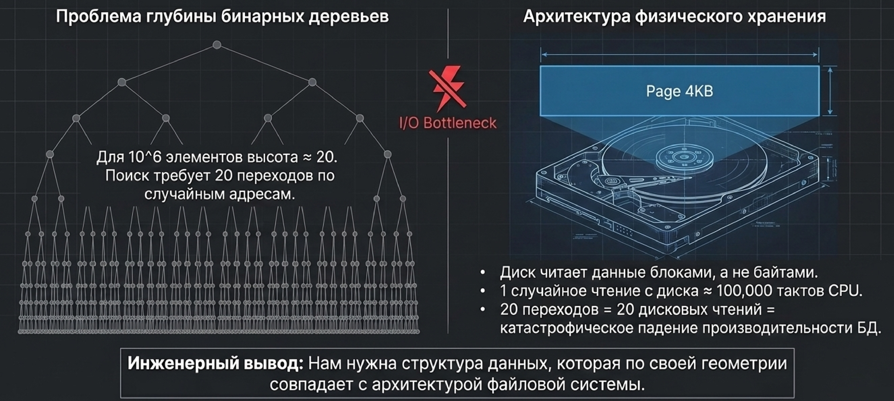

Отсюда задача: хранить то же количество элементов, но в меньшем числе узлов и при меньшей высоте дерева, сохранив при этом возможность поиска. Каждый сэкономленный уровень — это одно сэкономленное дисковое чтение.


## B-дерево: идея, правила и вставка

*Таймкод: 00:21:20 · слайды 8–10*

### Дерево поиска не обязано быть двоичным

Нужно хранить в дереве то же огромное количество элементов, но так, чтобы узлов было меньше, высота ниже, а поиск по дереву по-прежнему работал. Чтобы понять, как это сделать, вспомним, на чём держится бинарное дерево поиска. У каждого узла всё, что лежит слева, меньше его значения, а всё, что справа, больше. Значение узла служит разделителем, который говорит, в какую сторону спускаться.

Ничто не мешает хранить в одном узле не одно значение, а несколько. Значения внутри узла называются **ключами**. Пусть в узле два ключа, 20 и 30. Тогда у узла три ребёнка: в первом лежат значения меньше 20, во втором значения между 20 и 30, в третьем значения больше 30. Дерево перестаёт быть бинарным и становится N-арным. В памяти такой узел устроен как блок `P1 | K1 | P2 | K2 | P3`: ключи `K` чередуются с указателями на детей `P`, и указателей всегда на один больше, чем ключей. Так одно и то же количество ключей помещается в меньшее число узлов. Такая структура называется **B-деревом (B-Tree)**. Это широкая и неглубокая структура, каждый узел которой целиком помещается в одну дисковую страницу.

### Почему асимптотика та же и в чём тогда выигрыш

Если считать операции через O-большое, B-дерево ничего не выигрывает: и там и там получается логарифм. Узлов действительно меньше, и спускаться приходится на меньшую глубину. Зато в каждом узле теперь нужно сделать не одно сравнение, а несколько: в нашем примере сравнить с первым ключом, потом со вторым. Само по себе B-дерево не быстрее бинарного.

**Важный вывод:** B-дерево становится быстрее только тогда, когда сравнение намного дешевле, чем получение данных. Именно так обстоит дело, когда данные лежат не в оперативной памяти, а на диске, SSD или HDD: чтение с диска на порядки дольше сравнения. В этом случае выгодно дерево поиска, которое хранит в узле много ключей.

B-дерево, как и бинарное, нужно балансировать. Если ключи выстроятся в линию, обход займёт линейное время, и от структуры не будет никакой пользы. Поэтому B-дерево подчиняется набору правил.

### Правила B-дерева

Удобнее всего сформулировать правила через максимальное число ключей в узле. Возьмём для примера максимум 5.

1. В узле не больше заданного максимума ключей, здесь 5. Ключи внутри узла упорядочены по возрастанию.
2. В узле не меньше половины максимума, округлённой вниз. Здесь это $\lfloor 5/2 \rfloor = 2$ ключа.
3. Все листья лежат на одном уровне.

Из правила минимума есть одно исключение, и это корень: в нём может быть сколь угодно мало ключей. Без этого исключения дерево нельзя было бы даже начать строить. Когда мы вставляем первый элемент, например 10, получается дерево из одного узла с одним ключом, и оно нарушало бы правило минимума.

Формально те же правила записывают через **минимальную степень $t \ge 2$**, параметр, который задаёт пределы заполнения узлов:

- в узле от $t-1$ до $2t-1$ ключей, отсортированных по возрастанию;
- детей у внутреннего узла всегда на одного больше, чем ключей, то есть от $t$ до $2t$;
- корень — исключение, в нём минимум 1 ключ;
- все листья лежат строго на одной глубине.

Наш пример с максимумом 5 соответствует $t = 3$: максимум $2t-1 = 5$, минимум $t-1 = 2$. В реальных системах $t$ гораздо больше. Например, при дисковом блоке 4 КБ и $t = 100$ один узел вмещает до 199 ключей и 200 указателей.

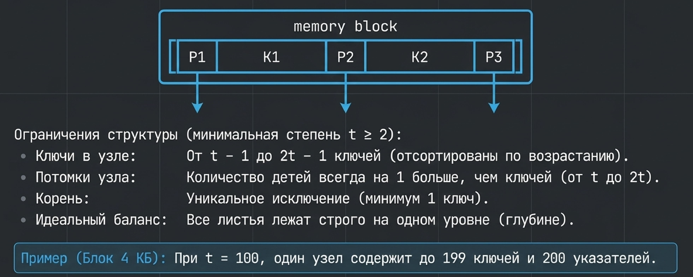

### Вставка: разделение узла

Разберём, как дерево строится с нуля. Сначала это один корень с одним ключом, допустим 10, что допустимо благодаря исключению для корня. Новые ключи добавляются в тот же корень, пока он не заполнится до максимума, то есть до 5 ключей. Следующую вставку корень уже не вместит.

Тогда выполняется **разделение узла (split)**. В узле находится **медиана**, центральный ключ. Всё, что левее медианы, уходит в левое поддерево, всё, что правее, — в правое, а сама медиана поднимается на уровень выше и становится ключом нового корня. Так появляется дерево из корня и двух листьев.

В отличие от бинарного дерева, B-дерево растёт не вниз, а вверх, от листьев к корню. Новые ключи всегда вставляются в листья. Когда лист уже полон и в него нужно вставить ещё один ключ, возникает **переполнение**: ключей становится $2t$, на один больше допустимого. Переполненный узел ломается пополам, а его медианный ключ выталкивается к родителю. В практических реализациях часто делают **упреждающее расщепление (Preemptive Split)**: полный узел с $2t-1$ ключами делят ещё на спуске к месту вставки, а потом спускаются дальше и вставляют ключ в нужную половину[^n6b].

Посмотрим на числах. Пусть после первого разделения корня и нескольких вставок в корне лежит ключ 30, в левом листе `5 10 15 20 25`, в правом `40 50`. Левый лист полон, и в него нужно вставить ещё один ключ. Делим лист пополам по медиане 15. Медиана поднимается в корень и становится там новым разделителем рядом с 30. В итоге корень `15 | 30`, слева от 15 лист `5 10`, между 15 и 30 лист `20 25`, а лист `40 50` остаётся справа от 30, потому что все его ключи больше 30. Вставляемый ключ при этом оказывается в той из половин, куда он относится по величине.

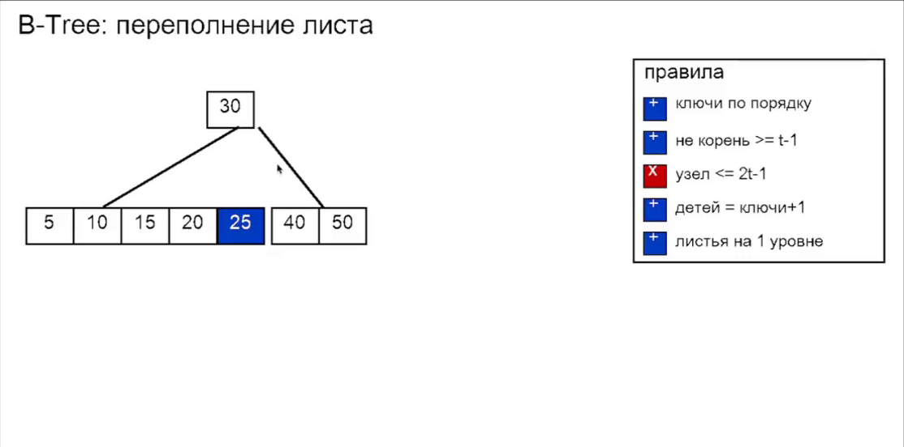

Проверим правила. Все листья по-прежнему на одном уровне, в каждом некорневом узле не меньше двух ключей и не больше пяти, у корня с двумя ключами три ребёнка. Дерево сбалансировано, пределы $t$ соблюдены, и можно вставлять дальше.

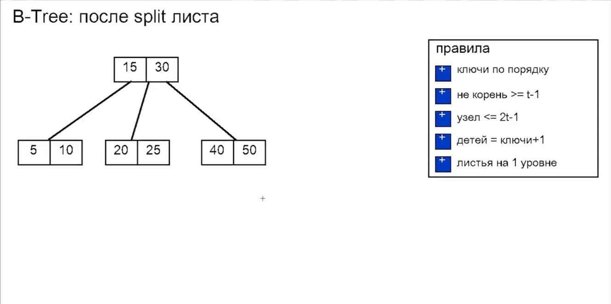

### Выигрыш на диске

Вся ценность конструкции в том, что один узел дерева можно положить на диск в одно место и прочитать за одно обращение. Сравнений остаётся столько же, а вот число обращений к памяти и чтений с диска резко падает. Поэтому B-дерево сильно ускоряет чтение структуры, которая хранится на диске.

Поиск в B-дереве сочетает два вида операций. Дорогое дисковое чтение (I/O) нужно, чтобы перейти от страницы к странице. Таких чтений $O(\log_t N)$ против $O(\log_2 N)$ у бинарного дерева. Внутри уже считанной в ОЗУ страницы нужный ключ ищется быстрым бинарным поиском за $O(\log_2 t)$[^n6a]. Масштаб впечатляет: при $t = 1000$ и $N = 10^9$, миллиарде записей, высота дерева всего 3. Значит, любая запись находится максимум за 3 чтения с диска.

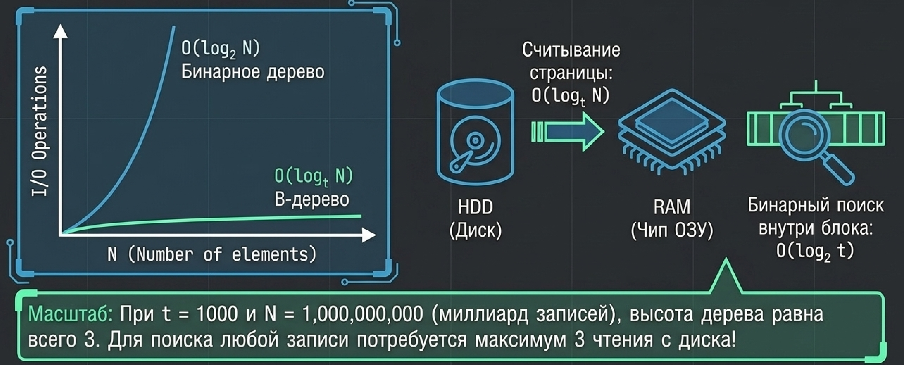

Ещё заметнее разница в распределённой системе, где данные приходится получать сетевыми запросами. Разрыв между сетевым запросом и операцией процессора ещё колоссальнее, чем между чтением с локального диска и процессором. Значит, сокращение числа обращений там ценится ещё выше.

[^n6a]: Примечание составителя: если перемножить, $O(\log_t N) \cdot O(\log_2 t) = O(\log_2 N)$. Общее число сравнений такое же, как у бинарного дерева, меньше становится только число дисковых чтений. Это и есть утверждение «асимптотика та же, выигрыш — в I/O».

[^n6b]: Примечание составителя: на иллюстрации к правилу разделения шаги нарисованы некорректно: ключи 20 и 30 оказываются по разные стороны от неподходящих разделителей. При правильном разделении переполненного узла `10 20 30 40` ($t = 2$) медианный ключ (20 или 30, в зависимости от реализации) уходит вверх, а остальные ключи делятся между левым и правым ребёнком, например корень `20`, листья `10` и `30 40`.


## Удаление в B-дереве: заимствование и слияние

*Таймкод: 00:30:51 · слайды 11*

В большинстве случаев удаление из B-дерева проходит без последствий: ключ находят и просто убирают из узла. Проблема возникает, когда после этого в узле остаётся меньше минимума — меньше $t-1$ ключей. Такое состояние называется **дефицитом ключей**. Дерево становится невалидным, и его нужно восстановить, причём «горизонтально»: перераспределить ключи между соседними узлами одного уровня, не трогая высоту без необходимости.

Все примеры ниже — для дерева с максимумом 5 ключей в узле, то есть $t = 3$: в любом узле, кроме корня, должно быть от 2 до 5 ключей. Исходное дерево такое: в корне один ключ 30, слева от него лист `5 10 15 20 25`, справа лист `40 50`. Оно валидно: листья на одном уровне, пределы соблюдены, а корню разрешено иметь всего один ключ.

### Простой случай

Удалим 15. Спускаемся к листу, находим ключ, удаляем — в листе остаётся `5 10 20 25`. Это 4 ключа, не меньше минимума, так что больше ничего делать не нужно.

### Заимствование у соседа

Теперь из того же исходного дерева удалим 40. В правом листе остаётся только `50` — один ключ при минимуме 2. Возник дефицит. Зато у левого соседа ключей с запасом, и можно забрать один у него. Это **заимствование (Borrowing)**: узел в дефиците забирает ключ у «богатого» соседа.

Здесь легко ошибиться. Если просто перенести 25 из левого листа в правый, дерево сломается: 25 окажется справа от ключа 30, хотя меньше его, и поиск перестанет работать. Поэтому ключ передают **через родителя**. 25 поднимается в корень и становится новым разделителем, а прежний разделитель 30 спускается в правый лист:

```
30
5 10 15 20 25 | 40 50      исходное дерево

30
5 10 15 20 25 | 50         удалили 40: справа дефицит (1 ключ)

25
5 10 15 20 | 30 50         25 поднялся в корень, 30 опустился вправо
```

Почему поднимается именно 25? Это самый большой ключ левого соседа. После перестановки все ключи слева меньше нового разделителя, а все ключи справа больше, так что свойство дерева поиска сохраняется. Если богатый сосед стоит справа, всё симметрично: в родителя поднимается его самый маленький ключ, а разделитель спускается в узел с дефицитом.

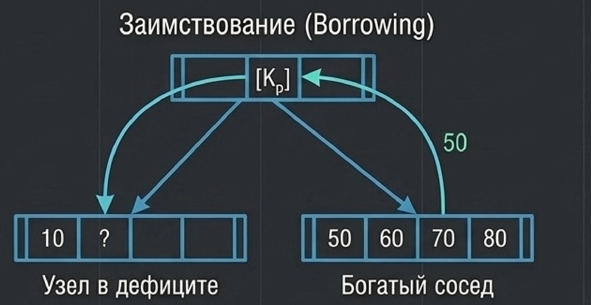

Перебалансировка затрагивает всего три значения: удалённый ключ, максимум соседа и разделитель в родителе. Это константное число операций, и оно не зависит от размера дерева.

::: {.qa title="Вопросы из зала"}
**Минимум — это половина максимума? При максимуме 5 получается 2, округление всегда вниз?** Да, вниз. Сбалансированное B-дерево держится на двух правилах: все листья на одном уровне, и в каждом узле не меньше половины заданного максимума, округлённой в меньшую сторону. Исключение — корень. Иначе нельзя было бы вставить даже первый элемент: дерево из одного ключа нарушало бы правило минимума.

**Как это выглядит в коде? В каком порядке переставлять значения?** Точный порядок не так важен: по сути нужно переставить три значения. Пусть `parent_value = 30`, левый сосед — массив `[5, 10, 15, 20, 25]`, правый узел — `[40, 50]`. В правом массиве находим 40 и удаляем. Из левого массива забираем максимум 25. Ставим 25 в родителя, а старое значение родителя 30 через временную переменную переносим в правый массив.

**Но если вставлять 30 в начало правого массива, это сдвиг всех элементов, а не O(1)?** Замечание справедливое: из массива дёшево удалить последний элемент, а вставка или удаление в начале требует сдвига. Оценка O(1) относится к дереву: балансировка затрагивает только два соседних узла и их общего родителя и не зависит от того, сколько над ними уровней. Внутри узла логичнее сразу ставить значение на нужное место. Впрочем, ключей в узле B-дерева не миллионы, так что этот сдвиг обычно не критичен.
:::

### Слияние

Заимствование возможно не всегда. Продолжим с последнего дерева (корень 25, листья `5 10 15 20` и `30 50`) и удалим 10 и 15. Левый лист станет `5 20` — ровно минимум. Если теперь удалить ключ из правого листа, например 50, там останется один ключ 30, а занять у брата нельзя: у него самого ключей впритык.

В этом случае соседей объединяют. Это **слияние (Merge)**: два «бедных» соседа сливаются в один узел, и туда же из родителя спускается разделявший их ключ. Узел с дефицитом содержит $t-2$ ключа, сосед — $t-1$, плюс разделитель: всего $(t-2) + (t-1) + 1 = 2t-2$ ключа. Это не больше максимума $2t-1$, поэтому объединённый узел валиден. У родителя становится на один ключ и на одну ссылку на ребёнка меньше.

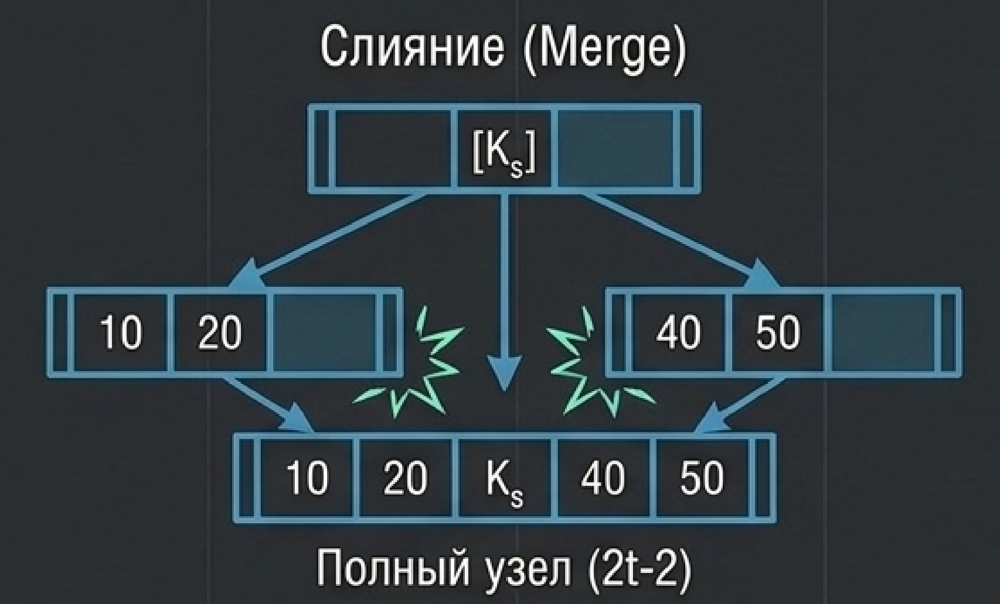

В нашем примере `5 20`, разделитель 25 и `30` дают узел `5 20 25 30`. Корень лишился единственного ключа и опустел, поэтому корнем становится объединённый узел, а высота дерева уменьшается на единицу. Только так B-дерево и становится ниже: оно растёт вверх через split корня и опускается через слияние под корнем.[^n7a]

### Удаление из внутреннего узла

До сих пор ключ удалялся из листа. Но он может стоять и во внутреннем узле, у которого есть дети. Что тогда происходит со ссылками на них?

Детей у внутреннего узла всегда на одного больше, чем ключей. Если ключей становится на один меньше, то и ссылок должно стать на одну меньше. Возьмём фрагмент дерева: внутренний узел `40 50 60`, слева от 40 лист `32 33`, между 40 и 50 лист `41 45`. Удалим 40. Два ребёнка, которых он разделял, теперь смотрят в одну общую «щель». Их ключи можно просто объединить: получится лист `32 33 41 45`, который остаётся слева от 50. В узле осталось два ключа `50 60` и три ребёнка, всё валидно.

Бывает, что детям тесно. Пусть слева от 40 лист `30 32 33`, а справа `41 43 45`. После объединения в узле оказалось бы 6 ключей, больше допустимых 5. Тогда переполненный узел снова делят по медиане, как при вставке. Одно значение поднимается в освободившееся место родителя, остальные расходятся по двум листьям: в родителе встаёт 41, слева остаётся `30 32 33`, справа `43 45`.

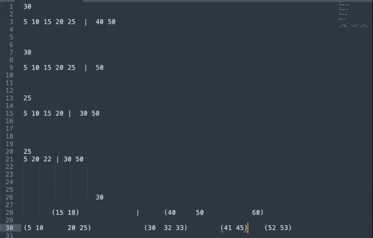

Итог совпадает с общим правилом: удаляемый ключ внутреннего узла замещают **предшественником** или **преемником**. Предшественник — самый большой ключ в левом поддереве удаляемого ключа, преемник — самый маленький ключ в правом. Оба они лежат в листьях. Любой из них можно поставить на место удалённого ключа, и порядок ключей не нарушится: здесь это преемник 41. После этого остаётся задача удаления из листа, которая решается уже разобранными способами: простым удалением, заимствованием или слиянием.[^n7b]

[^n7a]: Примечание составителя: пример слияния восстановлен по смыслу: в речи не сказано, какой ключ удаляется последним, а слияние описано как «перемещаем все элементы наверх», после чего узел может переполниться (если у родителя, скажем, уже есть ключи 22 и 25, выйдет 6 ключей), и его снова делят по медиане. В классическом слиянии разделитель, наоборот, спускается из родителя вниз, и переполнения не бывает: получается $2t-2$ ключа. Если же после слияния в дефиците оказался сам родитель (и он не корень), к нему применяют те же заимствование или слияние, и так, возможно, до корня.

[^n7b]: Примечание составителя: числа во фрагменте дерева немного изменены: в нарисованном при разборе дереве ключ 40 стоял одновременно во внутреннем узле и в листе. Объединение детей удалённого ключа работает так просто, когда эти дети — листья. В общем случае ключ заменяют предшественником или преемником из листа, а затем исправляют возможный дефицит в этом листе.


## Другие деревья: Trie, дерево отрезков, splay-дерево

*Таймкод: 00:44:25 · слайды 12–14*

Теория B-деревьев на этом закончена. Но деревьями поиска по числам мир деревьев не исчерпывается: на деревьях построено огромное количество алгоритмов и структур данных, а хранить в узлах можно что угодно, не только числа. Ниже — короткий обзор трёх таких структур. Каждая решает свою узкую задачу, и полезно просто знать, что для этой задачи готовое решение уже придумано.

### Префиксное дерево (Trie)

Допустим, в системе хранится огромное количество строк, и нужно быстро искать по ним: проверять, есть ли слово в словаре, и подсказывать продолжение того, что пользователь начал вводить. Так работают поисковики вроде Яндекса и Google. Это же нужно, если вы хотите ускорить «ручку» поиска, то есть API-эндпоинт, который отвечает на поисковые запросы. Предсказание оставшейся части слова или фразы по уже введённому тексту и словарю называется **автодополнением** (autocomplete).

Для таких задач подходит **префиксное дерево (Trie)**. Корень — пустая строка, каждое ребро — один символ, и каждый следующий узел добавляет к строке одну букву. Поэтому путь от корня до любого узла образует префикс, а сам узел этот префикс и представляет. Общие приставки хранятся только один раз: у слов «алгоритм» и «алгебра» общий путь А → Л → Г, после которого ветка расходится на О → Р → И → Т → М и на Е → Б → Р → А.

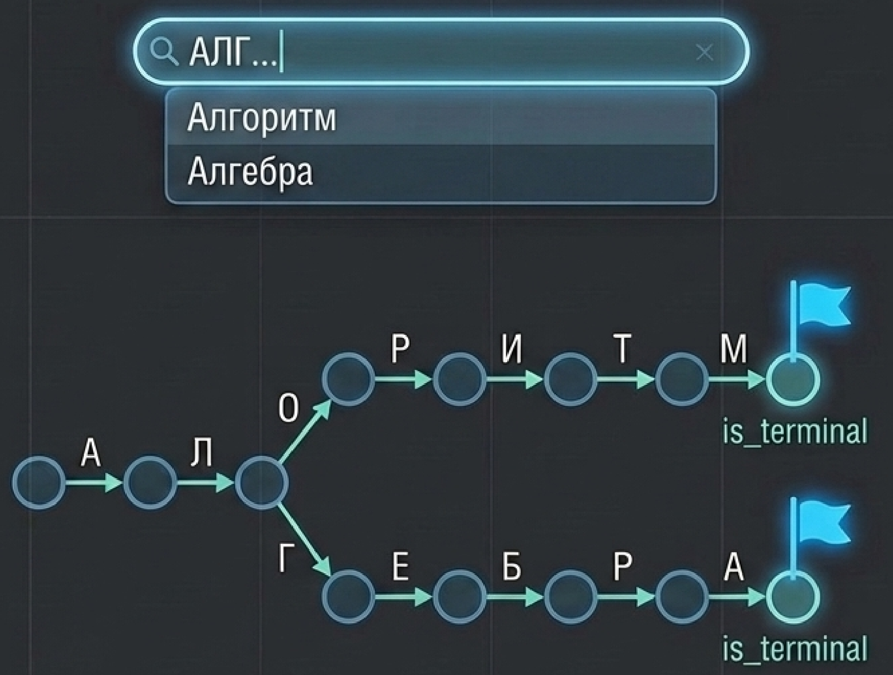

Поиск повторяет ввод пользователя. Человек набирает «А», и мы спускаемся в поддерево буквы А. Все слова на «А» лежат в этом поддереве, и для подсказки можно взять, например, первое попавшееся. Если такого узла нет вообще, то слов с таким началом в словаре точно нет, и это выясняется сразу. Пользователь вводит дальше, и мы переходим от «А» к ребёнку «Л», от него к «Г» и так далее.

Не каждый префикс является словом: «АЛГ» — только начало. Поэтому в узлах хранится специальный маркер **`is_terminal`**: он означает, что путь от корня до этого узла сам является словом словаря. Дошли до узла с таким флагом — слово найдено, можно вернуть `true`. При этом спускаться дальше терминального узла никто не запрещает. После «алгебра» может идти «алгебраический», и тогда у последней «а» будет ребёнок «и».

Чем это лучше простого хранения? Если сложить все строки в массив, то для проверки одного слова придётся обойти весь список. В Trie поиск занимает $O(L)$, где $L$ — длина искомого слова: на каждую букву приходится один переход вниз. Сложность совсем не зависит от размера словаря $N$. По сути, Trie — аналог деревьев поиска (бинарного, красно-чёрного, B-дерева), только для строк вместо чисел. Если когда-нибудь понадобится ускорить поиск по строкам, вспомните про эту структуру.

### Дерево отрезков (Segment Tree)

Другая задача. Есть большой массив данных, и по разным его интервалам нужно часто считать одну и ту же метрику: сумму, минимум, максимум. Типичный пример — мониторинг. Есть график задержки (latency) какой-то ручки по минутам, и к нему постоянно обращаются с вопросом: насколько медленно ручка отвечала за выбранный промежуток? Интересует худший случай, то есть максимум. Пересчитывать его каждый раз заново, перебирая все точки промежутка, расточительно.

Здесь подходит **дерево отрезков (Segment Tree)** — дерево, построенное над массивом. Листья — исходные значения, например задержка за конкретную минуту. Каждый внутренний узел отвечает за отрезок массива $[L, R]$ и хранит **агрегат** по этому отрезку, то есть значение метрики, заранее посчитанное по всем его элементам. Корень отвечает за весь массив, дети делят отрезок родителя на части, и агрегат родителя получается объединением агрегатов детей. В нашем примере каждый узел хранит максимум по своим детям.

Возьмём массив задержек за 10 минут с индексами $[0]$…$[9]$: 60, 120, 180, 150, 90, 160, 200, 110, 70, 130. Над листьями $[2..4]$ стоит узел со значением 180, над $[5..7]$ — узел 200, выше — узлы для половин $[0..4]$ и $[5..9]$, на вершине — корень 200.[^n8a] Максимум за весь период — это просто значение в корне. Нужен максимум на отрезке $[2, 7]$? Перебирать шесть значений не нужно. Отрезок складывается из двух готовых узлов: максимум на $[2, 4]$ уже известен (180), на $[5, 7]$ тоже (200). Остаётся сравнить два числа: $\max(180, 200) = 200$. В общем случае запрос собирает ответ из нескольких готовых непересекающихся отрезков верхних уровней. И запрос, и обновление значения выполняются за $O(\log N)$.

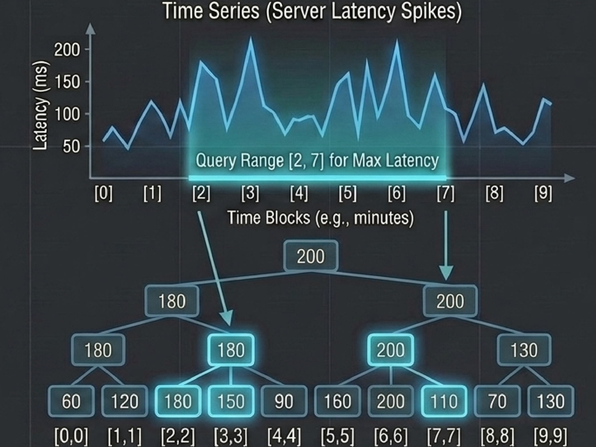

[^n8a]: Примечание составителя: на исходной картинке узел над листьями 60 и 120 подписан 180. Это ошибка: максимум этих двух листьев равен 120. На ответ для отрезка $[2, 7]$ она не влияет.

### Splay-дерево

**Splay-дерево** — тоже самобалансирующееся двоичное дерево поиска, но балансируется оно не по высотам или цветам, как AVL- и красно-чёрное дерево. Баланс в узлах вообще не хранится. Основная операция называется **splay**: узел, к которому только что обратились (при поиске или вставке), перемещается в корень.

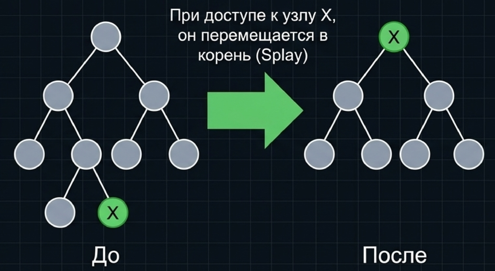

Зачем? Чтобы самые частые сценарии обслуживались быстрее всего. Если к тому же элементу обращаются снова, спускаться по дереву не нужно: элемент лежит в корне, и ответ получается за одну проверку. При обращении к другому элементу в корень поднимается уже он, а прежний корень смещается ступенью ниже. Оба недавно запрошенных элемента остаются близко к вершине, и на повторные запросы к ним ответ приходит быстро. Так часто используемые элементы со временем собираются наверху, а редко используемые опускаются вниз.[^n8b] Сложность операций в splay-дереве оценивается амортизированно, то есть в среднем по последовательности операций, а не для каждой операции в отдельности.

[^n8b]: Примечание составителя: «прежний корень смещается на ступень ниже» — упрощённая картина. На самом деле узел поднимается в корень серией поворотов, тех же, что в красно-чёрных деревьях. Их сочетания называют zig, zig-zig и zig-zag, в зависимости от того, как расположены узел, его родитель и дед. Схема zig-zag есть в ноутбуке к теме, подробно повороты здесь не разбирались.

В ноутбуке к теме есть краткие описания всех трёх структур и полная реализация B-дерева: поиск, вставка с разделением узлов, удаление и проверка того, что число ключей в каждом узле не выходит за пределы, заданные $t$. Её полезно разобрать самостоятельно.


## Какое дерево выбрать

*Таймкод: 00:58:14 · слайды 15*

Мы разобрали несколько деревьев поиска, и легко соблазниться мыслью, что одно из них лучше остальных и подойдёт для любой задачи. Это не так: дерево выбирают под конкретную задачу. Инженерный подход здесь простой: выбор структуры диктуется **носителем данных** (где они лежат) и **паттерном доступа** (какие операции с ними выполняют чаще всего). Отсюда схема из двух вопросов.

Первый вопрос: где хранятся данные? Если на диске или в **СУБД** (системе управления базами данных), то есть нужно выполнять запросы к данным, которые не помещаются в память, ответ — B-дерево. Его широкие узлы минимизируют число чтений и записей, то есть I/O, а именно обращения к диску и есть узкое место.

Если данные лежат в оперативной памяти, второй вопрос: что это за данные и что с ними делают.

- **Текст, автодополнение** — префиксное дерево (Trie), поиск за $O(L)$, где $L$ — длина слова. Для строк не подойдут ни красно-чёрные деревья, ни B-деревья: они рассчитаны на сравнение ключей, а Trie использует то, что строки состоят из общих префиксов.
- **Агрегация на интервалах**, когда нужно считать сумму, минимум или максимум по произвольному отрезку массива, — дерево отрезков (Segment Tree).
- **Горячий кеш**, когда к небольшой части элементов обращаются постоянно, — splay-дерево: недавно запрошенные элементы оказываются у корня.
- **Универсальная Map** — обычные ключи (например, числа), по которым нужен поиск. Кажется, что здесь всегда стоит брать красно-чёрное дерево, но и это не так. AVL-дерево сбалансировано строже, поэтому путь от корня до ключа в нём короче и поиск может идти заметно быстрее, до двух раз[^n9a]. Поэтому если запись **редкая** и её задержка (latency) не критична, лучше AVL-дерево: выигрываем на поиске. Если запись **частая** — красно-чёрное дерево, которое делает меньше перебалансировок при вставке и удалении.

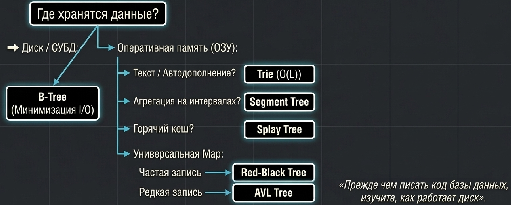

**Важный вывод:** единого ответа, какое дерево лучше, нет — смотрите на конкретную задачу. Сначала определите, где живут данные, затем — какие операции над ними преобладают. Для задач с диском действует правило: прежде чем писать код базы данных, изучите, как работает диск.

[^n9a]: Примечание составителя: «до двух раз» — оценка по худшему случаю для высоты. Высота красно-чёрного дерева не превышает $2\log_2(N+1)$, а высота AVL-дерева — примерно $1{,}44\log_2 N$. Поэтому в худшем случае путь в AVL-дереве короче примерно в 1,4 раза, а на практике разница обычно ещё меньше.


## Главное из лекции {.unnumbered}

::: keypoints
- AVL-дерево держит строгий баланс $|h_L - h_R| \le 1$ в каждом узле. Поиск в нём максимально быстрый, но любая модификация может потребовать балансировки по всему пути до корня, поэтому для частой записи оно дорого.
- Красно-чёрное дерево — трейд-офф: вместо условия на высоты пять правил раскраски (цвет, чёрный корень, чёрные NIL-листья, нет двух красных подряд, одинаковая чёрная высота). Высота остаётся логарифмической, $h \le 2\log(N+1)$, а исправление после изменения обходится константным числом поворотов.
- Вставка в RB-дерево: новый узел красный, конфликт возможен только при красном родителе. Красный дядя — перекраска (конфликт может подняться выше), чёрный дядя — поворот (при зигзаге два) и перекраска. При удалении угроза — «двойной чёрный», четыре сценария по цвету брата и его детей.
- Выбор между AVL и RB определяется нагрузкой: read-heavy — AVL, write-heavy — красно-чёрное дерево (`std::map`, CFS в Linux).
- Когда данные не помещаются в оперативную память, стоимость поиска определяется числом дисковых операций I/O, а не сравнений: одно случайное чтение с диска сопоставимо со 100 000 тактов процессора.
- B-дерево хранит в узле много ключей (от $t-1$ до $2t-1$, детей на одного больше), все листья — на одном уровне, корень — исключение. Асимптотика поиска та же, логарифм, но дисковых чтений $O(\log_t N)$ вместо $O(\log_2 N)$: при $t = 1000$ миллиард записей укладывается в дерево высоты 3.
- B-дерево растёт вверх: переполненный узел делится по медиане (split), медиана уходит к родителю. При удалении дефицит ключей исправляют заимствованием у богатого соседа через родителя или слиянием с бедным соседом и разделителем; ключ внутреннего узла замещают предшественником или преемником.
- Для частных задач есть специальные деревья: Trie — поиск и автодополнение строк за $O(L)$, дерево отрезков — агрегаты (сумма, минимум, максимум) на любом отрезке за $O(\log N)$, splay-дерево — поднимает недавно запрошенные элементы к корню и подходит для горячего кеша.
- Структуру выбирают по носителю данных и паттерну доступа: диск или СУБД — B-дерево; в памяти — Trie, дерево отрезков, splay-дерево или, для универсальной map, AVL (редкая запись) либо красно-чёрное дерево (частая запись).
:::

## Что подчеркнул лектор {.unnumbered}

::: emphasis
- Пять правил красно-чёрного дерева стоит выучить и запомнить: на них держится вся логика вставки и удаления.
- В красно-чёрном дереве важнее всего понять концепцию — зачем ослаблен баланс и что это даёт, а не заучить все случаи.
- Удаление из красно-чёрного дерева предстоит реализовать самостоятельно на семинаре.
- O-большое считает только число операций. Когда операции различаются по стоимости на порядки (чтение с диска или по сети против сравнения), алгоритмы с одной асимптотикой ведут себя совершенно по-разному.
- B-дерево само по себе не быстрее бинарного: выигрыш появляется только тогда, когда получение узла намного дороже сравнений внутри него.
- При заимствовании в B-дереве ключ нельзя просто перенести в соседний узел — он передаётся через родителя, иначе нарушится порядок ключей.
- Нет дерева, которое лучше всех: выбор определяется задачей. Прежде чем писать код базы данных, изучите, как работает диск.
:::

## Стоит посмотреть в видео {.unnumbered}

::: watch
- **00:08:56–00:12:29** — пошаговая анимация вставки в красно-чёрное дерево и левый поворот.
- **00:12:42–00:15:42** — код красно-чёрного дерева в Colab: проверки правил, `rotate_left` и `rotate_right`.
- **00:25:43–00:29:22** — анимация вставки в B-дерево с разделением листа.
- **00:31:19–00:44:19** — удаление из B-дерева: заимствование через родителя, вопросы о порядке действий и оценке O(1), пример слияния. Пример слияния объяснён скомканно, в конспекте он восстановлен.
- **00:48:34–00:51:26** — дерево отрезков на графике задержек: как запрос на отрезке $[2, 7]$ собирается из готовых узлов.
- **00:53:24–00:58:06** — удаление ключа из внутреннего узла B-дерева, разбор на дереве в редакторе.
:::

## Глоссарий {.unnumbered}

| Термин | Коротко |
|:-----------------|:---------------------------------------------|
| **AVL-дерево** | самобалансирующееся дерево поиска со строгим балансом высот поддеревьев |
| **Инвариант строгой балансировки** | условие AVL: в каждом узле $\lvert h_L - h_R \rvert \le 1$ |
| **Красно-чёрное дерево (Red-Black Tree)** | дерево поиска с раскраской узлов и пятью правилами; высота $\le 2\log(N+1)$, быстрые модификации |
| **Трейд-офф** | сознательный компромисс: отказ от части одного свойства ради другого |
| **Фиктивные листья (NIL)** | пустые чёрные узлы на месте отсутствующих детей |
| **Двойной красный** | нарушение правила 4: красный узел с красным родителем |
| **Чёрная высота** | число чёрных узлов на любом пути от узла вниз до листьев |
| **Дядя (U)** | брат родителя, второй ребёнок дедушки; его цвет определяет сценарий вставки |
| **Перекраска** | смена цветов узлов без изменения формы дерева |
| **Левый поворот / правый поворот** | локальная перестройка: ребёнок поднимается на место узла, порядок ключей сохраняется |
| **Двойной чёрный** | угроза при удалении чёрного узла: на путях через него не хватает одного чёрного |
| **Read-heavy / write-heavy** | системы, где преобладает чтение / запись |
| **Индекс базы данных** | вспомогательное дерево поиска для быстрого нахождения записей |
| **I/O** | операции ввода-вывода (чтение и запись на диск); узкое место при работе с диском |
| **Дисковая страница** | блок, которым диск читает и пишет данные (типично 4 КБ) |
| **Ключ** | значение, хранящееся в узле дерева поиска и служащее разделителем |
| **B-дерево (B-Tree)** | широкое и низкое сбалансированное дерево поиска с многими ключами в узле |
| **Минимальная степень $t$** | параметр B-дерева: в узле от $t-1$ до $2t-1$ ключей, у внутреннего узла от $t$ до $2t$ детей |
| **Разделение узла (split)** | деление переполненного узла по медиане с подъёмом медианы к родителю |
| **Медиана** | центральный ключ узла |
| **Переполнение** | в узле больше $2t-1$ ключей |
| **Упреждающее расщепление (Preemptive Split)** | деление полных узлов ещё на спуске к месту вставки |
| **Дефицит ключей** | в некорневом узле меньше $t-1$ ключей после удаления |
| **Заимствование (Borrowing)** | узел в дефиците получает ключ от богатого соседа через родителя |
| **Слияние (Merge)** | объединение бедного узла с соседом и разделителем из родителя |
| **Предшественник / преемник** | наибольший ключ левого / наименьший ключ правого поддерева удаляемого ключа |
| **Префиксное дерево (Trie)** | дерево строк: ребро — символ, узел — префикс; поиск за $O(L)$ |
| **`is_terminal`** | маркер узла Trie: путь от корня до узла — целое слово |
| **Автодополнение** | подсказка продолжения слова по введённому началу и словарю |
| **Дерево отрезков (Segment Tree)** | дерево над массивом, узел хранит агрегат по своему отрезку; запрос и обновление за $O(\log N)$ |
| **Агрегат** | заранее посчитанное значение метрики (сумма, минимум, максимум) по отрезку |
| **Splay-дерево** | самобалансирующееся дерево поиска, поднимающее запрошенный узел в корень |
| **Splay** | основная операция splay-дерева: перемещение узла в корень поворотами |
| **СУБД** | система управления базами данных |
