::: {.abstract title="О чём лекция"}
Лекция о хеш-таблицах — структуре данных, которая находит значение по ключу в среднем за константное время. В ней разобрано, откуда берётся сама идея (раскладка по корзинам вместо перебора стопки), чем хеш-таблица выигрывает у списка и дерева поиска, какой должна быть хеш-функция и почему коллизии неизбежны. Дальше — два способа их разрешать, метод цепочек и открытая адресация с надгробиями (tombstone), и то, как таблица растёт: коэффициент заполнения и рехеширование. Завершают лекцию кеши на основе хеш-таблицы (LRU, MRU, TTL), сводка «что когда выбирать» и задачи семинара. Почти весь материал показан на коде учебного Colab-ноутбука на Python, поэтому в конспекте много коротких фрагментов кода и выводов их запуска. Для чтения нужны основы Python, O-нотация и представление о массивах, списках и деревьях поиска.

Организационная часть занимает пару минут в конце и сжата в последний раздел. Вопросы из чата вплетены в разделы, к которым относятся, и выделены серыми блоками — их можно пропустить при беглом чтении. Кадры ноутбука и доски с анимациями приведены прямо в тексте. Сноски с пометкой «Прим. составителя» — пояснения, которых не было в лекции.
:::

## Зачем нужны хеш-таблицы: бейджики по корзинам

*Таймкод: 00:00:01 · слайды 1–14*

Меня зовут Антон Воронов, я работаю в Авито (Technical Unit Lead в Авито.Подработке) и больше 11 лет занимаюсь DS и разработкой. Эта тема — хеш-таблицы: откуда взялась сама идея, как устроена эта структура данных, в чём её плюсы и минусы, что делать, когда двум элементам достаётся одно и то же место, и как организовать такую структуру в памяти.

### Задача о бейджиках

Удобнее всего начать с образа, который хорошо показан во фрагменте гарвардского курса CS50 (2019, Lecture 5). Представим крупное мероприятие, к которому заранее напечатали бейджики с именами гостей. Самое простое решение — сложить их одной большой стопкой. Но даже если стопка разложена по алфавиту, каждому гостю придётся встать в очередь и перебирать бейджики, пока не попадётся свой. Это линейный поиск: чем больше гостей, тем дольше ждать.

Гораздо удобнее заранее поставить несколько подписанных контейнеров. Тогда гость подходит сразу к своему контейнеру и мгновенно достаёт бейджик, если повезло и он единственный, чьё имя начинается с этой буквы.

### Как это выглядит в массиве

**Хеш-таблица** — это массив, по ячейкам которого раскладываются данные, плюс правило, которое сразу говорит, в какую ячейку элемент класть и где его потом искать. В CS50 её описывают как комбинацию массива и связанных списков внутри него. Зачем там списки, станет понятно, когда разберёмся, что делать с несколькими элементами в одной ячейке. Ячейку такого массива называют **корзиной**, или **бакетом (bucket)**. **Ключ** — то, по чему мы ищем (здесь это имя), а значение — то, что храним (сам бейджик).

Если ключи — слова или имена, корзину обычно выбирают, анализируя символы слова. Самое простое правило — взять первую букву. Получается массив из 26 ячеек с индексами от 0 до 25, которые удобно представлять как буквы от A до Z. Разложим имена из «Гарри Поттера» по первой букве английского написания: Albus (Альбус) попадает в корзину 0, Zacharias (Захария) — в 25, Hermione (Гермиона) — в корзину H, то есть 7, Ginny (Джинни) — в 6, Ron (Рон) — в 17, Cedric (Седрик) — в 2, Draco (Драко) — в 3, James (Джеймс) — в 9, Kingsley (Кингсли) — в 10, Luna (Луна) — в 11, Minerva (Минерва) — в 12, Neville (Невилл) — в 13.

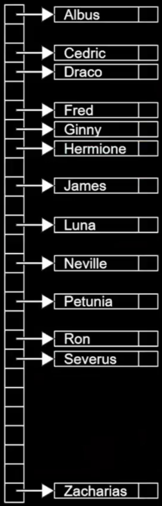

Человеку идти до корзины 25 далеко, но у массива есть произвольный доступ: компьютер переходит к ячейке 0, к ячейке 25 или к любой между ними одинаково быстро. Поэтому и положить бейджик, и найти его — это **один шаг**: по ключу сразу вычисляем номер корзины и идём туда, не перебирая стопку.

Но впереди проблема: что, если придут два человека, чьи имена начинаются с одной буквы? Им достанется одна и та же корзина, и с этим придётся что-то делать. Сначала, однако, разберёмся, чем такой способ хранения выигрывает у списков и деревьев.


## От списка и дерева к константе: прямая адресация

*Таймкод: 00:06:09 · слайды 13–19*

### Зачем нужна константа

Начнём с классической задачи: найти что-то «в стопке». Она распадается на две: понять, есть ли нужный элемент в массиве и где он лежит, а затем забрать его. Если идти в лоб и просматривать массив элемент за элементом, в худшем случае придётся пройти его целиком, то есть $O(n)$. Быстрее получается, когда данные упорядочены: бинсёрч по отсортированному массиву или дерево поиска находят элемент за $O(\log n)$.

Но доступ к памяти по известному адресу и так стоит константу. Хочется по ключу сразу попадать в нужное место и забирать значение за **константное время, $O(1)$**, то есть за число шагов, которое не зависит от количества хранимых элементов. Это и обещает хеш-таблица. Её основной признак такой: есть массив, скажем, из 100 элементов, и функция, которая однозначно говорит, в какую позицию массива идти, чтобы положить или забрать элемент.

| Структура | Поиск | Память / порядок |
|:--|:--|:--|
| Список / массив без сортировки | $O(n)$ | просто |
| Дерево поиска (темы 6–7 курса) | $O(\log n)$ в среднем / при балансе | ключи упорядочены |
| Хеш-таблица | среднее $O(1)$ | порядок ключей сам по себе не обещан |

Хеш — не «магия, которая всегда быстрее логарифма». В худшем случае, когда все ключи оказываются в одной корзине, поиск снова стоит $O(n)$. Среднее $O(1)$ держится, пока функция хорошо размазывает ключи по корзинам и таблица не переполнена.

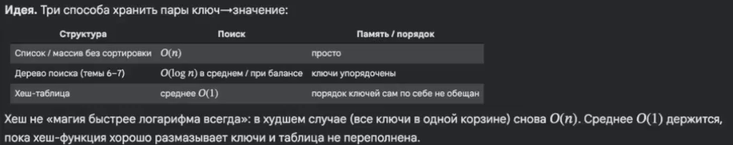

### Прямая адресация

Простейшее воплощение этой идеи — **прямая адресация**[^n2a]. Заранее выделяем в памяти массив из $m$ ячеек (слотов), а номер ячейки для ключа $k$ вычисляем функцией $h(k)$. Этот массив, то есть всё множество адресов, куда может попасть ключ, будем называть **пространством признаков**. Для целых чисел удобен учебный пример

$$h(k) = k \bmod 100,$$

где ключ делится на длину массива (100), а номером ячейки служит остаток (в Python — оператор `%`). Пришло число 22: остаток от деления на 100 говорит «иди в 22-й контейнер». Адрес этого контейнера точно известен, поэтому положить туда число или достать его — константа. Ключ $k$ всегда попадает в один и тот же слот $h(k)$, и поиск сводится к переходу по индексу, без просмотра всех 100 ячеек наугад. Сама идея хеширования в программировании появилась в 1950-е годы (Luhn, Dumey и другие).

Ключевой вопрос здесь — размер пространства признаков. Обычные списки выделяют память динамически, по мере надобности, а здесь размер приходится выбирать заранее, исходя из ожидаемого числа элементов. Если их будет до 100, делим на 100, если до 1000 — на 1000, можно завести и миллион контейнеров. Важно лишь, чтобы функция однозначно и за известное время говорила, куда класть: сколько стоит поделить число на 100, мы знаем заранее. Сама функция может быть любой, деление — только простейший вариант. Какой ей стоит быть, разберём в следующем разделе.

Ещё одна приятная особенность: массив не нужно сортировать. Функция $h$ сама говорит, куда положить элемент и откуда его взять.

### Как это работает

Возьмём ключи 15, 22 и 8 и массив из $m = 10$ слотов:

```
выделили массив из 10 слотов
ключ 15: h=15%10=5 → пишем в слот 5
ключ 22: h=22%10=2 → пишем в слот 2
ключ 8:  h=8%10=8  → пишем в слот 8
таблица: [None, None, 22, None, None, 15, None, None, 8, None]
```

В этом учебном варианте в каждом слоте лежит одно значение и выполняется простое правило: `table[h(k)]` хранит `k`. Пока разные ключи попадают в разные ячейки, операции `put` и `get` стоят $O(1)$, а память — $O(n)$: сколько элементов нужно положить, столько места и займём[^n2b].

![Слайд 16. Прямая адресация: h(22) = 22 % 10 = 2, ключ 22 кладётся прямо в T[2]](figures/slide_16.png)

Пограничный случай: два разных ключа дают одно и то же значение $h$. Тогда прямая запись в ячейку затирает соседа, и константная оценка верна, только пока таких совпадений нет. Как с ними справляться, разобрано дальше.

[^n2a]: Примечание составителя: в учебниках прямой адресацией обычно называют частный случай $h(k) = k$, когда ключи — небольшие целые числа и сами служат индексами; общий случай с вычислением $h(k)$ называют хешированием. Здесь термин используется шире — для любой схемы «вычислили индекс и сразу пошли в ячейку».

[^n2b]: Примечание составителя: массив выделяется сразу на все $m$ ячеек, так что точнее память пропорциональна $m$. Оценка $O(n)$ получается потому, что $m$ выбирают порядка ожидаемого числа элементов $n$.


## Хеш-функции: хорошие и плохие

*Таймкод: 00:11:25 · слайды 19–28*

Если заранее известно, что уникальных элементов будет, скажем, не больше 1000 и это целые числа, хватит остатка от деления или самого идентификатора. Но это частный случай. В общем случае приходится сесть и подумать, как устроить **хеш-функцию** — функцию $h(k)$, которая по ключу сразу говорит, в какую ячейку пространства признаков записать значение и откуда его потом забрать.

### Три требования к хеш-функции

Хорошая хеш-функция удовлетворяет трём критериям.

1. **Детерминированность.** Один ключ всегда даёт один адрес в пространстве признаков: сколько бы раз и где бы вы ни вызывали функцию, на один и тот же вход она возвращает один и тот же выход. Если на вход пришло 1000, а функция — остаток от деления на 1000, то результат всегда 0. Функция, которая на тот же ключ может вернуть что-то другое, не годится: положив значение, вы его потом не найдёте.
2. **Равномерность.** Разные, даже близкие по смыслу ключи не сваливаются в одно значение, а распределяются по всему пространству признаков. Функция, которая для разных входов отдаёт одно и то же, плохая: все значения попадут в одну корзину и будут перезатирать друг друга.
3. **Быстрый расчёт.** Сама $h$ не должна считаться дольше, чем обычный поиск. Если хеш-функция очень сложная, иногда проще воспользоваться поиском по дереву, чем вычислять, где лежит элемент.

### Каким должен быть ключ

Кроме функции нужно правильно спроектировать сами ключи: чем сложнее извлечь из ключа детерминированную логику, тем хуже ключ. В Python для этого есть понятие **`Hashable`** (тип из модуля `typing`) — в первую очередь это неизменяемые типы данных, например строки и `int`. Ключ такого типа не может «вдруг» поменять значение: если в памяти лежит `int` со значением 1, он так и останется единицей, а при «изменении» переменной меняется только ссылка на объект[^n3a]. Второй важный вопрос — насколько большим будет ключ.

Отдельная задача — строки. Их в любом случае нужно перевести в число, чтобы понять, где строка будет лежать в пространстве признаков. В простом случае можно посчитать, сколько раз встречается каждая буква, но иногда порядок букв важен, поэтому здесь нужна осторожность.

### Антипример: длина строки

Возьмём в качестве ключей строки, а в качестве хеша — длину строки по модулю $m$:

```python
def hash_length(s: str, m: int) -> int:
    return len(s) % m
```

При $m = 7$ слова «кот», «ток», «кит» и «дом» имеют длину 3 и все попадают в слот 3. Для таблицы это плохо: четыре разных ключа делят один слот, а остальные шесть пустуют. Функция детерминирована и быстра, но нарушает требование равномерности.

### От символов к числу: `ord` и полиномиальный хеш

У любого символа в любом языке программирования есть порядковый номер в таблице символов. В Python его возвращает функция **`ord`**: для «к», «о», «т» это 1082, 1086 и 1090. Из этих кодов строку можно превратить в число двумя наивными способами.

Первый — сложить коды. Это не очень хороший вариант: сумма не учитывает порядок, и «кот» с «ток» дадут одно и то же. Коды нужно домножать на вес, зависящий от позиции символа.

Второй — склеить коды в одно число:

```python
"".join([str(ord(item)) for item in "кот"])   # '108210861090'
```

Такое число однозначно определяет слово, и вы точно знаете, куда его положить. Но пространство признаков становится огромным: ради хранения нескольких букв это очень дорогой по памяти способ.

Для этого и существует **полиномиальный хеш** — он учитывает и сами символы, и их порядок, но не требует бесконечного пространства признаков:

$$h(s) = \left(\sum_{i=0}^{|s|-1} s[i] \cdot p^{i}\right) \bmod m$$

Здесь $s[i]$ — код $i$-го символа (`ord`), $p$ — основание (в коде $p = 31$), $p^i$ — вес позиции. Благодаря весам перестановка букв меняет результат, а взятие остатка по $m$ приводит его к номеру слота:

```python
def hash_poly(s: str, m: int, p: int = 31) -> int:
    h = 0
    power = 1
    for ch in s:
        h = (h + ord(ch) * power) % m
        power = (power * p) % m
    return h
```

Остаток берётся на каждом шаге, поэтому промежуточные числа остаются маленькими. Сравним обе функции при $m = 7$:

| слово | `len % m` | `poly` |
|:--|:--|:--|
| «кот» | 3 | 3 |
| «ток» | 3 | 2 |
| «кит» | 3 | 6 |
| «дом» | 3 | 6 |
| «собака» | 6 | 3 |
| «лампа» | 5 | 1 |

Полиномиальный хеш развёл «кот» и «ток» и разбросал слова по разным слотам. Но и он не идеален: «кит» и «дом» по-прежнему попали в слот 6, а «собака» — в тот же слот 3, что и «кот». Даже хорошая функция не гарантирует, что разные ключи окажутся в разных ячейках, — это тема следующего раздела.

[^n3a]: Примечание составителя: строго говоря, `Hashable` — объект, у которого определён метод `__hash__`, причём хеш не меняется за время жизни объекта. Неизменяемые встроенные типы (`int`, `str`, `tuple` из неизменяемых элементов) хешируемы, а изменяемые (`list`, `set`) — нет, поэтому изменяемые объекты в Python нельзя использовать как ключи хеш-таблицы.


## Коллизии и метод цепочек

*Таймкод: 00:19:21 · слайды 29–38*

### Почему коллизии неизбежны

Как бы хорошо ни была придумана хеш-функция, рано или поздно двум разным ключам достанется одна и та же ячейка. **Коллизия** — это как раз такой случай: два разных ключа попали в один слот,

$$h(k_1) = h(k_2), \quad \text{но} \quad k_1 \ne k_2.$$

Почему это происходит всегда, объясняет **принцип Дирихле**: если голубей больше, чем клеток, то хотя бы в одной клетке сидят минимум двое. Пусть $U$ — множество всех возможных ключей, $m$ — число слотов, а хеш-функция отображает ключи в номера слотов: $h: U \to \{0, 1, \dots, m-1\}$. «Голуби» здесь — ключи, «клетки» — значения хеша. Если $|U| > m$, то функции, которая всем ключам выдаёт разные индексы, не существует: пришлось бы уместить $|U|$ различных чисел в диапазон длины $m$. На пальцах: если в пространстве признаков 1000 ячеек, то 1001-й элемент своей отдельной ячейки уже не получит. Совсем маленький пример: $m = 3$, ключи $\{0, 1, 2, 3, 4\}$. Любая $h$ выдаёт только 0, 1 или 2, поэтому хотя бы два ключа из пяти обязаны совпасть.

Возьмём хеш «остаток от деления на 5». Кладём 10 — она попадает в ячейку 0. Кладём 1 — в ячейку 1. Кладём 15 — и снова ячейка 0, хотя ключи 10 и 15 разные. Значит, хорошая хеш-функция коллизий не исключает, а только делает их редкими в среднем. Поэтому сама структура данных обязана уметь их разрешать. Основных способов два, и первый из них — метод цепочек. Второй разбирается в следующем разделе.

### Идея метода цепочек

Самый простой выход — переделать ячейку так, чтобы она хранила не один ключ, а несколько. В **методе цепочек** каждая ячейка становится списком пар «ключ — значение». Если по хешу мы попали в уже занятую ячейку, новая пара просто дописывается в конец этой «цепочки», как в связном списке (linked list): сначала лежит 15, сразу за ней 22 и так далее. Проще всего представить, что каждая ячейка — это дополнительный список.

Что это даёт: пространство признаков становится «резиновым», и в одну ячейку помещается сколько угодно элементов. Чем за это платим: попав в ячейку, мы перебираем все ключи в ней, пока не найдём нужный. Чем сильнее раздувается ячейка, тем ближе сложность к $O(n)$. В худшем случае почти все значения окажутся в одной ячейке, и поиск превратится в обычный проход по списку.

### Реализация `ChainedHashMap`

Учебная хеш-таблица с цепочками — класс **`ChainedHashMap`**. При создании ей передаётся **capacity** — число корзин, то есть размер пространства признаков. Каждая корзина — пустой список. Ключи в примере целые, поэтому хеш — это просто остаток от деления на capacity:

```python
class ChainedHashMap:
    def __init__(self, capacity):
        self.capacity = capacity
        self.buckets: list[list[tuple[int, object]]] = [[] for _ in range(capacity)]
        self.size = 0

    def _h(self, key: int) -> int:
        return key % self.capacity
```

- `put` вычисляет номер корзины и проходит по ней. Если такой ключ уже есть, пара обновляется на месте. Если нет — новая пара добавляется в конец списка (`append`), а счётчик `size` увеличивается. Так сохраняется правило: ключ `key` лежит ровно в `buckets[h(key)]`.
- `get` устроен так же: идём в корзину `h(key)` и перебираем пары, пока ключ не совпадёт. Если корзина пуста или ключ не нашёлся, возвращаем `None`.
- `remove` чуть сложнее: элемент нужно аккуратно вынуть из списка. В связном списке для этого перекладывают указатели, в обычном списке Python элемент забирают с конкретной позиции (`bucket.pop(j)`) и уменьшают `size`.

### Пример: все ключи в одной корзине

Запустим таблицу с capacity $= 7$ на ключах 15, 22, 8, 29, 11:

```
put 15: корзина 1, длина цепочки 1
put 22: корзина 1, длина цепочки 2
put 8: корзина 1, длина цепочки 3
put 29: корзина 1, длина цепочки 4
put 11: корзина 4, длина цепочки 1
get 29: нашли в корзине 1
remove 22: удалили из корзины 1
корзины: [[], [(15,'v15'), (8,'v8'), (29,'v29')], [], [], [(11,'v11')], [], []]
```

У 15, 22, 8 и 29 остаток от деления на 7 равен 1, поэтому все четыре ключа выстраиваются в одну цепочку в корзине 1. Ключ 11 уходит в корзину 4. Чтобы достать 29, приходится пройти 15, затем 22, затем 8 и только потом 29, то есть четыре шага. В общем случае поиск стоит $O(k)$, где $k$ — длина самой большой корзины (здесь $k$ — не ключ, а размер цепочки).

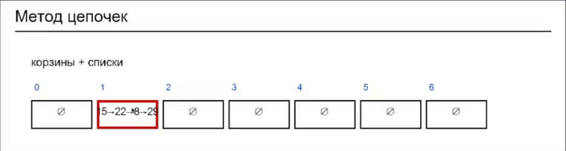

### Плюсы и минусы

Главный минус: скорость поиска целиком зависит от качества хеш-функции, и как бы идеально её ни подбирать, длинные цепочки остаются возможными. Главный плюс: не нужно заранее ломать голову над размером пространства признаков, потому что дополнительная память выделяется по ходу дела, в виде списка внутри ячейки. Но в примере выше видна и обратная сторона: одна корзина раздулась, а пять из семи стоят пустыми. Жертвовать ячейками не всегда хочется. Отсюда идея следующего метода: использовать все выделенные ячейки и класть элемент в соседнюю свободную.


## Открытая адресация и tombstone

*Таймкод: 00:26:43 · слайды 39–52*

### Идея: искать свободную ячейку по правилу

В **открытой адресации** каждая ячейка хранит не больше одной пары ключ–значение, и ключ живёт прямо в таблице, без дополнительных списков. Если ячейка с индексом $h(k)$ занята другим ключом, ищем другую свободную ячейку по заранее заданному правилу. Это правило называется **пробированием** (probing, от англ. probe — «зонд», «проба»). Формально задаётся последовательность проб $h(k,0), h(k,1), h(k,2), \dots$, где $h(k,i)$ — индекс ячейки на $i$-й попытке. Идём по ней, пока не найдём свободную ячейку (при вставке) или нужный ключ (при поиске).

Самый простой вариант — **линейное пробирование (linear probing)**: каждый раз сдвигаемся на одну ячейку вправо:

$$h(k, j) = \bigl(h(k) + j\bigr) \bmod \text{capacity}, \qquad j = 0, 1, \dots, \text{capacity}-1,$$

где $h(k) = k \bmod \text{capacity}$, а $j$ — номер пробы. Остаток от деления нужен, чтобы после последней ячейки продолжить обход с начала массива.

Возьмём $h(k) = k \bmod 7$. Ключ 15 ложится в ячейку 1. У ключа 22 хеш тоже 1, но ячейка занята, поэтому идём дальше и кладём его в ячейку 2. У ключа 8 хеш снова 1: ячейки 1 и 2 заняты, делаем +1 и ещё +1 и кладём его в ячейку 3. Поиск 8 повторяет те же пробы: 1 → 2 → 3, нашли.

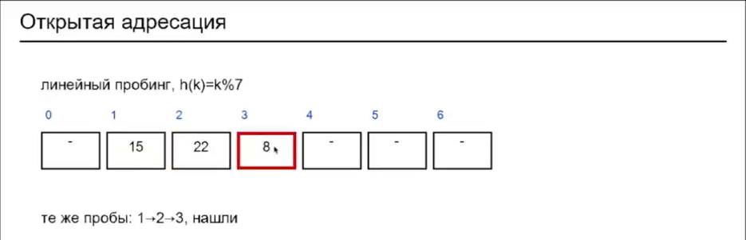

Лишние шаги никуда не делись, зато не нужно думать о дополнительной памяти: переиспользуется ровно та, что уже выделена. Это удобно, когда пространство признаков выделено с запасом, элементов немного, а хорошую равномерную хеш-функцию подобрать не удаётся.

### Удаление: зачем нужен tombstone

При удалении элемента его ячейку нельзя просто сделать пустой. Поиск останавливается на первой пустой ячейке, поэтому ключи, лежащие дальше по той же последовательности проб, станут ненаходимыми. Пусть в ячейках 1, 2, 3 лежат 15, 22 и 8. Если удалить 22 и обнулить ячейку 2, то поиск 8 упрётся в пустоту и решит, что ключа нет.

Поэтому на место удалённого элемента ставится плейсхолдер — **tombstone** («надгробие»), специальная метка DELETED. Она говорит: «здесь было значение, его удалили, двигайся дальше». При поиске через надгробие проходим насквозь, пока не найдём свой ключ или настоящую пустоту. При вставке надгробие можно переиспользовать. Если оно встретилось раньше пустой ячейки, его запоминают как кандидата, но поиск продолжают до настоящей пустоты. Если ключ так и не нашёлся, пару кладут в первое встреченное надгробие. Дойти до пустоты нужно, чтобы не создать дубликат: тот же ключ мог лежать дальше, за надгробием.

### Реализация `OpenHashMap`

Класс **`OpenHashMap`** — хеш-таблица с открытой адресацией и линейным пробированием. Сначала заводится уникальная метка надгробия, которая точно не совпадёт ни с одним значением, — в Python для этого подходит отдельный объект `_TOMB = object()`. Слот таблицы находится в одном из трёх состояний: `None` — пусто, `_TOMB` — удалено, `(key, value)` — занято. Поле `size` хранит число живых пар без учёта надгробий.

```python
def put(self, key, value):
    first_tomb = None
    for j in range(self.capacity):
        i = (self._h(key) + j) % self.capacity
        cell = self.slots[i]
        if cell is None:                    # настоящая пустота: ключа точно нет
            dest = first_tomb if first_tomb is not None else i
            self.slots[dest] = (key, value)
            self.size += 1
            return
        if cell is _TOMB:                   # запоминаем первое надгробие
            if first_tomb is None:
                first_tomb = i
            continue
        k, _ = cell
        if k == key:                        # ключ уже есть: обновляем
            self.slots[i] = (key, value)
            return
```

`get` идёт по тем же пробам, начиная с `_h(key)`. Встретив `None`, он возвращает `None`: слот пуст, ключа нет. Надгробие `get` пропускает, а при совпадении ключа возвращает значение. Поиск заканчивается, когда найден ключ, встретилась пустота или исчерпаны все `capacity` проб. `remove` сначала ищет ключ точно так же. Если найден, на его место ставится `_TOMB`, `size` уменьшается на единицу и возвращается `True`; если поиск упёрся в `None` или обошёл всю таблицу — `False`.

### Разбор запуска

Запустим таблицу с `capacity = 7` на ключах 15, 22, 8, 29, 11. У первых четырёх $k \bmod 7 = 1$, поэтому все они претендуют на ячейку 1 и выстраиваются подряд: 15 ложится в слот 1 с первой пробы, 22 — в слот 2 со второй, 8 — в слот 3 с третьей, 29 — в слот 4 с четвёртой. У ключа 11 хеш равен 4, но слот 4 уже занят ключом 29, и 11 со второй пробы попадает в слот 5:

```
slots: [None, (15,'v15'), (22,'v22'), (8,'v8'), (29,'v29'), (11,'v11'), None]
```

После `remove(22)` в слоте 2 появляется надгробие, и `get(8)` всё равно находит 8 в слоте 3, пройдя через него. Удалим ещё и 8 — получим два надгробия подряд:

```
после remove 8: [None, (15,'v15'), 'T', 'T', (29,'v29'), (11,'v11'), None]
```

Если потом понадобится вставить новый ключ и пробы дойдут до надгробия, новое значение можно положить на его место.

### Плюсы и минусы

Длинных списков нет: данные компактнее, все ключи живут в том же пространстве признаков, а выделенная память заранее известна и контролируется. Минусы — тот же худший случай $O(n)$ и сложное удаление: появляется флаг-надгробие, который обязательно нужно хранить в памяти. Ещё один минус линейного пробирования — **кластеризация**[^n5a].

**Акцент лектора:** открытая адресация полезна прежде всего тогда, когда памяти мало. Если память есть, лучше потратить её на другой подход — таблицу, которая растёт по мере заполнения.

[^n5a]: Примечание составителя: кластеризация — образование длинных сплошных серий занятых ячеек. Любой ключ, чей хеш попадает внутрь серии, проходит её до конца и удлиняет её на одну ячейку, поэтому пробы становятся всё длиннее. Это видно в разобранном запуске: ключи 15, 22, 8, 29 заняли слоты 1–4, и ключ 11, которому полагался слот 4, ушёл в слот 5, хотя с остальными у него нет общего хеша.

::: {.qa title="Вопросы из зала"}
**Не ломается ли хеш-функция при поиске, если элементы ставятся не по её правилам?** Нет. Хеш-функция не меняется: она детерминирована и для ключа всегда указывает одну и ту же стартовую ячейку. Если ключ лёг не туда, куда указал хеш, а дальше, поиск это учитывает: ключ в текущей ячейке не совпал — идём дальше, пока не найдём свой ключ или пустоту. Пустая ячейка означает, что ключа в таблице нет. Хеш-функция остаётся прежней, мы просто идём по таблице, пока не встретим пустоту.

**Что если элементов окажется больше, чем ячеек?** Положить их не получится. Таблица выделена под фиксированный `capacity`, поэтому ведётся счётчик `size`. Когда все слоты заняты, свободной ячейки нет, и новый ключ можно только записать поверх старого или не класть вовсе. В ноутбуке `put` в этом случае обходит все `capacity` проб и выбрасывает ошибку `RuntimeError("таблица полна")`. Именно поэтому нужна таблица, которая сама увеличивается по мере заполнения.
:::


## Коэффициент заполнения и рехеширование

*Таймкод: 00:39:09 · слайды 53–66*

Оба способа разрешения коллизий работают, но у них общая проблема: пространство признаков приходится выделять заранее и с запасом. Если элементы в него не помещаются, размер нужно как-то менять. Нам нужен «резиновый словарик»: он всегда позволяет сохранить новое значение и при этом расходует память экономно. Значит, надо понять, в какой момент создавать новое пространство признаков, то есть новую хеш-таблицу на основе старой.

### Коэффициент заполнения

**Коэффициент заполнения (load factor)** показывает, насколько сильно забита память таблицы:

$$\alpha = \frac{n}{m},$$

где $n$ — число уже положенных элементов, $m$ — число слотов (capacity). Иначе говоря, $\alpha$ — сколько элементов в среднем приходится на одну ячейку. Пока $\alpha$ ограничен константой, операции в среднем выполняются за $O(1)$. Когда таблица заполняется, коллизий становится больше, и константа теряется.

Поэтому для коэффициента задают порог — **threshold**. На практике его берут в диапазоне от 0,5 до 0,75, в коде ниже он равен 0,7. Правило простое: перед вставкой проверяем, не превысил ли коэффициент заполнения порог. Если превысил, нужно остановиться и выделить место побольше, обычно в два раза.

### Рехеширование

После увеличения массива старые ключи нельзя оставить на прежних местах. Хеш-функция — это остаток от деления на размер таблицы, $h(k) = k \bmod m$. Поэтому новая таблица означает и новую хеш-функцию, и все ключи раскладываются по ней заново. Такая перекладка всех ключей в увеличенный массив называется **рехешированием**.

Возьмём таблицу на $m = 5$ слотов с ключами 15, 22 и 8: $\alpha = 3/5 = 0{,}6$, порог достигнут. Создаём таблицу на $m = 10$ и считаем индексы заново: $h'(15) = 5$, $h'(22) = 2$, $h'(8) = 8$. Коэффициент заполнения падает до 0,3: места снова много, и можно класть новые значения.

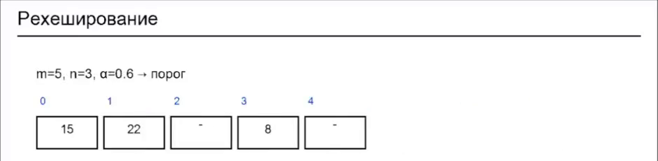

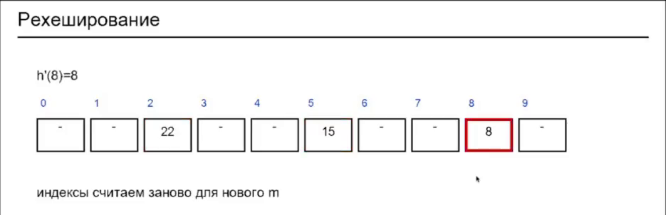

### Реализация `GrowingOpenHashMap`

Класс **`GrowingOpenHashMap`** наследуется от `OpenHashMap` и добавляет рехеширование при $\alpha > \text{threshold}$:

```python
class GrowingOpenHashMap(OpenHashMap):
    def __init__(self, capacity=4, threshold=0.7):
        super().__init__(capacity=capacity)
        self.threshold = threshold

    @property
    def load_factor(self):
        return self.size / self.capacity

    def _rehash(self):
        old = [c for c in self.slots if c is not None and c is not _TOMB]
        self.capacity = self.capacity * 2
        self.slots = [None] * self.capacity
        self.size = 0
        for k, v in old:
            super().put(k, v)

    def put(self, key, value):
        if self.load_factor > self.threshold:   # упрощённо: рехеш до вставки
            self._rehash()
        super().put(key, value)
```

`_rehash` сначала сохраняет во временный список живые пары; пустые слоты и надгробия не переносятся. Затем ёмкость удваивается, создаётся новое пространство признаков с `None` во всех слотах, текущее состояние обнуляется, и старые пары кладутся заново уже через новую хеш-функцию `key % capacity`. Проверка в `put` упрощена: она срабатывает до вставки, даже если ключ уже есть и значение просто обновляется.

Прогоним таблицу с `capacity = 4` и порогом 0,7 на ключах 10, 20, 30, 40, 50:

| Шаг | $\alpha$ до вставки | Что происходит |
|:--|:--|:----------|
| put 10 | 0,00 | $10 \bmod 4 = 2$ → слот 2 |
| put 20 | 0,25 | $20 \bmod 4 = 0$ → слот 0 |
| put 30 | 0,50 | $30 \bmod 4 = 2$, занято → слот 3 |
| put 40 | 0,75 > 0,7 | рехеш 4 → 8, три ключа переносятся; $40 \bmod 8 = 0$ → слот 0 |
| put 50 | 0,50 | $50 \bmod 8 = 2$, там 10 → слот 3 |

В итоге capacity равна 8, в таблице 5 элементов, $\alpha \approx 0{,}62$.

Рехешировать можно и таблицу с цепочками. Но если памяти мало или её важно беречь, лучше брать открытую адресацию.

**Акцент лектора:** такие динамические хеш-таблицы применяются везде, и главная проблема в них — подобрать коэффициент заполнения.

::: {.qa title="Вопросы из зала"}
**Почему при новом capacity старые ключи нужно перераспределять?** Потому что хеш-функция почти всегда одна и та же: ключ делится на размер пространства признаков, `key % self.capacity`. Новая таблица получает новую хеш-функцию, которая делит уже на новый capacity. Поэтому старое пространство признаков сохраняется во временной памяти, в объекте создаётся новое, и в него кладутся все старые пары. Старые ключи при этом получают новый хеш: раньше делили на 4, теперь на 8. Например, ключ 30 при $m = 4$ попадал в слот 2 и конфликтовал с 10, а при $m = 8$ его хеш равен 6.
:::


## Кеши на хеш-таблице: LRU, MRU и TTL

*Таймкод: 00:46:27 · слайды 70–72*

Рехеширование хорошо, когда таблица может расти без ограничений. Но бывает и обратная задача: нужна хеш-таблица фиксированного размера, скажем на 150 ключей, и делать её динамической мы не хотим. Такую структуру называют **кешем**. Ищем в ней по ключу как обычно, за константу. Вопрос возникает только тогда, когда место в пространстве признаков кончилось, а положить нужно новый ключ. Вместо рехеша приходится решать, какую из старых записей выкинуть. Это вытеснение называется **эвикцией** (от английского evict); про вытесненный ключ говорят, что он «эвиктится». Чтобы выбрать, кого вытеснить, рядом с хеш-таблицей держат отдельную структуру, где учитывается, как давно или как часто обращались к каждому ключу. Правило выбора и отличает один вид кеша от другого.

### LRU: вытесняем то, что давно не трогали

**LRU-кеш (least recently used)** выкидывает ключ, к которому дольше всех не обращались. Обращением считается любая операция: и `put`, и `get`. Каждое обращение делает ключ самым свежим, то есть переставляет его на «свежий» край списка ключей. Ключ, к которому давно не обращались, постепенно оказывается на другом краю. Ключи удобно представлять выстроенными в ряд: слева те, которые давно не трогали, справа только что использованные.

Возьмём кеш с capacity = 2. Кладём ключ 1, затем ключ 2. После этого ключ 1 стал менее свежим. Если теперь сделать `get(1)`, он снова станет самым свежим: это сигнал, что ключ популярен. Когда же нужно положить ключ 3, а места нет, мы смотрим на «старый» край ряда, берём оттуда ключ, который использовали давнее всех, вытесняем его и кладём новый.

Каркас будущей реализации — класс `LRUCache` с методами `__init__` (ёмкость задаётся при создании и должна быть положительной), `get` и `put`.

### MRU: вытесняем по частоте обращений

Вторая реализация называется **MRU-кеш (most recently used)**[^n7a]. В том виде, в котором она разбирается здесь, у каждой записи есть счётчик обращений `freq` (frequency), и `get`, и `put` увеличивают его на единицу. Чем выше счётчик, например за последние сутки, тем меньше у записи шансов быть выкинутой из памяти.

Снова возьмём capacity = 2. После `put(1)` и `put(2)` у обеих записей частота 1, и кеш заполнен. Затем дважды вызываем `get(1)`: теперь `freq(1) = 3`, `freq(2) = 1`. Ключ 1 трогали чаще, поэтому, когда понадобится место, у него меньше шансов на вытеснение, чем у ключа 2.

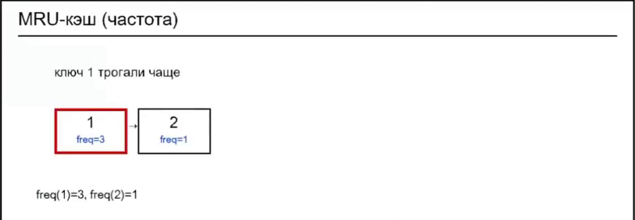

### TTL: время жизни записи

К таким кешам часто добавляют **TTL (time to live)** — время жизни объекта, который кладётся в кеш. Это свойство самой записи: если её время жизни истекло, запись вытесняют, а на освободившееся место кладут что-то другое.

[^n7a]: Примечание составителя: в общепринятой терминологии MRU вытесняет как раз самый недавно использованный элемент (он полезен, когда к свежим данным повторно почти не обращаются), а вытеснение по наименьшей частоте обращений обычно называют LFU (least frequently used). Здесь MRU описан так, как он устроен в лекции и в задаче семинара: со счётчиками частоты.


## Что выбрать: сводка и `OrderedDict`

*Таймкод: 00:50:52 · слайды 62, 67–69, 73*

### Когда брать хеш-таблицу

Хеш-таблица — структура, с которой вы будете работать в большинстве задач: она есть в любом языке программирования. В Python это **`dict`** — встроенный словарь «ключ → значение», устроенный как хеш-таблица. На словарях построено и хранение атрибутов объектов, особенно когда объекты создаются и меняются динамически.

Хеш-таблица нужна, когда требуется быстрый доступ по точному ключу: вы знаете, что именно ищете, и получаете ответ, как правило, за константу. Для запросов вида «больше / меньше» или «ближайший больший» она бесполезна — для них берут дерево поиска или отсортированный массив.

Итог удобно свести в таблицу.

| Задача | Структура |
|:-------------------------------------------|:------------------------------------------|
| Нужен порядок ключей / ближайший больший | дерево поиска / отсортированный массив |
| Нужен быстрый словарь «ключ → значение» | хеш-таблица (`dict` в Python) |
| Много коллизий допустимы, проще удалять | цепочки |
| Нужна компактность, α контролируем | открытая адресация |
| Таблица растёт | следите за α, делайте рехеш |

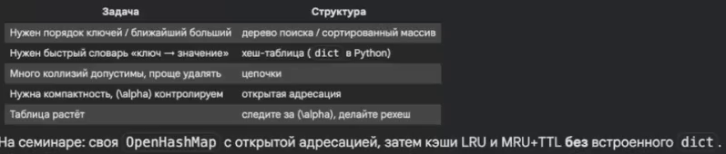

### Как выбирать стратегию и размер

На практике коллизии разрешают гибридно. При ограничениях по памяти чаще выбирают открытую адресацию, а не цепочки. Если памяти хватает, можно использовать цепочки, но и там следят за заполнением: когда какая-то цепочка становится слишком длинной, таблицу рехешируют.

Сами по себе коллизии обычно не большая проблема. Но если память забивается, рассчитывайте на деградацию: операции замедляются и в пределе становятся линейными, поэтому порог на коэффициент заполнения и рехеширование так важны. Не менее важно подобрать хеш-функцию для ключа, чтобы слишком много элементов не попадало в одно место.

**Важно:** если число элементов заранее ограничено и известно, сразу задайте подходящий размер пространства признаков, $m \approx n/\alpha$, где $\alpha$ — желаемый коэффициент заполнения. Слишком маленькая таблица означает частые рехеши, слишком большая — лишнюю память; иногда ищут компромисс между ними.

### `OrderedDict`: словарь с порядком

В стандартной библиотеке есть коллекции, которые расширяют словарь. Одна из них — **`OrderedDict`**: она нужна, когда элементы должны не только лежать в хеш-таблице, но и идти в определённом порядке. К `dict` добавляется понятие порядка — по сути, дополнительный список, по которому можно пройти элементы «сверху вниз». По умолчанию это порядок вставки: в каком порядке элементы положили, в таком они и будут.[^n8a]

[^n8a]: Примечание составителя: начиная с Python 3.7 обычный `dict` тоже гарантированно сохраняет порядок вставки; `OrderedDict` дополнительно умеет, например, переносить ключ в конец (`move_to_end`) и учитывает порядок при сравнении словарей.


## Задачи семинара и организационное

*Таймкод: 00:54:41 · слайды 74–77*

На семинаре, который начинается примерно через 35 минут после лекции, три задачи. Все три собраны на тех же структурах, что разобраны выше, и во всех действует одно ограничение: **нельзя пользоваться встроенным `dict`**, другими готовыми словарями стандартной библиотеки и сторонними библиотеками. Хеш-таблицу нужно собрать самостоятельно.

**Задача 1 — открытая адресация.** В классе `OpenHashMap` нужно реализовать три метода: `put(key, value)` добавляет ключ со значением, `get(key)` возвращает значение или `None`, если ключа нет, `remove(key)` удаляет ключ и возвращает `bool`. Максимальный размер таблицы задаётся заранее, ключи — целые положительные числа от 1 до $10^8$. В заготовке уже есть константа `TOMBSTONE` и индекс `key % capacity`, то есть основа та же, что у `OpenHashMap` из лекции.

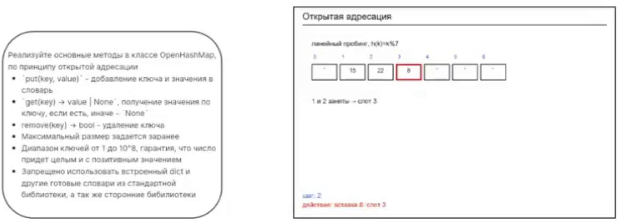

**Задача 2 — LRU-кеш фиксированной ёмкости.** Размер задаётся при создании, например `LRUCache(2)`. Методов два: `put` кладёт объект, `get` достаёт его. Вытесняется элемент, который дольше всех не вызывали, причём вызовом считаются обе операции, и `put`, и `get`.

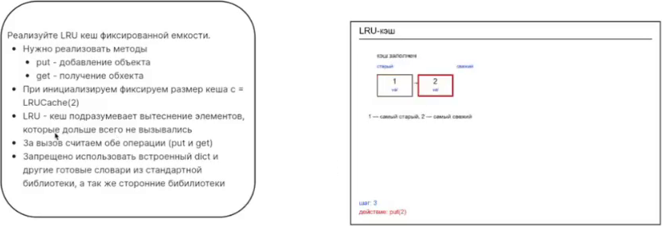

**Задача 3 — MRU-кеш с TTL.** Реализация похожа на LRU, но строится на счётчиках: учитывается, как часто вызывали тот или иной элемент. При инициализации фиксируются размер кеша и TTL в секундах, например `MRUCache(2, ttl=5.0)`. Если ёмкость или TTL не положительны, конструктор бросает `ValueError`. Запись удаляется по истечении TTL независимо от порядка обращений, и `get` её срок жизни не продлевает. Обычно TTL задают один на всю структуру при инициализации. Бывают и реализации сложнее, где у каждого ключа своё время жизни, но это редкость.

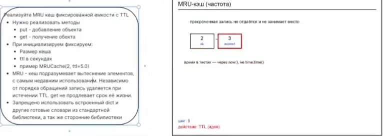

Об организационном. Код по деревьям, отправленный на ревью, проверят примерно за неделю. Нагрузку между ревьюерами распределят организаторы, ориентир по срокам — к 30 октября. Приглашения в приватные репозитории могли истечь, поэтому проще всего сделать репозиторий публичным.


## Главное из лекции {.unnumbered}

::: keypoints
- Хеш-таблица — массив ячеек плюс хеш-функция, которая по ключу сразу называет номер ячейки. Поэтому положить и найти значение можно в среднем за $O(1)$, без перебора, как у списка ($O(n)$), и без спуска по дереву ($O(\log n)$).
- Хорошая хеш-функция детерминирована, равномерно разбрасывает ключи и считается быстро. Ключи должны быть неизменяемыми (`Hashable`). Строки переводят в число через коды символов (`ord`) с весами позиций — полиномиальный хеш; длина строки или сумма кодов — плохие хеши.
- Коллизии неизбежны по принципу Дирихле: ключей больше, чем ячеек. Хорошая функция делает их редкими, но структура данных обязана уметь их разрешать.
- Метод цепочек хранит в каждой ячейке список пар. Он прост и не требует угадывать размер, но поиск стоит $O(k)$ по длине самой большой цепочки, а часть ячеек пустует.
- Открытая адресация кладёт ключ в следующую свободную ячейку (линейное пробирование). Память компактна и заранее известна, но удаление требует надгробий (tombstone), а занятые ячейки слипаются в кластеры.
- Коэффициент заполнения $\alpha = n/m$ — главный параметр таблицы. Когда он превышает порог (0,5–0,75), таблицу увеличивают, обычно вдвое, и рехешируют: все ключи раскладываются заново, потому что хеш зависит от размера.
- Кеш — хеш-таблица фиксированного размера, которая при нехватке места вытесняет запись: LRU — давно не использованную, MRU в варианте лекции — по счётчику частоты обращений. TTL ограничивает время жизни записи.
- Хеш-таблица нужна для точного поиска по ключу; для порядка и запросов «больше / меньше» берут дерево поиска или отсортированный массив.
:::

## Что подчеркнул лектор {.unnumbered}

::: emphasis
- Константа у хеш-таблицы — средняя: в худшем случае (все ключи в одной корзине) поиск снова стоит $O(n)$, поэтому качество хеш-функции решает всё.
- При удалении в открытой адресации ячейку нельзя просто очистить: поиск остановится на пустоте и потеряет ключи дальше. Нужно надгробие.
- Открытая адресация оправдана прежде всего при нехватке памяти; если память есть, лучше таблица, которая растёт.
- Динамические хеш-таблицы применяются везде, и главная проблема в них — подобрать коэффициент заполнения.
- Если число элементов известно заранее, сразу задайте подходящий размер таблицы, чтобы не платить за рехеши.
- На семинаре все три задачи (своя `OpenHashMap`, `LRUCache`, `MRUCache` с TTL) решаются без встроенного `dict`.
:::

## Стоит посмотреть в видео {.unnumbered}

::: watch
- **00:01:51–00:05:50** — фрагмент CS50 с бейджиками по корзинам: идея хеш-таблицы показана наглядно.
- **00:15:43–00:18:51** — живая демонстрация с `ord` и `join`: как строка превращается в число.
- **00:22:22–00:26:28** — код `ChainedHashMap` и разбор его запуска на ключах 15, 22, 8, 29, 11.
- **00:30:23–00:37:19** — код `OpenHashMap`, надгробия и разбор запуска с `remove`; объяснено сбивчиво, полезно следить за кодом на экране.
- **00:39:09–00:46:27** — анимация рехеширования и прогон `GrowingOpenHashMap`.
- **00:47:26–00:50:37** — анимации LRU- и MRU-кеша на доске.
:::

## Глоссарий {.unnumbered}

| Термин | Коротко |
|:--|:------------|
| **Хеш-таблица** | Массив ячеек и функция, которая по ключу сразу называет ячейку; поиск и вставка в среднем за $O(1)$ |
| **Корзина / бакет (bucket)** | Ячейка хеш-таблицы, куда попадают ключи с одним значением хеша |
| **Ключ** | То, по чему ищут значение в таблице |
| **Константное время, $O(1)$** | Число шагов, не зависящее от количества хранимых элементов |
| **Прямая адресация** | Схема «вычислили индекс по ключу и сразу пошли в ячейку» |
| **Пространство признаков** | Так в лекции называется массив ячеек таблицы, всё множество адресов для ключей |
| **Хеш-функция** | Функция $h(k)$, которая по ключу даёт номер ячейки; детерминирована, равномерна, быстра |
| **`Hashable`** | Тип из `typing`: объект, пригодный в качестве ключа (неизменяемый, с постоянным хешем) |
| **`ord`** | Функция Python, возвращающая код символа |
| **Полиномиальный хеш** | $h(s) = \left(\sum s[i]\,p^i\right) \bmod m$: учитывает символы и их порядок |
| **Коллизия** | Два разных ключа с одинаковым хешем |
| **Принцип Дирихле** | Если ключей больше, чем ячеек, хотя бы в одной ячейке окажутся двое |
| **Метод цепочек** | Разрешение коллизий: в каждой ячейке хранится список пар |
| **`ChainedHashMap`** | Учебная реализация хеш-таблицы с цепочками |
| **Capacity** | Число ячеек (корзин) таблицы |
| **Открытая адресация** | Разрешение коллизий: ключ кладётся в другую свободную ячейку той же таблицы |
| **Пробирование (probing)** | Правило, по которому ищется следующая ячейка при открытой адресации |
| **Линейное пробирование (linear probing)** | Пробы подряд: $h(k) + j$ по модулю capacity |
| **Tombstone** | «Надгробие»: метка удалённой ячейки, через которую поиск проходит дальше |
| **`OpenHashMap`** | Учебная реализация хеш-таблицы с открытой адресацией |
| **Кластеризация** | Слипание занятых ячеек в длинные серии при линейном пробировании |
| **Коэффициент заполнения (load factor)** | $\alpha = n/m$ — сколько элементов в среднем приходится на одну ячейку |
| **Threshold** | Порог коэффициента заполнения, после которого таблицу увеличивают |
| **Рехеширование** | Перекладка всех ключей в увеличенную таблицу с новой хеш-функцией |
| **`GrowingOpenHashMap`** | Учебная таблица с открытой адресацией, которая удваивается при превышении порога |
| **Кеш** | Хеш-таблица фиксированного размера с вытеснением записей |
| **Эвикция** | Вытеснение записи из кеша, когда место кончилось |
| **LRU-кеш (least recently used)** | Кеш, вытесняющий запись, к которой дольше всех не обращались |
| **MRU-кеш (most recently used)** | В лекции — кеш со счётчиками частоты обращений: реже используемые записи вытесняются раньше |
| **TTL (time to live)** | Время жизни записи в кеше |
| **`dict`** | Встроенный словарь Python, устроенный как хеш-таблица |
| **`OrderedDict`** | Словарь, который дополнительно хранит порядок элементов |
