::: {.abstract title="О чём лекция"}
Первая лекция курса была о жизненном цикле продукта и роли продуктового аналитика. Эта лекция о том, как продуктовое решение появляется из понимания пользователя, а не из идеи фичи. Она отвечает на вопросы: что именно нужно узнать о пользователе и чем потребность отличается от проблемы и от решения; какие бывают исследования и почему метод выбирают по вопросу, а не наоборот; как отделить факт от интерпретации; как описать пользователя через сегмент, персону и Jobs to Be Done; как построить карту пути пользователя (CJM) и найти на ней барьеры и возможности; как дойти от симптома до причины и точки роста; как сформулировать проверяемую продуктовую гипотезу и как превратить выбранное решение в user story с критериями приёмки. Все шаги складываются в одну цепочку, и почти каждый проиллюстрирован примерами из мессенджера MAX и сервисов доставки еды. Специальной подготовки не требуется.

Приоритизация гипотез и способы их проверки в эту лекцию не поместились и перенесены на семинар 30.09. Лекция идёт около трёх часов с перерывом примерно с 01:28 до 01:43. Организационной части почти нет, зато много интерактивов и вопросов из чата. Содержательные ответы вплетены в разделы и выделены серыми блоками — при беглом чтении их можно пропустить. Схемы и таблицы со слайдов приведены прямо в тексте. Сноски «Прим. составителя» — пояснения, которых не было в лекции.
:::

## Как появляется продуктовое решение

*Таймкод: 00:00:03 · слайды 1–2*

Первая лекция была об общей роли продуктового аналитика. Теперь речь пойдёт о том, как аналитик работает с пользовательской проблемой **до того, как появилось решение**. Главная установка этой темы: мы не начинаем с фичи. Мы начинаем с попытки понять, что происходит с человеком, какую задачу он решает, где у него возникает барьер и насколько мы уверены, что правильно поняли проблему.

### Карта лекции

Дальше появится много сущностей, которые на первый взгляд похожи друг на друга: проблема, потребность, барьеры, возможности, гипотезы, user stories, CJM. Чтобы не запутаться, полезно всё время задавать себе один вопрос: **на каком уровне рассуждения мы сейчас находимся** — описываем пользователя, объясняем его проблему или уже проектируем решение.

Все эти понятия складываются в одну цепочку:

исследование пользователя → потребность → Jobs to Be Done → CJM → pain point → предполагаемая причина → возможности решения → гипотеза → способ проверки → наблюдения → продуктовые решения.

Пока это просто набор слов, и каждое звено будет разобрано по очереди. Важно другое: это не отдельные темы, а **последовательные шаги одной работы**. Сначала мы учимся выявлять потребность и не подменять её готовым решением. Затем разбираем способы описать пользователя и его опыт: сегмент, персону, Jobs to Be Done и CJM. После этого учимся превращать наблюдаемые барьеры в возможности для улучшения, а возможности — в проверяемые гипотезы, и формализуем пользовательскую ценность через user story. Глубокого разбора метрик и статистического дизайна A/B-тестов здесь не будет — метрикам посвящена следующая лекция. Сегодняшняя задача — **правильно сформулировать то, что мы собираемся проверять**.

Простой пример того, о чём пойдёт речь. Фраза «мне нужна кнопка „Скачать“» описывает решение. Фраза «мне нужен доступ к материалам без интернета» — то, что человеку на самом деле нужно. Разница кажется чисто словесной, но именно она **определяет пространство решений**: если в формулировку уже зашито решение, все варианты сужаются до одной кнопки. К этому различию мы подробно вернёмся в следующем разделе.

### Две модели появления решения

Решение в продукте может появиться двумя путями. **[Наивная модель]{.gl key="Наивная модель / продуктовая модель"}** выглядит так: идея → разработка → запуск. **Продуктовая модель** длиннее: наблюдение → исследование → потребность → проблема → возможность → гипотеза → проверка → решение. Ключевая мысль: хорошее продуктовое решение начинается не с идеи фичи, а с понимания проблемы.

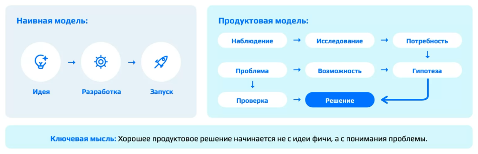

Наивная модель очень соблазнительна, и в жизни часто всё так и происходит. Кто-то увидел функцию у конкурента, руководитель предложил механику, дизайнер нарисовал красивый экран — и команда уже обсуждает реализацию. Проблема в том, что между идеей и разработкой нет проверки исходных предположений. Мы не знаем, существует ли проблема вообще, у кого она есть, насколько она значима, сколько людей воспользуются решением и почему именно это решение должно помочь. Продуктовая модель длиннее только на схеме: на практике ранняя проверка часто экономит месяцы разработки.

Возьмём поиск в приложении. Наблюдение: пользователи редко им пользуются. Наивная реакция — сделать поиск заметнее: нарисовать большую лупу, поменять цвет кнопки, вынести её на середину экрана. Но исследование может показать, что пользователи **вообще не ожидают найти через поиск нужный им тип контента**. Тогда ни цвет, ни положение кнопки проблему не решат. Хорошее решение начинается не с любви к собственной идее, а с понимания проблемы.

Проверить себя можно на простом упражнении: вспомните последнюю фичу, которой вы начали пользоваться, и сформулируйте, какую проблему она для вас решает. Частая ошибка — назвать саму фичу, например вишлисты в Ozon или Wildberries, и на этом остановиться. Ответ по существу звучит иначе: «субтитры нужны, чтобы при плохом соединении не терять часть информации», «вишлист помогает понять, что подарить другу», «хочу слушать музыку без связи», «хочу видеть, где находится друг, чтобы позвать его гулять или попросить о помощи», «хочу понимать, что было в голосовом сообщении, когда нет возможности его послушать».

::: {.qa title="Вопросы из зала"}
**Можно ли срезать углы, если мы точно знаем, что конкуренту фича приносит деньги, и даже знаем сколько?** В целом да, но этап исследования при этом не пропускается — он просто становится короче. Логика «у ребят есть такая фича, значит, и нам нужна» не работает. Смотрят, какую проблему решает фича конкурента, каким способом и как на неё реагируют пользователи. Исследование всё равно проводится, только быстрее: мы не придумываем новый функционал, а проверяем то, что уже есть у конкурентов.
:::

### Зачем исследовать пользователя, если есть продуктовые данные

Первый большой блок темы — исследование пользователя и выявление потребностей. Здесь мы сознательно не говорим о решениях: задача — научиться удерживаться внутри проблемы и понять ситуацию пользователя раньше, чем мозг автоматически предложит решение.

Естественный вопрос: зачем вообще исследовать пользователя, если у нас есть данные о его действиях в продукте? Данные о событиях хорошо показывают поведение, но не содержат готового объяснения этого поведения. Когда мы объясняем то, что видим в данных, мы на самом деле выдвигаем свои гипотезы о том, что думал пользователь и зачем он это делал.

Пример — доставка еды. В логах видно, что человек открыл приложение, посмотрел пять ресторанов и ушёл. Последовательность действий известна, причина — нет. Он мог не найти нужную кухню, увидеть стоимость доставки, понять, что ждать заказ придётся полтора часа, или просто отвлечься и приготовить еду дома. Каждое из этих объяснений ведёт к своему решению.

Поэтому о пользователе нужно понять как минимум:

- какую задачу он решает;
- в каком контексте она возникает;
- как он решает её сейчас;
- что ему мешает;
- какие альтернативы он использует;
- что он считает ценностью.

Исследование пользователя — не гуманитарное украшение аналитики, а способ уменьшить неопределённость относительно продукта и конкретной проблемы. Мы исследуем пользователя не ради самого пользователя, а чтобы принимать более обоснованные продуктовые решения.

### Команда продукта ≠ пользователь

Есть и ещё одна причина не полагаться на собственное понимание: команда знает продукт слишком хорошо. Отсюда возникают когнитивные искажения, и три из них встречаются особенно часто.

**Проклятие знания (curse of knowledge)** — трудно представить опыт человека, который не знает продукт. Если вы два года работаете над приложением, вы знаете, где каждая кнопка, что означает каждый термин и почему выбраны именно эти цвета. Новому пользователю это неизвестно, да и давнему пользователю — не обязательно. Команде кажется, что её знание о продукте есть и в головах пользователей, поэтому фраза «но здесь же очевидно» почти всегда опасна.

**Предвзятость подтверждения (confirmation bias)** — склонность искать подтверждения своей гипотезе. Если мы уже верим, что функция нужна, мы замечаем подтверждения и не замечаем опровержений. Один пользователь сказал «классная идея» — и мы это запомнили; пятеро не поняли, в чём ценность, — и мы списали это на плохую выборку. Так же бывает, когда друг говорит, что продукт супер, и мы принимаем это за единственно верное мнение, а негативные отзывы объявляем случайными.

**Эффект ложного консенсуса (false consensus effect)** — склонность считать собственное поведение типичным. Например, команда активно пользуется папками в мессенджере и предполагает, что это базовая потребность всей аудитории. Или кто-то уверен, что «Избранное» в Ozon — самая классная фича и ею пользуются все, а потом выясняется, что многие вообще не знают, что там есть.

Встречаются все три искажения, и их частота зависит от продукта и стадии его развития. На стадии зарождения продукта, в стартапах, чаще всего встречается предвзятость подтверждения: идея кажется отличной, гипотеза «подтвердилась» на части пользователей, и это принимается за истину. В зрелых командах, например в MAX, искажения тоже возникают, но коллеги быстро останавливают того, кто начинает так рассуждать: в мире всё работает не так, как внутри команды.

**Важный вывод:** мнение команды — источник гипотезы, а не доказательство. Продакт, дизайнер и аналитик могут хорошо чувствовать продукт, и их идеи — отличный материал для гипотез. Но это не наблюдение того, что пользователи действительно ведут себя так же.

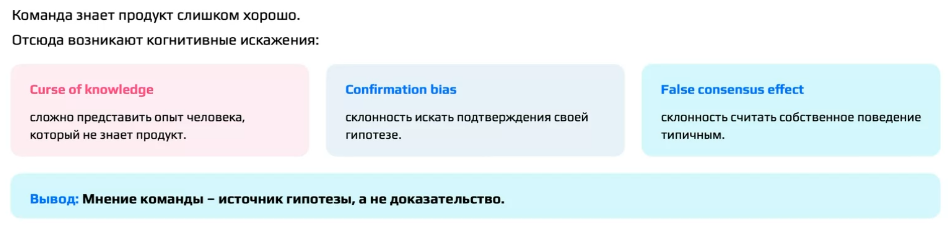

## Что мы хотим узнать о пользователе

*Таймкод: 00:16:20 · слайды 3–6*

### Семь измерений пользовательской ситуации

Задача «изучить пользователя» слишком широкая: непонятно, куда копать и что считать результатом. Это та же история, что и с любыми широкими задачами в работе аналитика: их нужно конкретизировать. Исследование становится полезным, когда заранее ясно, какие именно знания о человеке нам нужны.

Удобно раскладывать ситуацию пользователя на семь измерений: **[контекст, цель, мотивация, поведение, барьеры, альтернативы и результат]{.gl key="Семь измерений ситуации пользователя"}**. Каждому измерению соответствует свой вопрос.

|Измерение|Вопрос|Что за ним стоит|
|:--|:----|:--------|
|Контекст|Когда возникает задача?|В какой ситуации находится человек, раз у него появилась эта задача|
|Цель|Чего хочет достичь пользователь?|Какого результата он добивается|
|Мотивация|Почему это важно?|Почему этот результат для него ценен|
|Поведение|Что он делает?|Что реально делает в момент решения задачи|
|Барьеры|Что ему мешает?|Что мешает и раздражает|
|Альтернативы|Как решает задачу сейчас?|Как обходится без нас или другим способом|
|Результат|Что считает успешным исходом?|Что сам пользователь называет успехом|

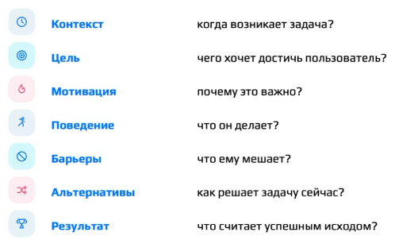

Про альтернативы стоит помнить: даже если нам кажется, что задача сейчас не решается никак, человек всё равно что-то делает. Значит, свою боль он как-то закрывает, и это «как-то» и есть наш настоящий конкурент.

Возьмём студента, который едет в метро. Контекст: он в дороге. Цель: продолжить обучение. Мотивация: с пользой провести время в пути. Поведение: открывает курс на телефоне. Барьер: нестабильный интернет. Альтернативы: заранее наделать скриншотов, почитать книгу или просто отложить учёбу. Успешный результат: можно заниматься и без связи. Такое описание намного богаче фразы «пользователю нужен офлайн-режим». Мы понимаем, кто, что и зачем делает, а офлайн-режим оказывается лишь одним из возможных способов решить задачу.

Второй пример: человек ищет чемодан на маркетплейсе. Если знать только действие «ищет чемодан», мы почти ничего не понимаем. Добавим остальные измерения. Контекст: через три дня он улетает в отпуск на море. Цель: получить подходящий чемодан до поездки и успеть собраться. Мотивация: не остаться без нужной вещи. Поведение: открывает карточки товаров и проверяет сроки доставки. Барьер: многие варианты приедут уже после вылета. Альтернативы: сходить в офлайн-магазин или поехать без чемодана (что вряд ли). Успешный результат: товар гарантированно приходит вовремя. Контекст здесь полностью меняет критерий хорошего продукта: срок доставки становится важнее скидки и количества отзывов.

Третий пример — поиск в мессенджере. Один человек открывает поиск, чтобы найти адрес, который ему прислали вчера, другой ищет документ полугодовой давности, третий — человека, которому давно не писал. Событие в данных одно, а задачи за ним разные. Поэтому исследование должно объяснять не только само действие, но и ситуацию, в которой оно совершается.

### Потребность, проблема и решение

Дальше нам понадобятся три уровня рассуждения, которые нельзя смешивать.

- **[Потребность]{.gl key="Потребность"}** — результат, который человеку нужно получить: «мне необходимо получить определённый результат».
- **[Проблема]{.gl key="Проблема"}** — барьер на пути к этому результату: «что-то мешает мне его получить».
- **[Решение]{.gl key="Решение"}** — конкретный способ устранить этот барьер.

Фраза «мне нужна кнопка „Скачать“» звучит как потребность, но на самом деле пользователь уже предложил готовое интерфейсное решение. Если спросить его «зачем?», может выясниться, что он хочет читать материалы в самолёте. Тогда настоящая потребность — «мне нужен доступ к материалам без интернета». Разница выглядит словесной, но она важна. Если реализовать запрос буквально, пространство вариантов сужается до одной кнопки. Ту же потребность можно закрыть и по-другому: автоматическим кэшированием, сохранением избранного для офлайн-доступа, выгрузкой в PDF.

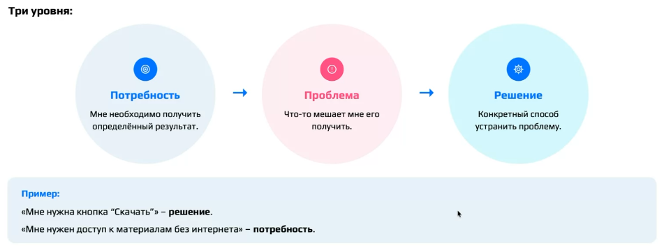

Отсюда полезная привычка аналитика. Когда вы слышите «мне нужна функция X», задайте пару вопросов: «зачем?» и «что вы пытаетесь сделать?». Они возвращают разговор от решения к потребности.

Потренируемся на фразе «мне нужен тёмный режим». Это решение, а не потребность. Какую потребность оно может закрывать? «Пользоваться приложением вечером или ночью» — сомнительный ответ: это скорее контекст, потребность здесь так и не названа. «Бережное энергопотребление» формально похоже на потребность, но спросите себя честно: когда вы в последний раз говорили, что у вас потребность в бережном энергопотреблении? Потребность стоит формулировать по-человечески, а не сложными конструкциями. Здесь всё сильно проще: забота о глазах («я боюсь посадить зрение со светлой темой»), чтобы глаза не болели и не уставали, комфортное чтение. Своя доля правды есть и в ответах про эстетику: тёмная тема может просто нравиться.

### Problem Space и Solution Space

Это разделение удобно описывать как два пространства. **Problem Space** (пространство проблемы) отвечает на вопросы: кто пользователь, в какой ситуации он находится, что пытается сделать, почему это важно и что ему мешает. **Solution Space** (пространство решения) отвечает на другие вопросы: что изменить, какой интерфейс сделать, какую механику добавить, как это реализовать. Порядок такой: сначала Problem Space, затем Solution Space.

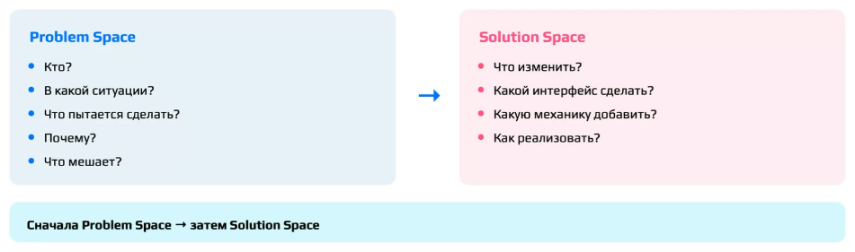

Частая ошибка — понимать это правило слишком буквально и считать, что в пространство решений нельзя заходить, пока мы не узнали о пользователе абсолютно всё. Так мы никогда ничего не выпустим, нужна золотая середина. Смысл правила в другом: **решение должно быть ответом на сформулированную проблему, а не подменять её.**

Вернёмся к чемодану. «Добавить фильтр по сроку доставки» — это Solution Space. «Пользователь не может быстро отсеять варианты, которые не успеют приехать к нужному времени» — это Problem Space. Вторая формулировка позволяет придумать несколько решений и сравнить их между собой, как мы только что сделали с тёмным режимом.

### Почему нельзя сразу придумывать решение

Факт: пользователи не заканчивают регистрацию. Команда предлагает сократить количество полей в форме. Это может сработать, но только если настоящая причина — лишние усилия на заполнение формы. А причины могут быть совсем другими:

- не приходит SMS;
- пользователь не понимает, зачем ему регистрироваться;
- не хочет давать номер телефона;
- возникает техническая ошибка;
- его отвлекли (пришла кошка и потребовала корм);
- нужная ему функция оказалась недоступна.

Список легко продолжить: не работает кнопка, пропал интернет, вылетела страница, мешает VPN, человек опасается кражи данных, ему не понравился какой-то вопрос, в поле нет подходящего варианта, поля непонятны, не хочется придумывать длинный пароль или вручную вводить всё подряд, перед последним шагом выскочила капча с мотоциклами на картинках. Одно и то же наблюдение может объясняться разными механизмами, а разные механизмы требуют разных решений. Если не приходит SMS, сокращение формы не поможет. Если человек не понимает ценности аккаунта, не поможет и технически идеальная форма. **Поэтому до выбора решения нужно хотя бы сузить множество правдоподобных причин.**

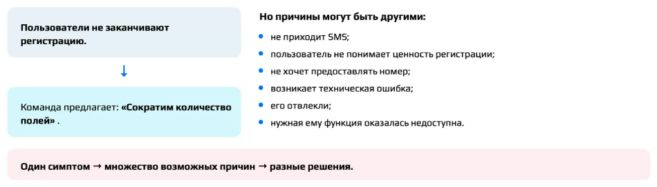

Посмотрим на условные числа по шагам регистрации. Регистрацию начали 1 000 000 человек, ввели телефон 850 000, перешли к SMS 500 000, завершили 450 000.[^n2a] Продакт говорит: «Люди боятся давать номер телефона». Где это написано в данных? Нигде. Данные показывают только, сколько людей теряется между этапами, но не почему. Дальше нужно проверять платформу, версию приложения, страну и оператора, время ожидания SMS, ошибки API, повторные попытки, новые и старые устройства, источник трафика. Может оказаться, что основная потеря появилась на Android после конкретного релиза, и тогда психологическое объяснение изменений вообще не объясняет. А может быть наоборот: технических проблем нет, а разговоры с реальными пользователями стабильно показывают недоверие к запросу номера. Тогда у версии про страх оставить номер появляется больше оснований.

**Практическое правило:** прежде чем чинить проблему, сформулируйте минимум три альтернативные причины. Это не даёт команде принять первое правдоподобное объяснение за факт.

[^n2a]: Примечание составителя: если посчитать долю перешедших на каждый следующий шаг, получится примерно 85 %, 59 % и 90 %. Больше всего людей теряется между вводом телефона и переходом к SMS — именно здесь и стоит искать причину.

## Слова и поведение: методы исследования

*Таймкод: 00:29:33 · слайды 7–9*

### Что пользователь говорит и что он делает

Узнавать о пользователе можно двумя принципиально разными путями: спросить его или посмотреть, что он делает. Отсюда два вида данных. **Attitudinal data** — это то, что человек говорит, думает, считает и чувствует. **Behavioral data** — то, что он фактически делает. Оба вида полезны, но отвечают на разные вопросы, и путать их нельзя.

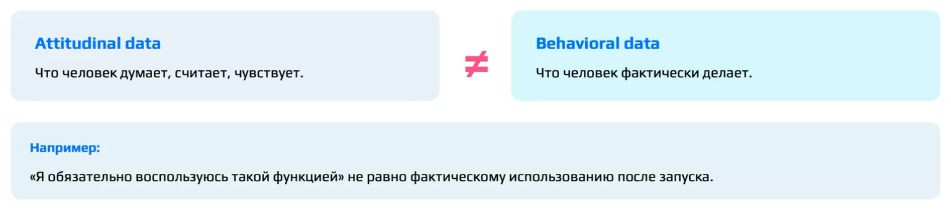

Самый известный способ получить attitudinal data — **глубинное интервью**. Садятся двое: человек из компании, который задаёт вопросы, и представитель целевой аудитории. Это либо пользователь уже существующего приложения, либо человек, который сталкивается с проблемой, которая, как нам кажется, существует: например, он хочет правильно питаться и как-то решает эту задачу прямо сейчас. Вопросы идут по заранее составленному сценарию, и составлен он так, чтобы по ответам можно было подтвердить или опровергнуть несколько предположений команды.

Проблема в том, что сказанное и сделанное расходятся. Фраза «Я обязательно воспользуюсь такой функцией» не равна фактическому использованию после запуска. Она фиксирует **текущее намерение или отношение** человека, а не его будущее поведение. Причин у этого разрыва много:

- люди хотят выглядеть последовательными;
- они плохо предсказывают собственное поведение;
- забывают контекст, в котором на самом деле принимают решения;
- реальное поведение зависит от цены, времени, привычек и альтернатив;
- и даже от того, насколько человек переживает, что о нём подумает собеседник.

Есть известная формула: «люди врут». Речь не о злом умысле, а о социально приемлемых ответах. Спросите, сколько раз в день человек чистит зубы, — почти все ответят «два-три раза, после каждого приёма пищи». Для кого-то это правда, но большинство просто отвечает так, как принято. Поэтому не каждому ответу можно верить буквально, и сильное исследование обычно сочетает слова и действия: что пользователь сказал и что мы наблюдаем в продукте.

### Количественные и качественные исследования

Исследования делятся на два больших класса. **Количественные исследования** отвечают на вопрос «что происходит»: сколько, как часто, у кого, насколько распространено. **Качественные исследования** отвечают на вопросы «почему» и «как»: в каком контексте это происходит, что человека мотивирует, что ему мешает. Глубинное интервью — типичный качественный метод.

Важно, что это не «количественные *против* качественных», а «количественные *плюс* качественные»: методы не конкурируют, а дают разные части знания о пользователе. Количественный факт звучит, например, так: 38 % пользователей уходят на шаге подтверждения номера. Качественное исследование позволяет «прощупать» эту проблему: почему так происходит, как человек к этому шагу пришёл, что пытался сделать, что его остановило и почему это для него важно.

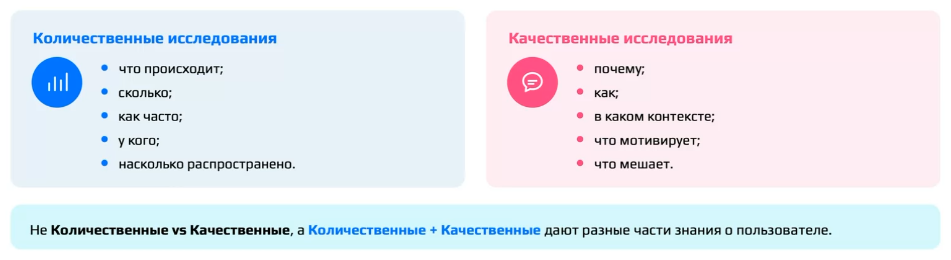

**Важно:** здесь нельзя создавать ложную симметрию. Интервью не доказывает, что найденная причина распространена. А продуктовые данные не содержат готовой причинности. Поэтому часто работают в такой последовательности:

1. количественно найти, **где** проблема;
2. качественно сформулировать **объяснение**;
3. количественно проверить **масштаб** найденного паттерна.

Это не единственно возможный порядок, но хорошая иллюстрация того, как методы дополняют друг друга.

::: {.qa title="Вопросы из зала"}
**Где найти людей для интервью?** Для нового продукта — в мессенджерах, в специальных чатах для CustDev: туда можно прийти самому поучаствовать в чужом исследовании или разместить приглашение в своё. Так делают и стартапы, и существующие компании, но в компании на это обычно нужно согласование. Для учебной работы можно прямо написать, какую проблему вы изучаете, и откликнутся те, кто готов участвовать; не все соглашаются бесплатно, но такие люди есть. Компания может приглашать и собственных пользователей — это сильно зависит от компании.

**Сколько нужно интервью?** Точно не две штуки. Интервью проводят до тех пор, пока названные проблемы не начнут повторяться — когда, условно, в каждом третьем интервью звучит одно и то же. Из таких повторяющихся тем складываются основные вопросы, и дальше их переносят в количественное исследование.[^n3a]

**Обязательно ли пользователю осознавать проблему, чтобы функция оказалась полезной? Вишлисты на Wildberries и Ozon оценили уже после появления.** И да, и нет. Часть пользователей просто подхватила общую волну. Но были и люди с реальной проблемой: друзья периодически просили их прислать список желаемых подарков, и функция эту проблему закрыла. Если бы за ней не стояло реальной потребности, её бы не стали выкатывать.

**Люди ведь подстраиваются под интервьюера: понимают, что от них хотят услышать, и отвечают под это?** Да, так и есть. Поэтому нельзя проводить интервью со знакомыми и с людьми, которые понимают, о чём будут вопросы.

**Можно ли в глубинном интервью задавать вопросы с ответом «да» или «нет»? И можно ли считать интервью то, что делает ВЦИОМ?** Зависит от того, какие вопросы задают. В количественных исследованиях, то есть в опросах, используют закрытые вопросы с конкретными вариантами ответа: «Сколько раз в день вы чистите зубы? 1 / 2 / 3 / 4 / больше». Это логично: если опрос прошли тысячи людей и у каждого было поле для свободного ответа, обработать такие ответы очень трудно (современный ИИ, возможно, справился бы с агрегацией, но обычно так не делают). В глубинном интервью, наоборот, задают открытые вопросы — такие, на которые нельзя ответить «да» или «нет»; вопросов «да / нет» там просто не бывает, иначе не понять мотивы человека. Мы заранее не знаем, каких ответов ожидать, и интервью для того и проводится, чтобы человек сам рассказал всё, что у него накипело. Бывает, что респондент начинает жаловаться на всю свою жизнь, и полезное приходится вычленять из этого потока, но обрывать его фразой «у нас шаблон и жёсткие тайминги, ответьте на конкретный вопрос» нельзя. ВЦИОМ в основном проводит количественные исследования, но качественные у них тоже бывают.

**Проводит ли интервью сам продуктовый аналитик?** Зависит от компании. В MAX, например, интервью и опросы делает отдельная команда исследований, и продуктовые аналитики глубинных интервью не проводят.

**Выгрузка из базы данных — это количественное исследование?** Да, это наблюдение за текущим поведением пользователей. Выгрузку можно использовать, чтобы подтвердить предположение, или чтобы сформулировать его и потом отнести на качественное исследование.

**Зачем опрашивать большое число людей?** Количественное исследование показывает, насколько проблема распространена. К тому же опрос можно сделать анонимным, и тогда люди меньше переживают о том, что о них подумают.

**Как бороться с тем, что люди намеренно отвечают неправду?** Часть ответов неизбежно окажется неправдоподобной, поэтому опрос проводят на большой выборке и отсеивают выбросы по перцентилям. Кроме того, в анкету включают несколько вопросов об одном и том же, сформулированных по-разному, — так же устроены психологические тесты на тип личности, где вопросы крутятся вокруг одной темы. Вообще, сильнее всего ответы искажаются лицом к лицу, когда человек отвечает так, как считает нужным; в анонимном опросе врать ему особенно незачем.
:::

### Основные методы исследования

У каждого метода своя зона ответственности. Ниже — основные методы и то, что каждый из них помогает понять.

| Метод              | Что помогает понять                              |
|:-------------------|:-------------------------------------------------|
| Продуктовые данные | Что пользователи делают                          |
| Интервью           | Почему и в каком контексте                       |
| Наблюдение         | Как ведут себя в реальной ситуации               |
| Usability-тест     | Где возникают проблемы взаимодействия            |
| Опрос              | Насколько распространены мнения / характеристики |
| Отзывы и обращения | Какие проблемы пользователи артикулируют         |

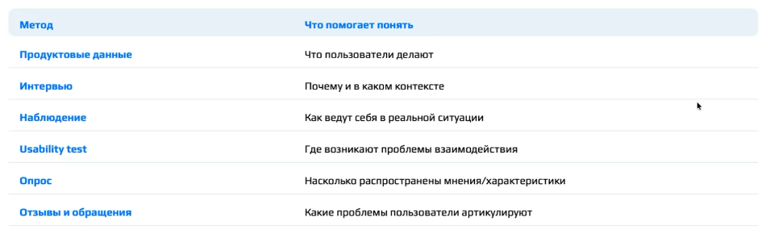

**Продуктовые данные** — это фактическое поведение внутри продукта, наш факт: по логам видно, как вели себя люди или система. **Интервью** раскрывает мотивацию, контекст, язык пользователя и его собственные объяснения. **Наблюдение** особенно полезно, когда реальное действие расходится с тем, что человек о нём рассказывает. Простейший пример — сходить ради интереса в магазин и посмотреть, как люди выбирают молоко.

**Usability-тест** показывает, где человек не понимает интерфейс или не может пройти сценарий. Человеку, который продукт не знает, дают попробовать им воспользоваться и смотрят, как он справляется. Классическая картина: участник ломает голову, куда нажать, а разработчики стоят у него за спиной и возмущаются: «Ну вот же, сюда нужно перейти, неужели не видно?» Им всё понятно, потому что они знают продукт слишком хорошо, — это и есть проклятие знания в чистом виде. **Правило usability-теста:** комментировать и подсказывать нельзя, можно только наблюдать и запоминать, где ломается логика пользователя.

**Опрос** оценивает распространённость мнений и характеристик — но только при конкретной выборке и конкретных формулировках вопросов. **Важно:** и в опросе, и в интервью респондент должен соответствовать целевой аудитории продукта. Если человека, который никогда не ездил на мотоцикле, позвать в опрос для мотоциклистов, его ответы будут нерелевантны, особенно если в анкете нет варианта «не знаю» или «другое».

**Отзывы и обращения** хорошо показывают проблемы, которые пользователи сами формулируют. Но те, кто пишет в поддержку, не обязательно представляют всю аудиторию: среди них хватает людей, которым просто нужно было поворчать.

### Один вопрос — разные методы

Самого лучшего метода не существует: есть метод, подходящий к тому, что именно мы хотим узнать. Поэтому методы комбинируют, и одну проблему обычно исследуют несколькими способами. Возьмём довольно простой пример — разбираемся, что не так с оплатой. Каждый частный вопрос закрывается своим методом:

| Вопрос                                                  | Метод                                        |
|:--------------------------------------------------------|:---------------------------------------------|
| Где ломается оплата?                                    | Продуктовые данные: события, ошибки, логи    |
| Что человек пытался сделать в момент ошибки?            | Интервью или наблюдение                      |
| Понимает ли он текст ошибки?                            | Usability-тест                               |
| Насколько распространено недоверие к комиссии при оплате? | Опрос — после того как поняли, как люди формулируют эту проблему |
| Какие проблемы люди сами считают достаточно серьёзными, чтобы пожаловаться? | Обращения в поддержку |

### Границы методов

У каждого метода есть пределы, за которые его выводы не распространяются. Отзывы — хороший источник идей о проблемах, но плохая оценка их распространённости: чаще всего пишут люди с сильным, обычно плохим опытом, которых что-то очень сильно вывело из себя. Интервью хорошо раскрывает механизм, но пять интервью не означают, что 40 % аудитории думает так же. Логи дают масштаб поведения, но не читают мысли пользователя.

**Важный вывод:** у каждого метода свои границы, и для каждого вопроса нужен свой метод.

[^n3a]: Примечание составителя: в методологии качественных исследований этот принцип называют насыщением (saturation): интервью продолжают, пока новые беседы перестают приносить новые темы.

## Метод начинается с вопроса

*Таймкод: 00:49:16 · слайды 10–11*

Раз у каждого метода есть свои границы, возникает практический вопрос: как выбрать метод под конкретную задачу? Ответ на него — один из ключевых методологических принципов всей темы: метод выбирается последним.

### Цепочка от вопроса к методу

Типичная ошибка звучит так: «Давайте проведём интервью, потому что давно не проводили». Здесь метод выбран сам по себе, без понимания того, что мы хотим узнать. Правильный порядок обратный:

Исследовательский вопрос → Необходимое знание → Данные → Метод.

Сначала формулируется **исследовательский вопрос** — что именно мы хотим узнать. Затем решаем, какое знание позволит на него ответить и какие данные для этого нужны. Только после этого выбирается метод.

Возьмём уже знакомый пример с регистрацией. Один и тот же сюжет распадается на три исследовательских вопроса, и каждому нужен свой метод:

| Исследовательский вопрос | Необходимое знание | Метод |
|:-----------------------------|:--------------------|:----------------------------|
| Где пользователи бросают регистрацию? | Что происходит? | Продуктовые данные |
| Почему они уходят? | Какая причина? | Интервью / usability-тест |
| Насколько распространена найденная причина? | Насколько часто? | Количественная проверка |

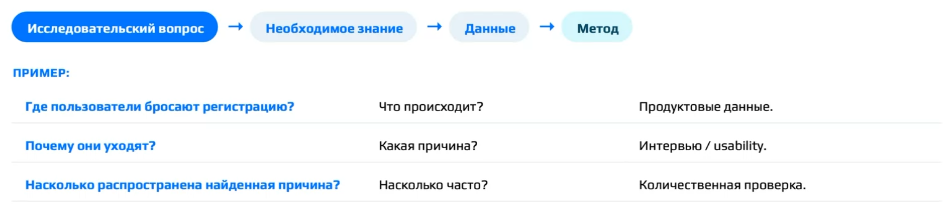

На первый вопрос отвечают продуктовые данные: нужно наблюдаемое распределение пользователей по шагам. Продуктовый аналитик строит **[воронку]{.gl key="Воронка"}** — последовательность шагов сценария с числом пользователей, дошедших до каждого из них (подробнее о ней в конце раздела), — и видит, на каком шаге отваливается большинство. На второй вопрос логи сами по себе не ответят. Теоретически можно обвесить логами каждую кнопку и каждый клик, чтобы потом восстановить причинно-следственную связь, но в большинстве сервисов такого нет. Здесь понадобятся интервью, usability-тесты, анализ технических ошибок. Когда причина найдена в качественном исследовании, остаётся третий вопрос — насколько она распространена, — и для него нужна количественная проверка.

Такая логика защищает от инструментального мышления, когда метод становится целью сам по себе.

### Зачем это продуктовому аналитику

Естественный вопрос: а занимаются ли аналитики исследованиями? В MAX глубинные исследования (выйти к пользователю, поговорить с ним) продуктовые аналитики не проводят: для этого есть отдельная команда исследований, которая делает опросы и интервью. Но у аналитика не должно складываться ощущение, что на любой вопрос можно ответить только из данных, — это неправда.

Эта тема основополагающая: она показывает, какой путь проходит функция, прежде чем появиться в приложении, и закладывает правильное мышление о том, как развивается продукт. Продукт развивают не потому, что задача лежит в бэклоге, и не потому, что руководство вдруг так решило (хотя, будем честны, бывает и такое), а потому, что во главе всего стоит пользователь с его проблемой.

### Кейс: информеры для веб-приложения MAX

Вот как это выглядит в работе: данные показывают, *где* проблема, а исследование объясняет, *почему*. MAX сейчас нельзя скачать на iOS, но его можно поставить из браузера на рабочий стол как веб-приложение (PWA)[^n4a]. Заодно веб-приложение позволяет вернуть на iOS push-уведомления. Чтобы рассказать пользователям об этой возможности, команда запустила несколько информеров. Информер — это плашка над списком чатов; похожие плашки в Telegram предлагают купить Telegram Premium. Тексты у информеров были разные, но смысл один: «вы можете поставить себе MAX». По нажатию пользователь попадал на инструкцию по установке.

Воронка показала, что после перехода на инструкцию люди просто отваливаются: конверсия до установки была совсем маленькой. Начались гадания в духе «мы же правильно составили инструкцию». Может, дело в лендинге, то есть в одностраничном сайте с описанием. Может, в самой инструкции. Может, пользователи уходят на этапе загрузки. Возможных причин миллион. Тогда команда исследований вышла к людям, и выяснилось, что технической проблемы нет и дело не в цветах или оформлении: люди просто не понимали, зачем им это нужно. Суть предложения переформулировали и объяснили совсем другим языком — и люди начали устанавливать приложение. Исследование было двух видов: глубинное и количественное.

**Важный вывод:** без исследования команда перебрала бы множество вариантов решений, прежде чем поняла бы, что до людей просто не доходит ценность.

### Плохие запросы к аналитику

Принцип хорошо виден на запросах, которые часто приходят в работе.

«Давайте проведём опрос про новую функцию» — плохой запрос: метод выбран раньше вопроса, мы ещё не знаем, для чего это делаем. Сначала нужно сформулировать неизвестное. Например: «в интервью мы нашли такой-то барьер и не понимаем, насколько он распространён». Вот тогда действительно нужно количественное исследование.

«Нужно A/B-тестировать новую навигацию» — неясно, что именно неизвестно. Если вопрос в том, замечают ли люди новую иконку и понимают ли её значение, подойдут usability-тест или наблюдение. Они обнаружат проблему быстрее и дешевле, чем разработка и полноценный эксперимент. Для чего на самом деле нужны A/B-тесты, разбирается на следующих лекциях.

**Важный вывод:** не существует самого сильного метода вне исследовательского вопроса.

### Факт, интерпретация, гипотеза о причине

Даже когда данные уже получены, утверждения о них бывают разного уровня. Различают три уровня знания; посмотрим на них на том же примере с регистрацией.

**[Факт]{.gl key="Факт"}**: «38 % пользователей покидают регистрацию на этапе подтверждения номера». Это наблюдение из данных — при условии, что расчёт корректен. Мы видим его по воронке, оно строится только по нашим данным.

**[Интерпретация]{.gl key="Интерпретация"}**: «на этом этапе существует значимый барьер». Это уже смысл, который мы сами приписываем данным. Слово «значимый» требует контекста: с каким ожидаемым уровнем мы сравниваем и насколько этот шаг важен для бизнеса.

**[Гипотеза о причине]{.gl key="Гипотеза о причине"}**: «пользователи не понимают, зачем продукту нужен номер телефона». Это объяснение механизма, и оно может оказаться правдой, а может быть полностью неверным. Мы уже видели, сколько разных причин можно придумать для одного и того же оттока на регистрации.

**Важно:** главный принцип аналитика — не выдавать объяснение данных за сами данные.

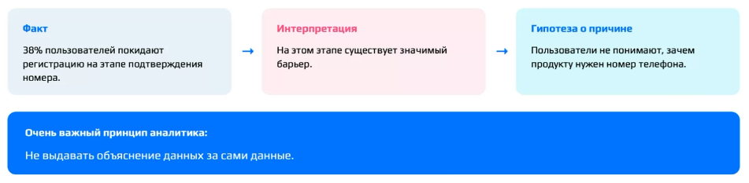

Отсюда важная профессиональная привычка — маркировать уровень утверждения: «мы видим…», «это может означать…», «одна из гипотез…». Когда выводы доносятся до других людей в такой форме, команда не начинает принимать правдоподобное объяснение за доказанный факт.

Потренируемся на кейсе оформления заказа в сервисе доставки. Фраза «после отображения полной стоимости 22 % новых пользователей прекращают оформление» — это факт: мы просто посмотрели на воронку. «На этом шаге заметная потеря пользователей» — интерпретация. «Пользователей раздражает стоимость доставки» — гипотеза. Даже если кажется, что это «инфа сотка», это всё равно гипотеза.

### Пара слов о воронке

Воронка уже несколько раз встречалась, поэтому разберём её на пальцах. Допустим, люди покупают билеты на концерт. На сайт зашли 1000 человек. Из них 800 перешли на страницу конкретного концерта, 600 дошли до выбора места, и только 100 действительно купили билет, то есть закончили оформление. Между этими шагами могут быть и другие: оплата, ввод кода от карты. На пути от верха воронки к низу всегда теряется какой-то процент пользователей. Воронку, в которой до конца дошли бы сто человек из ста, трудно даже представить: даже если раздавать айфоны, кто-то решит, что это обман, и уйдёт.

::: {.qa title="Вопросы из зала"}
**Как правильно выделять шаги воронки?** Это сильно зависит от того, что вы хотите исследовать и насколько глубоко. Выделять отдельным шагом каждое действие пользователя нужно не всегда.
:::

[^n4a]: Примечание составителя: PWA (Progressive Web App) — веб-приложение, которое устанавливается из браузера и затем открывается с рабочего стола как обычное приложение.

## Описание пользователя: сегмент и персона

*Таймкод: 01:03:59 · слайды 12–14*

Исследование даёт много разрозненных наблюдений, и, чтобы команда могла ими пользоваться, их нужно свернуть в модели, которые описывают пользователя и его задачу. Таких моделей три: сегмент, персона и задача (job), которую человек пытается совершить. Это не взаимоисключающие подходы: каждый отвечает на свой вопрос, поэтому нельзя сказать, что один лучше другого.

**Сегмент** — группа пользователей с общими значимыми характеристиками. Это могут быть новые пользователи, активные создатели контента, пользователи определённого сценария, мамы, бабушки — любая группа, которую можно назвать. Сегмент отвечает на самый общий вопрос: какую группу мы рассматриваем.

**Persona (персона)** — модель характерного пользователя и его контекста, собранная на основе повторяющихся паттернов в данных и исследованиях. Она отвечает на другой вопрос: какие устойчивые особенности этой группы важны для продукта.

Третья модель описывает прогресс или задачу, которую человек пытается совершить в конкретной ситуации, и отвечает на вопрос, зачем он вообще ищет решение. Её подробно разберём в следующем разделе.

Вот как три модели выглядят на одном примере, сервисе доставки еды:

|Модель|На какой вопрос отвечает|Пример для доставки|
|:--|:-------|:---------|
|Сегмент|Какую группу мы рассматриваем|Новые пользователи доставки|
|Персона|Какие устойчивые особенности группы важны для продукта|Занятой пользователь, которому важны скорость выбора и предсказуемость|
|Задача (job)|Зачем человек ищет решение в конкретном контексте|Вечером, после работы, быстро организовать ужин без готовки|

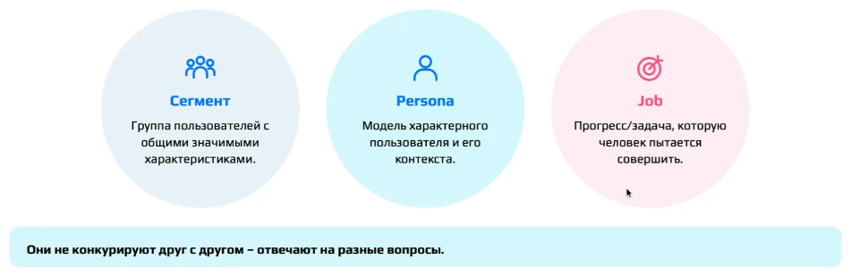

### Что включать в персону

Персону часто превращают в литературного персонажа, и так делать нельзя. Типичный пример того, чего делать не надо: «Мария, 29 лет, любит кофе, путешествия и сериалы», да ещё с картинкой, где у Марии голубые волосы. Беда не в возрасте и не в кофе как таковых, а в том, что эти детали никак не объясняют продуктовую задачу. Возраст или любовь к кофе стали бы важны, только если бы на них опиралась какая-то гипотеза. Без этого такое описание ничего не сообщает команде.

Хорошая персона содержит то, что действительно связано с продуктом: контекст, цели, мотивацию, поведение, потребности и барьеры. Правило отбора простое: **если характеристика не помогает объяснять продуктовую задачу, она лишняя**.

Для сервиса доставки значимыми могут оказаться такие черты: человек заказывает вечером после работы (это его паттерн поведения), часто сравнивает несколько вариантов, чувствителен к сроку доставки и хочет заранее понимать полную стоимость. А цвет глаз или любимый сериал не помогают принимать никаких решений.

**Важно:** даже доход стоит включать в персону только тогда, когда есть основания считать, что он объясняет различия в поведении или потребностях. «Пользователю важна прозрачность цены» — не то же самое, что «у пользователя низкий доход». Есть люди с низким доходом, совершенно финансово безграмотные, которые каждый вечер заказывают самую дорогую доставку. Если у дохода в конкретном контексте есть разумное объяснение, его включают, если нет — это ещё одна «Мария, 29 лет».

### Персона строится на данных

Персона — не придуманный персонаж. Её основания — исследования, наблюдаемое поведение, данные и устойчивые паттерны, которые из них выделяются. **Важный вывод:** персона — модель реального паттерна поведения, а не литературный портрет.

Если мы поговорили с одним человеком, то получили кейс одного пользователя, а не персону. Чтобы говорить о модели характерного пользователя, нужна повторяемость: несколько источников должны показывать схожий контекст, цели, барьеры и поведение. Один человек может оказаться исключением, поэтому персону не строят из одного яркого интервью, а ищут повторяющиеся истории: одинаковый контекст, одинаковый способ решения, одинаковые боли.

Персону удобно понимать как компрессию реальности. Мы берём множество наблюдений и собираем из них удобную модель, которая помогает команде помнить, для какого паттерна поведения она проектирует решение. Но модель не должна подменять реальных пользователей.

Пример из мессенджера: если в серии интервью видно, что пользователи пришли в мессенджер ради конкретного рабочего чата, не планируют менять основной мессенджер и почти не исследуют остальные функции, это уже возможный устойчивый паттерн, из которого может вырасти персона.

Хорошая практика — хранить рядом с персоной её основания: какие исследования и какие поведенческие признаки её поддерживают. Тогда через полгода команда сможет отличить, где данные, а где устаревшая легенда.

::: {.qa title="Вопросы из зала"}
**Если в свойства сегмента можно добавлять сколько угодно характеристик, чем он отличается от персоны?** Сегмент действительно можно сужать характеристиками хоть до трёх человек, и он всё равно останется сегментом. Но сегмент — это просто набор общих признаков, по которым людей объединяют, например для исследования. Персона же описывает типичного пользователя: его характеристики показывают, как ведёт себя и чего добивается характерный представитель группы.[^n5a]

**Верно ли, что сегмент отвечает на вопрос «кто наш клиент», а персона описывает, как он принимает решение о покупке?** В целом да, кроме одного: сегмент — не всегда ответ на вопрос «кто наш клиент». Это может быть просто объединение людей с определёнными характеристиками. Например, можно собрать сегмент тех, кто меньше всего пользуется продуктом, чтобы подробнее их исследовать.
:::

[^n5a]: Примечание составителя: проще говоря, сегмент задаётся фильтром по признакам и может быть сколь угодно узким, а персона — обобщённый портрет повторяющегося поведения, мотивов и барьеров, выведенный из данных; внутри одного сегмента может оказаться несколько разных персон.

## Jobs to Be Done и job story

*Таймкод: 01:09:51 · слайды 15–19*

### Основная идея: смотреть на прогресс, а не на продукт

Третий способ описать пользователя, после сегмента и персоны, — **Jobs to Be Done (JTBD)**. Основная идея подхода: пользователь выбирает продукт, чтобы совершить определённый прогресс в конкретной ситуации. Сам продукт для него только средство. Поэтому смотреть нужно не на продукт, а на этот прогресс, то есть на задачу, которую человек пытается решить. Такую задачу называют **[джобой (job)]{.gl key="Джоба (job)"}**.

Разница хорошо видна на переформулировках. Человеку нужен не мессенджер, а возможность быстро договориться с группой людей. Ему нужен не сервис доставки, а способ организовать ужин, когда готовить не хочется. В первом варианте каждой пары названа категория продукта, во втором — задача, ради которой его выбирают.

Зачем такой сдвиг взгляда? Причин три.

- IT-продукты меняются, а задача может оставаться прежней. Мессенджеры, интерфейсы и технологии приходят и уходят, а потребность договориться с группой людей остаётся.
- Если определять рынок через категорию продукта, круг конкурентов получается слишком узким. Если определять его через джобу, становятся видны реальные альтернативы, из которых выбирает пользователь.
- JTBD особенно полезен, когда команда слишком привязалась к собственной реализации и перестала видеть задачу шире интерфейса.

Классический пример для объяснения JTBD — дырка в стене[^n6a]. Пусть джоба — сделать в стене отверстие. Сколько существует способов её выполнить? Можно вызвать мастера, взять дрель, перфоратор или молоток, ударить чем-нибудь тяжёлым, проковырять ложкой, прожечь лазером. Способов очень много, а джоба одна. Конечно, при поиске конкурентов этот пример не стоит понимать буквально: соседа, который может просверлить вам дырку, в конкуренты не записывают. Но для IT-продуктов размышление от джобы, а не от функции, заметно расширяет круг конкурентов. К этому мы ещё вернёмся.

[^n6a]: Примечание составителя: пример восходит к известной фразе, которую приписывают маркетологу Теодору Левитту: «Людям не нужна дрель диаметром в четверть дюйма, им нужно отверстие в четверть дюйма».

### На каком уровне формулировать джобу

Человек редко хочет дрель как предмет, ему нужно отверстие. Но и отверстие — не обязательно конечная цель. Возможно, он хочет повесить полку, организовать хранение, сделать квартиру удобнее. А может быть, ему просто кажется, что по фэншую так лучше. Цепочку «а зачем?» можно продолжать долго, и на каком уровне остановиться, зависит от продуктового вопроса.

Сравним формулировки для мессенджера. «Хочу отправлять сообщения» — слишком близко к функции продукта, такая джоба почти ничего не добавляет к описанию самого мессенджера. Содержательнее так: «мне нужно быстро согласовать планы с несколькими людьми; я хочу собрать обсуждение в одном месте, чтобы не договариваться с каждым отдельно». С доставкой то же самое: «хочу заказать еду» — это почти название категории. Джоба звучит иначе: «когда после работы нет сил готовить, я хочу быстро организовать ужин на двоих, чтобы поесть без дополнительных усилий».

**Важно:** JTBD не означает бесконечно спрашивать «зачем?». Если довести цепочку до «хочу быть счастливым», получится джоба, которая верна для любого продукта и потому бесполезна для продуктовой команды. Нужен уровень, на котором задача стабильна, но всё ещё позволяет сравнивать реальные альтернативы.

### Job story

Удобная форма записи джобы — **job story**. Её формат:

> Когда [ситуация], я хочу [мотивация / действие], чтобы [ожидаемый результат].

Пример: «Когда я еду в метро без стабильного интернета, я хочу заранее сохранить материалы, чтобы продолжить обучение в дороге». Разберём его по частям. «Когда я еду в метро без стабильного интернета» — это не демография, а контекст, в котором возникает задача. «Хочу заранее сохранить материалы» — желаемое действие. «Чтобы продолжить обучение в дороге» — ценность, ради которой это действие вообще нужно.

Последняя часть обязательна. Хорошая job story помогает не потерять причинную логику: если убрать «чтобы», мы рискуем оптимизировать действие, не понимая, какой результат за ним стоит.

Попробуем сформулировать job story для заказа такси или доставки еды. Вот несколько формулировок и что с ними не так.

- «Когда у меня заканчивается зарплата, я хочу вызвать тариф, где можно ехать с попутчиками, чтобы сэкономить деньги». История хорошая, но «тариф» — это уже функциональность продукта. Люди не обязательно мыслят тарифами.
- «Когда я опаздываю, мне нужно быстро и без задержек заказать такси из любой точки Москвы в любую другую». Здесь нет части «чтобы», то есть нет ожидаемого результата.
- «Когда я возвращаюсь домой, я хочу выбрать сохранённый адрес в такси, чтобы вызвать такси быстрее». Мысль слишком уходит в сторону фич. Сохранённый адрес — это решение, а не задача.
- «Когда я еду в аэропорт, я хочу воспользоваться транспортом от двери до двери». Снова функциональность, а не проблема, и снова нет «чтобы».
- «Когда я долго жду автобус, я хочу заказать такси, чтобы быстрее приехать домой»; «когда ребёнок ночью заболел, я хочу вызвать такси, чтобы отвезти его в больницу»; «когда хочется пиццы, я заказываю доставку, чтобы не тратить время на поход в кафе». Это рабочие формулировки: есть ситуация, действие и результат.
- «Когда хочу есть, я хочу быть уверена, что еда придёт, чтобы не волноваться и не быть злой». Хорошая формулировка, в ней есть и эмоциональная сторона. Добавим только, что еда должна прийти ещё и в нужном качестве: бывает, что привозят бургер без котлеты.

**Акцент лектора:** формулируйте проще — как люди, а не как продуктовые аналитики. В части «я хочу» должно стоять действие или мотивация словами пользователя, а не фича или тариф продукта. Часть «чтобы» обязательна.

### Три измерения джобы

У потребности несколько измерений, и джобу можно рассматривать с трёх сторон:

- **[Functional Job]{.gl key="Functional / Emotional / Social Job"}** отвечает на вопрос «что я хочу сделать?», например добраться до аэропорта;
- **Emotional Job** — «как я хочу себя чувствовать?», например спокойно, без тревоги, что опаздываю;
- **Social Job** — «как я хочу выглядеть в глазах других?».

Покупка автомобиля может одновременно решать все три задачи. Функциональная джоба — перемещаться безопасно и удобно, эмоциональная — чувствовать уверенность и комфорт, социальная — транслировать определённый образ, статус, принадлежность.

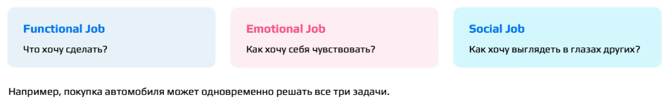

Интуиция здесь такая: человеческий выбор редко определяется одной функциональностью. Бывает, что два решения одинаково хорошо выполняют функцию, а выигрывает то, которое лучше закрывает эмоциональное или социальное измерение. При этом такие измерения есть не только у «статусных» продуктов. В B2B аналитик хочет не просто построить отчёт, но и чувствовать контроль над ситуацией, выглядеть компетентным перед руководителем, и продукт может закрывать и это.

Две оговорки. Во-первых, не нужно искусственно находить все три джобы для каждой задачи. Во-вторых, и это **важно**, нельзя придумывать психологию пользователя. Если мы пишем «хочет чувствовать статус», это должно опираться на наблюдения. Измерения помогают задавать вопросы, но ни в коем случае не дают разрешения додумывать мотивы.

### Кто наши конкуренты

С точки зрения JTBD конкурент — не обязательно похожий продукт. Возьмём джобу «занять себя в дороге». Её выполняют YouTube, Rutube, VK Видео, музыка, книга, игра, соцсети, судоку, которое человек возит в сумке, и даже сон: в метро можно просто поспать. Для доставки еды альтернативы — не только другая доставка, но и готовая еда из магазина, ресторан рядом, повар, который раз в неделю приходит и готовит на всю семью. Это тоже конкуренты.

Получается, что круг альтернатив шире прямых продуктовых конкурентов: пользователь сравнивает не логотипы компаний, а разные способы совершить нужный прогресс. Такой взгляд меняет анализ рынка и помогает переосмыслить собственный продукт.

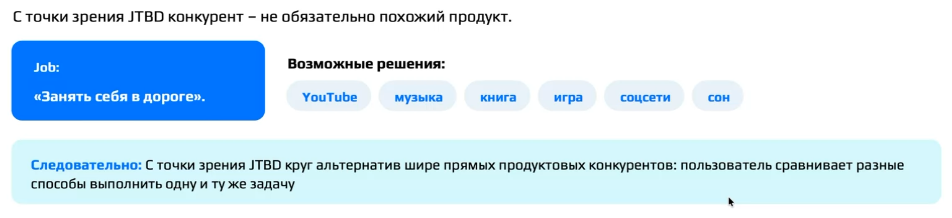

**Важный вывод:** полезно регулярно задавать себе вопрос: что человек делал бы, если бы нашего продукта просто не существовало?

### Persona и JTBD

Персона и JTBD не исключают друг друга, их можно использовать совместно, потому что они отвечают на разные вопросы. Персона описывает, кто пользователь, как он себя ведёт, какие его особенности важны и какие у него барьеры. JTBD описывает, в какой ситуации возникает задача, какого прогресса человек хочет, почему он ищет решение и какой результат ему нужен.

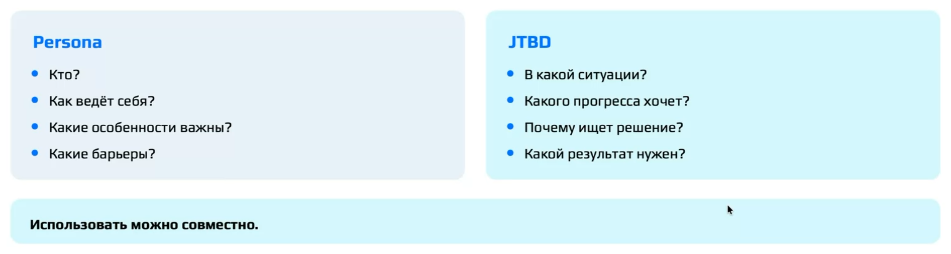

Один и тот же человек может иметь разные джобы в разных ситуациях. И наоборот, одна джоба бывает у людей из совершенно разных демографических групп. Поэтому не стоит искать единственно правильный инструмент. Под конкретный вопрос выбирают ту модель или то сочетание моделей, которое на него лучше отвечает.

## Customer Journey Map

*Таймкод: 01:43:00 · слайды 20–27*

### Опыт пользователя — это путь

До сих пор мы описывали пользователя: кто он, в какой ситуации находится, какую джобу решает. Следующий шаг — соединить пользователя, контекст и задачу **во времени**, то есть смотреть не на отдельный экран, а на весь путь к цели.

Пользователь не воспринимает продукт как набор экранов. У команды есть «экран чатов» и «экран звонков», у пользователя такого нет — у него есть путь от возникновения потребности до достижения цели. Причём часть этого пути проходит до того, как человек вошёл в продукт, и после того, как он из него вышел. Пользователь не думает категориями наших команд. В пути выделяют ситуацию, цель, действия, точки контакта и результат.

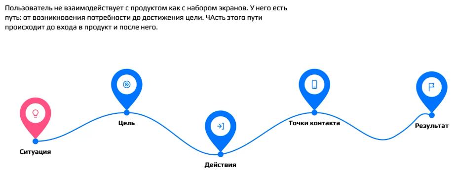

Возьмём покупку подарка. Путь начинается не с открытия интернет-магазина. Сначала возникает ситуация: скоро у друга день рождения. Человек вспоминает интересы друга, ищет идеи, спрашивает знакомых, сравнивает магазины и только потом оплачивает. На оплате опыт тоже не заканчивается: дальше доставка, распаковка, иногда возврат. Всё это части одного пути.

Где у пути начало и конец, зависит от исследовательского вопроса. Если строить карту только от главной страницы до оплаты, можно упустить, что ключевая причина выбора возникла ещё до входа в продукт. Покупка билетов, например, начинается не в приложении. Друг, лёгкий на подъём, пишет: «Давай махнём в Петербург? Белые ночи, мосты!» Дальше согласуют даты и бюджет, сравнивают самолёт и поезд (с самолётами проблемы, на поезда билетов нет), и только потом открывают сервис, смотрят события и сверяются со своими календарями. Продукт видит лишь кусок этого пути, и команда легко принимает первый экран за начало задачи.

После транзакции путь тоже продолжается. В доставке это ожидание, получение заказа, решение проблем, повторный заказ. В образовании покупка курса на условном Stepik — только начало ценности: пользователю ещё нужно начать учиться, пройти материал и получить результат.

### Что такое CJM

**Customer Journey Map (CJM)** — визуальная модель пути пользователя к определённой цели. Она собирает в одну структуру действия, цели и контекст пользователя, его мысли, эмоции и барьеры, помогает находить точки роста. Но главное — CJM **выравнивает понимание внутри команды**. Каждый видит в одном и том же сценарии своё: продакт — бизнес-воронку, дизайнер — интерфейс, аналитик — события, поддержка — обращения. Карта заставляет всех посмотреть на один и тот же путь глазами пользователя.

**Акцент лектора:** CJM — это не карта экранов. Если человек сравнивает варианты через поиск, спрашивает друга, открывает приложение, а потом звонит в поддержку, всё это может быть частью одного пути. CJM описывает опыт пользователя, а не экраны продукта.

### Сначала границы

Прежде чем строить карту, обязательно задают её границы. Для этого отвечают на шесть вопросов:

1. Кто пользователь?
2. В какой ситуации он находится?
3. Какую цель хочет достичь?
4. Где начинается рассматриваемый путь?
5. Где он заканчивается?
6. Какие каналы взаимодействия и точки контакта включаем?

Типичная ошибка звучит так: «Построим CJM нашего приложения». Это слишком широко, потому что приложение закрывает десятки сценариев. В MAX, например, можно позвонить, написать сообщение, выложить сторис, смотреть контент в каналах, пользоваться госсервисами. Сценариев миллион. Построить CJM всего приложения можно, но бесполезно. Нужен конкретный путь. Например: пользователь — студент, цель — купить онлайн-курс, путь — от первого контакта с рекламой (или от момента, когда возникла потребность, в зависимости от вопроса) до начала обучения. Такие границы задают рабочий масштаб. Без них карта разрастается до бесконечности и смешивает разные джобы и сегменты.

### Из чего состоит карта

Основа карты — **этапы пути**, то есть логические шаги пользователя к цели. Всё остальное записывается относительно каждого этапа:

- **цели** — чего пользователь хочет достичь на этом этапе;
- **действия** — что он реально делает;
- **точки соприкосновения** — где он взаимодействует с продуктом или брендом;
- **мысли и эмоции** — что он думает и чувствует в этот момент, если у нас есть такие наблюдения;
- **точки боли** — барьеры, которые мешают ему в этот момент;
- **возможности для улучшения** — где есть пространство, чтобы сделать лучше (подробнее о них — в следующем разделе).

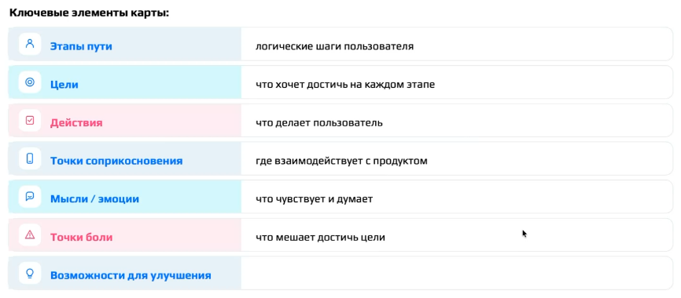

**Важно:** таблицу не заполняют ради заполнения. Во многих CJM часть полей остаётся пустой, потому что реально доказанного знания нет. Если мы не знаем эмоцию пользователя, лучше написать «нет данных», чем придумать «раздражён». CJM — исследовательская модель, а не художественное упражнение. Её наполняют из глубинных интервью, обращений пользователей и количественных исследований.

Разберём один этап доставки еды — «Сравниваю рестораны»:

| Строка карты | Содержание |
|:--|:----------|
| Цель | исключить неподходящие варианты |
| Действия | открыть несколько карточек, посмотреть меню, сроки, цены |
| Точки соприкосновения | каталог, карточка ресторана, отзывы |
| Мысли | «Сколько выйдет в итоге? Когда привезут?» |
| Точка боли | важные критерии приходится собирать в разных местах |
| Возможность | упростить сравнение по критериям, по которым принимается решение |

Точка боли здесь — то, что на этом этапе пользователю неудобно, некомфортно, мешает. Возможность — направление улучшения, и она должна быть конкретной: формулировка «неудобно выбирать» слишком общая и почти ничего не даёт. Частая ошибка — смешивать строки. Действие — это то, что человек делает; мысль — то, что он думает или говорит; боль — то, что ему мешает; цель записывается отдельно.

### Этапы пути ≠ экраны

С продуктовой точки зрения путь легко описать как «Главная → Каталог → Карточка → Корзина → Оплата». Наверняка у вас сразу возникла картинка, как это выглядит на сайте или в приложении. Но это структура интерфейса. Пользователь мыслит иначе: «Возникла потребность → Ищу варианты → Сравниваю → Выбираю → Покупаю → Получаю».

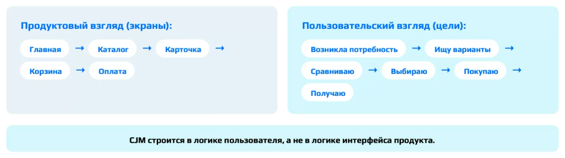

Один пользовательский этап пересекает несколько экранов и каналов. На этапе «Сравниваю» человек может открыть десять карточек, уйти в поисковик, почитать отзывы и вернуться. **Важный вывод:** если строить CJM по экранам, мы рискуем оптимизировать навигацию, не понимая реальной цели шага. CJM строится в логике пользователя, а не в логике интерфейса.

Попробуйте описать путь заказа еды в терминах целей пользователя, а не экранов. Частая ошибка в таком упражнении — ответ вроде «захожу в Лавку, в Самокат…». Это уже точки соприкосновения, их записывают внутрь конкретного этапа. Сам этап должен звучать как шаг к цели: «захотелось поесть → ищу, где заказать → выбираю категории внутри магазина → сравниваю магазины». Таргетная реклама, кстати, тоже входит в CJM: взаимодействие с баннером — это точка контакта.

::: {.qa title="Вопросы из зала"}
**CJM — это то же самое, что воронка?** Нет. CJM можно рассматривать как воронку, если так её построить, но воронка описывает экраны или логические шаги внутри нашего приложения. А в CJM на этапе сравнения человек может уйти куда угодно, вплоть до поиска отзывов в каком-нибудь канале.

**CJM — аналог LTV?** Нет. LTV — метрика, связанная со временем жизни пользователя в продукте (её разберём в лекции про метрики). CJM — путь пользователя к конкретной цели.
:::

### Точки контакта

Точки контакта называют по-разному: точки соприкосновения, точки пересечения, **[touchpoints]{.gl key="Точки контакта (touchpoints)"}**. Суть одна: это места, где пользователь соприкасается с продуктом, брендом, маркой. Далеко не всегда они находятся внутри приложения. Это реклама, поисковая выдача, сайт, приложение, email, push-уведомления, поддержка, доставка — и даже курьер, который привёз суп. Значительная часть опыта пользователя может происходить вне основного интерфейса.

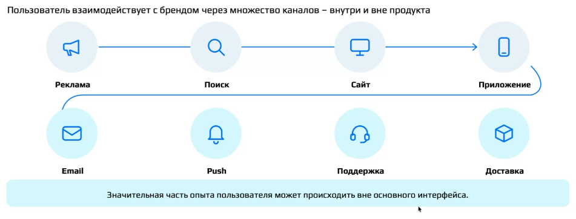

Идеально оформленный чекаут не спасёт впечатление, если курьер опоздал на два часа: еда остыла, и суп уже не нужен. Плохое письмо после покупки может породить обращение в поддержку, хотя сама покупка прошла безупречно. Поэтому в исследованиях полезно отдельно спрашивать, где пользователь получает информацию и где взаимодействует с нами на каждом этапе.

Бывает, что каналы противоречат друг другу. Реклама обещает «доставка бесплатно», в приложении обнаруживается минимальная сумма заказа, push-уведомление формулирует условия по-другому, а поддержка объясняет ещё одно, третье правило. Каждый экран по отдельности понятен, но в рамках одной задачи опыт противоречив. CJM позволяет увидеть такие разрывы между каналами и командами: иногда проблема не в одной точке контакта, а в несогласованности обещаний рекламы, продукта, уведомлений и поддержки.

### Точки боли и их оценка

**Pain point (точка боли)** — конкретный барьер, который мешает пользователю достичь цели. Чтобы не собирать бесконечный список жалоб, каждый барьер оценивают минимум по трём измерениям — **Frequency / Severity / Impact**:

- **Frequency** — как часто барьер возникает;
- **Severity** — насколько сильно он мешает конкретному пользователю;
- **Impact** — к каким последствиям для поведения и продукта он приводит.

Редкая, но критическая ошибка оплаты может оказаться важнее частого мелкого неудобства. И наоборот: минимальное изменение, которое каждый день затрагивает миллионы пользователей, может дать огромный совокупный эффект. **Важный вывод:** сам факт жалобы ещё не определяет приоритет проблемы, нужно учитывать масштаб и последствия.[^n7a]

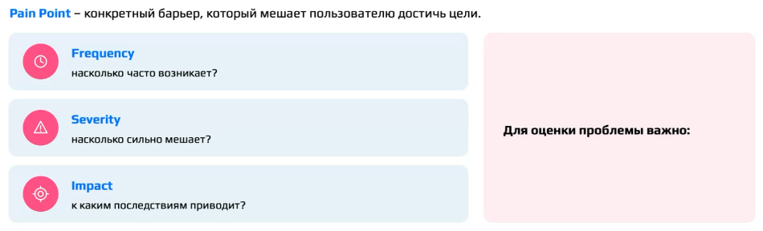

### Moments of Truth

**Moments of Truth** (моменты истины) — точки пути, которые непропорционально сильно влияют на восприятие продукта, дальнейшее поведение и решение продолжить или прекратить взаимодействие. Например:

- **первая успешная покупка**: если она прошла легко, пользователь получает удовлетворение и подтверждение, что сервису можно доверять;
- **первая ошибка оплаты**, наоборот, разрушает доверие: «что-то с сервисом не так»;
- **получение заказа** — момент, когда обещание цифрового интерфейса сталкивается с физической реальностью. Заказываешь бургер, видишь красивую картинку, а привозят что-то непонятное. Если это был первый заказ, доверия больше нет: картинкам сервиса уже не веришь и при каждом следующем заказе ждёшь, что что-то пойдёт не так;
- **первый конфликт с поддержкой**.

Не каждая точка пути — момент истины, это именно точки повышенного влияния. На многих CJM их не выделяют, но выделять полезно: одно и то же улучшение на разных этапах может иметь разную продуктовую ценность. Опоздание доставки на первом заказе может стать моментом истины, потому что доверие ещё не сложилось и именно этот момент формирует впечатление обо всём сервисе. То же опоздание на 15 минут у постоянного клиента даёт совсем другой эффект. В банке моментами истины могут быть первая неуспешная операция, первое обращение по спорной транзакции, первый визит в отделение.

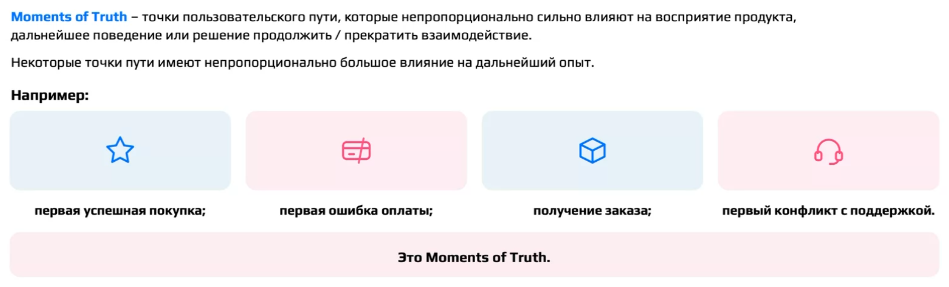

**Важно:** момент истины — не просто этап, который команда назвала важным. Желательно проверить, действительно ли опыт в этой точке непропорционально связан с дальнейшим поведением или восприятием.

[^n7a]: Примечание составителя: как свести три оценки в один приоритет, здесь не уточняется. Сравнивать и упорядочивать проблемы помогают методы приоритизации, которые разбираются на семинаре.

## От барьеров к возможностям: CJM на практике

*Таймкод: 02:01:38 · слайды 28–33*

### Возможность: шаг между барьером и решением

Когда на карте найден барьер, очень хочется сразу перейти к фиче. Но между барьером и решением полезно поставить промежуточный уровень. Цепочка выглядит так: барьер — пользователь не понимает итоговую стоимость до последнего шага; потребность — понимать стоимость до того, как принято решение; возможность — сделать стоимость прозрачной раньше. И только после этого появляются варианты решений.

**[Opportunity (возможность)]{.gl key="Opportunity (возможность)"}** — формулировка того, что можно улучшить в опыте пользователя. Она остаётся близкой к проблеме, но намеренно не говорит, *как* это сделать. Возьмём Самокат: внизу справа там всё время видна текущая сумма корзины вместе с доставкой. Это одно из решений, но возможность «сделать стоимость прозрачной раньше» допускает и другие: показывать стоимость доставки в листинге, прогнозировать итог, добавить фильтр, объяснять условия бесплатной доставки. Если вместо возможности сразу написать «добавить плашку с доставкой», мы снова преждевременно привязываемся к одному решению.

Пример из мессенджера. Барьер: новому участнику активного группового чата трудно понять, что происходило до его прихода. Плохой ход — сразу сказать «сделаем AI summary»: технология уже выбрана. Правильная возможность звучит так: помочь новому участнику быстро восстановить значимый контекст разговора. Под неё подходят разные решения: закреплённый итог, выделение ключевых сообщений, саммари, онбординг от администратора, тред с итогами. В этом и польза opportunity: она близка к проблеме, но не зашивает в себе реализацию.

Тот же ход для доставки. Pain point: дополнительные расходы становятся понятны слишком поздно. Представьте: вы точно знаете, что набрали товаров на 300 рублей, переходите в корзину или уже к оплате, а там 349. Вы не знали, что доставка платная, а больше 300 рублей у вас нет. Возможность здесь — сделать полную стоимость предсказуемой раньше. Только после этого обсуждаем решения: показывать доставку прямо в выдаче, прогнозировать полную сумму или вообще повесить плашку ещё до начала заказа: «кстати, доставка у нас платная».[^n8a]

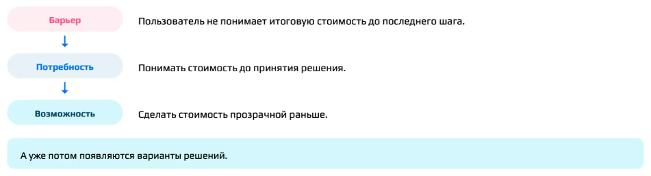

[^n8a]: Примечание составителя: по сути это та же граница между Problem Space и Solution Space. Возможность — последняя формулировка, которая ещё описывает проблему, а не решение.

### CJM опирается на данные

Карта — не художественное произведение, в ней ничего не придумывают. Она строится на реальных источниках: продуктовые данные о поведении пользователей, интервью, usability-тесты, опросы, обращения и отзывы пользователей, рыночные и конкурентные данные. А фраза вроде «мне кажется, здесь пользователь злится» в качестве основания не годится. CJM — исследовательская модель, а не упражнение на фантазию.

Важно различать виды свидетельств. Если пользователь на интервью прямо сказал «я разозлился», это наблюдаемое свидетельство его самоотчёта, и его можно брать, но только если такое повторяется у разных людей: история одного человека не подходит. Если же в данных видно, что пользователь несколько раз возвращается назад, это поведенческое наблюдение, но эмоцию из него автоматически вывести нельзя. Хорошая практика — для каждой важной ячейки карты уметь ответить на вопрос «откуда мы это знаем?». Если ответа нет, ячейку помечают как предположение и не выдают за факт.

### Как выглядит карта

Чаще всего CJM оформляют таблицей. Её удобно собирать, например, в Miro из стикеров. В шаблоне для покупки товара по горизонтали идут этапы: потребность, поиск, сравнение, выбор, оплата, получение, период после покупки. По вертикали для каждого этапа фиксируют действие, точку контакта (touchpoint), эмоцию (emotion), боль (pain) и возможность (opportunity). Этот шаблон развивает классический e-commerce-путь Awareness → Consideration → Purchase → Post-purchase → Loyalty.

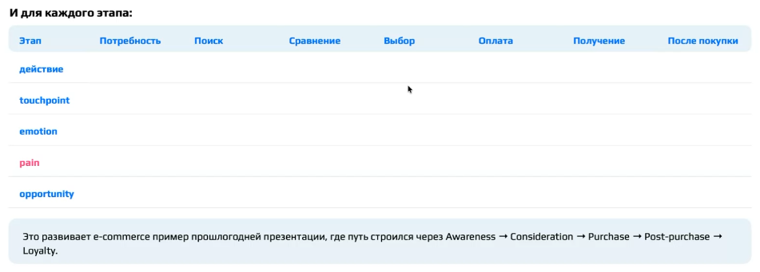

Набор строк не универсален. Opportunity, например, выносят далеко не все, а в конкретном исследовании можно добавить ожидания, вопросы, каналы, метрики, наблюдения, владельца, проблемы — всё, что важно для вашего исследовательского вопроса. Базовая логика при этом одна: на каждом этапе мы связываем цели и действия пользователя с его опытом и барьерами. Заполняя такой шаблон, стоит у каждой записи подписывать источник: так вырабатывается дисциплина.

Реальные карты выглядят по-разному. В карте «Music Sharing Experience» этапы такие: Visit, Listen, Discover, Share, Discuss, Receive, Respond, а строки — steps, thoughts, touchpoints, actors, emotions. Эмоции на ней нарисованы кривой со смайликами, так команды наглядно видят, на каких этапах проседает пользовательский опыт. А «карта впечатлений» Starbucks, которую тоже называют CJM, устроена совсем иначе: элементы разбросаны, и читается она с трудом. Отсюда главный вывод: смысл не в красоте схемы и не в количестве стикеров, а в том, чтобы путь пользователя стал понятным. Если простая таблица отвечает на исследовательский вопрос, она лучше сложного плаката. Карту оценивают не по дизайну, а по тому, помогает ли она увидеть путь, барьеры и возможности.

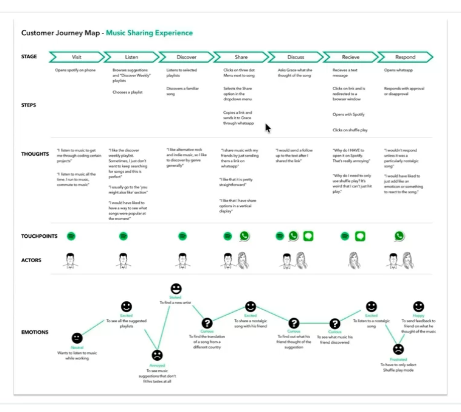

Ещё один пример полезно разобрать критически. Иван Петров, 30 лет, живёт в Москве, средний достаток, покупает другу подарок в интернет-магазине. В карте есть точки контакта, этапы, кривая эмоций, чувства, ожидания, барьеры и «преодоление препятствий». Во-первых, часть элементов (конкретные эмоции, причины барьеров) похожа на гипотезы команды, и в реальном проекте нужно спросить, на каких данных они основаны. Во-вторых, в нижней строке уже стоят решения: SEO-статьи, фильтрация каталога, сжатие изображений, работа со службами доставки. Это следующий уровень, он начинается после диагностики проблемы. Нельзя считать, что CJM сама доказала нужность именно этих решений: скорее всего, их выписали по итогам мозгового штурма. Карта хороша как структура мышления, но каждой причинной связи и каждому решению нужно отдельное основание.

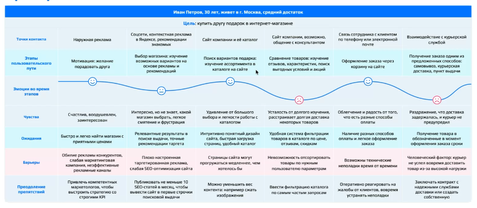

### Типичные ошибки CJM

Чаще всего ошибаются так:

- **строят карту по экранам** — подменяют путь пользователя архитектурой интерфейса;
- **используют только мнение команды** — исследование превращается в коллективную фантазию;
- **смешивают несколько разных сценариев** или **объединяют разные сегменты пользователей** — получается усреднённый пользователь, которого не существует;
- **придумывают эмоции и потребности** — каким-то этапам придаётся слишком большое значение, которого на деле может не быть;
- **пытаются описать весь продукт** — теряется исследовательский фокус;
- **строят карту без данных** и **путают проблему и решение**;
- **считают CJM конечным результатом**.

Последняя ошибка особенно важна. Карта сама по себе ничего не улучшает. Она должна помочь найти барьер, сформулировать возможности, построить гипотезу и принять решение о следующем шаге.

Какая из ошибок самая опасная? Чаще всего называют одну и ту же группу: придумывать, строить без данных, опираться только на мнение команды, на экспертное мнение или на собственные ощущения, делать выводы по малому количеству данных. С этим стоит согласиться. В лучшем случае такое исследование окажется бессмысленным, в худшем — мы потратим ресурс на проверку гипотез и реализацию решений, которые никому не нужны.

::: {.qa title="Вопросы из зала"}
**Часто ли вы сами делаете CJM?** В MAX карты строит отдельная команда исследований, продуктовые аналитики работают с её результатами.
:::

## От симптома к точке роста

*Таймкод: 02:11:54 · слайды 34–38*

Мы научились видеть путь пользователя и барьеры на нём. Теперь следующий вопрос: как не перепутать симптом с причиной и не прыгнуть с первого же наблюдения в первую пришедшую в голову фичу.

### Симптом ≠ причина

То, что мы наблюдаем в данных, — это **[симптом]{.gl key="Симптом / причина"}**: описание того, что происходит с показателем. Симптом не всегда и есть реальная проблема, и за одним симптомом может скрываться несколько **причин** — того, что на самом деле вызывает изменение. Возьмём «падает конверсия в покупку». Это не объяснение, а констатация. Причины могут быть совершенно разными: цена, ассортимент, доставка, UX, техническая ошибка, доверие, способ оплаты, и если подумать ещё, можно нагенерировать хоть сотню вариантов.

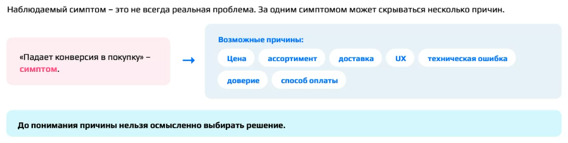

Есть и тонкость: если падение начинается на одном экране, причина может находиться раньше. Пользователь дошёл до оплаты и отказался — но отказался из-за стоимости доставки, которую увидел только сейчас. Экран оплаты здесь лишь место, где проявилось то, что сломалось на предыдущих шагах.

Пока у нас нет понимания причины — хотя бы набора вероятных причин, — осмысленно выбрать решение невозможно. Поэтому, когда аналитик обнаружил аномалию, его работа не заканчивается, а только начинается.

Кейс из мессенджера. Упало количество отправленных сообщений на пользователя. Классическая первая реакция: люди стали меньше общаться. Но метрика могла упасть и по другим причинам:

- изменился состав аудитории: пришло много новых пользователей с низкой интенсивностью общения;
- случился платформенный инцидент;
- часть общения ушла в звонки;
- изменилось логирование событий;
- вырос знаменатель.

Диагностика здесь идёт слоями. Когда началось падение? На каких платформах? У каких когорт? Что изменилось — числитель или знаменатель? Какие соседние метрики сдвинулись? Были ли релизы или внешние события — может быть, на нас плохо повлиял новостной фон?

Так же устроено и падение retention: это симптом, а не инструкция «переделать наш онбординг». **Важный вывод:** ценность аналитика в том, что он не принимает название метрики за объяснение причины. В хорошей продуктовой команде, если прийти к продакту только с симптомом, он разведёт руками: «Ну упал retention, хорошо. А почему? Зачем ты пришёл ко мне с этой информацией? Пугаешь — так пугай до конца».

### Метод 5 «Почему?»

Простой способ не останавливаться на первом правдоподобном объяснении — **метод 5 «Почему?»**. Мы последовательно задаём вопрос «почему?», чтобы перейти от наблюдаемого симптома к более глубоким гипотезам о причинах.

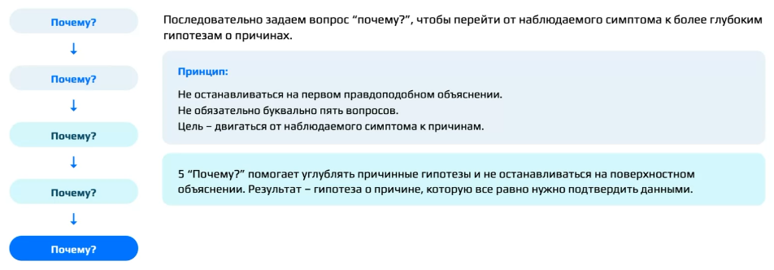

Пример из доставки еды:

1. Пользователи бросают оформление заказа. Почему? — Они видят неожиданную стоимость.
2. Почему она неожиданная? — Стоимость доставки показывается только на позднем шаге.
3. Почему это важно? — До этого пользователь сравнивал варианты по цене блюд и уже сформировал ожидание о полной стоимости.

**Важно:** цепочка «почему» не превращает предположение в факт. Можно построить красивую причинную историю и при этом ошибиться. Поэтому результат метода — более глубокая гипотеза о причине, которую всё равно нужно проверять данными. И задавать ровно пять вопросов не обязательно: число — эвристика, а цель — углубиться в исследование и двигаться от симптома к причинам.

Метод годится не только для аналитики, но и для личной жизни. «Хочу пойти на концерт» — почему? «Давно не слышал любимого исполнителя»: всё ясно, причина понятна. А вот другой пример: «хочу купить новую шубу». Почему? «Потому что у других она уже есть». Почему важно, что она есть у других? «Потому что не хватает уверенности в себе и нужно подтверждение со стороны». Почему это важно? И тут докапываешься до того, что на самом деле это не важно.

### Где искать точки роста

**Точки роста** — места в продукте, где изменение может заметно улучшить результат. Искать их можно в дашборде, но не только. Источники такие:

1. пользовательские исследования;
2. продуктовые данные;
3. CJM;
4. обратная связь;
5. обращения в поддержку;
6. незакрытые потребности пользователей;
7. альтернативные сценарии;
8. рынок и конкуренты.

С конкурентами нужно быть аккуратными. Как уже говорилось, то, что конкурент сделал функцию, — ещё не точка роста. Это сигнал, из которого рождается вопрос: какую пользовательскую задачу они решают и существует ли она у нашей аудитории? Конкуренты не дают готовый бэклог. Вопрос не в том, «когда мы скопируем», а в том, какую проблему они пытаются решить, есть ли она у наших пользователей и какими фактами это подтверждается.

Сильная точка роста обычно возникает на пересечении нескольких источников. В данных мы видим высокий отказ, в интервью слышим повторяющийся барьер, а в обращениях встречаем ту же проблему — вот тогда это серьёзный кандидат.

И ещё одно: точка роста не обязательно там, где самая низкая конверсия. Этап с очень высокой конверсией затрагивает почти всю аудиторию, и улучшение на 1 процентный пункт даст на нём больший абсолютный эффект. А этап с конверсией 20% может быть нишевым и сознательно необязательным — тянуть его вверх просто незачем.

### Opportunity Solution Tree

Связать найденные возможности с решениями помогает **Opportunity Solution Tree** — дерево возможностей и решений[^n9a]. Оно разводит четыре уровня:

- **ожидаемый результат (Desired Outcome)** — какой результат мы хотим улучшить;
- **возможности (Opportunities)** — какие пользовательские проблемы и потребности могут привести к этому результату;
- **решения (Solutions)** — какие способы воздействия мы рассматриваем;
- **эксперименты (Experiments)** — как быстро получить наблюдения и факты о наших предположениях.

Наверху один результат, под ним несколько возможностей, под каждой — несколько решений, под каждым решением — эксперименты.

**Важный вывод:** для одной возможности полезно рассмотреть несколько альтернативных решений. Это защищает команду от привязанности к первой идее — к тому самому эффекту, о котором идёт речь на протяжении всей темы. Возьмём opportunity «сделать полную стоимость заказа предсказуемой раньше»: решений для неё мы уже придумали множество — показывать доставку в выдаче, прогнозировать итоговую сумму, предупреждать о платной доставке заранее. Когда вариантов несколько, команда может их сравнивать, а не защищать единственную придуманную фичу.

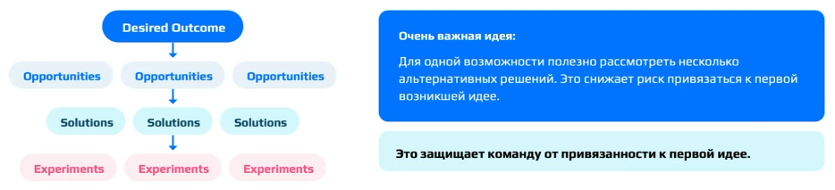

### От исследования к гипотезе

Теперь соберём всю цепочку вместе: наблюдение → потребность → pain point → причина → opportunity → варианты решений. После этого возникает следующий вопрос: как превратить выбранное предположение в то, что можно проверить?

В широком смысле гипотеза — это проверяемое предположение о пользователе, проблеме, решении или ожидаемом результате, истинность которого важна для принятия продуктового решения. Это определение шире привычного шаблона «если мы сделаем фичу X, метрика Y вырастет». Иногда, прежде чем проверять эффект решения, нужно проверить, существует ли проблема вообще, или нужна ли пользователям предполагаемая ценность. Поэтому дальше мы будем различать разные типы неопределённости.

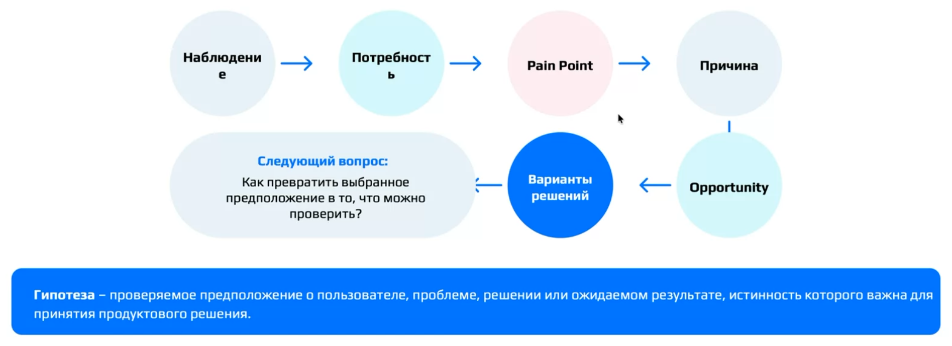

Пройдём цепочку без прыжков на сквозном примере доставки:

- *наблюдение:* новые пользователи часто возвращаются из корзины в каталог;
- *исследование:* часть из них только в корзине замечает дополнительные расходы;
- *pain point:* невозможно заранее оценить итоговую стоимость;
- *гипотеза о причине:* неожиданная сумма заставляет пересматривать выбор;
- *opportunity:* сделать расходы предсказуемыми раньше;
- *варианты решений:* несколько способов показать стоимость.

И только после этого формулируется гипотеза о выбранном изменении. **Акцент лектора:** если в цепочке внезапно появляется любимая фича команды, которую нельзя вывести из предыдущего шага, нужно спросить, откуда именно взялось это решение.

::: {.qa title="Вопросы из зала"}
**Кто и как решает, какая фича будет реализована, а какая нет?** Зависит от того, о какой фиче речь. Если это решение конкретной проблемы, то есть гипотеза, то перед разработкой фичи оценивают по моделям приоритизации, и в разработку берут то, что получило высокий приоритет. Приоритизация — тема почти на целую лекцию, она разбирается на семинаре. Если же фича уже лежит в бэклоге и гипотеза о том, что её нужно делать, уже проверена, всё сложнее: решение зависит от стратегии продукта, ранжирования гипотез, ресурсов команды и квартальных планов.
:::

[^n9a]: Примечание составителя: фреймворк Opportunity Solution Tree предложила Тереза Торрес (Teresa Torres), он подробно описан в её книге «Continuous Discovery Habits».

## Продуктовые гипотезы

*Таймкод: 02:24:52 · слайды 39–47*

К этому моменту у нас есть контекст проблемы и найденные возможности. Теперь задача в том, чтобы превратить предположение в форму, которую можно проверить и потенциально опровергнуть. Именно эту работу и делает гипотеза.

### Идея ≠ гипотеза

Начнём с различия, которое на практике часто стирается. «Добавим персональные рекомендации» — это идея. Она говорит, *что* сделать, но не говорит, для кого, какой результат ожидается и почему он должен возникнуть. В ней нет контекста, не отражён результат, не объяснено, почему это сработает, и поэтому её трудно проверить.

Сравним с другой формулировкой: «Если новым пользователям показывать персональные рекомендации, они быстрее найдут релевантный контент и чаще начнут взаимодействовать с продуктом, потому что проблема выбора будет снижена». Здесь уже есть пользователь и контекст (новые пользователи), ожидаемый результат (изменение поведения: быстрее находят, чаще взаимодействуют), объяснение (снижается проблема выбора), и такое утверждение можно проверить.

Почему второй вариант лучше? Если после запуска пользователи не находят контент быстрее и не начинают взаимодействовать чаще, мы можем честно сказать: предположение не получило поддержки. У идеи такого критерия нет. Её «проверка» сводится к тому, добавили мы функцию или нет, а значит, функцию можно запустить и объявить успехом просто потому, что она существует.

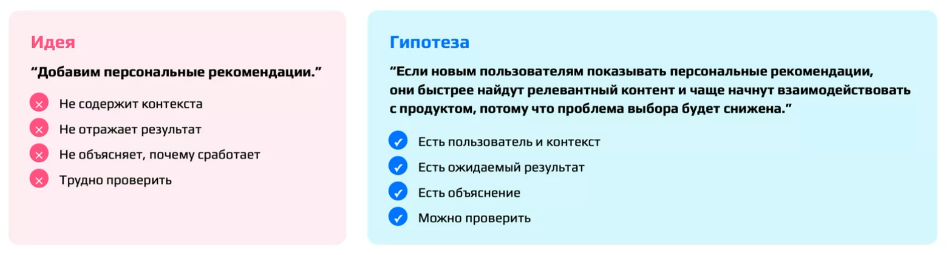

::: {.qa title="Вопросы из зала"}
**Но ведь идея — это тоже предположение?** Да, и идея, и гипотеза — предположения. Разница в том, что у гипотезы есть ожидаемый результат, есть объяснение и, самое главное, она проверяема.
:::

Хорошее упражнение на понимание: попробуйте сами превратить идею «добавить избранное» в гипотезу.

### Что такое продуктовая гипотеза

**Продуктовая гипотеза** — проверяемое предположение о том, как изменение продукта повлияет на пользователя или продуктовый результат и почему. Она связывает четыре элемента: пользовательскую проблему, конкретное изменение, ожидаемый результат и механизм воздействия.

Вернёмся к сквозному кейсу доставки: эти примеры повторяются намеренно, чтобы с каждым блоком раскрывать в них всё больше контекста. Пользователи бросают оформление заказа после того, как неожиданно видят стоимость доставки. Предполагаем: если показать стоимость раньше, то меньше пользователей откажется на позднем шаге, потому что ожидание полной цены сформируется заранее.

К этому определению стоит сделать три уточнения.

**Акцент лектора:** во-первых, гипотеза — это не обещание. Мы не говорим «конверсия вырастет», мы говорим «предполагаем, что вырастет». Вся ценность гипотезы в том, что она делает наше незнание явным и проверяемым.

Во-вторых, гипотеза не обязана быть интерфейсной. Например: если сократить время ответа поддержки пользователям с неуспешной оплатой, доля повторных попыток оплаты увеличится, потому что человек быстрее получит понятный путь восстановления сценария. Здесь меняется процесс, а не экран. Изменение может быть процессным, алгоритмическим, ценовым, коммуникационным.

В-третьих, не каждая гипотеза обещает рост. Иногда мы проверяем, что отключение малоиспользуемой функции не нанесёт критического ущерба или что инфраструктурное изменение, сделанное, скажем, ради снижения затрат, не ухудшит пользовательский результат.

### Формула IF / THEN / BECAUSE

Удобный, хотя и не единственно верный способ записать гипотезу — формула **IF / THEN / BECAUSE** («если — то — потому что»):

- **IF** — мы [изменение]: какое изменение мы вносим;
- **THEN** — ожидаем [результат]: какой наблюдаемый результат ожидаем;
- **BECAUSE** — [основание / механизм]: почему считаем, что изменение приведёт к результату.

Схематично: «если сделаем X, то ожидаем Y, потому что Z». Усиленная версия формулы добавляет пользователя и ситуацию:

> Для [кого / в какой ситуации], если мы [изменение], то ожидаем [результат], потому что [основание].

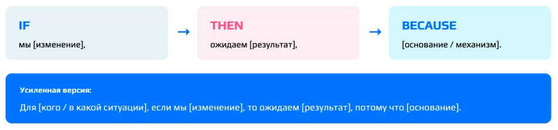

Пример: для нового пользователя доставки — если показывать стоимость доставки уже на этапе выбора ресторана, то ожидаем меньше отказов на этапе оформления, потому что человек сможет учитывать полную стоимость до того, как потратит время на сбор корзины.

**Важно:** формула не магия. Плохое предположение не станет хорошим только потому, что в него вставили слова If, Then, Because. Формула лишь заставляет явно показать логику и разложить мысль на составные части: изменение, результат, основание.

### Почему BECAUSE так важно

Часть BECAUSE описывает **механизм** — нашу теорию о том, как именно изменение приводит к результату. Без неё гипотеза теряет большую часть смысла.

Сравним две формулировки. «Если отправить push, пользователи будут чаще возвращаться». Измерить это можно, но непонятно, почему мы вообще этого ожидаем. Push кому? О чём он напоминает? Ведь можно отправить и просто «Эй, привет» или «Спишь?». Из такой формулировки сложно выбрать метрику и способ проверки.

Улучшенная версия: «Если напомнить пользователям о незавершённом заказе, часть из них вернётся к оформлению, потому что некоторые прерывают покупку из-за внешнего отвлечения, а не из-за отказа от намерения купить». Здесь механизм понятен: напоминание возвращает к незавершённому сценарию именно тех, кого отвлекли. Такую гипотезу можно проверить и можно опровергнуть.

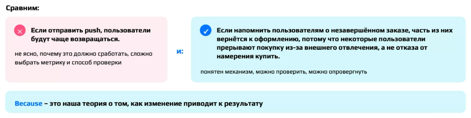

Из механизма прямо следует и дизайн проверки. Мы можем посмотреть, действительно ли существуют прерванные, но сохранившиеся намерения; решить, кому отправлять напоминание, через какое время и какое действие считать возвратом.

**Важный вывод:** если BECAUSE звучит как пустая фраза вроде «потому что станет удобнее», скорее всего, проблему ещё недостаточно поняли.

### Типы продуктовых гипотез

В одном продуктовом решении обычно скрыто несколько предположений. Чтобы их разделить, полезна классификация **[Problem / Value / Usability / Behavior / Growth / Viability hypothesis]{.gl key="Problem / Value / Usability / Behavior / Growth / Viability hypothesis"}**:

| Тип | Вопрос, который он проверяет |
|:--|:--|
| Problem hypothesis | Проблема действительно существует? |
| Value hypothesis | Решение создаёт ценность, она действительно нужна? |
| Usability hypothesis | Пользователь понимает решение и способен им воспользоваться? |
| Behavior / Outcome hypothesis | Изменится ли поведение? |
| Growth hypothesis | Решение способствует росту? |
| Viability hypothesis | Решение жизнеспособно для бизнеса? |

Это не единственная возможная классификация, а способ структурировать разные виды неопределённости.

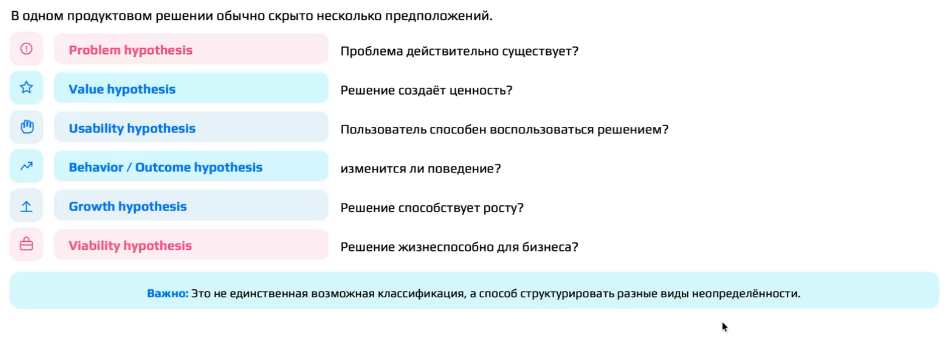

Возьмём автоматическую расшифровку голосовых сообщений. Problem: людям действительно неудобно слушать голосовые в части ситуаций. Value: текстовая расшифровка закрывает эту потребность. Usability: пользователь понимает, как её открыть. Behavior: он начинает чаще взаимодействовать с голосовыми, а не пропускает их. Viability: стоимость обработки приемлема. Последний пункт может оказаться решающим: если обработка обходится компании слишком дорого, остальное можно даже не проверять.

Второй пример — AI summary длинного группового чата:

- Problem: пользователям действительно трудно восстановить контекст после большого объёма сообщений;
- Value: краткое саммари помогает решить эту задачу;
- Usability: пользователь замечает саммари и понимает, как им воспользоваться;
- Behavior: после использования он быстрее включается в дальнейшее общение;
- Growth: улучшение сценария влияет на более широкий рост или удержание — например, человек начинает больше писать и вливается в беседу;
- Viability: стоимость генерации, качество и риски позволяют масштабировать функцию.

Классификация показывает, какие звенья логики пока остаются предположениями, и поэтому выбирать один тип гипотезы не нужно. **Важный вывод:** подтверждение одного уровня не подтверждает остальные. Проблема может быть реальной, а решение слабым; решение может быть ценным, а интерфейс непонятным; пользователи могут любить функцию, а её работа обходится компании так дорого, что поддерживать её невыгодно. Поэтому фраза «гипотеза сработала» без уточнения, какую неопределённость мы проверяли, часто слишком грубая.

### Проверяемость и фальсифицируемость

Центральное качество гипотезы — её проверяемость и **фальсифицируемость**, то есть возможность её опровергнуть: заранее должно быть понятно, какой результат будет означать, что мы ошиблись.

«Новый дизайн улучшит пользовательский опыт» звучит позитивно, но непонятно, что именно меняем, что считать улучшением и как понять, что гипотеза неверна. Проверяемая версия: «Если изменить дизайн карточки товара, то конверсия в добавление в корзину вырастет на 15%, потому что пользователи быстрее находят нужную информацию». В ней есть конкретное изменение, наблюдаемый результат и механизм.

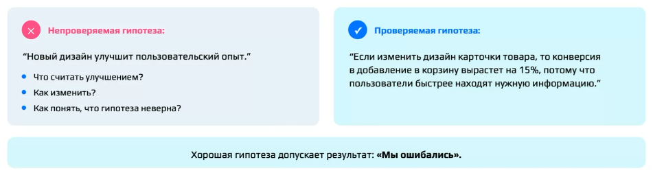

Число 15% полезно, только если оно не взято с потолка. В реальной работе порог должен опираться на бизнес-смысл, исторические данные или дизайн эксперимента; это подробно разбирается во второй части курса.

**Акцент лектора:** главный тест формулировки — можете ли вы *заранее* назвать наблюдение, после которого скажете, что предположение не подтвердилось? Если нет, это скорее убеждение, чем проверяемая гипотеза. Хорошая гипотеза допускает результат «мы ошибались».

### Критерии хорошей гипотезы

Хорошая продуктовая гипотеза:

1. конкретна;
2. основана на наблюдении или инсайте;
3. описывает пользователя или контекст;
4. содержит предполагаемое изменение;
5. содержит ожидаемый результат;
6. объясняет механизм;
7. измерима или наблюдаема;
8. проверяема;
9. опровержима.

Это не значит, что каждую гипотезу нужно превращать в огромное предложение со всеми девятью пунктами. Это чек-лист качества мысли: продумывая гипотезу, мы спрашиваем себя, сможем ли её проверить и опровергнуть, описан ли пользователь, понятен ли контекст. Если в голове всё раскладывается по полочкам, чек-лист пройден.

Особенно полезно проверить три слабых места: откуда взялось основание, что именно эту гипотезу стоит проверять; что является механизмом; какой результат будет считаться противоречащим гипотезе.

Разберём формулировку «Сделаем рекомендации лучше». Конкретики нет, пользователь не назван, изменение не определено («лучше» — это не изменение), результат неясен, механизма нет, проверяемость низкая. Перепишем: *для новых пользователей без подписок — если после онбординга показывать подборку контента на основе выбранных интересов, то доля пользователей, открывших первый материал, увеличится, потому что им потребуется меньше самостоятельного поиска.* Теперь каждый элемент можно отдельно критиковать и проверять.

### Плохие формулировки

Три типичных примера плохих гипотез:

| Формулировка | Что не так |
|:--|:-----------|
| «Добавим Stories — пользователям понравится» | Нет конкретного поведения и критерия проверки. Что значит «понравится»? Какое поведение изменится, у каких пользователей и почему? Стоит спросить и о том, на какие метрики мы повлияем. |
| «Сделаем onboarding удобнее» | Не определено изменение: «удобнее» — оценочное слово, а не действие. |
| «Добавим рекомендации и увеличим все метрики» | Нефальсифицируемое обещание: не определены механизм и ожидаемый эффект. |

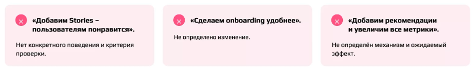

Полезное упражнение — задать каждой такой фразе четыре вопроса: для кого? что меняем? какой результат? почему он должен возникнуть? Уже эти вопросы резко повышают качество гипотезы. Переписывать эти формулировки будем на семинаре.

### Сквозной кейс: от проблемы к гипотезе

Соберём весь переход на одном примере.

- *Наблюдение:* пользователи часто бросают корзину. Это ещё не причина.
- *Исследование:* часть пользователей отвлекается и забывает вернуться. Это уже данные в пользу конкретного механизма, если они получены корректно.
- *Opportunity:* помочь продолжить прерванный сценарий.
- *Solution:* напоминание, например push.
- *Hypothesis:* если напомнить о незавершённой покупке, часть пользователей вернётся к оформлению, потому что их исходное намерение сохранилось.

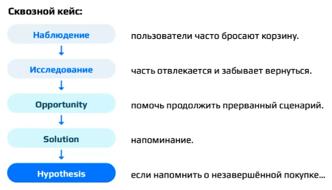

**Важный вывод:** решение появляется только после того, как сформулированы проблема и возможность. И даже тогда мы не считаем его правильным, а готовимся проверять предположение.

## User story и декомпозиция

*Таймкод: 02:39:55 · слайды 48–56*

Гипотеза сформулирована, решение выбрано, и дальше начинается переход к реализации. На этом переходе команда легко теряет из виду пользователя и ценность, ради которой всё затевалось: обсуждение уходит в экраны, кнопки и задачи. Чтобы этого не случилось, существует **user story** (пользовательская история; в обиходе их часто называют просто «сторями») — короткая формулировка того, какую возможность продукт должен дать пользователю и какую ценность тот от этого получит. Классический формат: *As a [persona], I want [need], so that [value]*, по-русски — «Как [пользователь], я хочу [возможность], чтобы [ценность]».

### Story — не гипотеза

Главное, что нужно усвоить с самого начала: user story нельзя путать с гипотезой. Гипотеза описывает предположение о мире, которое мы хотим проверить. Story формализует возможность и ценность, которую должен получить пользователь. Разницу проще всего увидеть на одном и том же примере из доставки.

Гипотеза: «Если показывать срок доставки раньше, больше пользователей продолжат оформление, потому что снизится неопределённость». User story: «Как покупатель, я хочу видеть срок доставки до оформления, чтобы понимать, подходит ли мне этот вариант». Первое — проверяемое предположение об эффекте, второе — описание ценности, которую нужно дать человеку. Они связаны, но не взаимозаменяемы.

Вместе с критериями приёмки, о которых речь пойдёт ниже, получается три уровня:

1. *Гипотеза* — какой эффект мы предполагаем получить и почему.
2. *Story* — какую возможность и ценность должен получить пользователь.
3. *Критерий приёмки* — при каких условиях реализация считается соответствующей договорённости. Например: «для доступного товара ожидаемый срок отображается до перехода к оформлению».

Типичная ошибка — смешать эти уровни. «Как пользователь, я хочу увеличить конверсию на 5%» — плохая user story: пользователю не нужна наша конверсия, ему нужна ценность для себя, а не продуктовая метрика. Такая формулировка относится скорее к гипотезе, чем к истории.

### Формула user story

Формула отвечает на три вопроса подряд: кто? → что? → зачем?

> Как [пользователь], я хочу [возможность], чтобы [ценность].

«Как покупатель» — для кого мы это делаем; «я хочу видеть полную стоимость до оплаты» — какая возможность нужна; «чтобы принимать решение осознанно» — какую ценность она даёт.

**Важно:** в user story ни в коем случае не зашивается техническая реализация. «Как пользователь, я хочу синюю кнопку в правом верхнем углу» — это не история, а готовое решение, выданное за потребность. В жизни так бывает постоянно: приходит близкий человек — например, мама — и говорит, что кнопку в MAX нужно перенести вот сюда, да ещё и объясняет почему, и попробуй с этим поспорить. Но при работе на масштабе так не действуют. Реальные пользователи не формулируют перестановки интерфейса — они говорят о своей ценности: что хотят видеть и зачем. Именно это и должна фиксировать история, а как это реализовать, решается дальше.

Хороший пример: «Как покупатель, я хочу видеть полную стоимость заказа до оплаты, чтобы понимать, укладывается ли заказ в мой бюджет». Здесь есть пользователь, возможность и ценность. Плохой пример для сравнения: «Как пользователь, я хочу, чтобы разработчики добавили API расчёта доставки и новый блок в checkout». Здесь смешаны пользовательская потребность и техническая реализация; непонятно, как такую историю оценивать, какое улучшение от неё ждать и на что она повлияет.

Пишут user stories чаще всего системные аналитики: истории ложатся в требования и спецификации и помогают понять, для чего реализуется функционал. Но продуктовому аналитику важно понимать, как они устроены, — тем более что не во всех компаниях обязанности аналитиков жёстко разделены.

### User story и job story

По форме user story очень похожа на job story, и обе называют «сторями». Различаются они фокусом:

| | Job story | User story |
|:--|:--------|:--------|
| Формат | Когда возникает X, я хочу Y, чтобы получить Z | Как пользователь X, я хочу Y, чтобы Z |
| Фокус | контекст и потребность — мотивация пользователя до выбора решения | возможность, которую должен предоставить продукт |
| Пространство | ближе к Problem Space | формализует уже выбранную возможность, Solution Space |
| Пример | «Когда я еду без интернета, я хочу продолжать обучение, чтобы не терять время» | «Как студент, я хочу сохранять уроки офлайн, чтобы проходить их без интернета» |

Job story описывает ситуацию и мотивацию, ещё не выбирая решения. User story появляется после того, как решение выбрано: в примере выше это офлайн-режим для уроков.

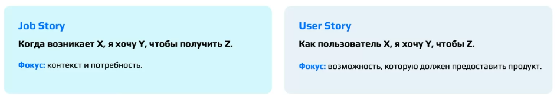

### INVEST

Качество user story удобно проверять по чек-листу **INVEST** — по первым буквам шести свойств хорошей истории:

- **I — Independent:** по возможности история не должна быть жёстко сцеплена с другими.
- **N — Negotiable:** это не контракт на конкретную реализацию, детали можно обсуждать.
- **V — Valuable:** она даёт ценность пользователю или стейкхолдеру.
- **E — Estimable:** команда способна оценить её объём.
- **S — Small:** она достаточно мала, чтобы ею можно было управлять.
- **T — Testable:** понятно, как проверить, что она реализована.

**Акцент лектора:** это чек-лист качества, а не механическая инструкция. Идеальной независимости историй в реализации удаётся достичь не всегда, и превращать INVEST в бюрократический фильтр — «одна буква не выполнена, значит, история запрещена» — точно не нужно. Его смысл в том, чтобы увидеть проблемы формулировки до разработки.

### Критерии приёмки

User story отвечает на вопрос, что нужно пользователю и зачем. Но разработке этого мало: ей нужно понимать, при каких условиях история считается реализованной. Это и задают **критерии приёмки** — условия, при выполнении которых реализацию истории признают соответствующей договорённости. Описывают их, как и сами истории, в основном системные аналитики.

Один из возможных форматов — **[Given / When / Then]{.gl key="Given / When / Then"}**: Given задаёт исходное состояние, When — действие или событие, Then — ожидаемое поведение системы. Формат удобен для запоминания, но он не единственный: критерии можно записывать и просто списком условий, и на практике так нередко и делают. Главное — чтобы критерии делали границы реализации однозначнее и проверяемее.

Возьмём историю: «Как покупатель, я хочу видеть срок доставки на карточке товара, чтобы понимать, когда получу заказ». Критерии приёмки к ней:

1. *Given* — я нахожусь на карточке товара; *When* — товар доступен для заказа; *Then* — отображается предполагаемая дата доставки. Это основной, «счастливый» путь, когда всё идёт как задумано.
2. *Given* — товар отсутствует на складе; *When* — я открываю карточку товара; *Then* — отображается сообщение о сроке поступления, а не ложная дата доставки.

Зачем всё это нужно, видно, если посмотреть, сколько неоднозначности оставляет одна фраза истории. Что показывать для недоступного товара? Что делать, если срок неизвестен? Если он сдвинулся? Как выглядит диапазон дат? Два критерия из примера — довольно примитивный список; в реальности требований гораздо больше, и учесть их все — непростая задача. **Важный вывод:** критерии приёмки превращают пользовательскую ценность в проверяемое поведение продукта. Глубже эта тема относится скорее к работе системных аналитиков, и для кругозора её стоит дочитать самостоятельно.

### Epic → Story → Task

Крупную работу в продуктах, особенно в бигтехе, раскладывают по уровням декомпозиции **Epic → Story → Task**:

- *Epic* — крупная пользовательская возможность или большой кусок сценария, который неудобно реализовать одной небольшой историей. Например, «Покупка» или «Сторис».
- *User story* — конкретная ценность внутри этого сценария. Для покупки — «выбрать способ доставки»; для сторис — «отреагировать на историю близкого человека», поставить ей сердечко.
- *Task* — техническая или организационная работа, нужная для реализации истории: разработать интерфейс выбора доставки, добавить метод, настроить события аналитики, залогировать клики.

Так стратегия связывается с конкретной разработкой. Возьмём мессенджер. Эпик — управление групповым чатом, в котором есть администраторы. Внутри него несколько историй: назначить администратора, изменить права, закрепить сообщения, управлять приглашениями. А у одной истории, скажем про передачу прав, свои задачи: дизайн, разработка, тесты, логирование экранов и действий. Соотношение получается такое: эпик один, историй в нём много, задач на каждую историю тоже много.

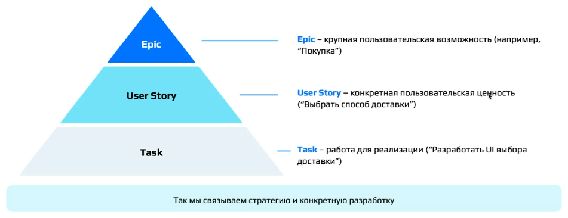

Частая ошибка — назвать эпиком что-то вроде «улучшения пользовательского пути». Это не крупная пользовательская возможность, а желаемый результат работы.

### Story Mapping

**Story Mapping** — способ разложить продукт в два измерения. По горизонтали идёт пользовательский путь: крупные действия и этапы. По вертикали — детализация, варианты и приоритет реализации. Такая карта помогает увидеть продукт целиком, декомпозировать сценарий, определить минимально достаточный набор для первой версии (то, что часто называют MVP) и спланировать последующее развитие.

Возьмём заказ еды. По горизонтали выстраиваются этапы: выбрать ресторан → выбрать блюдо → оформить → оплатить → получить. Под каждым этапом размещаются истории. Затем проводится линия релиза: что нужно до первого работающего сценария, а что появится позже.

В работе продуктового аналитика это напрямую связано с грумингами. Груминг — совместное обсуждение того, как будет выкатываться фича: что войдёт в первую версию, а что нет. На него собираются вместе с продактами и разработчиками, оценивают усилия, смотрят варианты развития и расставляют приоритеты. Смысл Story Mapping в том, чтобы планировать не список разрозненных задач, а целостный пользовательский путь, — тогда уже в минимальной версии будет работающий сценарий, покрывающий самые важные истории.

### Связка: CJM → гипотеза → User Story

Весь путь от исследования до реализации укладывается в одну цепочку на сквозном примере со стоимостью заказа.

- **CJM (pain point):** пользователи не понимают итоговую стоимость заказа.
- **Гипотеза** (предположение об эффекте): если показать итоговую стоимость раньше, то конверсия вырастет, потому что пользователи чаще отказываются на финальном шаге.
- **User story** (формализация ценности): «Как покупатель, я хочу видеть полную стоимость до оплаты, чтобы принимать решение осознанно».

CJM помогает найти проблему, гипотеза — проверить решение, user story — реализовать ценность.

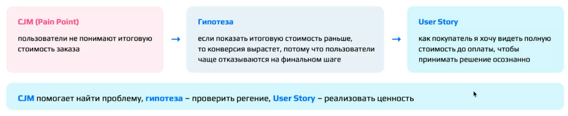

**Важно:** в этой цепочке есть ловушка. То, что пользователи чаще отказываются на финальном шаге, само по себе ещё не доказывает, что причина именно в стоимости. Это симптом, а не причина; если стоимость — наш предполагаемый механизм, его нужно подтверждать наблюдениями. Цепочка не означает, что каждое следующее звено автоматически доказано предыдущим. Она лишь показывает, как наблюдения переводятся в проверяемое продуктовое предположение, а затем в требование к ценности для пользователя.

## Организационное и что дальше

*Таймкод: 02:59:51*

Лекция получилась объёмной: она была рассчитана на три часа с пятнадцатиминутным перерывом между смысловыми блоками, и всю программу пройти не удалось. Остались два блока: приоритизация гипотез и подготовка гипотезы к проверке. Это около пятнадцати небольших слайдов, их разберём в начале семинара 30 сентября.

Дальше семинар посвящён практике по всему материалу этой лекции. На конкретных продуктовых кейсах (доставка, мессенджер и подобные) построим user stories и CJM, разберём персону и обсудим, какие её характеристики важны, а какие нет. Приоритизацию на практике отрабатывать не будем: ей посвящена отдельная лекция, и тема эта тоже непростая.

К лекции прилагаются основные тезисы, по которым она читалась. Их удобно сопоставлять с презентацией, и там может быть больше деталей, так что к расшифровке возвращаться не придётся. Позже появится и список литературы по всем лекциям. Запись выкладывается отдельно, но видео в ней нет.

У теста по второй лекции свои сроки. Начинать его до семинара не стоит: в нём есть вопросы по материалу, который ещё не пройден.

Если хочется разобрать большой практический проект, под него можно выделить последнее занятие курса, отведённое под Q&A-сессию. А на собеседованиях вас ждут продуктовые кейсы, которые нужно решить от начала до конца. При этом курс обзорный: его цель — познакомить с тем, с чем предстоит работать продуктовому аналитику. Хард-скиллы нужно получать дальше, на профильных курсах. Какие именно, обсудим в конце курса.

## Главное из лекции {.unnumbered}

::: keypoints
1. **Продуктовое решение начинается не с идеи фичи, а с понимания проблемы.** Наивная модель «идея → разработка → запуск» пропускает проверку исходных предположений; продуктовая модель идёт от наблюдения и исследования через потребность, проблему и возможность к гипотезе и её проверке.
2. **Мнение команды — источник гипотезы, а не доказательство.** Команда знает продукт слишком хорошо, поэтому ей мешают проклятие знания, предвзятость подтверждения и эффект ложного консенсуса.
3. Потребность, проблема и решение — разные уровни рассуждения. «Мне нужна кнопка „Скачать“» — уже решение; за ним стоит потребность «доступ к материалам без интернета», которую можно закрыть многими способами. Сначала Problem Space, затем Solution Space, а до выбора решения — минимум три альтернативные причины.
4. Слова и поведение расходятся: attitudinal data показывают намерения и отношение, behavioral data — фактические действия. Количественные исследования отвечают на «что и сколько», качественные — на «почему и как»; они не конкурируют, а дополняют друг друга.
5. **Метод выбирается последним:** исследовательский вопрос → необходимое знание → данные → метод. В выводах различают факт, интерпретацию и гипотезу о причине и не выдают объяснение данных за сами данные.
6. Пользователя описывают тремя моделями: сегмент (какую группу рассматриваем), персона (какие устойчивые особенности важны; строится на данных) и Jobs to Be Done (какой прогресс человек хочет совершить в конкретной ситуации). Через JTBD видны реальные конкуренты, а job story обязательно содержит «чтобы».
7. **CJM — модель пути пользователя к цели, а не карта экранов.** Её строят в заданных границах и на данных; на ней ищут точки боли (с оценкой Frequency / Severity / Impact), моменты истины и возможности. Сама по себе карта ничего не улучшает.
8. Метрика или наблюдение — симптом, а не причина. Метод 5 «Почему?» даёт более глубокую гипотезу, которую всё равно нужно проверять. Opportunity Solution Tree связывает ожидаемый результат с возможностями, решениями и экспериментами; для одной возможности полезно рассмотреть несколько решений.
9. **Гипотеза отличается от идеи тем, что её можно проверить и опровергнуть.** Формула IF / THEN / BECAUSE заставляет явно назвать изменение, ожидаемый результат и механизм. В одном решении скрыто несколько неопределённостей (Problem, Value, Usability, Behavior, Growth, Viability), и подтверждение одной не подтверждает остальные.
10. User story — не гипотеза: она формализует ценность выбранного решения для пользователя («Как…, я хочу…, чтобы…») без технической реализации. Её качество проверяют по INVEST, границы реализации задают критерии приёмки, а работу раскладывают как Epic → Story → Task и Story Mapping.
:::

## Что подчеркнул лектор {.unnumbered}

::: emphasis
- **Не начинайте с фичи.** Когда слышите «мне нужна функция X», спросите «зачем?» и «что вы пытаетесь сделать?» — так разговор возвращается от решения к потребности.
- **Прежде чем чинить проблему, сформулируйте минимум три альтернативные причины.** Это защищает от первого правдоподобного объяснения.
- **Маркируйте уровень утверждения:** «мы видим…», «это может означать…», «одна из гипотез…». Даже если причина кажется очевидной, это всё равно гипотеза.
- **«Давайте проведём опрос» — плохой запрос:** метод выбран раньше вопроса. Не существует самого сильного метода вне исследовательского вопроса.
- **Не превращайте персону в литературного персонажа:** характеристика, которая не объясняет продуктовую задачу, лишняя. Персону не строят по одному яркому интервью.
- **Формулируйте job story и потребности по-человечески,** словами пользователя, а не как продуктовый аналитик; в части «я хочу» не должно быть фичи или тарифа.
- **Не придумывайте эмоции и психологию пользователя.** Если данных нет, в ячейке CJM лучше написать «нет данных».
- **Не приходите к продакту с одним симптомом.** «Упал retention» — не объяснение; ценность аналитика в том, чтобы искать причину.
- **Конкуренты не дают готовый бэклог.** Функция у конкурента — сигнал задать вопрос, какую задачу она решает и есть ли эта задача у ваших пользователей.
- **Главный тест гипотезы:** можете ли вы заранее назвать наблюдение, после которого скажете, что ошиблись?
:::

## Стоит посмотреть в видео {.unnumbered}

::: watch
- **≈ 00:21–00:23** — упражнение «тёмный режим»: разбор ответов из чата, что здесь потребность, а что контекст.
- **≈ 00:33–00:44** — серия вопросов из чата об интервью и опросах (поиск респондентов, число интервью, открытые и закрытые вопросы, честность ответов); часть ответов звучит сбивчиво.
- **≈ 00:53–00:56** — кейс MAX с веб-приложением и информерами: рассказ из практики, в слайдах его нет.
- **≈ 01:15–01:21** — разбор job story, присланных в чат, и вопросы о разнице сегмента и персоны.
- **≈ 01:50–01:55** — разбор этапа «Сравниваю рестораны» и интерактив «путь заказа еды в терминах целей».
- **≈ 02:05–02:10** — примеры реальных CJM (Music Sharing, карта Starbucks — её нет в слайдах, пример «Иван Петров»): их удобнее смотреть на экране.
- **≈ 02:18** — тезис «точка роста не обязательно там, где самая низкая конверсия»: число в примере распознано неразборчиво.
- **≈ 02:32–02:34** — шесть типов гипотез на примерах расшифровки голосовых и AI summary: перечень местами слит в одну фразу.
:::

## Глоссарий {.unnumbered}

| Термин | Коротко |
|:--|:--------|
| **Наивная модель / продуктовая модель** | Два пути появления решения: «идея → разработка → запуск» против «наблюдение → исследование → потребность → проблема → возможность → гипотеза → проверка → решение». |
| **Проклятие знания (curse of knowledge)** | Трудно представить опыт человека, который не знает продукт так, как его знает команда. |
| **Предвзятость подтверждения (confirmation bias)** | Склонность замечать подтверждения своей гипотезы и не замечать опровержений. |
| **Эффект ложного консенсуса (false consensus effect)** | Склонность считать собственное поведение типичным для всей аудитории. |
| **Семь измерений ситуации пользователя** | Контекст, цель, мотивация, поведение, барьеры, альтернативы, результат — что нужно узнать о пользователе. |
| **Потребность** | Результат, который человеку нужно получить. |
| **Проблема** | Барьер на пути к нужному результату. |
| **Решение** | Конкретный способ устранить барьер. |
| **Problem Space** | Пространство проблемы: кто пользователь, в какой он ситуации, что пытается сделать и что ему мешает. |
| **Solution Space** | Пространство решения: что изменить, какой интерфейс или механику сделать и как реализовать. |
| **Attitudinal data** | Что человек говорит, думает, чувствует; фиксирует намерения, а не будущее поведение. |
| **Behavioral data** | Что человек фактически делает. |
| **Глубинное интервью** | Разговор исследователя с представителем аудитории по сценарию из открытых вопросов. |
| **Количественные исследования** | Отвечают на «что происходит»: сколько, как часто, у кого. |
| **Качественные исследования** | Отвечают на «почему» и «как»: контекст, мотивы, барьеры. |
| **Usability-тест** | Наблюдение за тем, как человек, не знающий продукт, проходит сценарий, без подсказок. |
| **Исследовательский вопрос** | Что именно мы хотим узнать; с него начинается выбор знания, данных и метода. |
| **Воронка** | Последовательность шагов сценария с числом пользователей, дошедших до каждого шага. |
| **Факт** | Наблюдение из данных (при корректном расчёте). |
| **Интерпретация** | Смысл, который мы приписываем данным. |
| **Гипотеза о причине** | Предполагаемое объяснение механизма; может оказаться неверным. |
| **Сегмент** | Группа пользователей с общими значимыми характеристиками. |
| **Persona (персона)** | Модель характерного пользователя и его контекста, собранная из повторяющихся паттернов в данных. |
| **Jobs to Be Done (JTBD)** | Подход: пользователь выбирает продукт, чтобы совершить прогресс в конкретной ситуации. |
| **Джоба (job)** | Задача, прогресс, ради которого человек ищет решение. |
| **Job story** | Запись джобы: «Когда [ситуация], я хочу [действие], чтобы [результат]». |
| **Functional / Emotional / Social Job** | Три измерения джобы: что сделать, как себя чувствовать, как выглядеть в глазах других. |
| **Customer Journey Map (CJM)** | Визуальная модель пути пользователя к цели: этапы, цели, действия, точки контакта, мысли и эмоции, боли, возможности. |
| **Этапы пути** | Логические шаги пользователя к цели (не экраны продукта). |
| **Точки контакта (touchpoints)** | Места, где пользователь соприкасается с продуктом или брендом, в том числе вне интерфейса. |
| **Pain point (точка боли)** | Конкретный барьер, который мешает пользователю достичь цели. |
| **Frequency / Severity / Impact** | Оценка барьера: как часто возникает, насколько сильно мешает, к каким последствиям приводит. |
| **Moments of Truth** | Точки пути, которые непропорционально сильно влияют на восприятие и решение продолжать взаимодействие. |
| **Opportunity (возможность)** | Что можно улучшить в опыте пользователя, без указания, как именно. |
| **Симптом / причина** | Наблюдаемое изменение показателя и то, что его на самом деле вызывает. |
| **Метод 5 «Почему?»** | Последовательные вопросы «почему?», чтобы перейти от симптома к более глубокой гипотезе о причине. |
| **Точки роста** | Места в продукте, где изменение может заметно улучшить результат. |
| **Opportunity Solution Tree** | Дерево: ожидаемый результат → возможности → решения → эксперименты. |
| **Ожидаемый результат (Desired Outcome)** | Верхний уровень дерева: какой результат мы хотим улучшить. |
| **Продуктовая гипотеза** | Проверяемое предположение о том, как изменение продукта повлияет на пользователя или результат и почему. |
| **IF / THEN / BECAUSE** | Формула гипотезы: изменение — ожидаемый результат — основание. |
| **Механизм** | Теория о том, как изменение приводит к результату (часть BECAUSE). |
| **Problem / Value / Usability / Behavior / Growth / Viability hypothesis** | Типы неопределённости в решении: есть ли проблема, нужна ли ценность, понятно ли, изменится ли поведение, будет ли рост, жизнеспособно ли для бизнеса. |
| **Фальсифицируемость** | Возможность опровергнуть гипотезу: заранее понятно, какой результат будет означать ошибку. |
| **User story** | «Как [пользователь], я хочу [возможность], чтобы [ценность]» — ценность выбранного решения без технической реализации. |
| **INVEST** | Чек-лист качества истории: Independent, Negotiable, Valuable, Estimable, Small, Testable. |
| **Критерии приёмки** | Условия, при которых реализация истории считается соответствующей договорённости. |
| **Given / When / Then** | Формат критерия приёмки: исходное состояние — действие — ожидаемое поведение системы. |
| **Epic → Story → Task** | Уровни декомпозиции: крупная возможность → конкретная ценность → техническая работа. |
| **Story Mapping** | Раскладка историй по пользовательскому пути (по горизонтали) и приоритету (по вертикали) с линией релиза. |
