::: {.abstract title="О чём семинар"}
Занятие начинается с окончания лекции «CJM, user stories, гипотезы». Первый час отвечает на два вопроса, которые встают после того, как гипотезы придуманы. Какие из них проверять в первую очередь: скоринг ICE и RICE и его ограничения. И как проверять: каким методом снимать ту неопределённость, которая мешает принять решение (интервью, прототипы, usability-тесты, фейковая дверь, «волшебник страны Оз», A/B-тест). Затем показан весь путь продуктовой гипотезы, от наблюдения до решения, и мостик к теме метрик.

Остальные два часа — практика на одном сквозном кейсе: сервис доставки еды хочет, чтобы больше новых пользователей доходили до первого заказа. На нём по шагам пройдена вся цепочка продуктового рассуждения: пользователь и контекст → потребность, а не решение → job story → CJM с барьерами на каждом этапе → наблюдение, интерпретация и гипотеза о причине → барьер, возможность и предполагаемое влияние → несколько решений и аргументированный выбор одного → гипотеза «если … то … потому что» и скрытые в ней неопределённости → user story с критериями приёмки → метод и план проверки. Каждое задание дано вместе с эталонным ответом и типичными ошибками.

Понятия CJM, JTBD, job story и user story вводились в первой части лекции 2; здесь они кратко определены заново, чтобы текст читался самостоятельно. Формул нет, специальной подготовки не требуется. Вопросы из чата, если ответ на них содержательный, вплетены в разделы и выделены серыми блоками: их можно пропустить при беглом чтении. Слайды семинара со схемами и эталонными ответами приведены прямо в тексте. Сноски с пометкой «Прим. составителя» — пояснения, которых не было на занятии.
:::

## Приоритизация гипотез: ICE и RICE

*Таймкод: 00:00:02 · слайды —*

### Зачем выбирать очерёдность

У каждой фичи есть этап исследования и этап формирования гипотез. Допустим, команда научилась генерировать хорошие гипотезы о том, как решить пользовательскую проблему, и набрала их целую кучу. Реализовать и проверить все сразу нельзя: разработка требует денег, времени и снова денег. Поэтому появляется отдельная задача — выбрать, в каком порядке гипотезы проверять. Это и есть **приоритизация гипотез**.

Представьте бэклог — список имеющихся задач — на 80–100 идей. Ограничены не только разработчики и деньги. Ограничено внимание пользователей: у них есть лишь какое-то время, чтобы подождать, пока вы решите их проблему. Ограничены трафик, на котором можно ставить эксперименты, и исследовательская ёмкость команды. Наконец, одновременные изменения мешают интерпретировать результаты: если запустить несколько экспериментов параллельно, их эффекты смешаются, и выделить вклад каждого не получится. Гипотез почти всегда больше, чем ресурсов.

Поэтому приоритизация — не поиск самой красивой идеи. Её вопрос звучит так: *какая гипотеза сейчас даёт наилучшее соотношение ожидаемой ценности, ресурсов и неопределённости?* Ответ бывает разным. Иногда дешёвая проверка слабой, но критичной неопределённости важнее разработки потенциально большой фичи. А иногда возможность настолько крупная и хорошо подтверждённая, что есть смысл вложить больше времени в разработку. Начинать всегда с самого лёгкого и дешёвого не нужно, но иногда это работает.

**Важный вывод:** приоритизация — это управление стоимостью ошибки и стоимостью получения знания.

Чтобы упорядочить гипотезы, им ставят оценки по нескольким критериям и сводят их в один балл. Такая процедура называется **скоринг**, а итоговый балл — скор. Любой скоринг, как и любое ранжирование, — способ структурировать разговор в команде, а не математически вычислить ответ.

### Четыре компонента

Чаще всего при приоритизации учитывают четыре компонента:

- **Reach** (охват) — сколько пользователей или событий затронет изменение за заданный период;
- **Impact** (импакт) — насколько сильным ожидается эффект;
- **Confidence** (конфиденс) — насколько мы уверены в исходных предположениях и оценках;
- **Effort** (эффорт) — сколько ресурсов потребуется, то есть сколько это будет стоить.

Иногда вместо Effort используют **Ease** — насколько легко и быстро гипотезу проверить и реализовать. Effort растёт с ценой, Ease, наоборот, тем больше, чем проще задача.

**Важно:** Reach и Impact не путают. Большой охват не означает большого эффекта: изменение может затронуть всех пользователей и почти не поменять их поведение. И наоборот, узкий сценарий может дать огромный эффект для небольшого, но стратегически важного сегмента. Например, есть совсем небольшая группа пользователей, которые постоянно платят. Изменение затронет немногих, но эти люди настолько важны, что его приоритизируют и поднимают наверх.

Confidence полезен тем, что заставляет спросить: на чём основана наша оценка — на данных исследований и прошлых экспериментов или только на интуиции? Бывает, что гипотезу предлагают интуитивно. Если она совсем ни на что не опирается, а другие опираются, её поставят ниже.

### Реальность шире четырёх букв

Кроме этих четырёх компонентов есть юридические требования, стратегические обязательства, зависимости, риск для бренда, технический долг. Возьмём случай из MAX. Команда хотела проверить гипотезу, и один из аналитиков предложил посмотреть переписки пользователей: как часто в них встречаются определённые слова, чтобы подогнать под это стикеры. Но таких данных в MAX нет: переписки — чувствительные, личные данные, и представление, будто мессенджер читает переписки, — большое заблуждение. Довод «нам всего один раз» ничего не меняет: это юридический риск, на который никто не пойдёт. Гипотезу отбросили сразу. Даже если Reach, Impact, Confidence и Effort у неё прекрасно сходятся, проверить её невозможно ни с юридической, ни со стратегической точки зрения.

**Акцент лектора:** фреймворк полезен, если делает предположения явными, и вреден, если команда считает, что итоговый скор отменяет продуктовый контекст. Контекст и риски учитываются всегда.

### ICE

Первый, самый простой вариант скоринга — **ICE**: гипотеза оценивается по Impact, Confidence и Ease (в другом варианте вместо Ease берут Effort):

$$\text{ICE} = \text{Impact} \times \text{Confidence} \times \text{Ease}.$$

Чем сильнее ожидаемый эффект, чем увереннее оценка и чем легче проверка, тем выше скор.[^n1a]

Плюс ICE — скорость: за короткое время можно относительно сравнить большое число идей. Минус — субъективность. Если одна команда ставит Impact по шкале от 1 до 10, а другая понимает «восемь» совсем иначе, числа создают ложную точность. Поэтому все, кто смотрит на скоринг, должны понимать, почему поставлен именно такой скор, и перед скорингом команда договаривается о шкалах и основаниях оценок. ICE хорош как структурированный разговор, но не как автоматический генератор роадмапа — карты пути команды по проверке гипотез.

### RICE

Второй метод — **RICE**. К ICE добавляется Reach, а произведение делится на Effort (здесь уже именно Effort, а не Ease):

$$\text{RICE} = \frac{\text{Reach} \times \text{Impact} \times \text{Confidence}}{\text{Effort}}.$$

Охват, сила эффекта и уверенность повышают приоритет, а стоимость его снижает. Ключевая особенность RICE — охват за конкретный период и обычно в реальных единицах: пользователях, сессиях, транзакциях. Частая ошибка — считать Reach одной гипотезы за неделю, а другой за год и потом сравнивать числа. Охват всех гипотез выражают в одинаковых единицах и за одинаковый период и только потом скорят.

RICE особенно полезен, когда идеи сильно различаются масштабом аудитории. Улучшение основного онбординга затрагивает почти всех новых пользователей, а изменение редкой настройки — лишь небольшой сегмент. Но от плохих входных данных формула не спасает: если Impact и Confidence придуманы, результат выглядит математически строгим, оставаясь субъективным.

### Что выбрать и чего не видит формула

ICE удобен для быстрого относительного сравнения и для случаев, когда Reach трудно оценить: охват затрагиваемого функционала неизвестен. RICE отдельно учитывает масштаб аудитории, поэтому его берут, когда этот масштаб известен.

У обеих моделей общие слабости: они зависят от качества оценок, чувствительны к шкалам и не учитывают весь контекст. Регуляторное требование может получить низкий скор, но быть обязательным — как в примере с переписками. Стратегическая инфраструктура может не давать мгновенного пользовательского импакта, но быть необходимой для будущих решений. Ни одна формула не ответит, нужно ли делать обязательную регуляторную задачу и допустим ли риск для доверия пользователей ради роста.

Поэтому скор — лишь один из входов в решение. Если команда говорит «у задачи 83 балла, значит, обязаны делать», она превращает вспомогательную модель в псевдообъективную истину. Спорить о правильной математике не нужно. Важнее единообразие шкал, основания оценок («почему вот это — 1, а вот это — 8») и прозрачность: всем должно быть понятно, почему одна инициатива получила более высокий скор. Подробно приоритизация разбирается в отдельной лекции.

### Гибкий скоринг

Более гибкий подход — **гибкий скоринг**: команда сама задаёт критерии и их веса под свой контекст. В критерии можно вынести пользовательскую ценность (user value), бизнес-ценность (business value), соответствие стратегии, а также Confidence, риск, Effort или Ease.

Набор критериев зависит от стадии продукта. Для зрелого продукта важны риски и эффективность. В большом бигтехе критично мнение пользователей: что о вас скажут после релиза, какой будет новостной фон. Опираться только на Confidence и Effort там нельзя — решение должно соответствовать стратегии и разумному будущему для пользователей. Для раннего продукта, стартапа, важнее скорость обучения и снятие критической неопределённости; какими-то ценностями можно поступиться, чтобы реализовать подход быстрее.

Чем больше критериев, тем легче построить сложную таблицу, которая маскирует субъективность. Добавить можно хоть сто критериев, но у каждого должно быть понятное определение, он должен влиять на решение, и его включение нужно обосновать. Хорошая таблица делает предположения явными: почему возможность ценна, на каких основаниях, что учли. Критерии, веса и оценки обязательно согласовывают с командой. Если вы вкладываете в вес один смысл, а коллега другой, ни гибкий, ни любой другой скоринг правильно работать не будет.

**Важный вывод:** скоринг отражает контекст решения, а не создаёт красивую математику; скор не равен истине. Он полезен тем, что структурирует обсуждение, заставляет назвать предположения и договориться о критериях, но решения за команду не принимает.

[^n1a]: Примечание составителя: способ объединения компонентов ICE в лекции не назван; произведение — распространённый вариант. Если вместо Ease используется Effort, его, как и в RICE, ставят в знаменатель.

## Скоринг помогает обсуждать, а не решать

*Таймкод: 00:16:38 · слайды —*

### 72 против 70: что на самом деле значит разница в баллах

Возьмём сервис доставки еды. Пользователь не понимает итоговую стоимость заказа, пока не дойдёт до корзины или до оплаты, и на этом шаге люди отваливаются. Какое решение поможет, пока неизвестно. Допустим, у команды есть десять гипотез, каждая из которых в принципе может снять проблему, и их нужно упорядочить: что проверять первым, что последним. Гипотезы оценили, например, с помощью гибкого скоринга, и две из них получили 72 и 70 баллов.

Значит ли это, что первая гипотеза объективно лучше и её нужно брать автоматически? Нет. Каждый балл в таблице выставлен человеком, и, оценивая отдельный критерий, мы могли чуть завысить или чуть занизить оценку. Погрешность субъективных оценок легко может оказаться больше, чем разница в два пункта. Правильное прочтение такого результата: модель показывает, что эти гипотезы выглядят **сопоставимо**. Дальше команда обсуждает, какие оценки в таблице самые неопределённые и какие стратегические факторы формула не учитывает.

Можно ли объяснить разницу сезонностью? В этом примере вряд ли. Мы не закладывали сезонность в таблицу, а критерии гибкого скоринга вроде пользовательской ценности описывают изменение глобально, а не его актуальность в данный момент. Сезонность имеет смысл учитывать для сезонных историй, например для осеннего предложения к началу учебного года. Для глобального изменения фичи она не подходит.

То же касается и больших чисел: 90 баллов против 70 не означают, что одна идея на сколько-то процентов лучше другой. Большая часть входных данных скоринга — **экспертные шкалы**, то есть оценки, которые участники дали «из головы».

### Что делать с почти равными гипотезами

С командой стоит заранее договориться, какую погрешность вы готовы принимать. Например, можно считать равноценными гипотезы, которые отличаются друг от друга примерно на пять баллов в любую сторону. Для таких гипотез решение принимается по дополнительным факторам: стратегическим соображениям и юридическим рискам. Принимает его команда вместе. Допустимо опереться и на интуицию: если две гипотезы оказались равноценными, но в одну из них команда не очень верит, разумно поставить выше вторую.

### Самый полезный результат скоринга

**Важный вывод:** самый полезный результат скоринга часто не первое место в таблице, а **расхождение оценок** между участниками. Пусть один участник ставит гипотезе Confidence 9, а другой 3. Это сигнал, что у команды разное понимание наблюдения: кто-то доверяет данным, на которых строилась оценка, а кто-то нет. Вместо спора о финальном балле полезнее разобрать, какие данные видит каждый и какого знания не хватает. Такое упражнение часто даёт больше, чем сам итоговый рейтинг.

::: {.qa title="Вопросы из зала"}
**Как часто продуктовый аналитик на практике работает с картами пути пользователя, job story и user story, скорингом? Обычно об этом рассказывают на курсах по дизайну.** Курс обзорный: его задача — показать, какие компетенции стоит прокачивать и в какую сторону копать дальше. О конкретных hard и soft skills продуктового аналитика поговорим на последних занятиях. Скоринг используют все, вплоть до разработчиков: везде, где нужно приоритизировать гипотезы или задачи и понять, что дешевле решить и с каким приоритетом. Какой именно скоринг принят, зависит от культуры компании. Ещё его применяют к задачам в Scrum и Agile, но эту тему курс не затрагивает. Карты пути пользователя и его истории[^n2a] сейчас строят в основном исследователи, а продуктовые аналитики — лишь в немногих компаниях. Но хороший продуктовый аналитик понимает, что фичи не возникают просто так, «потому что так решило руководство». Бывает и так: у руководства есть своя стратегия и «сильная рука». Но в большинстве случаев, даже когда речь идёт о метриках, нужно понимать, от чего отталкивался пользователь, принимая решение, и какого результата он хочет. В компании и даже в собственном стартапе во главе стоит пользователь с его «хотелками»: мы реализуем их, потому что в итоге на этом зарабатываем.
:::

[^n2a]: Примечание составителя: речь о CJM (карте пути пользователя), job story и user story. Эти инструменты подробно разбираются в практической части занятия: job story — в разделе «Кейс, пользователь и контекст, job story», CJM — в разделе «Customer Journey Map доставки ужина», user story — в разделе «User story, критерии приёмки и план проверки».

## Как проверить гипотезу: методы под вопрос

*Таймкод: 00:26:53 · слайды —*

Мы уже умеем формулировать предположения и выбирать, какие из них важнее. Остался последний большой шаг: понять, какие данные и наблюдения способны изменить наши решения и что вообще значит проверить гипотезу.

### Проверить — не значит доказать

**Проверка гипотезы** — это не доказательство того, что идея правильная. Мы получаем наблюдение и обновляем своё представление о мире. Исходов может быть несколько: результат поддерживает гипотезу, не поддерживает её, оказывается недостаточным или показывает, что исходное предположение нужно уточнить.

**Акцент лектора:** это очень важная смена мышления. Если команда идёт в эксперимент, чтобы *доказать*, что фича работает, она уже мотивирована и будет трактовать неоднозначные результаты в пользу своей идеи. Поэтому критерии нужно определить **заранее**: какой результат усилит нашу уверенность, какой её уменьшит, а при каком мы скажем «данных недостаточно».

### Пять интервью и смещённая выборка

Типичная ситуация. Команда очень хочет запустить функцию, проводит пять интервью, трое из пяти говорят: «Да, классно». Команда пишет в отчёте: «Гипотеза подтверждена». Что на самом деле проверили?

Во-первых, скорее всего, отношение к концепту, а не реальное поведение. То, что пользователь говорит, и то, что он делает, — разные данные: **attitudinal data** описывают, что человек думает, считает и чувствует, а **behavioral data** — что он фактически делает. Фраза «я обязательно воспользуюсь такой функцией» не равна использованию после запуска.

Во-вторых, выборка могла быть смещена. Проверять гипотезу нужно на равномерной выборке или на такой, которая точно **репрезентативна**, то есть её результаты будут показательны для всей интересующей нас аудитории. **Смещённая выборка** — это выборка, перекошенная в сторону какой-то группы. Если о мотоциклах спрашивать человека, который в них не разбирается и ими не интересуется, полезных ответов не будет. Но если, наоборот, опросить только любителей мотоциклов, а нужно среднее мнение, выборка сместится в сторону любителей. Другой пример: мы продаём мороженое и хотим выпустить «супер кокосовый» вкус, такой приторный, что, кроме кокоса, ничего не чувствуется. Берём для исследования пять человек, и четверо из них обожают кокос. Они, конечно, скажут «супер», но репрезентативного среднего ответа такая выборка не даёт.

**Акцент лектора:** математическая статистика очень полезна продуктовому аналитику, её совершенно точно стоит относить к hard skills и изучать.

В-третьих, то, что людям «понравилось», может вообще не касаться той неопределённости, которая мешает принять решение.

Честная формулировка результата звучала бы так: «В пяти интервью мы увидели повторяющийся сценарий X. Это повышает уверенность, что проблема существует в исследованном контексте, но не позволяет оценить её распространённость». Такая фраза описывает, как изменилось наше знание.

**Важный вывод:** сильный аналитик не обязан приносить бинарное «да/нет». Он должен ясно показать, какое наблюдение получено, какие у него ограничения и что теперь рационально делать.

### Метод выбирается под вопрос

Это очень важный блок. Способов проверить гипотезу много: анализ существующих данных, интервью, прототипы, usability-тесты, фейковая дверь, «волшебник страны Оз», A/B-тесты. Не все из них использует сам продуктовый аналитик, но знать их полезно. Этот перечень не упорядочен от лучшего к худшему, это не обязательная лестница и не матрица: **каждый метод отвечает на свой тип неопределённости**.

- **Интервью** помогает понять, почему пользователь поступает так или иначе и в каком контексте. Оно отлично подходит для исследования проблемы на ранних этапах, но плохо доказывает будущий причинный эффект фичи.
- **Usability-тест** показывает, где возникают проблемы взаимодействия и способен ли пользователь вообще воспользоваться решением. При этом он не гарантирует, что человек будет пользоваться решением регулярно.
- **A/B-тест** — эксперимент, в котором сравнивают поведение групп пользователей с изменением и без него. При подходящих условиях он может оценить причинный эффект изменения, но не объясняет автоматически, почему этот эффект возник.

Частая ошибка — выбирать метод по принципу «самый сложный значит самый надёжный». Правильный порядок другой: исследовательский вопрос → какое знание нужно → какие данные его дают → метод. Например, на вопрос «где пользователи бросают регистрацию?» ответят продуктовые данные, на вопрос «почему они уходят?» — интервью или usability-тест, а на вопрос «насколько распространена найденная причина?» — количественная проверка.

Для выбора удобна шпаргалка «вопрос → метод». Её строки соответствуют типам продуктовых гипотез: в одном решении обычно скрыто несколько предположений (Problem, Value, Usability, Behavior / Outcome hypothesis: есть ли проблема, ценно ли решение, поймут ли его, изменит ли оно поведение), и каждое проверяется по-своему.

|Вопрос (неопределённость)|Метод|
|:--------------|:-----------|
|Существует ли проблема?|Исследования, продуктовые данные|
|Есть ли ценность в решении?|Интервью, прототип[^n3a], фейковая дверь — в зависимости от того, что именно хотим узнать|
|Понимает ли пользователь решение?|Usability-тест|
|Меняется ли его поведение?|Эксперимент|
|Есть ли причинный эффект изменения при подходящих условиях?|A/B-тест|

**Важно:** в последней строке ключевое слово — «подходящих». A/B-тест требует возможности корректно разделить группы, достаточного трафика, корректной метрики и отсутствия статистических нарушений дизайна. Подробно это разбирается в отдельной лекции об A/B-тестах; пока достаточно запомнить: **сначала формулируем неопределённость, то есть свой вопрос, потом выбираем метод**.

Несколько примеров. Понимают ли пользователи новую иконку? Это usability-тест. Есть ли интерес к новому типу услуги? Фейковая дверь: она даёт поведенческий сигнал. Почему люди бросают сценарий? Интервью плюс продуктовые данные: если воронка достаточно подробная, по ней можно найти объяснение. Меняет ли конкретная механика вероятность завершения опроса или регистрации? Эксперимент, A/B-тест при подходящих условиях.

Плохая логика выбора звучит так: «A/B серьёзнее интервью, поэтому проводим A/B». Хорошая — «какое неизвестное мешает решению и какой метод лучше всего уменьшит именно это неизвестное». A/B-тесты любят, и все хорошие продуктовые аналитики умеют их проводить, но это довольно дорого, и возможность провести A/B есть не всегда.

### Фейковая дверь и волшебник страны Оз

Эти два метода звучат забавно, но применяются довольно часто, особенно в компаниях, у которых немного денег на разработку.

**Фейковая дверь (fake door)** показывает вход в функцию, которой ещё нет, и так измеряет реальный интерес. Например, в интерфейсе появляется кнопка «Автоматическая расшифровка». По нажатию открывается сообщение «Функция пока недоступна» или не происходит ничего. Мы считаем клики: если конверсия в клик высокая, функция людям интересна. Это поведенческий сигнал интереса, а не слова из интервью. Подходить к этому нужно аккуратно, потому что нельзя разрушать доверие пользователя: представьте продукт, где половина функционала — иконки, под которыми ничего нет или написано «будет в следующей версии». Поэтому фейковые двери чаще используют на ранних этапах проекта или когда денег мало: разработать функцию сразу нельзя, сначала нужно убедиться, что она нужна.

**Волшебник страны Оз (Wizard of Oz)** — пользователь взаимодействует с продуктом так, будто функция работает автоматически, но за кулисами часть процесса выполняется вручную. Ранний сервис рекомендаций может собирать подборки руками, пока команда не построила сложную систему. Или автоматический заказ из ресторана: партнёрское соглашение ещё не подписано, интеграции нет, но в приложении ресторан уже виден, пользователь «как будто» заказывает, и курьер везёт еду. На деле на той стороне сидит человек: звонит в ресторан, делает заказ, может быть, сам едет за ним на велосипеде и доставляет. Пользователю кажется, что функционал автоматизирован, а выполняют его вручную. Так мы тоже проверяем актуальность и интерес, но ещё не тратим кучу денег на разработку.

Оба подхода позволяют проверить часть ценности до дорогой автоматизации[^n3b]. Но масштабируемость и экономику полноценного решения они не доказывают: их потом всё равно придётся пересчитать.

[^n3a]: Примечание составителя: прототип — упрощённый макет решения (кликабельный интерфейс, эскиз), который можно показать пользователю до разработки; отдельно этот метод не разбирался.

[^n3b]: Примечание составителя: разница между методами в том, что за фейковой дверью функции нет совсем и измеряется только интерес (клик), а в «волшебнике страны Оз» пользователь действительно получает результат, просто его производят люди, а не система.

## A/B-тест, готовность к проверке и путь гипотезы

*Таймкод: 00:41:31 · слайды —*

Последний метод из перечня — A/B-тест. Вокруг него больше всего заблуждений, поэтому разберём его отдельно.

### Что даёт A/B-тест и чего он не даёт

A/B-тест — один из способов проверки гипотез, а не финальный экзамен, обязательный для любой идеи. При корректном дизайне он позволяет оценить причинный эффект изменения: мы сравниваем поведение сопоставимых групп, которые различаются только воздействием. Поэтому A/B полезен, когда вопрос именно о причине: изменило ли конкретное изменение поведение пользователей относительно **контрфактического сценария**, то есть того, что происходило бы без изменения. Группа без изменения как раз и показывает этот сценарий.

Работает это только при соблюдении условий: правильный дизайн, корректная метрика, рандомизация (случайное распределение пользователей по группам), достаточный объём данных и корректная интерпретация. Статистическому дизайну A/B-тестов посвящена отдельная лекция курса, здесь важна общая логика.

**Важно:** к фразе «объективные данные» стоит относиться осторожно. A/B-тест не делает исследование объективным автоматически. Можно выбрать неправильную метрику (так бывает), нарушить ход эксперимента, неверно интерпретировать результат или остановить тест раньше, чем заложено в дизайне. Если какое-то условие не соблюдено, тест провален. Хуже всего, когда команда этого не замечает: тогда она принимает неверное решение, ошибочно признавая гипотезу провальной или, наоборот, подтверждённой.

Даже хороший A/B-тест не объясняет, *почему* эффект появился или не появился. Для понимания механизма после теста иногда снова нужны исследования. В MAX, например, есть две точки входа в каналы (они устроены так же, как в Telegram): поиск и папка «Каналы» с рекомендациями из 25 каналов. Для рекомендаций было несколько вариантов рекомендательной системы, и лучший выбирали A/B-тестом. Эффект оказался неоднозначным, поэтому продуктовая аналитика дополнительно исследовала уже собранные данные.

Наконец, не каждую функцию можно или нужно проверять A/B-тестом. Он не подходит или мало что даёт, когда трафика мало, когда есть сетевые эффекты (пользователи влияют друг на друга), когда изменение обязательно и запускается в любом случае, когда речь о критических багах, а также когда интересны долгосрочные эффекты. A/B-тест — важное, но лишь одно звено в цепочке проверки.

### Чек-лист готовности гипотезы к проверке

Прежде чем запускать любую проверку, стоит пройти **чек-лист готовности гипотезы** — перечень вопросов, на которые команда должна уметь ответить:

1. Понятна ли пользовательская проблема?
2. Определены ли пользователь и контекст?
3. Есть ли основания для предположения?
4. Что именно мы меняем?
5. Какой механизм предполагаем?
6. Какой результат ожидаем?
7. Можно ли гипотезу опровергнуть?
8. Какой метод проверки подходит?
9. Что считаем успехом?
10. Какой результат реально изменит решение команды?

**Акцент лектора:** последний вопрос забывают чаще всего. Если команда при любом исходе всё равно собирается запускать фичу, проверка на решение не влияет и ресурс тратится ради ритуала. Готовность к тесту — это не красивая формулировка гипотезы, а ясная связь между наблюдением, которое мы получим, и будущим решением.

### Весь путь продуктовой гипотезы

Все инструменты лекции складываются в одну цепочку — **путь продуктовой гипотезы**:

1. Исследование пользователя даёт знание о контексте и потребности, в том числе о его джобах в терминах Jobs to Be Done.
2. CJM (карта пути пользователя) показывает, как пользователь проходит путь при решении своей задачи.
3. Pain points (точки боли) фиксируют барьеры, с которыми он сталкивается на этом пути.
4. Затем ищется предполагаемая причина барьера; автоматически считать её доказанной нельзя.
5. Возможности (opportunities) задают пространство для улучшения.
6. Рассматриваются варианты решений.
7. Формулируются гипотезы и user story (пользовательские истории).
8. Гипотезы приоритизируются.
9. Выбирается тест.
10. Тест даёт наблюдение.
11. Принимается продуктовое решение.[^n4a]

Короткая версия той же логики: наблюдение → потребность → pain point → причина → opportunity → варианты решений → гипотеза. В сквозном примере из e-commerce это выглядит так: пользователи часто бросают корзину (наблюдение); исследование показывает, что часть из них отвлекается и забывает вернуться; возможность — помочь продолжить прерванный сценарий; решение — напоминание; гипотеза — «если напомнить о незавершённой покупке…». Роли инструментов в этой цепочке разные: CJM помогает найти проблему, гипотеза — проверить решение, user story — реализовать ценность.

**Важно:** это не конвейер, а цикл. В реальной работе порядок бывает нелинейным или вообще другим. После теста можно вернуться к проблеме, обнаружить новый сегмент, изменить CJM или отказаться от возможности, если в её рамках не удаётся проверить ни одно решение. Поэтому в схеме есть петля обратно к пользователю или к любому этапу, на котором была допущена ошибка. Продуктовая работа — это цикл обучения, а не конвейер, который один раз проходят слева направо.

### Пример: AI summary для новых участников чата

Пройдём весь путь на кейсе мессенджера.

| Этап | Содержание |
|:--------------------|:----------------------------------------------------|
| Наблюдение | Часть новых участников активных групповых чатов долго остаётся читателями и не пишет |
| Исследование | Некоторые говорят, что после входа сложно понять контекст сотен предыдущих сообщений |
| Джоб | Быстро включиться в коммуникацию группы |
| CJM | Приглашение → вход → просмотр → попытка восстановить контекст → первое взаимодействие → дальнейшее участие или выход |
| Pain point | Высокая «стоимость» восстановления контекста: сложно, неприятно, слишком много сообщений, непонятно, что писали до тебя |
| Гипотеза о причине | Сложность понимания пропущенного обсуждения мешает части пользователей начать участвовать в чате |
| Возможность | Помочь быстро восстановить значимый контекст |
| Варианты решений | Закреплённый итог, AI summary, ключевые сообщения, онбординг, треды; выбран AI summary |
| Гипотеза | Если новому участнику активного чата показать краткое содержание недавнего обсуждения, то он быстрее совершит первое содержательное взаимодействие, потому что ему потребуется меньше усилий для понимания контекста |
| User story | Как новый участник активного группового чата, я хочу быстро увидеть краткое содержание недавнего обсуждения, чтобы понять контекст и включиться в разговор |
| Первая проверка | Не строить сразу полноценную AI-систему, а показать вручную подготовленные саммари на небольшой выборке (волшебник страны Оз) |
| Дальше | Получить наблюдение, обновить уверенность и только затем принять решение |

**Важный вывод:** так инструменты лекции перестают быть набором отдельных фреймворков и превращаются в одну последовательность продуктового рассуждения.

[^n4a]: Примечание составителя: подробно элементы этой цепочки (Persona и джобы, CJM, барьеры и возможности, формулировка гипотез и user story) разбираются на практике в разделах семинара ниже.

## Итог лекции: от гипотез к метрикам

*Таймкод: 00:51:41 · слайды —*

Путь продуктовой гипотезы ведёт от наблюдения за пользователем к проверке и решению, но оставляет открытым ещё один вопрос.

### Как понять, что продукт стал лучше

Мы научились находить проблему, формулировать гипотезу и выбирать, что и как проверять. Остаётся фундаментальный вопрос: как понять, что продукт действительно стал лучше? Острее всего он встаёт, когда изменение кажется небольшим на фоне огромного продукта. Допустим, в мессенджере, которым каждый день пользуются 100 миллионов человек, вместо одного закреплённого сообщения разрешили закреплять несколько. На таком масштабе это выглядит мелочью, но каждое решение должно положительно влиять на продукт — иначе зачем были потрачены деньги на разработку, время и люди.

Чтобы ответить на этот вопрос, нужно решить:

- что именно мы измеряем;
- какие показатели отражают состояние продукта;
- как связать поведение пользователей с бизнес-результатом;
- как отличить полезное изменение от простого движения цифры.

Это прямой мостик к теме «Метрики продукта»: системы метрик, выбор показателей, интерпретация изменений. С неё начинается хардовая часть работы продуктового аналитика. Не понимать, какие метрики существуют, для продуктового аналитика очень плохо. Джуну знать все метрики не обязательно — это нарабатывается с опытом, — но на более серьёзных позициях это уже нужно, а на собеседованиях джунов в заданиях просят назвать определённые метрики. Коротко: эта лекция отвечала на вопрос «что мы предполагаем и почему», следующая ответит на вопрос «чем мы будем измерять результат».

### Главная мысль

**Важный вывод:** продуктовая аналитика начинается не с таблицы и не с идеи фичи, а с правильно поставленного вопроса о пользователе и продукте.

Это хорошо видно, если сравнить две модели появления продуктового решения. В наивной модели всё линейно: идея → разработка → запуск. В продуктовой модели решению предшествует длинная цепочка: наблюдение, исследование, потребность и проблема, возможность, гипотеза и её проверка. Хорошее продуктовое решение начинается не с идеи фичи, а с понимания проблемы.

### Core-пользователи и целевая аудитория

Может показаться, что карты пути пользователя (CJM) и формулировки его задач — учебные упражнения, далёкие от реальной работы. Это не так: в продуктовых исследованиях MAX ими оперируют буквально каждый день. Пример — работа с ядром аудитории.

**Core-пользователи (core-аудитория)** — ядро аудитории продукта, те, кто на данный момент составляет его основу. По сути, это тот же портрет ключевого пользователя с его характеристиками, только под другим названием. Понимая ядро, мы видим, сколько таких пользователей и из кого оно состоит, а значит — насколько продукт устойчив: большое ядро означает, что решение уже довольно стабильно. Но важнее другое: какую долю остальной аудитории удастся «подтянуть» до ядра, то есть как его расширить и насколько остальные пользователи близки к показателям ядра.

Для этого строятся гипотезы, в том числе через задачи пользователей. Например, среди пользователей MAX можно выделить сегмент учителей. Тогда задача формулируется в духе «Как учитель начальных классов, я хочу …, чтобы …» — и с этой формулировки начинается вся связка от пользователя к метрикам. Метрики у такого сегмента будут совсем другими, потому что в MAX он решает свою особую задачу. Работая с данными и логами в отрыве от пользователя, рядовые задачи решать можно, но на серьёзный уровень продуктовой аналитики так не выйти.

Ядро не стоит путать с **целевой аудиторией**. Core-пользователи — те, кто *уже сейчас* является ядром продукта. Целевая аудитория — все потенциальные люди, которые могли бы взаимодействовать с продуктом, включая тех, с кем он уже взаимодействует. Например, целевой аудиторией могут быть люди 18–25 лет, которые сейчас учатся и обладают определёнными характеристиками: это не core-аудитория конкретного университета, а все люди, подходящие под описание.

::: {.qa title="Вопросы из зала"}
**Насколько подробно нужно знать метрики, чтобы попасть на стажировку?** Если на стажировке подробно спрашивают метрики, скорее всего, требования завышены. От стажёров не ждут чётких знаний: стажировка как раз нужна, чтобы получить навыки джуна. На стажировку в VK, например, ищут ребят условно с 3–4-го курса университета. Опыта работы у них может не быть вовсе, но нужны хард-скиллы: понимание математической статистики и SQL — хотя бы по личным или учебным проектам; Python желателен, но не обязателен. А что такое метрики, как собирать выборки и визуализировать данные в Redash, Superset или DataLens — это нарабатывается уже на работе.

**Может ли услуга, которую на этапе проверки выполняют вручную, оказаться настолько плохой, что окажется невостребованной?** Такое бывает, но обычно это следствие неправильных технических требований, то есть ТЗ к функции. Прежде чем писать ТЗ, проверяют актуальность каждого требования: насколько оно важно и нужно, что войдёт в MVP. Из этого складываются условия, по которым принимают готовую фичу. Если фича всё же оказалась ненужной, вариантов два: либо её актуальность не доказали ещё до разработки, либо она была актуальна, но что-то упустили в требованиях.[^n5a]
:::

[^n5a]: Примечание составителя: ответ сформулирован для фичи в целом. Применительно к ручной проверке («волшебник страны Оз») из него следует, что неудачный результат может говорить о качестве исполнения, а не о ненужности самой идеи, поэтому, прежде чем отвергать гипотезу, стоит убедиться, что её проверили на достаточно качественной реализации.

## Кейс, пользователь и контекст, job story

*Таймкод: 01:02:27 · слайды 1–15*

Семинар целиком опирается на лекцию про CJM, user stories и гипотезы. Возьмём один продуктовый кейс и пройдём его от самого начала до проверки. Главный вопрос, на который мы учимся отвечать: почему именно эта фича вообще появилась в бэклоге и на чём основана вера, что она что-то изменит. По ходу семинара мы научимся отличать потребности пользователя от готовых решений, описывать пользователя и его опыт, находить проблемы и точки роста продукта, формулировать требования и гипотезы, приоритизировать их и готовить к проверке.

### Четыре опорных понятия и маршрут семинара

Рассуждение держится на четырёх словах. **Evidence** — наблюдения и данные о пользователях. **Pain point** (точка боли) — барьер, который мешает пользователю. **Opportunity** — возможность: направление, в котором продукт может этот барьер снять. **Solution** — наше конкретное решение. Именно между этими звеньями чаще всего и происходят логические скачки: от одного наблюдения команда перепрыгивает сразу к готовой фиче, минуя и боль, и возможность. Поэтому главный навык, который нужен к концу семинара, — для любого решения уметь пройти назад, от solution до наблюдения, на котором оно стоит.

Маршрут складывается в четыре шага: понять пользователя, разобрать его путь, сформулировать решение, проверить ключевое предположение. Подробнее порядок такой: сначала понимаем пользователя и его задачу, потом строим путь пользователя (CJM), на этом пути собираем evidence, формулируем проблемы, из проблем получаем opportunities — и только после этого переходим к пространству решений. Затем выбираем одно решение, превращаем его в проверяемую гипотезу, описываем пользовательскую ценность через user story и проектируем первый разумный тест. В реальной работе процесс бывает итеративным, к этапам возвращаются, но логика обоснования должна сохраняться.

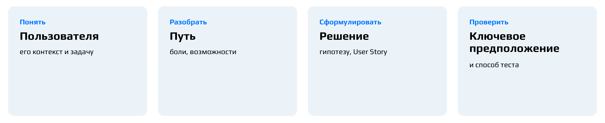

Статистику глубоко разбирать не будем. Важнее вопрос, который возникает раньше: что именно нам неизвестно и какой метод способен уменьшить эту неопределённость.

### Кейс: новые пользователи не доходят до заказа

Весь семинар построен на **кейсе доставки еды**. Вы — продуктовая команда сервиса доставки, и бизнес хочет увеличить долю новых пользователей, которые совершают первый заказ. Известно, что многие новые пользователи начинают выбирать еду, но часть из них до заказа не доходит. Задача — понять, где есть возможности улучшить пользовательский опыт, и предложить обоснованное изменение продукта.

Этих данных недостаточно, чтобы решать, что делать. Низкая конверсия здесь — **симптом**: наблюдаемый результат, а не его причина. За одним и тем же симптомом могут стоять очень разные причины: сложность выбора, цена, срок доставки, техническая ошибка, недоверие к сервису, отсутствие подходящего способа оплаты или просто внешнее отвлечение. Одинаковый результат не означает одинаковую причину, а разные причины требуют разных решений.

### Что нужно узнать до обсуждения решения

Типичная ситуация: приходят разработчики или продакт и говорят: «Каталог ресторанов плохой, всё дело в нём, пользователь в нём теряется и в итоге ничего не заказывает — надо переделать». Задача аналитика — остановить этот переход сразу к решению и задать вопросы до того, как начнётся обсуждение дизайна.

Хорошие вопросы здесь такие: на каком этапе воронки отваливаются пользователи (это видно по логам); откуда вообще узнали о проблеме и на какой выборке; как поняли, что пользователю не нравится именно каталог; во всех ли сегментах пользователи отваливаются одинаково. Самый важный из них — «С чего вы взяли, что дело именно в каталоге?». Он нужен, чтобы понять, на чём стоит предложение. Если кто-то до вас это уже проверил — прекрасно, на результат можно опереться. Если же за этим стоит просто чуйка, с таким мы не работаем.

Все такие вопросы удобно держать как шпаргалку из трёх групп.

|Группа|Вопросы|На что смотрим|
|:--|:-----------|:--------|
|О пользователе|Кто он? В каком контексте находится? Какую задачу решает?|нужен контекст, а не паспортные данные|
|О поведении|Что делает? Как решает задачу сейчас? Какие есть альтернативы?|что человек реально делает|
|О проблеме|Где возникает барьер? Что именно происходит? Почему это может происходить?|где и как возникает барьер|

Сюда же относятся вопросы о том, что пользователь делает, когда уходит, возвращается ли он потом и что считает успешным результатом.

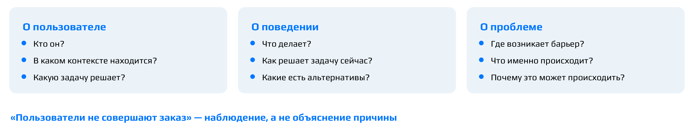

**Важно:** фраза «Пользователи не совершают заказ» — наблюдение об итоге, но точно не объяснение причины. Очень важная привычка аналитика — не превращать название плохой метрики в диагноз: нам нужно объяснение причины, а не констатация.

### Какие признаки описывают пользователя и контекст

Следующий шаг — описать пользователя и его контекст; этот блок назовём **User & Context**. В упражнении дан список признаков, где полезное специально перемешано с шумом: 28 лет; живёт в Москве; маркетолог; заказывает обычно вечером; заказывает 2–3 раза в неделю; сравнивает рестораны; не хочет готовить после работы; хочет заранее знать итоговую стоимость; пользуется iPhone 17; часто заказывает на двоих; любит путешествовать; любимый цвет — синий; доход 150–200 тыс. ₽; боится ошибиться с рестораном; предпочитает знакомые рестораны. Нужно выбрать признаки для описания пользователя и контекста и объяснить, почему каждый помогает понять поведение — и почему остальные не подходят.

Это реальная продуктовая постановка, просто в облегчённом виде. В мессенджере, например, встречается задача увеличить долю пользователей, которые никогда не писали сообщений, чтобы они начали переписываться, — и рассуждать там приходится так же.

Типичный слабый ответ — «берём всё, что касается пользователя и его поведения с доставками». Это слишком широко: любимый цвет тоже касается пользователя. Смысл упражнения в другом: выбирая признак, мы должны понимать, зачем его берём. «28 лет — чтобы понимать платёжеспособность» — уже объяснение. Даже любимый цвет можно взять, если есть обоснование: скажем, всё приложение оформлено в фиолетовых тонах, а наши пользователи любят фиолетовый, — тогда вопросов нет.

**Важный вывод:** релевантность определяется объяснительной ценностью. Признак важен не из-за своего типа, а потому, что помогает объяснить различия в поведении пользователей в исследуемом контексте. Отсюда примерная разбивка на три группы:

- объясняют поведение — поведение, контекст, цели, потребности, мотивация, барьеры;
- могут быть релевантны — возраст, город, профессия, доход, устройство, семейное положение;
- скорее шум — характеристики, которые никак не помогают объяснить поведение в рассматриваемом сценарии.

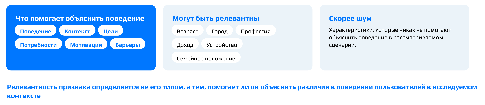

Разбивка именно примерная: тот же любимый цвет при «фиолетовой» аудитории переходит из шума в нужные признаки. Но биографию пользователя мы не строим. Возьмём доход. Пользователь говорит: «Мне важно заранее понимать, сколько я заплачу». Вывести отсюда низкий доход нельзя: многие люди с большими доходами постоянно думают, на что тратить, и это нормально — прозрачность цены важна и обеспеченному пользователю. Доход становится частью модели, только если наблюдение — данные или исследование — показывает, что он действительно разделяет поведение.

### Пользователь и контекст из данных исследования

Теперь у нас появляются основания. Что известно о пользователе: он новый, возвращается домой около 20:00, периодически пользуется доставкой, сегодня ему нужен ужин на двоих, раньше пользовался другими сервисами. Из интервью есть цитаты: «После работы не хочется думать, что приготовить», «Открываю несколько ресторанов и сравниваю», «Важно понимать, сколько в итоге заплачу», «Если доставка долгая — выберу другое».

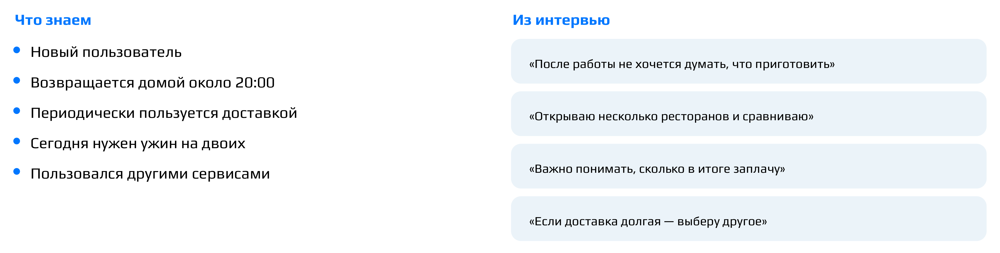

У цитаты особый статус. Это наблюдение того, что так сказал конкретный респондент, и оно не даёт права автоматически распространять вывод на всю аудиторию — разве что цитата повторяется у многих. Качественные интервью хорошо раскрывают механизм проблемы, но не измеряют её долю: для этого нужны количественные исследования.

Задание — собрать пользователя и контекст по шаблону из шести полей: контекст, цель, поведение, потребности, мотивация, барьеры. Правило одно: не добавляйте характеристики, которых нет в данных. **Акцент лектора:** если хочется написать «он устал», «он экономный», «он раздражён», остановитесь и спросите, где было это наблюдение. Возможно, это правдоподобная интерпретация, но пока точно не знание.

Правильный ход рассуждения даёт такой результат:

|Поле|Содержание|
|:--|:-----------|
|Контекст|Вечер после работы. Нужно организовать ужин на двоих.|
|Цель|Быстро выбрать и заказать подходящую еду.|
|Поведение|Сравнивает рестораны. Знаком с альтернативными сервисами.|
|Потребности|Быстрый выбор. Понятная стоимость и время доставки.|
|Мотивация|Ужин без приготовления и лишних усилий.|
|Барьеры|Сложность выбора, неопределённость итоговой стоимости, неопределённость времени доставки.|

Каждая строка прямо выводится из данных: «сравниваю рестораны» — это поведение; «важно понимать, сколько заплачу» даёт и потребность в понятной стоимости, и барьер неопределённости цены; «если доставка долгая — выберу другое» — потребность и барьер по времени; «не хочется думать, что приготовить» — мотивация.[^n6a]

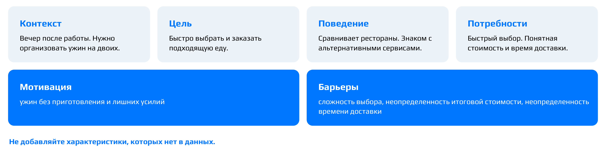

Контекст — это то, в рамках чего пользователь сейчас находится в этой проблеме. Частая ошибка — складывать в контекст всё подряд. «Вечером после работы нужен ужин» — действительно контекст, а «обычно заказывает 2–3 раза в неделю» — уже нет: это сведения о поведении, и в наших данных их вообще нет, есть только «периодически пользуется доставкой». Другая ошибка — подтягивать признаки из предыдущего упражнения: город и модель телефона в данных исследования не упоминаются.

### Потребность или решение

Пользователь часто говорит решениями: «хочу фильтр», «нужна кнопка», «показывайте цену здесь». Некоторые люди прямо формулируют свои желания фичами. Исправлять такого пользователя не нужно — нужно раскрутить, какую задачу он пытается решить. **Потребность** — то, чего пользователь хочет достичь; **решение** — конкретный способ ему в этом помочь. «Фильтр по времени» — способ, «я хочу понимать, когда получу заказ» — потребность. «Кнопка повторного заказа» — способ, «хочу быстро повторить понравившийся заказ» — потребность.

В упражнении шесть формулировок нужно разделить на потребности и решения: «хочу фильтр по времени доставки», «хочу понимать, когда получу заказ», «нужна кнопка повторного заказа», «хочу быстро заказать то, что уже понравилось», «показывать стоимость доставки в каталоге», «хочу заранее понимать итоговую сумму». Ловушка здесь — слово «хочу», вставленное намеренно: «хочу фильтр по времени» остаётся решением, сколько бы «хочу» в нём ни было.

|Потребность|Решение|
|:--------|:--------|
|Понимать время доставки|Фильтр по времени|
|Быстро повторить понравившийся заказ|Кнопка повторного заказа|
|Заранее понимать итоговые расходы|Отображение стоимости доставки в каталоге|

Сначала — чего пользователь хочет достичь. Потом — каким способом ему помочь.

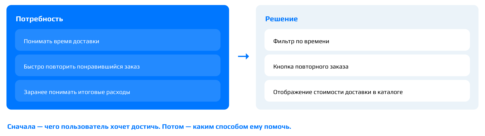

Различить их помогает простой критерий: если задачу можно закрыть несколькими способами, то конкретный способ — это solution. Потребность заранее понимать расходы может привести к показу стоимости доставки в каталоге, к прогнозу полной стоимости заказа, к сортировке по полной стоимости — нагенерировать можно и сотню вариантов. Если же начать с «нужен фильтр», пространство решений уже искусственно сужено. Тогда команда начинает гадать: почему фильтр, для чего, куда его поставить, — потому что неясно, в чём была потребность.

### Job story

Чтобы удержать потребность в её жизненной ситуации, используется формат job story. За ним стоит понятие **джоб (job)** — задача или прогресс, которого человек пытается добиться в своей жизни, независимо от конкретного продукта. Подход **Jobs to Be Done (JTBD)** описывает пользователя именно через такие задачи: продукт выбирают, чтобы совершить определённый прогресс в конкретной ситуации.

**Job story** — запись джоба, которая удерживает ситуацию, задачу и желаемый прогресс:

> Когда [ситуация], я хочу [мотивация / действие], чтобы [ожидаемый результат].

Цель — уйти от формулировки «пользователь хочет заказать еду в приложении» к жизненному контексту. Для нашего кейса один из возможных вариантов:

> Когда вечером после работы я не хочу готовить, я хочу быстро выбрать и заказать подходящую еду, чтобы получить ужин без лишних усилий.

Здесь «когда» задаёт контекст, «я хочу» — задачу, «чтобы» — результат. Результат можно сформулировать и проще, например «чтобы не париться», — суть от этого не меняется.

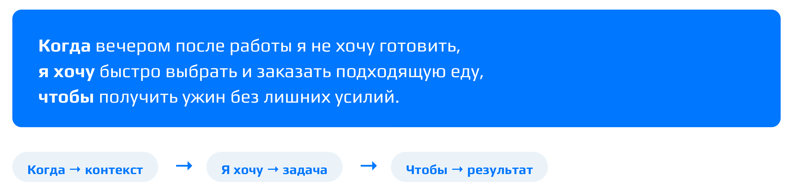

Проверить, что записана задача, а не функция, можно так: уберите наш продукт. Если джоб у человека остаётся, а закрыть его можно множеством альтернатив — доставкой, готовой едой из магазина, рестораном, тем, что приготовит другой человек, — значит, описана задача. Иначе говоря, спросите себя: если бы нашего приложения не существовало, существовала бы такая потребность? Если да, job story составлена правильно.

Дальше по маршруту — путь пользователя, на котором будем искать evidence и барьеры.

::: {.qa title="Вопросы из зала"}
**Мы описываем контекст решаемой задачи в целом или именно контекст пользователя?** Именно пользователя: в нашем кейсе это вечер после работы и ужин на двоих.

**Откуда известно, что пользователь живёт в Москве и пользуется iPhone 17?** Ниоткуда: этого нет в данных исследования. Опираемся только на то, что в них есть, а признаки из предыдущего упражнения в портрет не переносим.
:::

[^n6a]: Примечание составителя: на семинаре прозвучало замечание, что цель и мотивация как будто говорят об одном («поесть, утолить голод»). В шаблоне они разведены: цель — то, что пользователь пытается сделать сейчас (быстро выбрать и заказать подходящую еду), мотивация — почему это для него важно (ужин без приготовления и лишних усилий).

## Customer Journey Map доставки ужина

*Таймкод: 01:41:00 · слайды 16–21*

Когда пользователь и его контекст описаны, а его задача сформулирована в job story, можно переходить к самой сложной части семинара: по данным кейса построить карту пути пользователя, который заказывает ужин.

### Где начинается путь

Начнём с вопроса, который кажется простым: с какого момента начинается карта? Вариантов четыре: А — «Открыл приложение», Б — «Открыл список ресторанов», В — «Возникла необходимость решить вопрос с ужином», Г — «Добавил первое блюдо в корзину».

Правильный ответ — В. Путь пользователя начинается не с открытия приложения, а с того, что у человека появляется задача. Ещё до продукта у него есть контекст, ожидания и альтернативы. Наш пользователь находится не «на этапе загрузки приложения», а в вечере после работы, когда нужно решить вопрос с ужином. Если начать карту с интерфейса, мы потеряем причины, по которым он пришёл, и альтернативы, между которыми он выбирал. Например, реклама могла пообещать бесплатную доставку ещё до того, как пользователь увидел каталог, а разочарование проявится только в корзине. Карта, начатая с каталога, этот источник разочарования просто не увидит.

Отсюда определение. **CJM (Customer Journey Map)** — карта пути пользователя к его цели, и этот путь может начаться до первого контакта с продуктом. CJM описывает путь к цели, а не внутреннюю навигацию продукта.

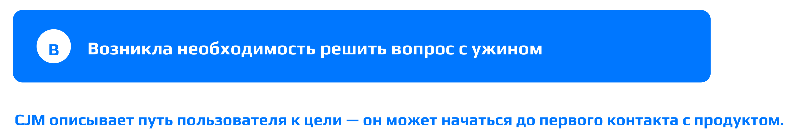

### Границы карты

Прежде чем рисовать карту, фиксируют **границы CJM** — для кого и в каких пределах мы её строим. В нашем кейсе это четыре ответа:

- **кто:** новый пользователь сервиса;
- **контекст:** вечер после работы;
- **цель:** организовать ужин на двоих;
- **границы:** от появления потребности решить вопрос с ужином до получения заказа.

Без границ задача «построить CJM доставки» превращается в огромную энциклопедию, где смешаны разные пользователи, разные джобы и очень много этапов. Граница задаёт и конец карты: она заканчивается вручением заказа. Жизнь пользователя на этом, конечно, не останавливается. Он ест и может обнаружить, что еда невкусная или заказ перепутали; может написать отзыв или позвонить в поддержку. Всё это за пределами нашей карты именно потому, что мы заранее определили её рамки. Для этого границы и нужны: они показывают, в пределах чего мы работаем.

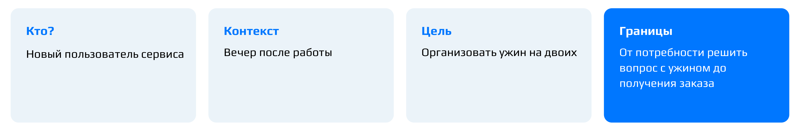

### На чём строится карта

CJM строится на данных исследования, то есть на том, что пользователи делали и говорили. В кейсе есть пять высказываний пользователей:

- «Минут десять листал рестораны и не мог определиться»;
- «Блюда выглядели недорогими, но потом добавилась доставка»;
- «Не понял: привезут через 30 минут или через полтора часа»;
- «Увидел итоговую сумму — решил посмотреть другой сервис»;
- «После заказа несколько раз проверял, где курьер».

К ним добавляется наблюдение из продуктовых данных: после того как показана полная стоимость, часть новых пользователей прекращает оформление заказа.

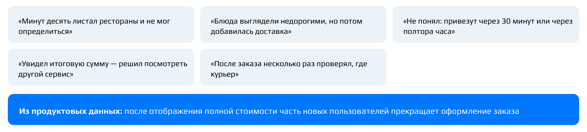

Обратите внимание: ни одна из этих фраз не говорит, что «пользователь чувствует себя обманутым». Такое утверждение — уже объяснение данных, а не сами данные; к этому различию мы ещё вернёмся. Точно так же многократная проверка статуса заказа не обязательно означает тревогу: причина может быть другой. Главное правило задания: опирайтесь на данные и не придумывайте боли без основания.

### Из чего состоит карта

Сначала выделяют **этапы пути** — шаги, из которых складывается путь к цели. Формулируют их в логике пользователя: что он делает, а не какой экран продукта видит. Затем для каждого этапа заполняют одни и те же строки:

- цель пользователя — чего он хочет добиться на этом шаге;
- действия — что он для этого делает;
- **точки соприкосновения (touchpoints)** — где он взаимодействует с продуктом или с тем, что к нему ведёт: приложение, каталог, карточки, реклама, курьер;
- **мысли / ожидания** — какие вопросы у него в голове и чего он ждёт;
- **эмоции** — что он при этом чувствует;
- барьеры — что мешает ему на этом этапе.

**Барьер** в CJM — это то, что мешает пользователю продвинуться к цели. Он должен следовать из данных и стоять на том этапе, где действительно возникает.

С эмоциями в нашем кейсе особая ситуация: данных о них нет. В правильной картине мира в такой ячейке пишут «нет данных»: пустая ячейка сильнее выдуманной. На семинаре мы немножко поиграли в неправильную картину мира и проставили эмоции шуточными стикерами, но только как учебную игру. В настоящей работе выдумывать эмоции нельзя.

Откуда тогда берутся эмоции в настоящих картах? Обычно их отмечают по шкале примерно из пяти значений: от самой негативной через нейтральную середину к самой позитивной. Соединив отметки по этапам, получают характерную волну. По ней видно, в какой момент барьер ощущается наиболее негативно, а значит, с каким этапом работать в первую очередь. Данные для этой волны дают исследования. Сначала качественные: в интервью замечают, что на каком-то этапе пользователи раз за разом называют одну и ту же эмоцию. Затем количественный опрос подтверждает масштаб. Например: «Отметьте по шкале от 0 до 10, насколько это про вас: когда мне долго не везут заказ, я начинаю злиться», где 5 — условно нейтрально. Такие опросы проходил почти каждый.

### Этапы — в логике пользователя

Работа идёт в два прохода: сначала договариваются об этапах (горизонталь таблицы), затем заполняют каждый этап по строкам (вертикаль). На первом проходе ошибаются чаще всего, и это нормально.

Первый этап — «Возникла потребность». Варианты вроде «желание сделать заказ», «поужинать после работы» или «заказать ужин» близки по смыслу, а вот «вход в приложение доставки» не подходит: это уже не потребность, а действие в продукте. Сюда же относятся предложения сделать этапами «регистрацию», «авторизацию» или «скачивание из стора». В CJM мы никогда не рассуждаем экранами навигации, только действиями пользователя. Подробнее эта ошибка разобрана в следующем разделе.

Правильная последовательность выглядит так: возникла потребность → ищу → сравниваю → выбираю → оформляю → жду → получаю. «Каталог» — не отдельный этап, он относится к выбору. Оплата тоже не выделяется в отдельный этап, а входит в оформление. Иногда предлагают этап «сталкиваюсь с опозданием курьера», но это не шаг пользователя, а проблема, то есть барьер.

### Этап за этапом

Эталонная карта для кейса выглядит так. Строку «Эмоции» в таблицу не выносим: она целиком заполнена прочерками.

| Этап | Цель | Действия | Точки соприкосновения | Мысли / ожидания | Барьеры |
|:--|:---|:---|:---|:---|:---|
| Возникла потребность | Решить вопрос с ужином | Решает заказать еду | — | «Хочу быстро организовать ужин» | — |
| Ищу | Найти подходящие варианты | Открывает сервис, просматривает рестораны | Приложение / каталог | «Что выбрать?» | Сложно сузить выбор и определиться |
| Сравниваю | Понять, какой вариант подходит лучше | Открывает несколько ресторанов, сравнивает | Каталог, карточки ресторанов | «Какой вариант лучше?», «Сколько будет стоить?», «Когда привезут?» | Сложно сравнивать, неясно время доставки |
| Выбираю | Определиться с рестораном и едой | Выбирает ресторан и блюда, собирает корзину | Карточка ресторана, меню, корзина | «Подходит ли мне этот вариант?» | Полная стоимость ещё недостаточно предсказуема |
| Оформляю | Сделать заказ на приемлемых условиях | Смотрит итоговую стоимость, принимает решение о заказе | Корзина → оформление заказа | «Сколько в итоге?» | Доп. расходы становятся очевидны слишком поздно |
| Жду | Понимать, когда будет заказ | Следит за заказом, несколько раз проверяет статус | Экран статуса заказа | «Где сейчас курьер?», «Когда привезут?» | Не хватает прозрачности статуса заказа |
| Получаю | Получить заказ | Получает заказ | Курьер / заказ | — | — |

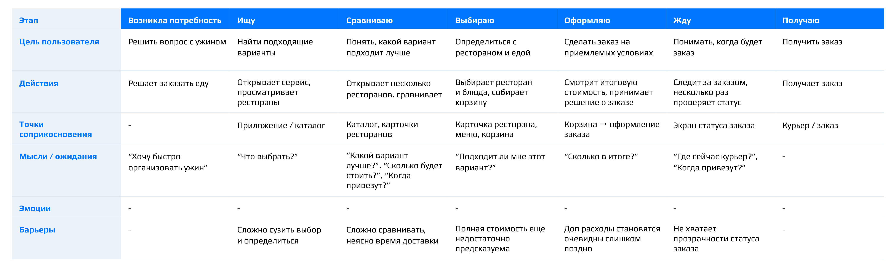

Разберём, как к ней прийти и где обычно ошибаются.

**Возникла потребность.** Цель — решить вопрос с ужином, по-простому «поесть». Мысли и ожидания уже есть, и они опираются на данные: поесть быстро, без усилий, не готовить после работы. А вот точек соприкосновения ещё нет: мы ни до чего не дошли, у нас просто возникла потребность, поэтому ставим прочерк. Барьеров тоже пока нет: человек хочет поесть и ещё ни с чем не столкнулся. Типичные ошибки здесь — записать в барьеры цену (пользователь ещё не открыл ни одного приложения и ничего не видел) или диету. Диета в жизни вполне возможна, но в данных о ней ничего нет, а то, чего нет в данных, на карту не добавляем.

**Ищу.** Цель лучше сформулировать широко — «найти подходящий вариант», а не только «найти заведение»: так в неё попадает всё, что пользователь ищет. Здесь точки соприкосновения уже точно есть: приложение, каталог, карточки, а также сайт или реклама. Мысль на этапе поиска одна: «Что выбрать? Что бы мне поесть сегодня — роллы или пиццу?» Барьер — большой выбор, из которого сложно сузиться до одного варианта: пользователь «минут десять листал рестораны и не мог определиться». Типичная ошибка — записать сюда платную доставку. Это действительно барьер, но он возникает позже, не при поиске.

**Сравниваю.** Цель похожа на цель предыдущего этапа: понять, какой вариант подходит лучше. Цели соседних этапов часто похожи, и это нормально. Точки соприкосновения тоже повторяются (каталог, карточки) — тоже нормально. В мыслях — сравнение по разным разрезам: какой вариант лучше, что будет быстрее, что вкуснее, сколько будет стоить, когда привезут. Барьер здесь прямо выписан в данных: «Не понял: привезут через 30 минут или через полтора часа». Неясно время доставки, а значит, сложно сравнивать.

**Выбираю.** Цель — определиться с рестораном и едой. Пользователь выбирает конкретный ужин и собирает корзину, но покупку ещё не оформляет. Его мысль: «Точно ли это то, что мне нужно?» Он уже выбрал, но ещё не заказал. Барьер связан с итоговой ценой: на этом этапе человек либо ещё не понимает, сколько заплатит, либо уже понял и разочаровался. Отсюда формулировка: полная стоимость ещё недостаточно предсказуема.

**Оформляю.** Пользователь проверяет корзину, смотрит, устраивают ли его условия, и принимает решение о заказе — по сути, делает последнюю сверку перед оплатой. Точки соприкосновения — корзина и оформление; это может быть интерфейс оплаты или банковское приложение, а иногда оплата происходит позже, при получении, но для карты это не важно. Здесь пользователь видит итоговую сумму, и его мысль: «Сколько в итоге?!» Типичная ошибка — записать в барьеры «не прошла оплата». Барьер хороший, но выдуманный: в данных его нет. Ближе к данным вариант «цена изменилась». Это тот самый барьер, о котором говорят и высказывания пользователей («блюда выглядели недорогими, но потом добавилась доставка», «увидел итоговую сумму — решил посмотреть другой сервис»), и продуктовые данные об отказах после показа полной стоимости. Точная формулировка: дополнительные расходы становятся очевидны слишком поздно. Так одна и та же проблема со стоимостью проявляется на двух этапах подряд: на выборе цена непредсказуема, на оформлении это оборачивается неприятным сюрпризом.

**Жду.** Цель здесь не «получить еду», а понять, когда она будет. Отсюда и действие: пользователь следит за заказом, отслеживает курьера и несколько раз проверяет статус, ровно как в высказывании из данных. Точка соприкосновения — экран статуса заказа. Это может быть карта с курьером, но не всегда: иногда просто пишут «курьер будет у вас через N минут». Мысли: «Скорее бы», «Где сейчас курьер?», «Когда привезут?». Барьер часто формулируют как «доставка задерживается». Такое утверждение можно сделать только из данных. Например, по логам видно, что в промо, как у Самоката, обещана доставка до 15 минут, а заказы систематически приезжают за 20–25. Тогда барьер можно выносить на карту. У нас такой информации нет, поэтому барьер — непонимание, когда привезут заказ, или, точнее, нехватка прозрачности статуса. Ещё одна ошибка — записать в барьеры «тревожность». Это эмоция, а не барьер: барьер — то, что мешает (неизвестно, когда привезут), эмоция — реакция на него.

**Получаю.** Цель и действие совпадают: получить заказ. Точка соприкосновения — курьер. О том, что пользователь думает в момент получения, данных нет, поэтому честная запись в строке мыслей — «нет данных». Барьеров в данных тоже нет.

### Сверка с эталоном

Если сравнить карту, которую мы собрали вместе, с эталонной, они оказываются очень близки. Различия показательны: в эталоне эмоции не проставлены нигде, потому что о них нет информации; на этапе «Получаю» прочерк стоит и в строке мыслей; на первом этапе нет ни барьера, ни точки соприкосновения.

**Важный вывод:** CJM — исследовательская модель, построенная на evidence. Пустая ячейка или пометка «нет данных» — нормальный и честный результат. Выдуманная эмоция, придуманный барьер или этап-экран делают карту правдоподобной, но ненадёжной.

## Экраны и этапы, данные и интерпретации, от барьера к возможности

*Таймкод: 02:17:47 · слайды 22–31*

Карта пути построена, и теперь из неё нужно извлечь то, с чем можно работать дальше: барьеры, их возможные последствия для бизнеса и направления улучшения. Но сначала разберём две ловушки. Первая подстерегает при выборе этапов CJM, вторая — при чтении данных.

### Экраны — не этапы

Посмотрим на такой вариант этапов CJM: «Главная → Каталог → Карточка ресторана → Корзина → Оплата → Экран заказа». Что здесь не так? Это не этапы пути, а экраны продукта. Соблазн выписать экраны возникает часто: например, хочется сделать отдельными этапами регистрацию или авторизацию. Но **экраны ≠ этапы** CJM, и причин тому две.

Во-первых, один пользовательский этап может включать несколько экранов. Этап «Выбираю» — это и каталог, и корзина, и переходы между блюдами. Поэтому этапы CJM — это логические шаги пользователя на пути к цели, а не шаги навигации по интерфейсу. Во-вторых, один экран может обслуживать разные джобы. Это различие ещё понадобится дальше.

Правильная последовательность этапов для нашего кейса — «Возникла потребность → Ищу → Сравниваю → Выбираю → Оформляю → Жду → Получаю». CJM строится вокруг действий и целей пользователя, а не вокруг архитектуры продукта. Отсюда следует и требование к барьерам: барьер — это проблема в достижении цели, а не замечание об интерфейсе вроде «на этом экране много текста». И, как всё в CJM, он должен опираться на то, что мы действительно знаем.

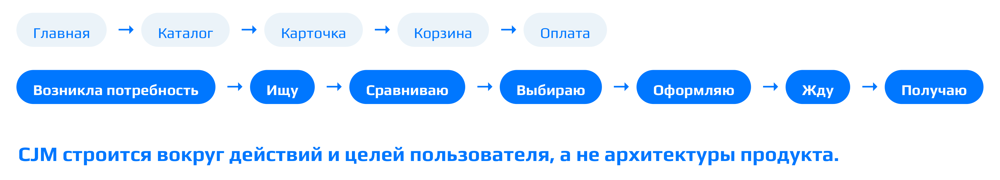

### Что мы действительно знаем

Это самое важное различие всего занятия. Возьмём четыре утверждения о кейсе доставки:

- А — цитата пользователя: «Блюда выглядели недорогими, но потом добавилась доставка»;
- Б — часть пользователей прекращает оформление после появления стоимости доставки;
- В — пользователи считают ценовую политику нечестной;
- Г — пользователи уходят, потому что чувствуют себя обманутыми.

Что из этого мы действительно знаем? Только А и Б. Утверждение А — наблюдение, то есть слова пользователя. Б — тоже наблюдение: это наблюдаемое поведение, зафиксированное в продуктовых данных. В — уже **интерпретация**. Так можно прочитать смысл наблюдений, но если отношение пользователей к ценовой политике никто не измерял, это наше прочтение данных, а не сами данные. Г — **причинное объяснение**, или **гипотеза о причине**: утверждение о том, *почему* пользователи уходят.

Три уровня отвечают на разные вопросы:

- наблюдение (evidence) — что мы видели или замечали;
- интерпретация — что это может означать;
- гипотеза о причине — почему это происходит.

Утверждения В и Г звучат правдоподобно, поэтому их легко записать в наблюдения. Но правдоподобность не превращает утверждение в наблюдение. Слова пользователя и его поведение дают основания для гипотезы о причине, но сами по себе причинность не доказывают.

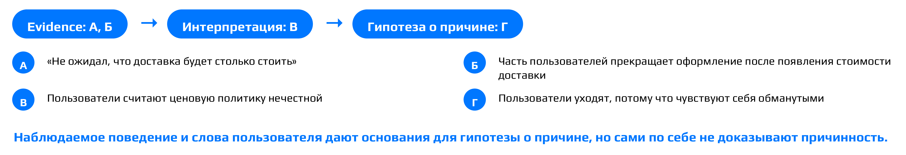

Тот же принцип хорошо виден на примере из мессенджера. «Пользователи, получившие входящее сообщение в первый день, чаще возвращаются» — наблюдение из данных. «Социальная коммуникация связана с возвратом» — интерпретация. «Входящее сообщение само по себе вызывает рост retention», то есть возвращаемости в сервис, — причинная гипотеза. И у неё есть альтернатива: возможно, причина в изначально сильном социальном графе этих пользователей, а не в самом сообщении.[^n8a]

Практический вывод — для рабочих документов: в них полезно буквально ставить маркеры, что мы наблюдаем, что интерпретируем и что предполагаем как причину.

### От наблюдения к барьеру

Барьер (pain point) — уже не сырое наблюдение, а формулировка, сделанная на основании наблюдений. Пользователь говорит: «Не понял: привезут через 30 минут или через полтора часа». Это наблюдение. Барьер, который из него следует: пользователь не может достаточно уверенно оценить время доставки при выборе.

Упражнение: вернуться к CJM, выбрать три самых существенных барьера и для каждого записать пару «наблюдение → барьер». Варианты «сложный выбор», «итоговая сумма считается не сразу», «отпугивает итоговая стоимость», «неясность во времени» — хорошие. Эталонный разбор выглядит так:

| Тема | Наблюдение (evidence) | Барьер (pain point) |
|:--------|:------------------------------|:------------------------------|
| Выбор | Долго листает и не может определиться | Сложно выбрать подходящий вариант |
| Время | Не понимает, привезут через 30 или через 90 минут | Неясно ожидаемое время доставки |
| Стоимость | Дополнительные расходы становятся очевидны поздно | Нельзя заранее оценить полную стоимость |

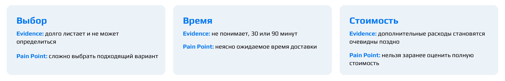

### Барьер, возможность, решение

Следующее различение — между проблемой и тем, что с ней делать. Барьер говорит, *что мешает* пользователю прямо сейчас. **Возможность (opportunity)** говорит, *что в опыте можно улучшить*. Решение говорит, *как именно* это сделать. Например, «не понимаю полную стоимость заранее» — барьер, «сделать стоимость предсказуемее» — возможность, а «показывать стоимость доставки в карточке ресторана» — решение.

Чтобы закрепить это различение, разложим шесть карточек по трём типам: «Не понимаю полную стоимость заранее», «Сделать стоимость предсказуемее», «Показывать доставку в карточке», «Трудно сравнивать по полной стоимости», «Помочь легче сравнивать варианты», «Фильтр „Бесплатная доставка“». Они складываются в две цепочки:

| Барьер | Возможность | Решение |
|:-----------------------|:-----------------------|:-----------------------|
| Не понимаю полную стоимость заранее | Сделать стоимость предсказуемее | Показывать доставку в карточке |
| Трудно сравнивать варианты по полной стоимости | Помочь легче сравнивать варианты | Фильтр «Бесплатная доставка» |

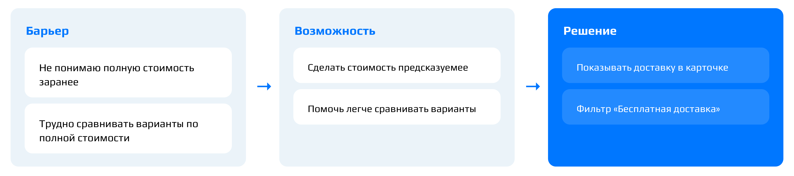

Хорошая возможность оставляет пространство для нескольких решений. Отсюда простой тест: можно ли реализовать её минимум тремя способами? Если да, уровень формулировки выбран хорошо. Если способ по сути один, в руках уже не возможность, а решение.

Барьер и возможность — сущности разного типа. Барьер фиксирует то, что мы знаем о проблеме сейчас, а возможность задаёт направление будущего улучшения. Между ними должна быть понятная мысленная цепочка через проблему: возможность вытекает из барьера, а не появляется сама по себе.

### Предполагаемое влияние и полная цепочка

Даже правильно связанные барьер и возможность ещё не объясняют, зачем бизнесу этим заниматься. Само наличие проблемы не доказывает, что она влияет на бизнес-результат. «Не могу заранее понять стоимость» — это барьер. «Из-за этого прекращаю заказ» — уже причинное предположение о последствиях. Такое звено называется **предполагаемое влияние**: как барьер может сказаться на поведении пользователя, а через него — на бизнесе. Столкнувшись с барьером, пользователь может отказаться от заказа, пойти искать что-то ещё или уйти к конкуренту. Обратная сторона — то, что мы рассчитываем получить, сняв барьер: например, рост конверсии из корзины в оплату, то есть более высокую вероятность, что пользователь дойдёт до оплаты. Влияние, таким образом, формулируется через поведение и через бизнес-показатель.

Вместе получается **продуктовая цепочка** из четырёх звеньев: наблюдение → барьер → предполагаемое влияние → возможность. Для проблемы стоимости она выглядит так:

| Звено | Содержание |
|:-------------------|:----------------------------------------------|
| Наблюдение (evidence) | Расходы видны поздно |
| Барьер (pain point) | Пользователь не может заранее определить полную стоимость |
| Предполагаемое влияние | Неожиданное увеличение стоимости может снижать готовность продолжить заказ, то есть снижать конверсию |
| Возможность (opportunity) | Сделать полную стоимость более предсказуемой ещё на этапе выбора |

Обратите внимание на формулировку влияния: «может снижать». Это предположение, а не установленный факт. Возможность же говорит, *что* улучшить, но ещё не определяет конкретную фичу.

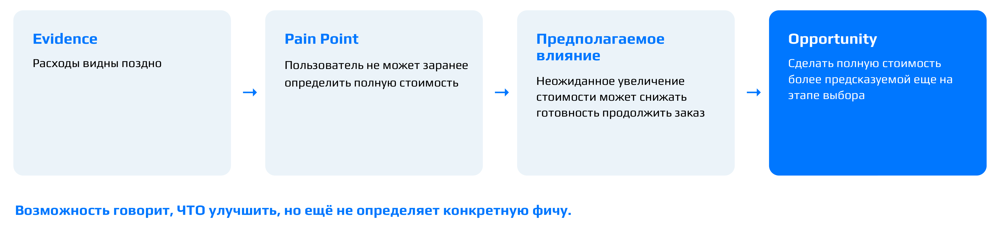

При построении такой цепочки чаще всего встречаются две ошибки. Первая — возможность подменяется фичей. «Сделать фильтр по категориям одежды» или «фильтр по времени доставки» — это уже решения. На уровне возможности та же мысль звучит, например, так: «давать точную информацию о сроках доставки ещё на этапе выбора». Вторая ошибка — пропадает звено влияния. Формулировка «понимать конечную цену заранее» верна как возможность, но в цепочке не сказано, как барьер сказывается на бизнесе.[^n8b]

[^n8a]: Примечание составителя: здесь наблюдаемая связь между входящим сообщением и возвратом может объясняться третьим фактором — силой социального графа, которая влияет на обе величины сразу: у человека с большим числом знакомых в сервисе выше и шанс получить сообщение в первый день, и шанс вернуться. Поэтому корреляция в данных ещё не показывает, что сообщение само вызывает возврат.

[^n8b]: Примечание составителя: без звена влияния непонятно, почему заниматься стоит именно этой проблемой. Влияние связывает пользовательскую проблему с бизнес-результатом и тем самым даёт основание сравнивать проблемы по важности.

## От решений к проверяемой гипотезе

*Таймкод: 02:30:38 · слайды 32–44*

Посмотрим, какая часть продуктовой цепочки уже пройдена. Пользователь и его контекст описаны, джоб сформулирован, CJM построена, барьеры выделены, возможность найдена: сделать полную стоимость заказа более предсказуемой ещё на этапе выбора. Пройдены звенья User & Context → Job → CJM → Pain Point → Opportunity. Впереди Solutions → Hypothesis → User Story → Test: решения, гипотеза и дальнейшие шаги вплоть до проверки.

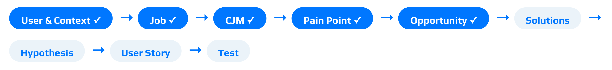

### Из пространства проблемы в пространство решений

До этого момента вся работа шла в **Problem Space**, пространстве проблемы. Мы выясняли, кто пользователь, в какой он ситуации, чего пытается добиться и что ему мешает. Теперь мы переходим в **Solution Space**, пространство решений, и начинаем генерировать решения: что изменить в продукте и как это сделать. Порядок важен: решения появляются только после того, как проблема понята и сформулирована возможность.

Вспомним свойство хорошей возможности: она оставляет место для нескольких решений. Поэтому на этом шаге полезно придумать хотя бы три разных способа её реализовать. Для нашей возможности варианты естественно делятся на три группы:

- *показать раньше:* стоимость доставки прямо в выдаче ресторанов, прогноз полной стоимости заказа;
- *помочь сравнить:* фильтр по стоимости доставки, сортировка по полной стоимости;
- *объяснить условия:* заранее показывать, при каких условиях доставка бесплатна.

Смысл упражнения в том, чтобы не забывать: первая идея команды — лишь один из способов решить проблему. Если сразу ухватиться за неё, другие, возможно более удачные, варианты даже не будут рассмотрены.

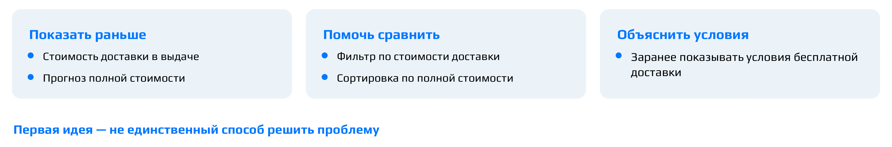

### Аргументированный выбор решения

Из нескольких решений нужно выбрать одно, которое имеет смысл проверить первым, и объяснить почему. Генерировать идеи легко, а вот обосновать выбор умеет не каждый. Позиция «делаем это, потому что я так предлагаю» не годится. **Аргументированный выбор решения** опирается на понятные критерии:

- *связь с проблемой*: насколько прямо решение снимает найденный барьер;
- *потенциальная ценность* для пользователя и бизнеса;
- *изолируемость*: решение можно реализовать и проверить в отрыве от других решений, и тогда его эффект не смешается с эффектами соседних изменений;
- *стоимость проверки*;
- *неопределённость*: что именно мы пока не знаем и хотим выяснить.

«Мне кажется, это самое удобное» аргументом не считается: это вкусовое суждение, в нём нет ни связи с проблемой, ни соображений о проверке.

Вот как выглядит аргументированный выбор в кейсе доставки. Выбираем решение «показывать стоимость доставки непосредственно при выборе ресторана». Связь с проблемой: информация появляется до того, как возникает барьер, а не в корзине. Изменение изолируемо: его можно реализовать и проверить отдельно. При этом честно фиксируем, что остаётся неопределённость: мы не знаем, изменит ли более ранняя информация поведение пользователей.

**Важно:** мы выбрали решение для проверки, а не доказали, что оно сработает. Это ключевая мысль всего шага, и именно поэтому дальше нужна проверяемая гипотеза.

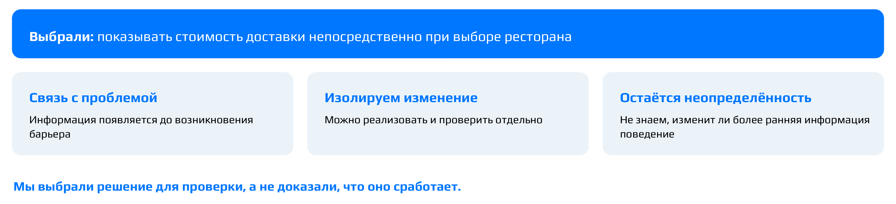

### Какая формулировка проверяема: каркас IF / THEN / BECAUSE

**Продуктовая гипотеза** — это проверяемое предположение о том, как конкретное изменение продукта повлияет на поведение пользователей и почему. Чтобы почувствовать разницу между гипотезой и тем, что на неё только похоже, сравним четыре формулировки и спросим себя, какая из них проверяема лучше всего:

- А: «Добавим стоимость доставки в каталог».
- Б: «Пользователям будет удобнее видеть стоимость доставки».
- В: «Если показывать стоимость раньше, больше пользователей продолжат оформление».
- Г: «Если показывать стоимость раньше, больше пользователей продолжат оформление, потому что смогут учитывать полную стоимость при выборе».

Лучше всего проверяема формулировка Г: она самая полная. Разберём остальные. В варианте А есть решение, но нет никакого проверяемого предположения: непонятно, что должно произойти после того, как стоимость появится в каталоге. В варианте Б слово «удобнее» не определено и плохо наблюдаемо: как измерить удобство и какой результат считать подтверждением, неясно. В варианте В уже есть изменение и ожидаемый результат, это шаг вперёд. В варианте Г добавлен ещё и предполагаемый механизм, то есть объяснение, почему изменение должно привести к результату.[^n9a]

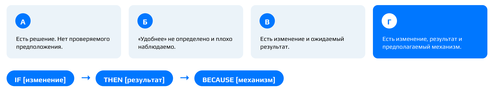

Так выглядит уже знакомый каркас **IF / THEN / BECAUSE**:

$$\text{IF [изменение]} \rightarrow \text{THEN [результат]} \rightarrow \text{BECAUSE [механизм]}$$

В части IF записывается, что мы меняем в продукте, в части THEN — какой наблюдаемый результат ожидаем, в части BECAUSE — через какой механизм изменение должно на этот результат повлиять.

**Акцент лектора:** каркас — не гарантия качества. Возьмём гипотезу «если сделать кнопку зелёной, конверсия вырастет, потому что зелёный удобнее». Формально она уложена в каркас: есть и «если», и «то», и «потому что». Но механизм в ней пустой: «зелёный удобнее» ни на чём не основано и ничего не объясняет. Заполнить три поля недостаточно, нужно думать в рамках реального механизма, который вытекает из того, что мы узнали о пользователе.

### Формулируем гипотезу для кейса доставки

Теперь сформулируем гипотезу, которая поможет решить проблему с непонятной стоимостью доставки, в полной форме «Если…, то…, потому что…». Вот хорошие варианты:

- «Если показывать стоимость доставки при выборе ресторана, то большее число пользователей продолжит оформление заказа, потому что они сразу понимают полную стоимость».
- «Если вывести стоимость доставки в карточку ресторана, то больше пользователей оформят заказ, потому что будут сразу понимать итоговую стоимость».
- «Если в корзине указывать стоимость доставки и сервисный сбор, то больше людей закончат оформление, так как сразу будут видеть итоговую сумму».

Все три формулировки корректны: в каждой есть изменение, результат и механизм. Эталонная формулировка выглядит так: «Если показывать *новому пользователю* стоимость доставки уже *на этапе выбора ресторана*, то *конверсия из выбора ресторана в начало оформления заказа* увеличится, потому что пользователь сможет учитывать полную стоимость раньше и будет реже сталкиваться с неожиданным увеличением цены».

|Изменение|Результат|Механизм|
|:-----------|:-----------|:--------------|
|Стоимость показываем раньше|Растёт конверсия в начало оформления|Меньше неожиданности относительно полной стоимости|

От вариантов выше эталон отличается конкретностью. В нём назван сегмент (новый пользователь), указан этап пути, на котором происходит изменение (выбор ресторана), и вместо расплывчатого «больше пользователей» стоит конкретная метрика: конверсия между двумя определёнными шагами. Механизм тоже связан с тем, что мы видели на CJM: барьер возникает, когда полная стоимость становится видна слишком поздно.

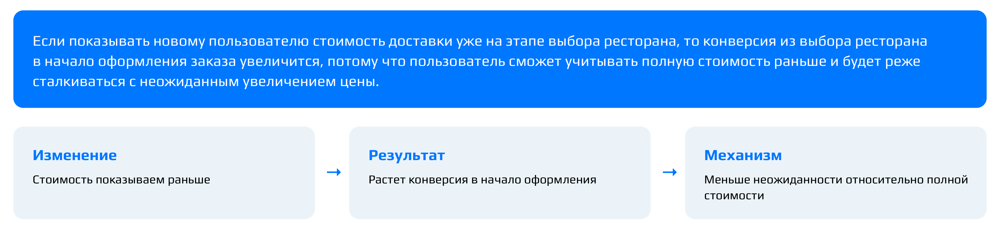

Формулируя гипотезу, полезно сразу ответить и на обратный вопрос: какой результат покажет, что предположение не поддержалось?[^n9b] Если такого результата придумать нельзя, гипотезу невозможно опровергнуть.

### Скрытые предположения: одна гипотеза — несколько неопределённостей

Даже аккуратно сформулированная гипотеза опирается на допущения, которые в ней прямо не названы. Возьмём другую гипотезу из того же сервиса: «Если добавить повтор прошлого заказа в один клик, пользователи будут чаще совершать повторные заказы, потому что им не придётся снова искать ресторан и блюда». Чтобы найти скрытые предположения, удобно спросить: что должно быть правдой, чтобы это сработало?

Первое, что приходит в голову: повторный поиск действительно должен быть проблемой для пользователя, у пользователей должно быть такое поведение и такая потребность (они правда заказывают одно и то же), а у команды должна быть техническая возможность это реализовать. Если разложить эти допущения систематически, получатся **неопределённости Problem / Value / Usability / Behavior**: четыре разных вопроса, на которые гипотеза отвечает одновременно и каждый из которых может получить отрицательный ответ.

|Тип|Вопрос|
|:--------|:------------------|
|Problem|Повторный поиск действительно является проблемой? Людям правда бывает нужно заказать то же самое ещё раз?|
|Value|Быстрый повтор действительно ценен, несёт ли он пользователю ценность?|
|Usability|Пользователь заметит функцию и поймёт её?|
|Behavior|Снижение усилий действительно изменит поведение?|

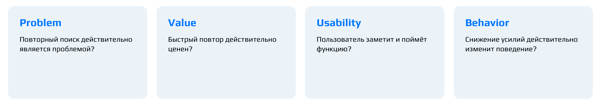

**Важный вывод:** одна гипотеза — это несколько неопределённостей, и подтверждение одной не подтверждает другую. Пусть usability-тест показал, что функцию находят и понимают. Это ещё не значит, что заказывать станут чаще: Behavior-неопределённость остаётся открытой. Точно так же реальная проблема ещё не означает, что выбранное решение хорошее. Поэтому, разбирая гипотезу, свою или чужую, нужно понимать, какое именно из этих предположений мы сейчас проверяем, а какие пока принимаем на веру.

### Чек-лист хорошей гипотезы

Готовую гипотезу полезно попробовать «сломать», и лучше чужую: взять формулировку соседа и пройтись по вопросам. Понятны ли пользователь и контекст? Понятно ли изменение? Наблюдаем ли результат? Есть ли механизм? Можно ли гипотезу опровергнуть? Где в ней предположение, за которым не стоит никакого наблюдения?

Эти вопросы собраны в **чек-лист хорошей гипотезы**. Он состоит из двух частей.

|Содержание|Проверяемость|
|:------------------|:------------------|
|Пользователь / контекст|Есть основание для предположения|
|Изменение|Результат наблюдаем|
|Наблюдаемый / измеримый результат|Гипотезу можно опровергнуть|
|Предполагаемый механизм|Заранее понятно, какой результат изменит решение|

Левая колонка проверяет, из чего гипотеза состоит: для кого и в какой ситуации, что меняем, что ожидаем увидеть и почему. Правая проверяет, можно ли с гипотезой работать: опирается ли она на наблюдение, можно ли увидеть результат, допускает ли она исход «мы ошибались» и известно ли заранее, при каком результате команда поступит иначе. Последний пункт перекликается с чек-листом готовности гипотезы к проверке: если любой исход проверки ведёт к одному и тому же решению, проверять незачем. Эталонная гипотеза про стоимость доставки проходит все пункты: в ней есть сегмент и контекст, конкретное изменение, измеримая конверсия, механизм, опирающийся на барьер из CJM, и её можно опровергнуть.

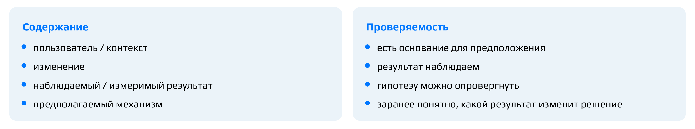

[^n9a]: Примечание составителя: механизм делает гипотезу информативной при любом исходе. Если результат не появился, формулировка Г подсказывает, какое звено цепочки проверить: заметили ли пользователи стоимость раньше и действительно ли неожиданная цена была причиной отказов. Формулировка В такой подсказки не даёт.

[^n9b]: Примечание составителя: для эталонной гипотезы таким результатом было бы отсутствие роста конверсии из выбора ресторана в начало оформления у новых пользователей, которые видят стоимость доставки раньше, по сравнению с теми, кто её не видит.

## User story, критерии приёмки и план проверки

*Таймкод: 02:42:00 · слайды 45–55*

### Стори или гипотеза?

Гипотеза у нас уже сформулирована: если показывать новому пользователю стоимость доставки на этапе выбора ресторана, больше людей начнут оформлять заказ, потому что полная стоимость перестанет быть неожиданностью. Но гипотеза описывает то, что мы собираемся проверить. Когда решение передают в разработку, нужен другой артефакт — **user story** (пользовательская история, «стори»). Она описывает возможность, которую продукт даёт пользователю, и ценность, которую тот от этого получает. Гипотеза же — это предположение о том, какой эффект даст изменение.

Команды часто путают эти два артефакта: смешивают «что хочет пользователь» и «что мы как бизнес ожидаем получить». Проверим себя на кейсе доставки. Какие из четырёх формулировок — стори, а какие — гипотезы?

1. Как пользователь, я хочу видеть стоимость доставки заранее, чтобы понимать расходы.
2. Если показывать стоимость раньше, больше пользователей продолжат оформление, потому что…
3. Как пользователь, я хочу видеть ожидаемое время доставки, чтобы понимать, когда получу заказ.
4. Если точнее показывать время, больше пользователей завершат заказ, потому что…

Стори здесь — первая и третья, гипотезы — вторая и четвёртая. Стори отвечает на вопрос, какую возможность и ценность получает пользователь. Гипотеза — на вопрос, какое предположение о результате мы хотим проверить. Есть простой способ их различить: пользователь не может сказать «я хочу повысить конверсию». Если в формулировке появился результат для бизнеса — рост конверсии, завершённые заказы, — это уже не стори, а гипотеза.

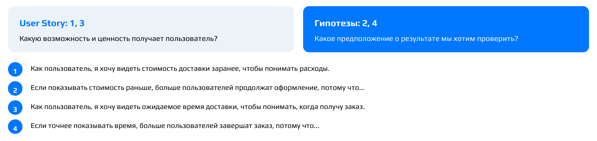

### Критерии приёмки

Стори записывают по формуле:

> Как [пользователь], я хочу [возможность], чтобы [ценность].

К ней добавляют два-три **критерия приёмки (Acceptance Criteria, AC)** — условия, при которых стори считается реализованной. Они отвечают на вопрос, что должно быть реализовано, а не на вопрос, какой бизнес-эффект должен случиться. Через критерии приёмки задачу доносят до разработчиков. На этапе формулировки их можно писать достаточно общими словами, без погружения в детали реализации. Удобный, хотя и не обязательный, формат критерия — **Given / When / Then**: исходные условия, затем действие или событие, затем результат, который должен наблюдаться.[^n10a]

Попробуем написать критерии для стори «хочу видеть стоимость доставки заранее». Начать можно, например, с того, что стоимость видна для всех доступных ресторанов или что её зависимость от условий явно обозначена. Хорошие варианты критериев:

- стоимость доставки указывается заранее, до заказа;
- цена пересчитывается в реальном времени, когда в корзину добавляют товары;
- стоимость заказа считается уже на этапе выбора ресторана или в корзине;
- стоимость доставки выведена на экран выбора ресторана;
- если стоимость показывается баннером, его текст и дизайн согласованы.

Все эти формулировки описывают, что именно должно появиться в продукте. Эталонный вариант стори и критериев к ней такой.

> Как новый пользователь сервиса, я хочу видеть стоимость доставки до начала оформления заказа, чтобы заранее понимать полную стоимость выбранного варианта.

- AC 1: стоимость доставки отображается до перехода к оформлению.
- AC 2: пользователь видит её для каждого доступного ресторана.
- AC 3: если стоимость зависит от условий, это явно обозначено.

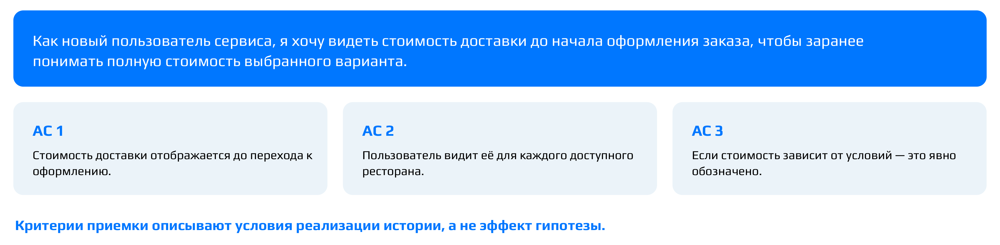

**Важно:** частая ошибка — записать в критерии приёмки что-нибудь вроде «конверсия выросла на 5 %». Это не критерий приёмки, а **критерий успеха** — результат, который должен подтвердить гипотезу. Критерии приёмки описывают условия реализации стори, а критерий успеха — эффект гипотезы. Поэтому стори принимают по критериям приёмки, а гипотезу проверяют по критерию успеха.

### Как проверять: метод под неопределённость

Сделаем шаг к тому, как проверять гипотезу. Универсально лучшего метода не существует. Метод выбирают под конкретный вопрос — под то, чего мы сейчас не знаем:

| Чего не знаем | Метод |
|:--|:--|
| Существует ли проблема | Исследование, данные |
| Понятна ли пользователю механика | Прототип, usability-тест |
| Есть ли интерес к новой возможности | Fake door (фейковая дверь) |
| Хотим оценить причинный эффект | A/B-тест, если для него есть подходящие условия |

Fake door подходит для вопроса об интересе потому, что даёт поведенческий сигнал интереса, а не мнение пользователя о функции.

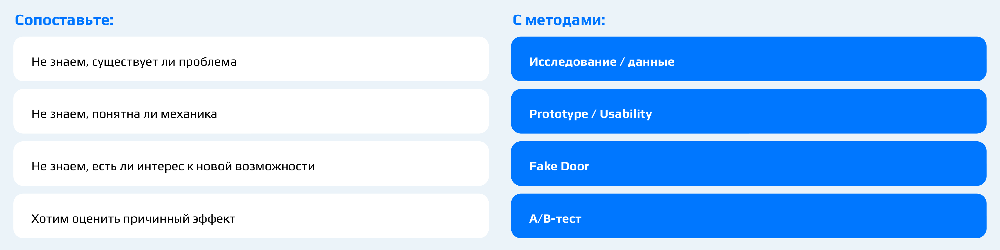

Эту таблицу удобно связать с четырьмя типами неопределённостей, на которые раскладывается гипотеза. Получается **метод проверки под неопределённость**:

- Problem — исследования и анализ данных;
- Value — интервью, прототип, fake door;
- Usability — usability-тест;
- Behavior, то есть причинный эффект, — пилот, эксперимент или A/B-тест при подходящих условиях.

Нет универсально лучшего метода — есть метод под конкретный вопрос.

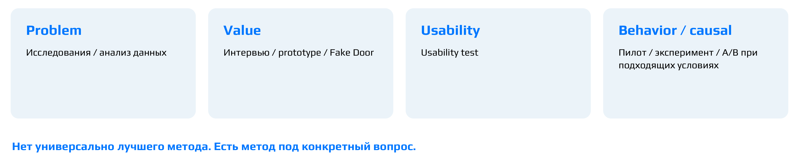

### План проверки: первый шаг

Теперь спроектируем проверку. **План проверки** отвечает на шесть вопросов:

1. Что сейчас неизвестно?
2. Что именно хотим узнать?
3. Какой метод используем и почему?
4. Что наблюдаем или измеряем?
5. Какой результат поддержит предположение? Это и есть критерий успеха.
6. Какой результат заставит пересмотреть предположение?

Чего писать не надо. «Проведём интервью» — это не дизайн проверки: не сказано, какую неизвестность интервью уменьшит. «Запустим A/B» — тоже не ответ. Если у гипотезы о проблеме нет основания, просто запустить A/B-тест нельзя: сначала нужно убедиться, что проблема вообще есть. И не нужно расписывать всю исследовательскую программу — достаточно спроектировать первый шаг.

Разберём задачу. Мы считаем, что барьер — пользователь не видит итоговую стоимость. Хотим понять, понимают ли пользователи итоговую стоимость и связано ли непонимание с тем, что они бросают заказ. Каким будет первый шаг и каким методом?

Удачные ответы опираются на то, что можно узнать уже сейчас. Можно посмотреть логи: на каком шаге пользователи прекращают заказ. Можно провести usability-тест и увидеть, что пользователь видит на экранах и куда переходит. Можно провести CustDev (серию интервью с пользователями), чтобы понять ход его мысли. Предложение проверить A/B-тестом, вырастет ли конверсия из корзины в заказ, относится к следующему этапу. A/B-тест нужен, когда мы меняем функциональность и хотим сравнить, сколько людей пришло и сколько заказало в новой версии по сравнению со старой. Если же функциональность уже изменили и все пользователи перешли на новую версию, сравнивать приходится по логам, на ретроданных.

Эталонный план первого шага:

- **неопределённость:** является ли неожиданное появление дополнительных расходов существенным барьером при оформлении;
- **что хотим узнать:** сталкиваются ли пользователи с этим барьером и связан ли он с отказом от продолжения заказа;
- **первый шаг:** анализ поведения и пользовательское исследование.

Если проблемная гипотеза получает достаточное основание, переходим к проверке эффекта выбранного изменения. Порядок такой: сначала проверяем предположение о проблеме, затем — эффект решения.

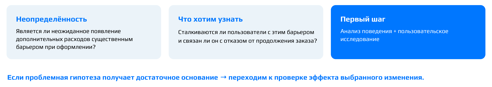

::: {.qa title="Вопросы из зала"}
**Непонятно, для чего здесь A/B-тест?** На первом шаге он и не нужен. A/B-тест проводят, когда меняют функциональность и уже хотят что-то внедрить. Тогда он показывает, что новое решение работает лучше старого. На вопрос «есть ли проблема» он не отвечает.
:::

### Итог: продуктовая цепочка целиком

Если собрать всё, что мы сделали с кейсом доставки, получится продуктовая цепочка от пользователя до проверки:

| Звено | Кейс доставки |
|:--|:-----------|
| Job | Быстро организовать ужин после работы без лишних усилий |
| CJM | Возникла потребность → поиск → сравнение → выбор → оформление → ожидание → получение |
| Evidence | «Когда увидел итоговую сумму, решил посмотреть другой сервис» |
| Pain point | Полная стоимость становится понятна слишком поздно |
| Предполагаемое влияние | Неожиданное увеличение стоимости может снижать готовность продолжить заказ |
| Возможность | Сделать полную стоимость более предсказуемой на этапе выбора |
| Решения | Стоимость доставки в выдаче, прогноз полной стоимости, фильтр и т. д. |
| Выбранное решение | Показывать стоимость доставки при выборе ресторана |
| Гипотеза | IF → THEN → BECAUSE |
| User story | Как новый пользователь сервиса, я хочу… |
| Проверка | Сначала проверяем предположение о проблеме, затем эффект решения |

Хорошее решение можно проследить по этой цепочке назад, до пользовательской проблемы и evidence.

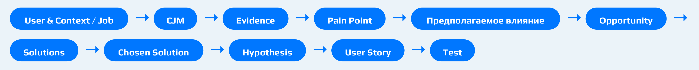

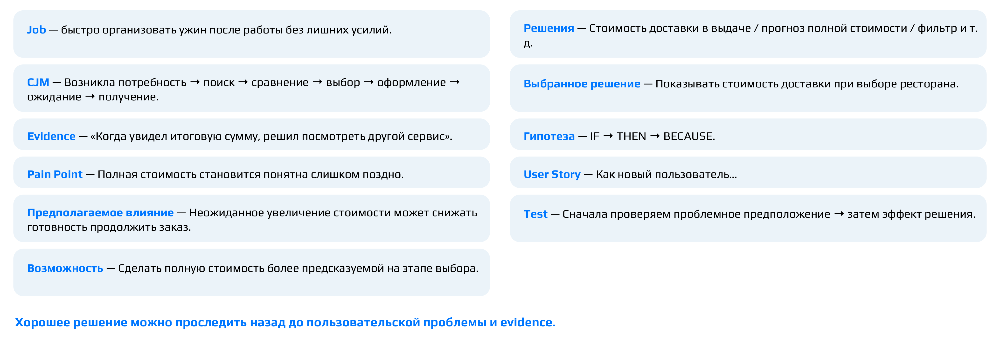

На семинаре мы прошли полный цикл продуктового рассуждения. Мы поняли пользователя и его джобы, построили его путь в CJM, отделили наблюдения от интерпретаций. Затем сформулировали барьеры и возможности, рассмотрели несколько решений, сформулировали гипотезу и стори и спроектировали проверку. Приоритизацию гипотез на кейсе мы не делали: он изучен слишком поверхностно, чтобы честно оценивать гипотезы. Сам приём разобран в начале занятия, а подробнее ему будет посвящена отдельная лекция.

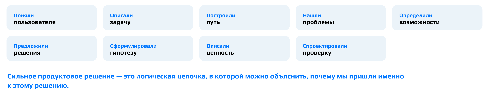

**Акцент лектора:** сильное решение — не самое эффективное. Сильное решение — то, для которого команда может объяснить всю логическую цепочку, то есть почему пришли именно к нему, и честно показать, где заканчивается знание и начинается предположение.

[^n10a]: Примечание составителя: например, первый критерий эталона в этом формате можно записать так: *Given* — новый пользователь открыл список ресторанов; *When* — он выбирает ресторан, ещё не перейдя к оформлению; *Then* — стоимость доставки уже показана. Третий критерий так же описывает поведение продукта в особом случае: *Given* — стоимость доставки зависит от условий; *When* — пользователь смотрит стоимость; *Then* — рядом указано, от чего она зависит.

## Вопросы в конце занятия

*Таймкод: 02:51:45 · слайды —*

Следующая лекция посвящена метрикам, и дальше мы будем рассуждать уже в терминах метрик. Без понимания метрик и умения построить дерево метрик не получится ни проводить A/B-тесты, ни проверять гипотезы.

::: {.qa title="Вопросы из зала"}
**Чем продуктовая аналитика в IT отличается от продуктовой аналитики в другой сфере, например в строительстве?** Инструменты и hard skills те же самые. Различаются специфика отрасли и то, что конкретная компания понимает под продуктовой аналитикой. Чётких границ у профессии нет: если бы все компании одинаково определяли функционал аналитика, разница сводилась бы к специфике отрасли, но на деле многое зависит от того, что компания вкладывает в эту должность.

**Если попасть на стажировку в IT-компанию, придётся ли самим строить CJM, писать Jobs to Be Done и user stories, или этим занимаются более опытные специалисты?** Дело не в опыте: этим обычно занимаются специалисты другого профиля — команда исследований. Но аналитику всё равно придётся работать с этими артефактами, поэтому у него в голове должна быть картина мира: почему пользователь поступает так или иначе. Виртуозно владеть этими инструментами не обязательно, а базовое понимание нужно.

**Есть ли смысл во второй магистратуре?** Учиться стоит, чтобы расширять кругозор, но только если изученное потом применяется на практике, а не ради самого обучения. При этом специализированные курсы часто оказываются намного эффективнее двух лет магистратуры — многое зависит от конкретной программы.
:::

## Главное из занятия {.unnumbered}

::: keypoints
1. Гипотез всегда больше, чем ресурсов, поэтому их **приоритизируют**. ICE (Impact × Confidence × Ease) годится для быстрого относительного сравнения, RICE ((Reach × Impact × Confidence) / Effort) — когда известен масштаб аудитории. Скор не равен истине: самый полезный результат скоринга — расхождение оценок между участниками.
2. Проверить гипотезу — не значит доказать её. Метод выбирается под конкретную неопределённость: есть ли проблема — исследования и данные; понимают ли решение — usability-тест; есть ли интерес — фейковая дверь; есть ли причинный эффект — A/B-тест при подходящих условиях.
3. Низкая конверсия — симптом, а не диагноз. До обсуждения решения выясняют, кто пользователь, что он делает и где возникает барьер, а в описание пользователя берут только признаки, которые объясняют поведение и есть в данных.
4. Пользователь часто говорит решениями («хочу фильтр»). Потребность — то, чего он хочет достичь; если задачу можно закрыть несколькими способами, конкретный способ — это решение. Job story удерживает потребность в жизненной ситуации и не зависит от нашего продукта.
5. CJM начинается с возникновения потребности, а не с открытия приложения, имеет явные границы и строится по шагам пользователя, а не по экранам. Ячейка «нет данных» честнее выдуманной эмоции или барьера.
6. Наблюдение, интерпретация и гипотеза о причине — три разных уровня утверждений. Правдоподобность не превращает интерпретацию в наблюдение.
7. Между барьером и решением лежат предполагаемое влияние на бизнес и возможность. Хорошая возможность допускает минимум три способа реализации.
8. Решение для проверки выбирают по аргументам: связь с проблемой, ценность, изолируемость, стоимость проверки, неопределённость. Выбрать решение не значит доказать, что оно сработает.
9. Гипотеза записывается по каркасу «если … то … потому что», с сегментом, измеримым результатом и реальным механизмом, и должна допускать опровержение. Внутри неё скрыты четыре неопределённости — Problem, Value, Usability, Behavior, — и подтверждение одной не подтверждает другие.
10. User story описывает ценность для пользователя, критерии приёмки — что должно быть реализовано, а бизнес-эффект вроде «конверсия +5 %» — критерий успеха гипотезы. Проверку начинают с первого шага: сначала есть ли проблема, потом эффект решения.
:::

## Что подчеркнул лектор {.unnumbered}

::: emphasis
- Скоринг — способ структурировать разговор в команде, а не вычислить ответ. Перед оценкой договоритесь о шкалах и основаниях, а гипотезы в пределах согласованной погрешности считайте равноценными.
- Не ходите в эксперимент, чтобы «доказать», что фича работает. Если команда запустит фичу при любом исходе, проверка — ритуал, а не источник знания.
- Не превращайте название плохой метрики в диагноз: «пользователи не совершают заказ» — наблюдение об итоге, а не причина. Главный вопрос к любому предложению: «С чего вы взяли?»
- Не добавляйте в описание пользователя и в CJM того, чего нет в данных («устал», «экономный», «тревожится», «не прошла оплата»). Правдоподобное — ещё не знание.
- Этапы CJM — логические шаги пользователя, а не экраны: «регистрация» и «скачивание из стора» этапами не являются.
- «Мне кажется, это самое удобное» — не аргумент. Каркас IF / THEN / BECAUSE тоже не гарантия: «зелёная кнопка удобнее» формально укладывается в него, но механизма в ней нет.
- «Проведём интервью» и «запустим A/B» — не дизайн проверки: нужно сказать, какую неизвестность уменьшает метод.
- Сильное решение — не самое эффективное, а то, для которого команда может объяснить всю цепочку рассуждения и честно показать, где кончается знание и начинается предположение.
- Математическая статистика — обязательный hard skill продуктового аналитика. Метрики — тема следующего занятия, без них не получится ни A/B-тестов, ни проверки гипотез.
:::

## Стоит посмотреть в видео {.unnumbered}

::: watch
- **≈00:47–00:51** — схема «весь путь продуктовой гипотезы» с петлёй обратной связи и разбор кейса AI summary: слайдов этой части нет.
- **≈01:12–01:19** — разбор ответов участников про признаки пользователя и контекста: видно, как отбраковываются признаки без основания в данных.
- **≈01:45–02:17** — совместное заполнение CJM доставки ужина: как формулируются этапы и барьеры и как ответы из чата сверяются с эталонной картой.
- **≈02:21–02:30** — разбор барьеров, возможностей и полной цепочки по ответам участников: типичные подмены возможности фичей.
:::

## Глоссарий {.unnumbered}

| Термин | Коротко |
|:----------|:--------------------------------------------|
| **Приоритизация гипотез** | Выбор очерёдности проверки гипотез при ограниченных ресурсах |
| **Скоринг** | Оценка гипотез по нескольким критериям со сведением в один балл (скор) |
| **Reach** (охват) | Сколько пользователей или событий затронет изменение за заданный период |
| **Impact** (импакт) | Насколько сильным ожидается эффект изменения |
| **Confidence** (конфиденс) | Насколько мы уверены в исходных предположениях и оценках |
| **Effort** (эффорт) | Сколько ресурсов потребуется на изменение |
| **Ease** | Насколько легко и быстро проверить и реализовать гипотезу |
| **ICE** | Скоринг по Impact, Confidence и Ease (или Effort); быстрый и субъективный |
| **RICE** | Скоринг (Reach × Impact × Confidence) / Effort; учитывает масштаб аудитории |
| **Гибкий скоринг** | Скоринг с критериями и весами, которые команда задаёт под свой контекст |
| **Расхождение оценок** | Разные оценки одной гипотезы у участников; сигнал о разном понимании данных |
| **Проверка гипотезы** | Получение наблюдения, которое обновляет уверенность, а не доказывает идею |
| **Attitudinal data** | Данные о том, что человек думает, считает и чувствует |
| **Behavioral data** | Данные о том, что человек фактически делает |
| **Смещённая выборка** | Выборка, перекошенная в сторону какой-то группы и поэтому не репрезентативная |
| **Интервью** | Метод, который объясняет, почему пользователь поступает так или иначе и в каком контексте |
| **Usability-тест** | Метод, который показывает, где возникают проблемы взаимодействия с решением |
| **A/B-тест** | Эксперимент со сравнением групп с изменением и без; оценивает причинный эффект |
| **Фейковая дверь (fake door)** | Вход в несуществующую функцию; клики измеряют реальный интерес |
| **Волшебник страны Оз (Wizard of Oz)** | Функция выглядит автоматической, но за кулисами её выполняют люди |
| **Контрфактический сценарий** | То, что происходило бы без изменения; в A/B-тесте его показывает контрольная группа |
| **Чек-лист готовности гипотезы** | Десять вопросов, на которые нужно ответить до запуска проверки |
| **Путь продуктовой гипотезы** | Цикл от исследования пользователя до продуктового решения с возвратами к любому шагу |
| **Core-пользователи (core-аудитория)** | Ядро аудитории продукта на данный момент |
| **Целевая аудитория** | Все потенциальные пользователи продукта, включая нынешних |
| **Evidence** | Наблюдения и данные о пользователях: что они говорят и что делают |
| **Pain point** (точка боли) | Барьер, который мешает пользователю добиться цели |
| **Solution** | Конкретное решение, которое предлагает команда |
| **Кейс доставки еды** | Сквозной кейс семинара: новые пользователи сервиса доставки не доходят до первого заказа |
| **Симптом** | Наблюдаемый результат (например, низкая конверсия), за которым могут стоять разные причины |
| **User & Context** | Описание пользователя через контекст, цель, поведение, потребности, мотивацию и барьеры |
| **Потребность** | То, чего пользователь хочет достичь |
| **Решение** | Конкретный способ помочь пользователю; одну потребность можно закрыть многими решениями |
| **Джоб (job)** | Задача или прогресс, которого человек добивается независимо от конкретного продукта |
| **Jobs to Be Done (JTBD)** | Подход: продукт выбирают, чтобы совершить прогресс в конкретной ситуации |
| **Job story** | «Когда [ситуация], я хочу [мотивация / действие], чтобы [ожидаемый результат]» |
| **CJM (Customer Journey Map)** | Карта пути пользователя к цели; путь может начаться до первого контакта с продуктом |
| **Границы CJM** | Кто пользователь, в каком контексте, с какой целью, где путь начинается и заканчивается |
| **Этапы пути** | Логические шаги пользователя к цели, сформулированные как его действия |
| **Точки соприкосновения (touchpoints)** | Где пользователь взаимодействует с продуктом или с тем, что к нему ведёт |
| **Мысли / ожидания** | Строка CJM: какие вопросы у пользователя в голове и чего он ждёт на этапе |
| **Эмоции** | Строка CJM: что пользователь чувствует; заполняется только по данным исследований |
| **Барьер** | То, что мешает пользователю продвинуться к цели; должен следовать из данных |
| **Экраны ≠ этапы** | Этап CJM может включать несколько экранов, а экран — обслуживать разные джобы |
| **Интерпретация** | Что наблюдение может означать; наше прочтение данных, а не сами данные |
| **Гипотеза о причине** (причинное объяснение) | Предположение о том, почему происходит наблюдаемое |
| **Возможность (opportunity)** | Что в опыте можно улучшить; допускает несколько способов реализации |
| **Предполагаемое влияние** | Как барьер может сказаться на поведении пользователя и бизнес-показателе |
| **Продуктовая цепочка** | Наблюдение → барьер → предполагаемое влияние → возможность (и дальше — решение, гипотеза, стори, проверка) |
| **Problem Space / Solution Space** | Пространство проблемы (кто, где, что мешает) и пространство решений (что и как изменить) |
| **Аргументированный выбор решения** | Выбор решения для первой проверки по связи с проблемой, ценности, изолируемости, стоимости проверки и неопределённости |
| **Продуктовая гипотеза** | Проверяемое предположение о том, как изменение повлияет на поведение пользователей, и почему |
| **IF / THEN / BECAUSE** | Каркас гипотезы: «если [изменение], то [результат], потому что [механизм]» |
| **Неопределённости Problem / Value / Usability / Behavior** | Есть ли проблема, ценно ли решение, поймут ли его, изменит ли оно поведение |
| **Чек-лист хорошей гипотезы** | Содержание (пользователь, изменение, результат, механизм) и проверяемость (основание, наблюдаемость, опровержимость) |
| **User story** | «Как [пользователь], я хочу [возможность], чтобы [ценность]» |
| **Критерии приёмки (Acceptance Criteria, AC)** | Условия, при которых user story считается реализованной |
| **Given / When / Then** | Формат критерия приёмки: исходные условия → событие → результат |
| **Критерий успеха** | Какой эффект должно дать изменение; относится к гипотезе, а не к стори |
| **Метод проверки под неопределённость** | Problem — исследования и данные; Value — интервью, прототип, fake door; Usability — usability-тест; Behavior — эксперимент, A/B-тест |
| **План проверки** | Что неизвестно, что хотим узнать, каким методом, что измеряем, какой результат поддержит и какой опровергнет предположение |
