::: {.abstract title="О чём лекция"}
Лекция о том, на каких данных строятся рекомендации и какими классическими моделями их получают до нейросетей. Сначала разбирается, что мы вообще наблюдаем о пользователе: явный и неявный фидбэк и четыре типа признаков (контентные, контекстные, поведенческие, коллаборативные). Затем строится матрица взаимодействий «пользователь × объект», и на ней по очереди вводятся основные семейства методов коллаборативной фильтрации: memory-based (user-based и item-based соседи), разложения матрицы (SVD и Truncated SVD), матричная факторизация с обучением через SGD и ALS, её вариант для неявного фидбэка iALS, учёт смещений и SVD++, а также линейные item-item модели SLIM и EASE. В конце — общие ограничения классических моделей и то, как их скоры используются как признаки в ранжировании. Для чтения нужны основы линейной алгебры (матрицы, скалярное произведение, обратная матрица, SVD в общих чертах) и машинного обучения (функция потерь, регуляризация, градиентный спуск); полезно помнить двухстадийную схему «отбор кандидатов → ранжирование» из прошлой лекции.

Организационная часть занимает около десяти минут в конце лекции и собрана в последнем разделе. Содержательные вопросы из чата и зала вплетены в разделы и выделены серыми блоками — их можно пропустить при беглом чтении. Схемы и таблицы со слайдов приведены прямо в тексте. Сноски с пометкой «Прим. составителя» — пояснения, которых не было в лекции.
:::

## Где мы находимся: двухстадийный пайплайн и постановка задачи

*Таймкод: 00:00:01 · слайды 1–7*

Эта лекция — о признаках и классических рекомендательных моделях. Сначала разберёмся, какие признаки вообще бывают в рекомендательной системе. Затем посмотрим, как строить рекомендации только по истории взаимодействий пользователей и объектов. Основная часть посвящена низкоранговым моделям, то есть матричной факторизации и связанным с ней алгоритмам.

### Две стадии рекомендательного пайплайна

Начнём с того, что уже знакомо по прошлой лекции. На входе у рекомендательной системы — каталог из $10^6$–$10^9$ айтемов, на выходе — выдача пользователю. Между ними стоят две стадии. Первая — **отбор кандидатов (retrieval)**: из огромного количества элементов выбирается небольшая доля, порядка $10^2$–$10^3$ кандидатов. Вторая — **ранжирование (ranking)**: отобранные кандидаты переранжируются, и в выдачу попадают $10^1$–$10^2$ лучших из них.

### Формальная постановка задачи

Введём обозначения:

- **$U$** — множество пользователей;
- **$I$** — множество объектов (айтемов);
- **$I_u \subset I$** — объекты, с которыми пользователь $u$ уже взаимодействовал;
- **$r_{ui}$** — рейтинг пользователя $u$ на объект $i$.

Известные рейтинги можно представлять как **матрицу оценок**: строки соответствуют пользователям, столбцы — объектам, на пересечении стоит $r_{ui}$, если оно известно. В строке пользователя $u$ заполнены только клетки объектов из $I_u$.

Задача рекомендательной системы — для каждого пользователя оценить, насколько ему будут интересны объекты, с которыми он ещё не взаимодействовал, то есть $i \in I \setminus I_u$, и выбрать несколько объектов с наибольшим предсказанным рейтингом $\hat r_{ui}$. Иначе говоря, из всех объектов, новых для пользователя, нужно выбрать самые релевантные.

Возьмём пользователя, который оценил товары $i_1$, $i_3$, $i_7$ и $i_{10}$ на 5, 3, 4 и 2 — это наблюдаемые рейтинги. Его история подаётся в модель рекомендаций, и модель выдаёт скоры $\hat r_{ui}$ для товаров, которых пользователь ещё не видел: например, 4.8, 4.1, 3.7, 2.9, 4.5 и 3.1. Скоры ранжируются, и пользователю показывается топ-3 — товары с прогнозами 4.8, 4.5 и 4.1.

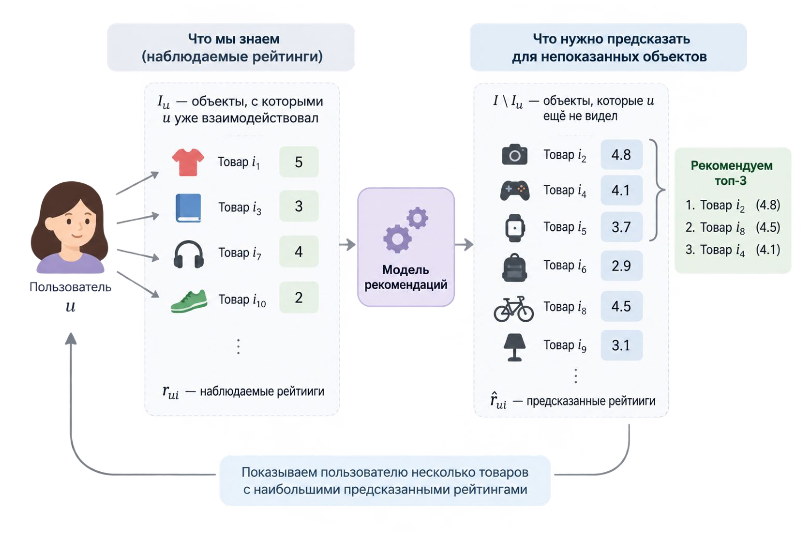

Чтобы понять, как именно выбирать такие объекты, сначала нужно разобраться, какие данные доступны в рекомендательной системе и что из них можно превратить в признаки. С этого и начнём.

## Данные и признаки: explicit и implicit feedback

*Таймкод: 00:04:51 · слайды 8–14*

Итак, модель берёт историю пользователя — с какими объектами он взаимодействовал и как, — выдаёт скоры для новых для него объектов, мы ранжируем объекты по этим скорам и показываем пользователю верхние. Чтобы понять, как устроена такая модель, сначала нужно разобраться, что именно мы о пользователе наблюдаем и что из этого можно подать ей на вход.

### Что такое признаки

**Признаки** в рекомендательной системе — это характеристики пользователя, объекта и контекста взаимодействия, которые модель использует, чтобы оценить, насколько объект релевантен пользователю. С пользователем и объектом всё интуитивно понятно, а контекст — это условия, в которых произошло взаимодействие: например, время суток.

### Explicit и implicit feedback

Один из самых важных источников информации для рекомендаций — обратная связь самого пользователя. Её делят на два вида.

**Explicit feedback** (явная обратная связь) — пользователь сам показывает, нравится ему объект или нет. **Implicit feedback** (неявная обратная связь) — любая другая информация о его действиях: пользователь ничего не говорит о своём отношении к объекту, но совершает какое-то действие, и по этому действию мы судим о его интересе.

Попробуйте разложить по этим двум видам привычные сигналы. Лайк — явный: человек прямо выразил отношение. Рейтинг — тоже явный. Клик — неявный. Интереснее с покупкой: правда ли, что если пользователь купил товар, то товар ему понравился? Не обязательно. Покупка говорит об интересе, но прямо выраженным «нравится» не является, поэтому это неявный сигнал. В итоге получается так:

- explicit: поставил рейтинг, лайкнул, написал отзыв;
- implicit: кликнул на карточку товара, начал смотреть фильм, добавил в корзину.

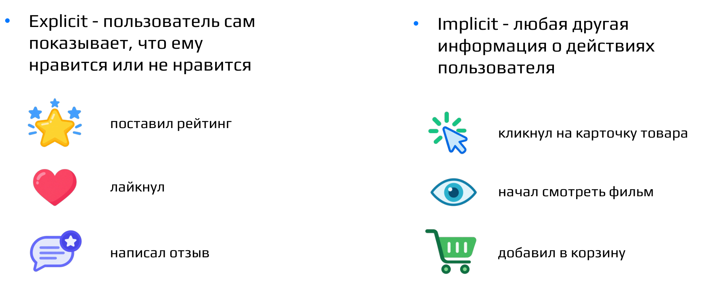

### Четыре типа признаков

Признаки, которые используются в рекомендательных системах, удобно делить на четыре типа.

|Тип признаков|Что описывают|Примеры|
|:---------|:----------------|:--------------------|
|Контентные|характеристики пользователя или объекта|жанр, актёры, бренд, цена, возраст пользователя|
|Контекстные|условия, в которых происходит взаимодействие|время суток, день недели, устройство, геолокация, сезон|
|Поведенческие|действия пользователя и историю взаимодействий|просмотры, клики, покупки, рейтинги|
|Коллаборативные|закономерности в коллективном поведении пользователей|популярность объекта, сходство пользователей, item–item сходство|

**Контентные признаки** описывают пользователя или объект сами по себе, независимо от конкретного показа: у фильма есть жанр и актёры, у товара — бренд и цена, у пользователя — возраст. **Контекстные признаки** описывают условия взаимодействия: время суток, день недели, устройство, геолокацию, сезон. Список легко продолжить, вплоть до погоды. **Поведенческие признаки** говорят о действиях конкретного пользователя и его истории взаимодействий — просмотрах, кликах, покупках, рейтингах. **Коллаборативные признаки** выражают закономерности уже не одного человека, а коллективного поведения всех пользователей: насколько популярен объект, насколько похожи друг на друга пользователи, насколько похожи объекты (item–item сходство).

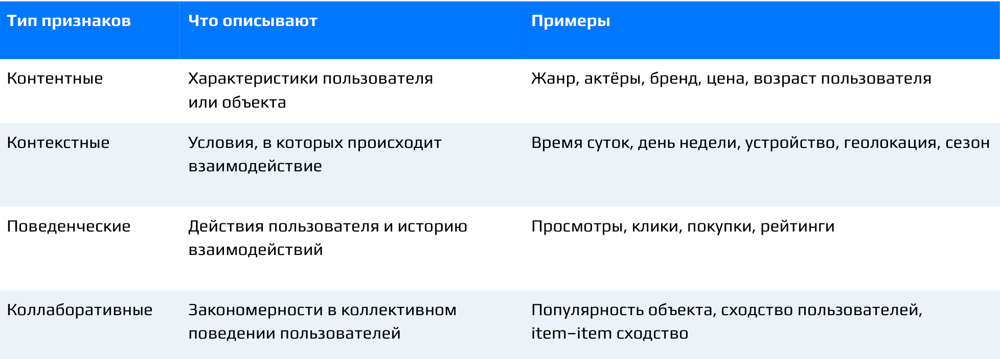

### Данные — не то же самое, что признаки

Важно различать данные и признаки. Всё, что поступает в систему, — это **сырые данные**, то есть сырые события: пользователь кликнул, посмотрел, поставил оценку. Признаки — уже характеристики пользователя, объекта или контекста, которые мы из этих событий извлекаем, чтобы подать в модель. В частности, поведенческие признаки строятся именно из истории взаимодействий. Explicit feedback при этом — явно выраженное отношение пользователя к объекту, а implicit feedback — косвенный сигнал интереса, который мы видим в его поведении: кликах, просмотрах, покупках.

**Акцент лектора:** отсутствие implicit-события — не отрицательный пример. Если пользователь не кликнул на товар или не начал смотреть фильм, это вовсе не значит, что объект ему не понравился или что мы порекомендовали что-то плохое. Возможно, он этот объект просто не видел. Эта асимметрия неявного фидбэка — наличие события говорит об интересе, а отсутствие почти ничего не говорит — ещё не раз понадобится нам при разговоре о моделях.

## Виды рекомендательных алгоритмов и матрица взаимодействий

*Таймкод: 00:11:18 · слайды 15–22*

### Персонализированные и неперсонализированные подходы

Рекомендательные алгоритмы делятся на два больших класса. **Неперсонализированные рекомендации** одинаковы для всех пользователей. Сюда относятся популярные методы, например топ-10 фильмов платформы, который показывается каждому, и методы на правилах: эвристики и бизнес-правила вида «если пользователь смотрел фильм X, рекомендуем фильм Y».

**Персонализированные рекомендации** учитывают информацию о конкретном пользователе и его интересах. Этот класс шире, и внутри него выделяют три подтипа.

- **Контентные методы (content-based)** опираются на контентные признаки объектов или самого пользователя: какие жанры он смотрит, какие актёры ему нравятся и т. д. Если человек смотрит научную фантастику, ему предлагают похожие фильмы того же жанра.
- **Коллаборативная фильтрация** использует только историю взаимодействий. Мы смотрим, с какими объектами взаимодействовал пользователь, и никак не привязываемся к свойствам этих объектов. Есть два варианта: можно найти похожих пользователей и порекомендовать то, что понравилось им, а можно рекомендовать объекты, похожие на те, с которыми пользователь уже взаимодействовал.
- **Гибридные методы** комбинируют несколько подходов. Они объединяют похожесть пользователей, признаки объектов и контекст ситуации, то есть всё, что можно скомбинировать из уже имеющихся вариантов.

В любом из подходов можно использовать дополнительные сигналы: признаки пользователя (демография, интересы), признаки объекта (жанр, автор, категория), контекст (время, устройство, локация) и тип обратной связи (просмотры, лайки, покупки, оценки).

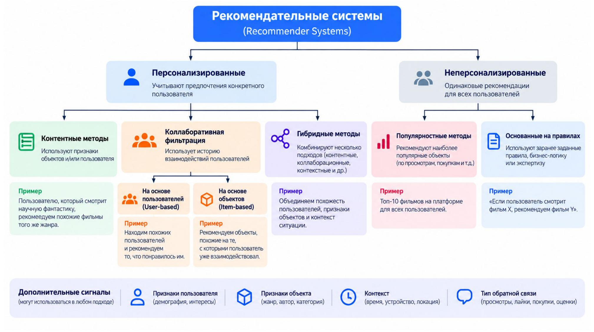

### Интуиция коллаборативной фильтрации

Начнём с простой интуиции. Допустим, нам с другом нравятся одни и те же фильмы: некоторые мы оба оценили высоко, а некоторые обоим не понравились. Друг посмотрел ещё один фильм и поставил ему высокую оценку. Тогда с высокой вероятностью этот фильм понравится и мне: друг бы мне его посоветовал, я бы посмотрела и сказала, что рекомендация отличная.

На этой идее и строится коллаборативная фильтрация: рекомендации получаются из поведения пользователей и их взаимодействий с объектами. Описание фильма при этом не используется, используется то, как с фильмами взаимодействовали похожие на нас пользователи. Коллаборативная модель может не знать, что фильм относится к фантастике. Она понимает, что два фильма похожи, только потому, что их смотрят похожие люди. Что именно значит «похожие люди», мы формализуем чуть позже.

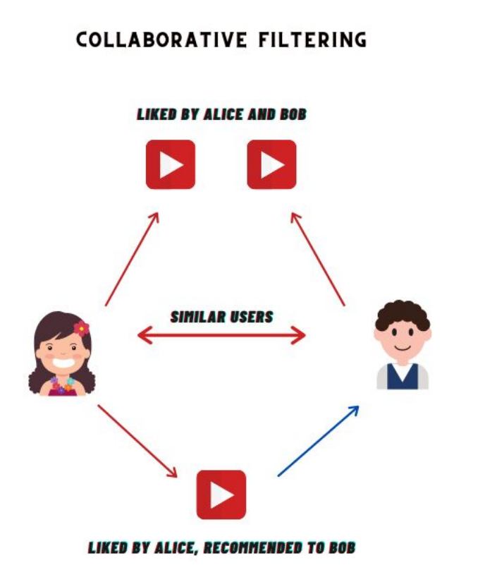

### Матрица взаимодействий

Основной объект, с которым работает коллаборативная фильтрация, — **матрица взаимодействий (user-item матрица)**. Её строки соответствуют пользователям, столбцы соответствуют айтемам (в нашем примере это фильмы). В ячейке на пересечении стоит рейтинг, который пользователь поставил объекту.

|        | Интерстеллар | Начало | Марсианин | Один дома | Форрест Гамп |
|:--     |:--:|:--:|:--:|:--:|:--:|
| Аня    | 5  | 1  | 4  |    |    |
| Борис  | 4  |    | 5  | 4  |    |
| Вика   |    | 5  |    | 4  | 3  |
| Глеб   | 1  | 4  |    | 2  | 4  |

Вика поставила «Началу» пятёрку, значит, фильм ей понравился, а Глебу «Интерстеллар» не понравился, у него единица.

**Важно:** пустая ячейка означает только отсутствие взаимодействия. Это ни в коем случае не сигнал о том, что объект пользователю не нравится, и это прямо продолжает мысль о неявном фидбэке из предыдущего раздела.

Что можно порекомендовать Ане? Подходит «Один дома». Аня и Борис смотрели одни и те же фильмы, «Интерстеллар» и «Марсианин», и оба оценили их высоко: у Ани 5 и 4, у Бориса 4 и 5. Борис посмотрел ещё и «Один дома» и поставил ему 4, так что с большой вероятностью этот фильм понравится и Ане.

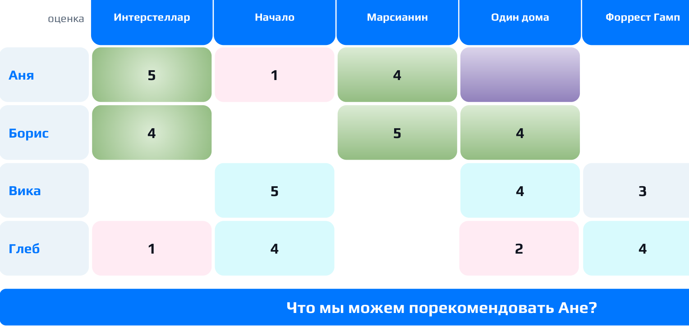

Отсюда формулировка задачи модели: **предсказать значения в пустых ячейках матрицы**, то есть заполнить её. Это та же задача оценки $\hat r_{ui}$ для $i \in I \setminus I_u$, только записанная в терминах матрицы.

Методы, которые решают эту задачу, делятся на две группы. **Memory-based** подходы не обучают отдельную параметрическую модель. Они работают непосредственно с матрицей взаимодействий: сравнивают её строки или столбцы и строят прогноз через похожих соседей. **Model-based** подходы, наоборот, обучают модель с параметрами, которая восстанавливает матрицу. Начнём с memory-based.

## Memory-based: user-based и item-based коллаборативная фильтрация

*Таймкод: 00:18:00 · слайды 23–32*

Memory-based коллаборативная фильтрация бывает двух видов: можно искать похожих пользователей, а можно искать похожие объекты. Начнём с первого варианта.

### User-based: соседи и прогноз оценки

В подходе **user-based** мы предсказываем оценку пользователя по оценкам людей, похожих на него. Для этого нужна **мера похожести $s(u,v)$**, то есть функция, которая говорит, насколько пользователь $u$ похож на пользователя $v$. Какая именно это функция, пока неважно: будем считать, что она у нас уже есть.

Первый шаг — найти соседей пользователя $u$:

$$N(u) = \{\, v \ne u \mid s(u,v) > \alpha \,\}.$$

**Соседи $N(u)$** — это все остальные пользователи, чья похожесть на $u$ больше порога $\alpha$. Порог $\alpha$ является гиперпараметром. Например, если $\alpha$ лежит между 0.2 и 0.6, то пользователи с похожестью 0.8, 0.7 и 0.6 попадают в соседи, а пользователи с похожестью 0.2 и −0.1 не попадают.

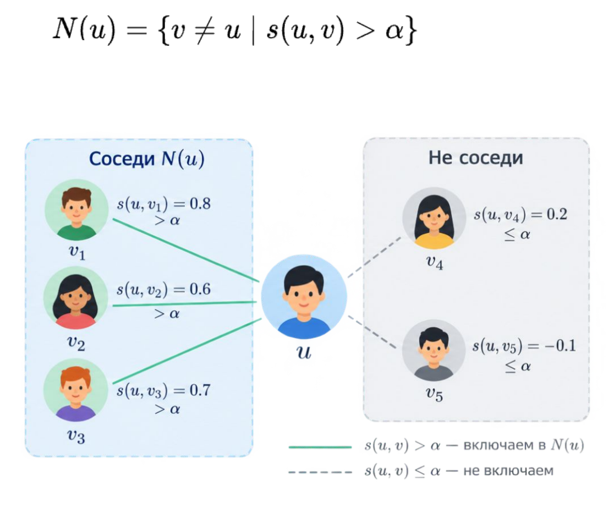

Второй шаг — предсказать оценку объекта $i$, с которым $u$ ещё не взаимодействовал, по оценкам соседей:

$$\hat r_{ui} = \frac{\sum_{v \in N_i(u)} s(u,v)\, r_{vi}}{\sum_{v \in N_i(u)} |s(u,v)|}.$$

Здесь $r_{vi}$ — оценка, которую сосед $v$ поставил объекту $i$, а суммирование идёт по тем соседям $u$, которые этот объект оценили (отсюда индекс $i$ в $N_i(u)$). В числителе стоит сумма произведений «похожесть соседа × его оценка», в знаменателе — сумма модулей похожестей. Получается взвешенное среднее оценок соседей: чем сильнее сосед похож на нашего пользователя, тем больше вес его мнения, и результат остаётся в той же шкале, что и исходные оценки.

Посчитаем на примере. У пользователя $u$ три соседа:

- $s(u,v_1) = 0.9$, и $v_1$ поставил объекту $i$ оценку 5;
- $s(u,v_2) = 0.7$, оценка 4;
- $s(u,v_3) = 0.4$, оценка 3.

Сначала умножаем похожести на оценки, затем делим на сумму похожестей:

$$\hat r_{ui} = \frac{0.9\cdot 5 + 0.7\cdot 4 + 0.4\cdot 3}{0.9 + 0.7 + 0.4} = \frac{8.5}{2.0} = 4.25 \approx 4.2.$$

Так считаем прогноз для всех объектов, которые пользователь ещё не видел, сортируем их по прогнозу и выдаём top-N.

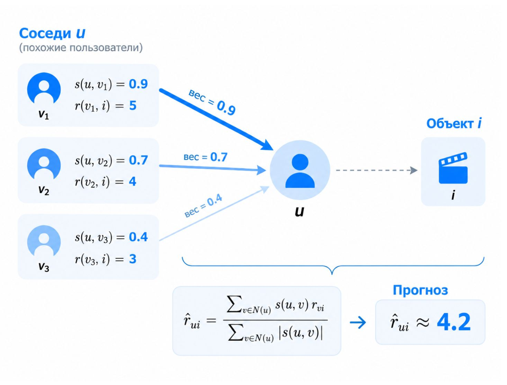

### Нормализация оценок

У этой схемы есть проблема: разные пользователи пользуются разными шкалами. Один обычно ставит от 7 до 10, и в среднем у него получается 8. Другой никогда не ставит ни 10, ни даже 7, его оценки лежат в диапазоне от 3 до 6. Восьмёрка от первого и пятёрка от второго могут значить одно и то же, но формула прогноза воспримет их как разные мнения.

Решение — **нормализация оценок**: для каждого пользователя смотрим не на саму оценку, а на её отклонение от его средней оценки:

$$r_{vi} \;\longrightarrow\; r_{vi} - \bar r_v,$$

где $\bar r_v$ — средняя оценка пользователя $v$ по всем объектам, которые он оценил. Пусть пользователь A со средней 8 поставил фильму 8, а пользователь B со средней 5 поставил тому же фильму 5. Отклонения равны $8 - 8 = 0$ и $5 - 5 = 0$, то есть фильм одинаково хорош для обоих, хотя сырые оценки различаются. В формуле прогноза вместо $r_{vi}$ теперь стоит отклонение $r_{vi} - \bar r_v$, а в остальном она почти не меняется.[^n4a]

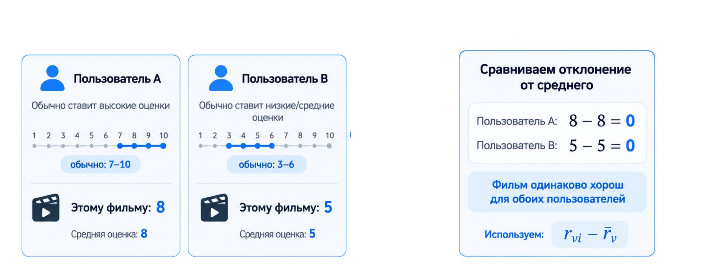

### Item-based: похожие объекты вместо похожих пользователей

Подход **item-based** зеркален user-based: вместо похожих пользователей ищем похожие объекты. Теперь $s(i,j)$ — мера похожести объектов $i$ и $j$, и соседи объекта $i$ определяются так же, через порог:

$$N(i) = \{\, j \mid s(i,j) > \alpha \,\}.$$

Если пользователь $u$ ещё не оценивал объект $i$, его рейтинг предсказывается по оценкам, которые этот же пользователь поставил похожим объектам:

$$\hat r_{ui} = \frac{\sum_{j \in N(i)} s(i,j)\, r_{uj}}{\sum_{j \in N(i)} |s(i,j)|}.$$

Разница между подходами такая. В user-based мы смотрим на поведение пользователей, похожих на нашего, а в item-based — на то, насколько айтемы похожи между собой.

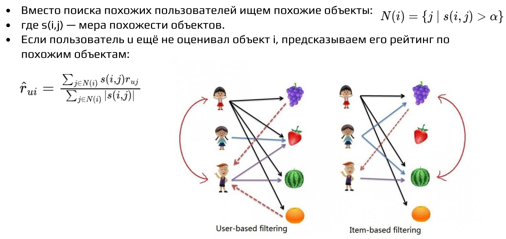

### Как считать похожесть

Оба подхода работают с одной и той же матрицей взаимодействий. В user-based пользователи сравниваются по **строкам** матрицы, в item-based объекты сравниваются по **столбцам**: для каждого айтема берём его столбец и сравниваем столбцы между собой. Для сравнения можно взять скалярное произведение двух векторов, а мер похожести бывает много: **косинусная мера** (в простом случае $s$ — это просто косинус угла между векторами), **корреляция Пирсона**, **мера Жаккара** и другие.

### Когда что выбрать

| | User-based | Item-based |
|:------|:----------|:----------|
| Сравниваем | пользователей | объекты |
| Соседства меняются | при изменении поведения пользователей | при изменении структуры каталога |
| Объяснение | «Похожим пользователям понравилось…» | «Похоже на то, что вы уже смотрели…» |
| Практический плюс | хорошо отражает сходство вкусов между пользователями | item-item связи часто стабильнее и проще интерпретировать |

Поведение пользователей меняется часто. Стоит соседу провзаимодействовать с новыми объектами, и в user-based соседства перестраиваются. В item-based соседства меняются, когда меняется сам каталог: например, выходит новый айтем, и для него приходится пересчитывать похожести.

Объяснения у двух подходов тоже разные. User-based говорит «это понравилось похожим на вас пользователям». Item-based говорит «это похоже на то, что вы уже смотрели». Такую подборку легко встретить в онлайн-кинотеатре: «вы смотрели такой-то фильм, посмотрите похожее», и эта задача как раз решается item-based подходом. Item-item связи к тому же легко интерпретировать: фильм «Брат» похож на «Брат 2». User-based подходит там, где важны связи между самими пользователями, например в социальных сетях.

Какой вариант лучше, зависит от данных: от того, какая доля матрицы взаимодействий заполнена, как быстро меняются пользователи и каталог, и от конкретной задачи.

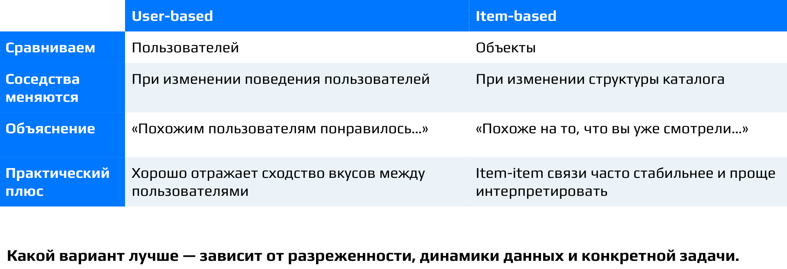

Выбирать что-то одно не обязательно. Подходы можно комбинировать, и получится **гибрид user-based и item-based** — частный случай гибридных методов. Простейший вариант — взвешенная сумма скоров двух подходов:

$$\text{score} = \alpha \cdot \text{score}_{\text{user-based}} + \beta \cdot \text{score}_{\text{item-based}},$$

где $\alpha$ и $\beta$ — веса слагаемых (это не порог из определения соседей).

::: {.qa title="Вопросы из зала"}
**Чем контентные методы отличаются от item-based?** Контентные методы используют информацию о самом объекте: его характеристики, например жанр, актёров и т. д. Item-based, как и любая коллаборативная фильтрация, использует только то, как пользователи взаимодействуют с объектами, то есть только матрицу взаимодействий. О содержании фильма модель ничего не знает: айтемы можно назвать «айтем 1», «айтем 2», «айтем 3», и к контенту эти названия никакого отношения иметь не будут. Похожими два объекта оказываются только потому, что с ними похоже взаимодействовали пользователи.
:::

[^n4a]: Примечание составителя: чтобы прогноз вернулся в шкалу пользователя $u$, к взвешенному среднему отклонений обычно прибавляют среднюю оценку самого $u$: $\hat r_{ui} = \bar r_u + \dfrac{\sum_{v \in N_i(u)} s(u,v)\,(r_{vi} - \bar r_v)}{\sum_{v \in N_i(u)} |s(u,v)|}$. Итоговая формула с нормализацией в лекции не была показана.

## Model-based: скрытые факторы, SVD и Truncated SVD

*Таймкод: 00:33:16 · слайды 33–46*

### Разреженность и скрытые факторы

Model-based подход начинается с той же матрицы взаимодействий, но смотрит на неё иначе. Возьмём онлайн-кинотеатр: пользователь смотрит гораздо меньше фильмов, чем есть в каталоге. Если фильмов 10 000, обычный зритель посмотрит от силы сотню, киноман, допустим, тысячу. Почти все ячейки матрицы пусты, и это свойство называется **разреженностью**: известных значений ничтожно мало по сравнению с размером матрицы.

Каждого пользователя можно считать точкой в пространстве $\mathbb{R}^n$, где $n$ — число айтемов в каталоге. При 10 000 фильмов пользователь описывается 10 000 координатами, и почти все они неизвестны. Правда ли нужны все эти координаты? Гипотеза model-based методов в том, что поведение описывается гораздо компактнее, через небольшое число **скрытых (латентных) факторов**. Это скрытые оси, по которым располагаются и пользователи, и объекты, а большое число наблюдаемых взаимодействий как раз и объясняется положением тех и других вдоль этих осей.

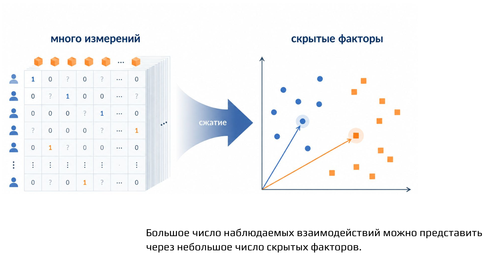

### Можно ли сжать матрицу

Тот же вопрос на уровне всей матрицы: можно ли приблизить большую матрицу взаимодействий чем-то компактным, что сохранит основную структуру данных? Формально: есть матрица

$$R \in \mathbb{R}^{|U|\times|I|},$$

и мы ищем матрицу $\hat R$, такую что

$$R \approx \hat R, \qquad \operatorname{rank}(\hat R) = k, \qquad k \ll \min(|U|, |I|).$$

Иначе говоря, нужна матрица того же размера, но гораздо меньшего ранга $k$, близкая к исходной. Как найти лучшее такое приближение? Классический инструмент для этого — сингулярное разложение.

### SVD

**SVD (Singular Value Decomposition)**, сингулярное разложение, применяется к полностью заполненной матрице взаимодействий $R \in \mathbb{R}^{n\times m}$, где $n$ — число пользователей, $m$ — число объектов. Самое главное условие: все элементы матрицы должны быть известны, пропусков нет. Для любой такой матрицы существует разложение

$$R = U\Sigma V^\top, \qquad U\in\mathbb{R}^{n\times r},\quad \Sigma\in\mathbb{R}^{r\times r},\quad V\in\mathbb{R}^{m\times r}, \qquad r = \operatorname{rank}(R).$$

Столбцы $U$ и $V$ ортонормированы:

$$U^\top U = I, \qquad V^\top V = I,$$

то есть каждый столбец имеет единичную норму, а разные столбцы ортогональны друг другу. Посередине стоит диагональная матрица

$$\Sigma = \operatorname{diag}(\sigma_1, \sigma_2, \dots, \sigma_r), \qquad \sigma_1 \ge \sigma_2 \ge \dots \ge \sigma_r > 0.$$

Числа $\sigma_j$ на её диагонали называются **сингулярными значениями**, они упорядочены по убыванию. Столбцы $U$ — левые сингулярные векторы, столбцы $V$ — правые. Матрица $R$ раскладывается в произведение трёх матриц.

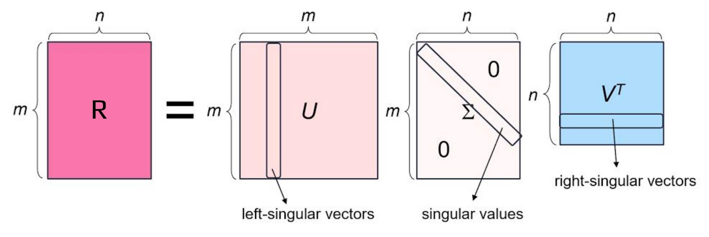

### Truncated SVD и лучшее приближение ранга k

Теперь простой шаг: оставим не все $r$ компонент, а только первые $k$. Так можно делать, потому что сингулярные значения упорядочены по убыванию: первые компоненты самые весомые, последние вносят меньше всего. Если записать $U\Sigma = [\sigma_1 u_1, \dots, \sigma_k u_k]$ для первых $k$ столбцов, получается

$$R \approx \sum_{j=1}^{k} \sigma_j u_j v_j^\top = U_k \Sigma_k V_k^\top.$$

Здесь $U_k$ — первые $k$ столбцов $U$, $\Sigma_k$ — левый верхний блок $k\times k$ матрицы $\Sigma$, $V_k^\top$ — первые $k$ строк $V^\top$. Получилась матрица ранга $k$, и такое усечённое разложение называется **Truncated SVD**.

Из линейной алгебры известно, что Truncated SVD даёт **лучшее rank-k приближение** в **норме Фробениуса**: среди всех матриц ранга $k$ ближе всего к $R$ именно $U_k \Sigma_k V_k^\top$.[^n5a] Норма Фробениуса считается по сумме квадратов всех элементов матрицы, поэтому, минимизируя её, мы минимизируем суммарную квадратичную ошибку восстановления матрицы.[^n5b]

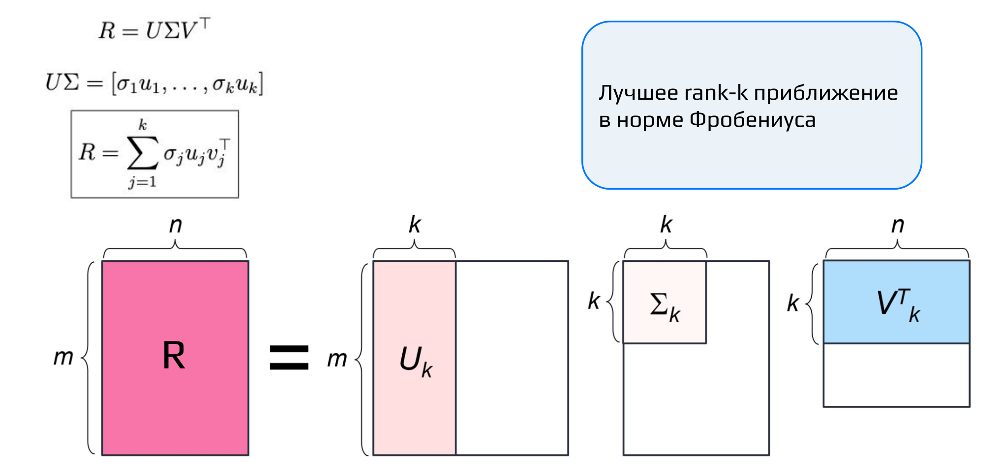

### Truncated SVD в рекомендациях

Как перейти от разложения к рекомендациям? Разделим $\Sigma_k$ поровну между двумя сомножителями:

$$R \approx U_k \Sigma_k V_k^\top = \underbrace{U_k \Sigma_k^{1/2}}_{P}\,\underbrace{\Sigma_k^{1/2} V_k^\top}_{Q^\top} = PQ^\top, \qquad P\in\mathbb{R}^{|U|\times k},\quad Q\in\mathbb{R}^{|I|\times k}.$$

Строка $p_u$ матрицы $P$ — это $k$-мерное представление пользователя, строка $q_i$ матрицы $Q$ — $k$-мерное представление объекта. Прогноз оценки получается их скалярным произведением:

$$\hat r_{ui} = p_u^\top q_i.$$

Это и есть то компактное описание через скрытые факторы, с которого начинался раздел: вместо 10 000 координат у пользователя $k$ чисел, и столько же у каждого фильма.

### Почему пропуски нельзя просто заполнить

Вернёмся к главному условию SVD: все элементы матрицы должны быть известны. В реальной матрице оценок это не так: даже в маленьком примере с Аней, Борисом, Викой и Глебом почти половина ячеек пуста. Что поставить на место пропусков, чтобы разложение стало возможным?

Самые очевидные варианты — нули или среднее, и оба плохи.

- **Нули.** Для рейтинга ноль не означает «мы ничего не знаем», это конкретное числовое значение, которое мы приписываем пользователю. Модель решит, что Аня оценила «Одного дома» на 0, хотя она его, возможно, просто не видела. При сильной разреженности таких искусственных значений подавляющее большинство.
- **Среднее.** Мы создаём огромное количество искусственных наблюдений о пользователе и тем самым объявляем, что он как-то относится к объектам, которые, возможно, не видел и никак не оценивал.

В обоих случаях SVD честно найдёт оптимальное приближение, но приближать будет не наши реальные данные, а то, что мы создали искусственно. Отсюда вывод.

**Важный вывод:** идею низкого ранга и представлений $p_u$, $q_i$ стоит сохранить, но искать их нужно только по тем ячейкам, значения в которых действительно известны, не придумывая значения для пустых.

[^n5a]: Примечание составителя: это утверждение известно как теорема Эккарта–Янга.

[^n5b]: Примечание составителя: строго говоря, норма Фробениуса — это корень из суммы квадратов элементов, $\|A\|_F = \sqrt{\sum_{i,j} a_{ij}^2}$. На то, какая матрица оказывается лучшим приближением, корень не влияет, поэтому минимизировать можно и сам квадрат нормы.

## Матричная факторизация и обучение через SGD

*Таймкод: 00:41:15 · слайды 47–55*

### Идея: приближать только то, что известно

Итак, от SVD хочется сохранить идею низкого ранга, но искать низкоранговое представление нужно без заполнения пропусков.

**Матричная факторизация (Matrix Factorization)** — это метод разложения одной матрицы на произведение двух или нескольких матриц меньшей размерности. Это более общее понятие, чем SVD-разложение. В рекомендациях первая матрица хранит короткое представление пользователей, вторая — короткое представление объектов. Главное отличие от SVD: не нужно восстанавливать полную матрицу и только потом раскладывать её. Вместо того чтобы придумывать значения для неизвестных ячеек, мы ищем низкоранговое представление напрямую по наблюдаемым взаимодействиям.

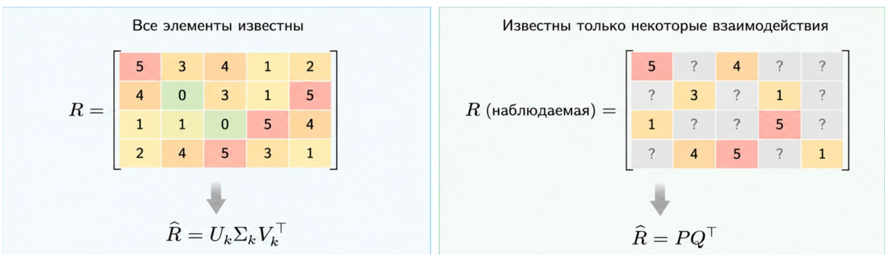

Сравним две постановки. Для полной матрицы $R$ SVD решает задачу лучшего приближения ранга $k$:

$$
\min_{\widehat R} \|R - \widehat R\|_F^2, \qquad \operatorname{rank}(\widehat R) \le k,
$$

где $\widehat R$ — приближение исходной матрицы. Решение — $\widehat R = U_k \Sigma_k V_k^\top$, или, что то же самое, $\widehat R = PQ^\top$. В матричной факторизации известны только элементы, с которыми пользователь взаимодействовал:

$$
\Omega = \{(u,i) : r_{ui} \ne 0\},
$$

то есть ячейки, где в матрице стоит значение (например, рейтинг), а не пропуск. Ошибку приближения оптимизируем только по этим парам и добавляем регуляризацию:

$$
\min_{P,Q} \sum_{(u,i)\in\Omega} \left(r_{ui} - p_u^\top q_i\right)^2 + \lambda\left(\|P\|_F^2 + \|Q\|_F^2\right).
$$

### Модель: $R \approx PQ^\top$

Пусть $R \in \mathbb{R}^{|U|\times|I|}$ — user-item матрица. Приблизим её произведением двух матриц меньшей размерности:

$$
R \approx PQ^\top, \qquad P \in \mathbb{R}^{|U|\times k}, \quad Q \in \mathbb{R}^{|I|\times k}, \quad k \ll |U|, |I|.
$$

Строка $p_u \in \mathbb{R}^k$ матрицы $P$ — **эмбеддинг (представление) пользователя**, строка $q_i \in \mathbb{R}^k$ матрицы $Q$ — **эмбеддинг (представление) объекта**. Предсказанная оценка — скалярное произведение вектора пользователя на вектор объекта:

$$
\hat r_{ui} = p_u^\top q_i .
$$

Как и в memory-based методах, мы хотим оценить, насколько пользователь «подходит» объекту, — только теперь это делается через их короткие векторные представления.

### Постановка задачи обучения

Каждому пользователю $u$ и объекту $i$ сопоставляем $k$-мерные латентные представления $p_u, q_i \in \mathbb{R}^k$. **Множество наблюдаемых пар $\Omega \subseteq U \times I$** — это пары $(u,i)$, для которых известен рейтинг $r_{ui}$ или, в общем случае, какое-то наблюдаемое событие, не обязательно рейтинг. Для каждой такой пары есть настоящее значение $r_{ui}$ и предсказание модели $\hat r_{ui}$. Подберём представления так, чтобы минимизировать квадрат отклонения реального значения от предсказанного:

$$
\min_{\{p_u\},\{q_i\}} \sum_{(u,i)\in\Omega} \left(r_{ui} - p_u^\top q_i\right)^2 .
$$

**Важно:** пустые ячейки матрицы в эту сумму не входят — только те, где на пересечении пользователя и объекта стоит значение.

К ошибке добавляем **L2-регуляризацию** — штраф за квадрат нормы векторов. Она ограничивает нормы представлений и помогает не переобучаться:

$$
\min_{\{p_u\},\{q_i\}} \left[\sum_{(u,i)\in\Omega} \left(r_{ui} - p_u^\top q_i\right)^2 + \lambda\left(\sum_{u\in U}\|p_u\|_2^2 + \sum_{i\in I}\|q_i\|_2^2\right)\right].
$$

Это та же функция потерь, что и выше, только регуляризация расписана по отдельным векторам[^n6a]. Задача — выбрать $P$ и $Q$, минимизирующие её.

### Обучение через SGD

Как оптимизировать такой функционал? Он напоминает регрессию, но неизвестны сразу обе матрицы — и $P$, и $Q$, поэтому естественный первый вариант — градиентный спуск, а именно **SGD (Stochastic Gradient Descent)**, стохастический градиентный спуск. В SGD берём одно наблюдаемое взаимодействие и обновляем только параметры этой пары. Для пары $(u,i)\in\Omega$ вычисляем текущую ошибку

$$
e_{ui} = r_{ui} - \hat r_{ui} = r_{ui} - p_u^\top q_i
$$

и делаем шаг в сторону её уменьшения:

$$
p_u \leftarrow p_u + \gamma\left(e_{ui} q_i - \lambda p_u\right), \qquad
q_i \leftarrow q_i + \gamma\left(e_{ui} p_u - \lambda q_i\right),
$$

где $\gamma$ — **learning rate** (шаг обучения), $\lambda$ — коэффициент регуляризации.

Смысл обновлений простой. Если модель недооценила рейтинг ($e_{ui} > 0$), скалярное произведение $p_u^\top q_i$ нужно немного увеличить, если переоценила — немного уменьшить. За один градиентный шаг меняются только $p_u$ и $q_i$, и меняются так, чтобы их произведение стало ближе к реальной оценке. Слагаемые $-\lambda p_u$ и $-\lambda q_i$ не дают векторам сильно расти по норме.

SGD для матричной факторизации применять можно, но у него есть минус: нужно подбирать learning rate и делать очень много шагов обновления. Поэтому дальше разберём другой, более удобный способ обучения той же модели.

::: {.qa title="Вопросы из зала"}
**Почему матрица пользователей обозначена $P$?** $P$ — это матрица представлений пользователей. Как и в предыдущих методах, мы хотим оценивать, насколько пользователь похож на объект, поэтому оперируем представлениями пользователя и объекта, а исходную матрицу представляем как произведение двух таких матриц.

**Как инициализировать $p_u$ и $q_i$ перед SGD?** Случайно, например из нормального распределения, но не нулями.

**Что рекомендовать новому пользователю, у которого ещё нет истории взаимодействий?** Это известная проблема рекомендаций — **холодный старт**: о новом пользователе мы ничего не знаем, рейтингов у него нет, и мы ещё вернёмся к ней, когда будем обсуждать ограничения классических моделей. Простой способ — рекомендовать популярные объекты, то, что смотрят другие пользователи. Второй вариант — провести **онбординг**: при первом входе попросить пользователя выбрать, что ему нравится, как это делает, например, Яндекс Музыка. Затем эту информацию используют в моделях, построенных специально для таких «холодных» пользователей.
:::

[^n6a]: Примечание составителя: квадрат нормы Фробениуса матрицы равен сумме квадратов норм её строк, $\|P\|_F^2 = \sum_{u\in U}\|p_u\|_2^2$ и $\|Q\|_F^2 = \sum_{i\in I}\|q_i\|_2^2$, поэтому обе записи регуляризации совпадают.

## ALS: попеременная минимизация

*Таймкод: 00:54:08 · слайды 56–61*

SGD для матричной факторизации работает, но требует подбирать learning rate и делать очень много маленьких шагов. Есть способ обучать ту же модель заметно эффективнее, если воспользоваться структурой функции потерь.

### Идея: замораживаем один блок

Вернёмся к функции потерь матричной факторизации с регуляризацией:

$$
L(P,Q) = \sum_{(u,i)\in\Omega} \left(r_{ui} - p_u^\top q_i\right)^2 + \lambda\left(\|P\|_F^2 + \|Q\|_F^2\right).
$$

Как функция от $P$ и $Q$ одновременно эта задача невыпуклая: в ней перемножаются две неизвестные. **ALS (Alternating Least Squares)** не пытается найти лучшие $P$ и $Q$ сразу. Он не обновляет и параметры одной пары, как SGD. Вместо этого он оптимизирует блоки параметров по очереди:

$$
P^{(t+1)} = \arg\min_P L\left(P, Q^{(t)}\right), \qquad
Q^{(t+1)} = \arg\min_Q L\left(P^{(t+1)}, Q\right).
$$

Сначала текущую матрицу $Q$ «замораживаем»: считаем зафиксированной и не меняем. Тогда все $q_i$ — просто известные коэффициенты, и выражение $r_{ui} - p_u^\top q_i$ линейно по $p_u$. Задача по $P$ становится обычной квадратичной: это **least squares** (метод наименьших квадратов) с $L_2$-регуляризацией, а такую задачу легко решить. Иначе говоря, если зафиксировать текущее значение одного блока, задача по другому блоку становится квадратичной.

В целом цикл выглядит так. Матрицу оценок $R$ размера $|U|\times|I|$ представляем как произведение $R \approx PQ^\top$, где $P$ — матрица факторов пользователей ($|U|\times k$), а $Q^\top$ — транспонированная матрица факторов объектов ($k\times|I|$). Фиксируем $Q$ и обновляем $P$, затем фиксируем $P$ и обновляем $Q$. Чередование повторяем, пока алгоритм не сойдётся. Каждый шаг сводится к задаче least squares, отсюда и название метода.

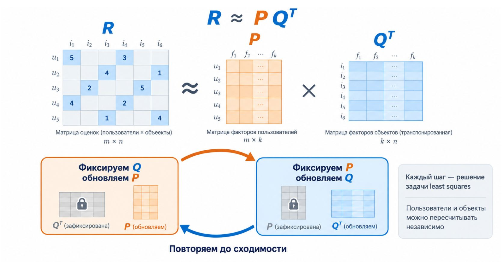

### Почему каждого пользователя можно обновлять отдельно

При фиксированном $Q$ функция потерь распадается на сумму маленьких лоссов по пользователям плюс константа:

$$
L(P\mid Q) = \sum_u \left[\sum_{i\in I_u} \left(r_{ui} - p_u^\top q_i\right)^2 + \lambda\|p_u\|_2^2\right] + \underbrace{\lambda\sum_i \|q_i\|_2^2}_{\text{const}}
= \sum_u L_u(p_u) + \text{const}.
$$

Здесь $I_u$ — объекты, с которыми взаимодействовал пользователь $u$. Вектор $p_u$ входит только в своё слагаемое $L_u$, а регуляризация $Q$ от $P$ не зависит. Поэтому

$$
\min_P L(P\mid Q) \iff \forall u:\ \min_{p_u} L_u(p_u),
$$

то есть каждый $p_u$ вычисляется независимо от остальных пользователей.

**Акцент лектора:** в этом главное преимущество ALS — **параллелизм по пользователям**. Пока $Q$ зафиксирована, пользовательские векторы можно спокойно пересчитывать параллельно, и ALS очень хорошо параллелится.

### Формула обновления $p_u$

Запишем лосс одного пользователя в векторном виде:

$$
L_u(p_u) = \|r_u - Q_u p_u\|_2^2 + \lambda\|p_u\|_2^2,
$$

где $r_u$ — вектор известных оценок пользователя $u$, а $Q_u$ — строки $Q$, соответствующие объектам, которые он оценил. Чтобы найти минимум, берём градиент по $p_u$ и приравниваем его к нулю:

$$
-2Q_u^\top(r_u - Q_u p_u) + 2\lambda p_u = 0
\;\Rightarrow\;
\left(Q_u^\top Q_u + \lambda I\right) p_u = Q_u^\top r_u
\;\Rightarrow\;
p_u = \left(Q_u^\top Q_u + \lambda I\right)^{-1} Q_u^\top r_u .
$$

Получилась формула в замкнутом виде: новый вектор пользователя выражается через векторы оценённых им объектов и его оценки.

**Важно:** в формуле стоит обратная матрица, но на практике её почти никогда не вычисляют. Вместо этого решают линейную систему вида $Ax = b$, где $A = Q_u^\top Q_u + \lambda I$ и $b = Q_u^\top r_u$.[^n7a]

### Полный шаг алгоритма

Один шаг ALS состоит из двух половин:

1. Фиксируем $Q$ и независимо пересчитываем представления пользователей:
   $$\left(Q_u^\top Q_u + \lambda I\right)p_u = Q_u^\top r_u.$$
2. Фиксируем $P$ и так же независимо пересчитываем представления объектов:
   $$\left(P_i^\top P_i + \lambda I\right)q_i = P_i^\top r_i.$$
   Здесь, симметрично, $P_i$ — строки $P$ для пользователей, оценивших объект $i$, а $r_i$ — вектор их оценок этого объекта.

Затем повторяем чередование: $Q$ фиксирована → обновляем $P$ → $P$ фиксирована → обновляем $Q$ → … до сходимости. Каждый $p_u$ вычисляется независимо от остальных пользователей, каждый $q_i$ — независимо от остальных объектов. Поэтому ALS хорошо параллелится.

[^n7a]: Примечание составителя: матрица $Q_u^\top Q_u + \lambda I$ имеет размер $k\times k$, где $k$ — число скрытых факторов, обычно небольшое. При $\lambda > 0$ она положительно определена, так что система всегда имеет единственное решение, и для каждого пользователя это быстрая задача маленького размера. Прямое решение системы численно устойчивее и дешевле, чем явное обращение матрицы.

## Неявный фидбэк и Implicit ALS

*Таймкод: 00:59:00 · слайды 62–68*

### Почему нужен отдельный подход к implicit feedback

До сих пор мы считали, что у нас есть явные рейтинги, которые пользователи выставили сами. В реальных рекомендательных системах их мало: лайки ставят и фильмы оценивают немногие, а гораздо чаще есть просмотры, клики, покупки, то есть implicit feedback. Смысл пропуска в матрице в этих двух случаях разный. В explicit-задаче рейтинг 5 означает положительную оценку, рейтинг 1 — отрицательную, а пропуск означает, что мы ничего не знаем. В implicit-задаче просмотр, клик или покупка говорят об интересе, а если действия нет, это не обязательно негатив: пользователь мог просто не увидеть объект.

Обычный ALS учитывает только наблюдаемые пары из $\Omega$, а пустые ячейки отбрасывает. Для неявного фидбэка хочется учитывать и пропуски, причём аккуратно: не выдавать их за дизлайки, но и не выбрасывать совсем. Для этого есть модификация ALS — **Implicit ALS (iALS)**.

### Предпочтение и уверенность

Вместо одного числа $r_{ui}$ в iALS для каждой пары вводятся две величины. Первая — **предпочтение (preference)**:
$$
a_{ui} = \mathbb{1}[r_{ui} > 0].
$$
Здесь $r_{ui}$ — сколько раз пользователь взаимодействовал с объектом (например, число просмотров). Если взаимодействие было, $a_{ui} = 1$, если не было — $a_{ui} = 0$. Проще говоря, там, где в user-item матрице стояли какие-то числа, теперь стоят единицы, а там, где было пусто, — нули. Ноль при этом не значит, что объект пользователю не нравится: это лишь отсутствие подтверждённого положительного сигнала.

Насколько мы доверяем каждой ячейке, показывает вторая величина — **уверенность (confidence)**:
$$
c_{ui} = 1 + \alpha r_{ui},
$$
где **константа $\alpha$** задаёт, насколько быстро уверенность растёт с числом взаимодействий, то есть насколько наблюдаемые события важнее пропусков. Чем сильнее сигнал, тем больше уверенность и тем сильнее влияет ошибка на этой паре. Единица в формуле нужна для ненаблюдаемых пар: у них $r_{ui} = 0$, значит $c_{ui} = 1$, и их вес в функции потерь получается не нулевым. Шкала весов выглядит так: нет взаимодействия — $1$, один просмотр — $1 + \alpha$, пять просмотров — $1 + 5\alpha$, двадцать — $1 + 20\alpha$.

### Функция потерь

Функция потерь iALS — взвешенная сумма квадратов ошибок:
$$
\mathcal{L} = \sum_{u,i} c_{ui}\left(a_{ui} - p_u^\top q_i\right)^2 + \lambda\left(\sum_u \|p_u\|_2^2 + \sum_i \|q_i\|_2^2\right).
$$
Здесь $c_{ui}$ — уверенность в наблюдении, $a_{ui}$ — было ли взаимодействие, $p_u$ и $q_i$ — эмбеддинги пользователя и объекта, второе слагаемое — та же $L_2$-регуляризация, что и раньше. От ALS эта функция отличается в двух местах. Во-первых, сумма идёт не по наблюдаемым парам, а по всем элементам матрицы: iALS учитывает все user–item пары. Во-вторых, в скобке теперь стоит не рейтинг $r_{ui}$, а факт взаимодействия $a_{ui}$, то есть цель бинарная. Мы хотим, чтобы $p_u^\top q_i$ было высоким для наблюдаемых пар и низким для остальных, но ошибки на остальных стоят дёшево. Пропуск остаётся слабым свидетельством отсутствия интереса, а не явным дизлайком: ненаблюдаемые пары участвуют в loss с минимальным весом $c_{ui} = 1$, как мягкие негативы.

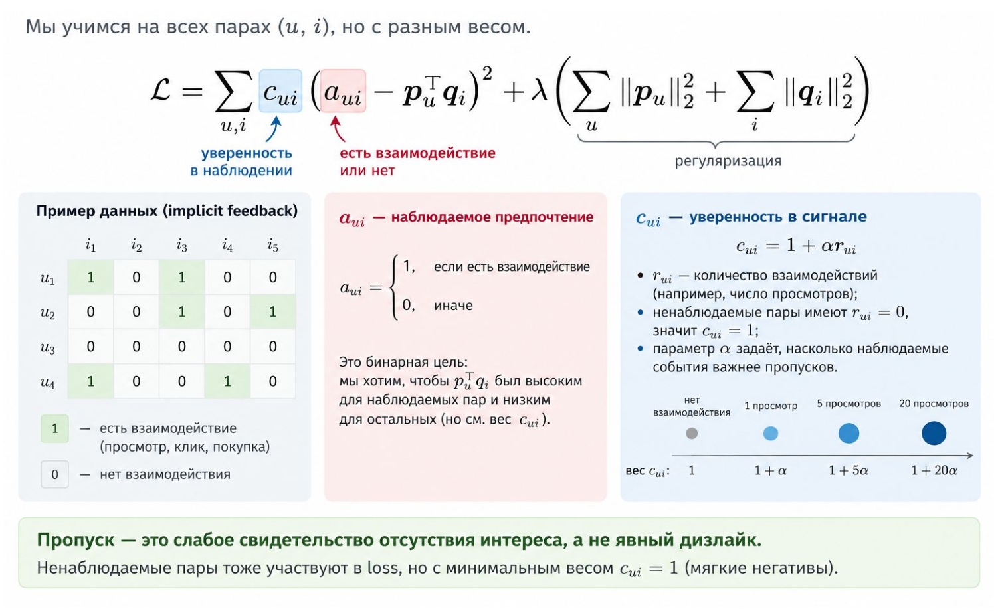

### Обучение

Обучается iALS так же, как ALS: поочерёдно фиксируем $Q$ и $P$. При фиксированном $Q$ задача для одного пользователя $u$ выглядит так:
$$
\min_{p_u} \sum_i c_{ui}\left(a_{ui} - p_u^\top q_i\right)^2 + \lambda\|p_u\|_2^2 .
$$
Запишем предпочтения пользователя вектором, а уверенности — диагональной матрицей:
$$
a_u = (a_{u1}, \dots, a_{u|I|})^\top, \qquad C_u = \mathrm{diag}(c_{u1}, \dots, c_{u|I|}).
$$
Тогда задача принимает матричный вид
$$
\min_{p_u} (a_u - Qp_u)^\top C_u (a_u - Qp_u) + \lambda p_u^\top p_u ,
$$
берём градиент и приравниваем его к нулю:
$$
-2Q^\top C_u(a_u - Qp_u) + 2\lambda p_u = 0
\;\Rightarrow\;
\left(Q^\top C_u Q + \lambda I\right)p_u = Q^\top C_u a_u .
$$
Это та же формула обновления, что в ALS, только каждое слагаемое взвешено своей уверенностью. По сути, каждый такой шаг — это **ridge-регрессия**, то есть линейная регрессия с $L_2$-штрафом на коэффициенты $p_u$. Регуляризация здесь не только борется с переобучением: при $\lambda > 0$ матрица $Q^\top C_u Q + \lambda I$ положительно определена, поэтому она обратима и решение получается аналитически. На практике, как и в ALS, обратную матрицу явно не считают, а решают линейную систему.

### Почему iALS хорошо работает на разреженных данных

Сумма в iALS идёт по всему каталогу, поэтому $C_u$ — матрица размера $|I| \times |I|$, и считать $Q^\top C_u Q$ «в лоб» для каждого пользователя дорого. Выручает **трюк $C_u = I + (C_u - I)$**: уверенность раскладывается на базовый вес, одинаковый для всех объектов, и добавку, которая отлична от нуля только у наблюдаемых. Тогда
$$
Q^\top C_u Q = Q^\top Q + Q^\top (C_u - I)\, Q .
$$
Первое слагаемое $Q^\top Q$ от пользователя не зависит, его считаем один раз для всех. Второе зависит только от объектов, с которыми пользователь взаимодействовал: у остальных $c_{ui} - 1 = 0$. Возьмём историю $r_u = (0, 3, 0, 1)^\top$: со вторым и четвёртым объектом взаимодействие было, с первым и третьим — нет. Тогда уверенности равны $(1,\ 1 + 3\alpha,\ 1,\ 1 + \alpha)$, что раскладывается на базовый вес $(1, 1, 1, 1)$ и добавку $(0,\ 3\alpha,\ 0,\ \alpha)$. Добавка задевает только два наблюдаемых объекта. Получается, не нужно пересчитывать произведения матриц по всем объектам, достаточно посчитать поправку по взаимодействиям пользователя.[^n8a]

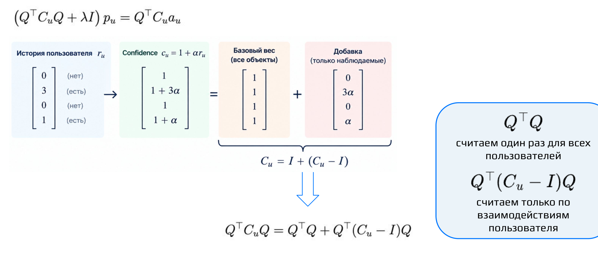

### Сильные и слабые стороны ALS и iALS

Оба метода хорошо масштабируются на больших разреженных матрицах. В отличие от SGD, они параллелятся (пользователей и айтемы можно обновлять независимо) и не требуют подбора learning rate. Оба дают компактные эмбеддинги пользователей и айтемов. Кроме того, при фиксированных item-факторах можно быстро пересчитать эмбеддинг пользователя по его новой истории. Число латентных факторов $k$ — тоже гиперпараметр, и выбирать его надо осознанно: чем больше факторов, тем больше матрицы и тем дольше обучение. iALS к тому же естественно работает с implicit feedback, а уверенность позволяет задавать разный вес разным взаимодействиям: 50 просмотров значат гораздо больше, чем один.

Ограничения у этих методов общие с остальными классическими моделями: холодные пользователи и айтемы, порядок действий (к ним вернёмся в конце лекции). Кроме того, всё, что модель умеет выразить, ограничено скалярным произведением представлений пользователя и айтема.

### Где в пайплайне применять ALS, а где iALS

Методы отвечают на разные вопросы, поэтому им подходят разные стадии двухстадийного пайплайна (каталог $10^6$–$10^9$ айтемов → отбор $10^2$–$10^3$ → ранжирование $10^1$–$10^2$ → выдача). ALS оценивает, насколько пользователь предпочитает один объект другому: он учится на известных оценках и сравнивает объекты между собой, поэтому подходит для ранжирования. iALS работает со всей user-item матрицей, включая незаполненные ячейки, и оценивает, какие объекты из большого каталога наиболее релевантны пользователю, поэтому подходит для отбора кандидатов.

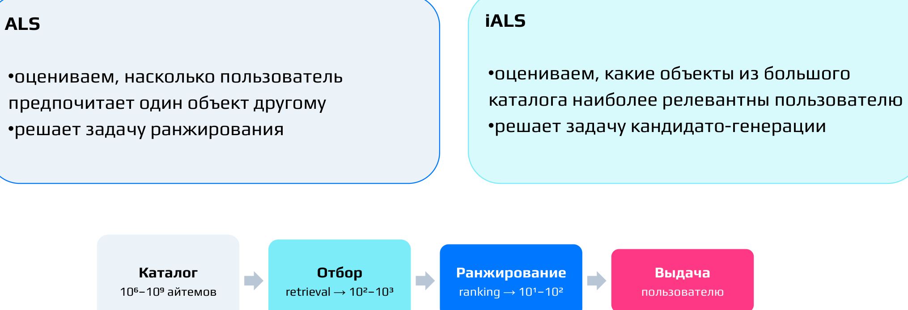

::: {.qa title="Вопросы из зала"}
**Почему решение не единственное и что с этим делает регуляризация?** В матричной факторизации решение вообще не единственное: разные пары $P$ и $Q$ могут давать одно и то же произведение $PQ^\top$.[^n8b] Регуляризация не даёт нормам векторов слишком расти. Кроме того, при $\lambda > 0$ матрица в формуле обновления положительно определена, так что каждый шаг ALS — ridge-регрессия с единственным аналитическим решением.
:::

[^n8a]: Примечание составителя: правая часть $Q^\top C_u a_u$ тоже считается только по наблюдаемым объектам, потому что у остальных $a_{ui} = 0$. Матрица $Q^\top Q$ имеет размер $k \times k$. Поэтому стоимость обновления одного пользователя зависит от числа его взаимодействий, а не от размера каталога.

[^n8b]: Примечание составителя: например, для любой обратимой матрицы $A$ размера $k \times k$ пара $P' = PA$, $Q' = Q(A^{-1})^\top$ даёт то же произведение: $P'Q'^\top = PAA^{-1}Q^\top = PQ^\top$. Мысль в ответе была начата именно с $P' = PA$, но не договорена.

## Смещения, SVD++ и Netflix Prize

*Таймкод: 01:16:07 · слайды 69–74*

Матричную факторизацию мы уже умеем обучать двумя способами: через SGD и через ALS. Теперь разберём **SVD++**. Несмотря на название, это модель матричной факторизации, а не приближение классического SVD. Чтобы к ней подойти, сначала расширим обычную факторизацию смещениями.

### Учёт смещений

Вспомним, что пользователи пользуются шкалой оценок по-разному: кто-то ставит 7–10, кто-то 2–5. Так же и с объектами: одни в среднем получают оценки выше других. В исходной задаче матричной факторизации

$$\min_{\{p_u\},\{q_i\}} \left[\sum_{(u,i)\in\Omega}\left(r_{ui} - p_u^\top q_i\right)^2 + \lambda\left(\sum_{u\in U}\|p_u\|_2^2 + \sum_{i\in I}\|q_i\|_2^2\right)\right]$$

всю эту разницу приходится объяснять скалярному произведению эмбеддингов. Логичнее вынести её в отдельные слагаемые, **смещения (bias)**:

$$\hat r_{ui} = \mu + b_u + b_i + p_u^\top q_i .$$

Здесь $\mu$ — глобальная средняя оценка, базовый уровень рейтинга во всём датасете. $b_u$ — смещение пользователя: склонен ли конкретный пользователь ставить оценки выше или ниже среднего. $b_i$ — смещение объекта: получает ли объект в среднем оценки выше или ниже, чем другие объекты. Скалярное произведение $p_u^\top q_i$ теперь отвечает только за то, что остаётся после этих поправок, то есть за индивидуальное отношение пользователя к объекту.

Ошибка на паре $(u,i)$ записывается так же, как раньше, только с новым прогнозом:

$$e_{ui} = r_{ui} - \left(\mu + b_u + b_i + p_u^\top q_i\right).$$

Смещения обучаются вместе с факторами тем же SGD, с шагом $\gamma$ и регуляризацией $\lambda$:

$$b_u \leftarrow b_u + \gamma\,(e_{ui} - \lambda b_u), \qquad b_i \leftarrow b_i + \gamma\,(e_{ui} - \lambda b_i).$$

Ничего принципиально нового здесь нет: модель просто расширилась дополнительными обучаемыми параметрами.

::: {.qa title="Вопросы из зала"}
**Смещения $b_u$ и $b_i$ — это булевы значения, есть смещение или нет? И как их подобрать?** Нет, это не индикаторы, а обучаемые вещественные скаляры. Заранее они неизвестны и подбираются при обучении тем же SGD по формулам выше, ровно так же, как векторы $p_u$ и $q_i$. По сути, это такие же параметры модели, как $p$ и $q$.
:::

### SVD++: история пользователя в его векторе

В обычной матричной факторизации пользователь описывается одним обучаемым вектором $p_u$, и в этом векторе нет ничего, кроме того, что выучила модель. При этом о пользователе мы знаем кое-что содержательное: с какими объектами он взаимодействовал. Обозначим это множество через **$N(u)$ — неявную историю пользователя**.

Идея SVD++ — использовать эту историю внутри представления пользователя. Каждому объекту $j$ сопоставляется ещё один обучаемый вектор **$y_j$**, его вклад в профиль тех, кто с ним взаимодействовал. Векторы объектов из истории суммируются и нормируются множителем $1/\sqrt{|N(u)|}$. Нормировка нужна, чтобы вектор не рос линейно вместе с историей. Без неё у активного пользователя, который посмотрел много фильмов, сумма имела бы гораздо большую норму, чем у остальных.

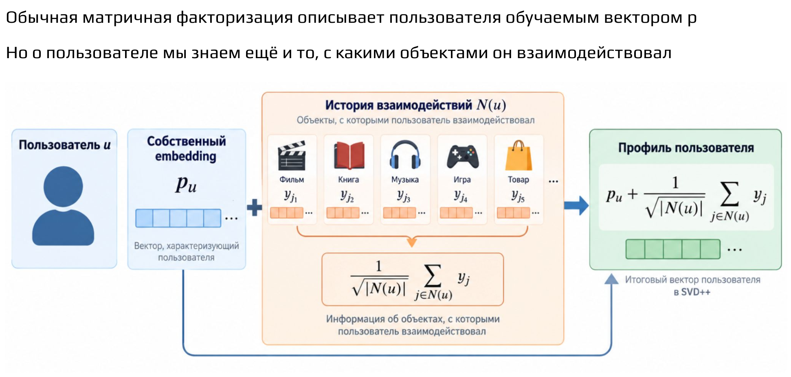

Итоговый прогноз SVD++:

$$\hat r_{ui} = \mu + b_u + b_i + q_i^\top\left(p_u + \frac{1}{\sqrt{|N(u)|}}\sum_{j\in N(u)} y_j\right).$$

Прогноз складывается из среднего рейтинга, смещения пользователя, смещения объекта и эмбеддинга объекта, умноженного на представление пользователя, в которое входит его история. Главное отличие от обычной матричной факторизации — замена

$$p_u \;\longrightarrow\; p_u + \frac{1}{\sqrt{|N(u)|}}\sum_{j\in N(u)} y_j .$$

Пользователь описывается уже не одним выученным латентным вектором: к нему добавляется вектор, собранный из истории взаимодействий. Обучают SVD++ тем же SGD.

### Сводка по матричной факторизации

Мы разобрали четыре метода матричной факторизации. Сведём их вместе.

| Модель | Фидбэк | Ключевая идея | Оптимизация |
|:--|:-------|:-------|:------|
| Truncated SVD | Явный: оценки после заполнения пропусков. Неявный: матрица действий с выбранным значением для отсутствия взаимодействий | Приближаем полную матрицу матрицей низкого ранга | SVD, оставляем $k$ компонент с наибольшими сингулярными значениями |
| ALS | Явный: выставленные оценки. Неявный: например, доля просмотра | Рассматриваем только наблюдавшиеся пары | Поочерёдная оптимизация двух матриц, одна из них фиксируется |
| iALS | Явный: лайк как положительный сигнал. Неявный: клики, просмотры, покупки | Ненаблюдавшиеся пары тоже входят в обучение, но с низкой уверенностью | Поочерёдная оптимизация двух матриц |
| SVD++ | Явный: рейтинги как цель предсказания. Неявный: история взаимодействий | Дополняем латентный вектор пользователя информацией об объектах из его истории | SGD |

Коротко по столбцу «Ключевая идея». Truncated SVD приближает полную матрицу, поэтому все пропуски в ней должны быть заполнены. ALS берёт только пары, где в user-item матрице стоит ненулевое значение, то есть где взаимодействие было. В iALS ненаблюдавшиеся пары тоже входят в обучение, но с более низкой уверенностью. SVD++ добавляет к латентному вектору пользователя информацию об объектах из его истории.

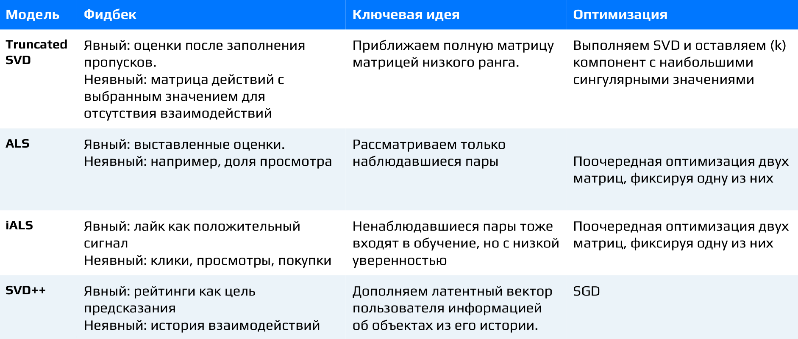

### Netflix Prize

Насколько эти модели важны на практике, хорошо видно на историческом примере. Netflix устроил открытое соревнование по предсказанию пользовательских рейтингов: нужно было улучшить качество относительно собственного **baseline** компании, базовой системы Cinematch, с которой сравнивали все решения. Приз составлял миллион долларов. 21 сентября 2009 года его выиграла команда BellKor's Pragmatic Chaos, улучшив **RMSE** на 10.06% относительно Cinematch. RMSE здесь — ошибка предсказанного рейтинга: чем она меньше, тем точнее модель[^n9a].

На графике RMSE отложена в зависимости от числа параметров модели, в миллионах, по логарифмической шкале. Конкретные цифры тут не важны. Важно, как шаг за шагом усложнялась модель, и каждая следующая кривая лежит ниже предыдущей.

1. Plain — базовая факторизационная модель.
2. With biases — добавлены смещения пользователей и объектов: учитываем, что пользователи в среднем ставят разные рейтинги.
3. With implicit feedback — в представление пользователя добавлена информация о том, с чем он взаимодействовал. Это и есть идея SVD++.
4. With temporal dynamics — **temporal dynamics**, учёт времени: предпочтения пользователя со временем меняются, и модель учитывает такие временные паттерны.

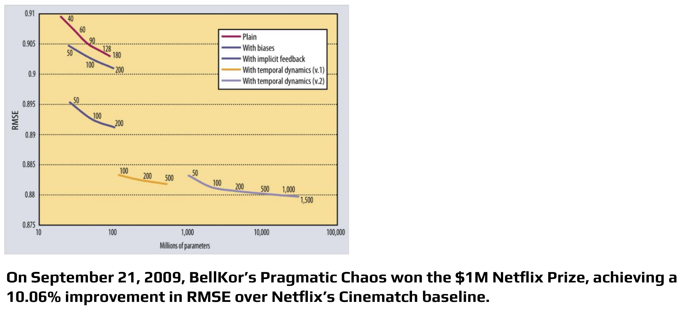

**Важный вывод:** самый большой эффект в итоге дала не какая-то одна модель, а гибридная — ансамбль разных моделей. Тем не менее классические модели внутри него оказались полезными и используются до сих пор.

[^n9a]: Примечание составителя: RMSE (root mean squared error) — корень из среднего квадрата отклонения предсказанной оценки от настоящей, $\mathrm{RMSE} = \sqrt{\frac{1}{|T|}\sum_{(u,i)\in T}(r_{ui} - \hat r_{ui})^2}$, где $T$ — тестовые пары. Это тот же квадратичный лосс, что минимизируется в матричной факторизации, только усреднённый и под корнем.

## Линейные item-item модели: SLIM и EASE

*Таймкод: 01:28:30 · слайды 75–82*

Матричная факторизация во всех её вариантах описывает пользователей и объекты латентными векторами, а прогноз получается из их скалярного произведения. Есть и другой тип model-based методов — **линейные item-item модели**. Отдельного латентного пространства в них нет: модель напрямую учит, как одни объекты помогают предсказывать другие. Разберём два таких алгоритма: SLIM и его упрощение EASE.

### SLIM: идея на примере

**SLIM (Sparse Linear Methods)** начинается с истории пользователя. Это просто строка матрицы взаимодействий user × item; будем считать её бинарной: единица означает, что пользователь взаимодействовал с объектом (посмотрел фильм, поставил лайк и т. п.), ноль — что нет. Пусть пользователь посмотрел «Интерстеллар» и «Марсианина», а «Матрицу» не смотрел: $a_u = [1\ 1\ 0\ \dots]$.

Мы хотим предсказать скор для объекта, которого в истории нет. Для этого для каждой пары объектов вводится вес $w_{ji}$: насколько взаимодействие с объектом $j$ должно повлиять на скор объекта $i$. Например, для фильма «Начало» вес со стороны «Интерстеллара» равен 0.6, со стороны «Матрицы» — 0.3, со стороны «Марсианина» — 0.1. Из таких весов складывается **матрица весов $W$** размера $|I|\times|I|$, и скор объекта получается как взвешенная сумма по истории:

$$
\hat a_{ui} = \sum_j a_{uj}\, w_{ji}, \qquad \hat A = AW.
$$

Иначе говоря, каждый просмотренный объект «голосует» за объект $i$ со своим весом. Самосвязей нет: $w_{ii}=0$. Посчитав скоры для всех непросмотренных объектов, выдаём top-K с наибольшими значениями[^n10a]. Ключевая мысль в том, что SLIM сам учит, какие айтемы связаны друг с другом.

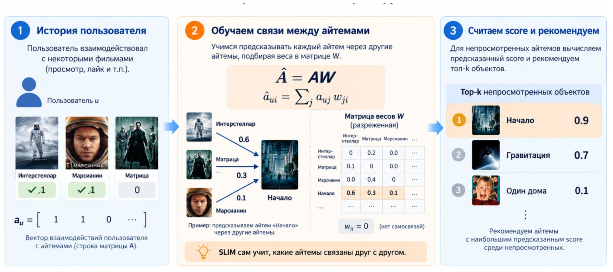

### Постановка задачи

Дальше матрицу взаимодействий обозначаем $R$. Формально мы подбираем item-item матрицу весов $W$ так, чтобы по взаимодействиям пользователя восстанавливать его предпочтения: $\hat R = RW$. Для этого минимизируем ошибку восстановления:

$$
\min_W \frac12\|R-RW\|_F^2 + \lambda\|W\|_1 + \frac{\beta}{2}\|W\|_F^2
\qquad \text{при}\quad \operatorname{diag}(W)=0,\quad W\ge 0.
$$

Первое слагаемое — квадратичная функция потерь: насколько $RW$ отличается от $R$ по норме Фробениуса. Дальше идут две регуляризации, и у каждой своя роль.

**L1-регуляризация** (слагаемое с $\lambda$) делает многие элементы $W$ нулевыми. Отсюда и название Sparse Linear Methods: матрица весов получается разреженной, и после обучения на финальный скор пользователя влияет лишь небольшое число объектов. L2-регуляризация (слагаемое с $\beta$) штрафует слишком большие коэффициенты и стабилизирует решение. По сути, для каждого айтема решается линейная регрессия с L1 + L2-регуляризацией; регрессию с обоими штрафами сразу называют **elastic-net**.

Ограничения тоже не случайны. Без условия $\operatorname{diag}(W)=0$ у задачи есть тривиальное решение — единичная матрица $W=I$: каждый объект «предсказывает сам себя», $RW=R$, ошибка нулевая, а полезных связей модель не выучила. Это и есть **нулевая диагональ**. Условие $W\ge 0$ означает, что веса неотрицательны: взаимодействие с одним объектом может только повысить скор другого, отрицательный вклад («этот объект понижает другой») не используется.

### Разбиение по столбцам и координатный спуск

Каждый столбец $W$ отвечает за предсказание одного айтема, поэтому задача распадается на $|I|$ независимых задач:

$$
\min_{w_i} \frac12\|r_i - Rw_i\|_2^2 + \lambda\|w_i\|_1 + \frac{\beta}{2}\|w_i\|_2^2,
\qquad w_{ii}=0,\quad w_i\ge 0,
$$

где $r_i$ — $i$-й столбец матрицы $R$. Для каждого объекта мы строим отдельную линейную регрессию, которая восстанавливает его столбец по остальным объектам. Эти задачи можно обучать независимо друг от друга.

Каждую из них решают **покоординатным спуском (координатный спуск)**: фиксируем все веса, кроме одного $w_{ji}$, находим его оптимальное значение, переходим к следующему весу и повторяем до сходимости. Обучается SLIM долго, зато каждый шаг очень простой: обновляется только один коэффициент.

Посмотрим на один шаг. Обновляем $w_{ji}$, остальные веса временно фиксированы:

$$
r_i \approx r_j w_{ji} + \sum_{\ell\ne j} r_\ell w_{\ell i}.
$$

Вклад остальных объектов переносим в остаток (residual):

$$
\rho_i^{(-j)} = r_i - \sum_{\ell\ne j} r_\ell w_{\ell i}.
$$

Остаётся одномерная задача $\rho_i^{(-j)} \approx r_j w_{ji}$, и из неё получается обновление

$$
w_{ji} \leftarrow \max\left(0,\ \frac{r_j^\top\rho_i^{(-j)} - \lambda}{\|r_j\|_2^2 + \beta}\right).
$$

Если связь слабая и скалярное произведение $r_j^\top\rho_i^{(-j)}$ не превышает $\lambda$, вес зануляется — ровно этого мы и добиваемся, чтобы матрица была разреженной. Внешний $\max(0,\cdot)$ обеспечивает неотрицательность. $\beta$ в знаменателе — вклад L2-регуляризации: она сжимает вес[^n10b].

### EASE: упрощение до аналитического решения

Постановку SLIM можно упростить так, что у неё появится аналитическое решение. Так устроен **EASE (Embarrassingly Shallow AutoEncoders)** — родственник SLIM с той же идеей: приближаем $R \approx RW$, учим item-item матрицу и восстанавливаем каждый объект линейной комбинацией остальных. Отличия три:

- L1-регуляризацию не используем;
- неотрицательности весов $W\ge 0$ не требуем;
- оставляем только L2-регуляризацию и нулевую диагональ.

Теперь веса могут быть как положительными, так и отрицательными. Модель может выучить, что наличие одного объекта в истории уменьшает скор другого. Задача принимает вид

$$
\min_W \frac12\|R-RW\|_F^2 + \frac{\lambda}{2}\|W\|_F^2,\qquad \operatorname{diag}(W)=0.
$$

Почему это автоэнкодер: на вход подаём вектор взаимодействий пользователя и одним линейным преобразованием — матрицей $W$ — пытаемся восстановить на выходе тот же вектор. Это автоэнкодер из единственного линейного слоя, то есть предельно «мелкий» (shallow)[^n10c].

Главное преимущество EASE в том, что это ridge-регрессия с нулевой диагональю, и для неё есть решение в явном виде. Никакого координатного спуска на каждой итерации не нужно. Обозначим

$$
P = \left(R^\top R + \lambda I\right)^{-1},
$$

тогда

$$
w_{ij} = -\frac{P_{ij}}{P_{jj}},\quad i\ne j,\qquad w_{jj}=0.
$$

Здесь $R^\top R$ — **матрица Грама** размера item × item: её элемент для пары объектов показывает, сколько у них совместных взаимодействий. Добавка $\lambda I$ — регуляризация: она делает матрицу устойчивее, а при $\lambda>0$ матрица гарантированно невырождена, так что обратная существует. Вывод формулы опустим; важен итог: вся item-item модель получается из одной регуляризованной матрицы Грама и её обратной.

Нулевая диагональ в EASE нужна по той же причине, что и в SLIM. Без этого ограничения каждый объект мог бы восстанавливать сам себя через собственный столбец, и получилось бы тривиальное решение — автоэнкодер, который просто копирует вход. Ограничение $\operatorname{diag}(W)=0$ заставляет модель объяснять объект через другие объекты, а это и есть полезная item-item связь. Платить за аналитическое решение приходится вычислениями: матрица весов получается плотной, а для её расчёта нужно обратить матрицу размера $|I|\times|I|$, поэтому обучение бывает тяжёлым.

### SLIM или EASE

|  | SLIM | EASE |
|:-----|:-------------|:-------------|
| Фидбек | Неявный: обычно бинарные взаимодействия. Явный: можно использовать числовые оценки (рейтинги) | То же |
| Ключевая идея | Строим разреженную матрицу item-item весов | Строим линейную item-item модель без требования разреженности |
| Оптимизация | Для каждого объекта отдельная elastic-net задача, обычно координатный спуск | Аналитическое решение |
| Когда выбирать | Большой каталог, если веса остаются разреженными; нужно выделить небольшое число важных связей между объектами | Небольшой и средний каталог; готовы учитывать множество связей и можем позволить себе плотную матрицу весов |

SLIM удобнее, когда каталог большой и мы хотим, чтобы на итоговый скор влияло небольшое число связей. EASE лучше подходит для небольшого и среднего каталога, когда плотная матрица весов нам по силам. На практике обе модели обычно применяют к бинарным взаимодействиям.

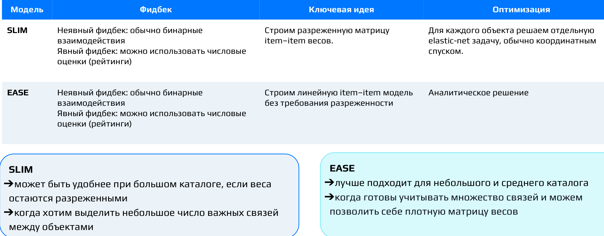

[^n10a]: Примечание составителя: числа в примере иллюстративные. Если честно сложить веса для «Начала» по истории $[1\ 1\ 0]$, получится $0.6 + 0.1 = 0.7$, а в списке рекомендаций у «Начала» стоит 0.9. На идею это не влияет.

[^n10b]: Примечание составителя: формула обновления — так называемый soft-thresholding. Скалярное произведение $r_j^\top\rho_i^{(-j)}$ показывает, насколько объект $j$ объясняет ту часть столбца $r_i$, которую ещё не объяснили остальные объекты. Без L1-штрафа и ограничения $w\ge 0$ оптимум одномерной задачи с L2-штрафом был бы $r_j^\top\rho_i^{(-j)}/(\|r_j\|_2^2+\beta)$. L1-штраф уменьшает числитель на $\lambda$, а отрицательный результат обрезается до нуля.

[^n10c]: Примечание составителя: embarrassingly shallow — «до неловкости мелкий». Название подчёркивает, что у модели нет скрытых слоёв.

## Ограничения классических моделей и связь с ранжированием

*Таймкод: 01:43:18 · слайды 83–87, 5, 68*

### Чего не умеют классические модели

Все модели этой лекции — memory-based подходы, матричная факторизация, ALS и iALS, SLIM и EASE — строят рекомендации только по матрице взаимодействий. Отсюда три общих ограничения.

Первое — **cold start (холодный старт)**, который мы уже обсуждали: у нового пользователя или нового объекта нет истории. Модель, которая видит только взаимодействия, не может его учесть: ей просто не на что опереться.

Второе — не учитывается **порядок взаимодействий**. Даже в SVD++, где история пользователя явно входит в модель, она входит суммой:

$$p_u + \frac{1}{\sqrt{|N(u)|}}\sum_{j \in N(u)} y_j.$$

От перестановки слагаемых сумма не меняется. Поэтому модели всё равно, в какой последовательности пользователь взаимодействовал с объектами и что было последним: эта информация теряется.

Третье — не используются признаки пользователей, объектов и контекста. Это прямое следствие того, что все разобранные модели коллаборативные, а не контентные. Контентные и контекстные признаки, о которых шла речь в начале лекции, в них просто не попадают.[^n11a]

### Итоги

Подведём итог. Мы разобрали, какие данные и признаки используются в рекомендательных системах и как явный и неявный фидбек отражают интересы пользователей. Затем посмотрели, как строить рекомендации только по взаимодействиям. В memory-based подходе мы ищем похожих пользователей или похожие объекты. Матричная факторизация выявляет скрытые предпочтения пользователей и скрытые характеристики объектов. Линейные модели обучают связи между объектами напрямую. Наконец, мы обсудили, чего все эти модели не умеют.

### Как классические модели встраиваются в двухстадийный пайплайн

Остаётся вопрос: как модели этой лекции связаны с ранжированием, которое на прошлых семинарах строили с помощью **CatBoost** — градиентного бустинга в роли ранжировщика? Вспомним, что пайплайн рекомендаций двухстадийный. Сначала из большого каталога отбирается сколько-то кандидатов, например тысяча, — это **кандидатогенерация** (на жаргоне — **канген**). Затем отдельная модель ранжирует этих кандидатов между собой. Задача моделей кангена — отобрать как можно больше подходящих вариантов, чтобы потом передать их ранжировщику.

Мост между стадиями такой: **скоры моделей кандидатогенерации можно подавать как признаки ранжировщику**.

**Важный вывод:** выход модели первой стадии становится признаком для второй. Скоры классических моделей можно «прокидывать в фичи» бустинга.

Хороший пример — ALS и iALS. ALS обучается только на тех объектах, с которыми пользователь взаимодействовал, и по сути ищет среди них то, что понравилось ему больше всего. Он оценивает, насколько пользователь предпочитает один объект другому, то есть решает задачу ранжирования. iALS работает со всей матрицей: ненаблюдавшиеся пары тоже входят в обучение, с нулевым предпочтением и маленькой уверенностью. Поэтому iALS оценивает, какие объекты из большого каталога наиболее релевантны пользователю, и годится для кандидатогенерации. Отсюда типичная связка: iALS выдаёт кандидатов, а дальше они вместе со скорами iALS отправляются в ранжировщик CatBoost.

**Важно:** двухстадийная схема не обязательна. Не всегда нужны две модели, и после кангена не обязательно должен стоять бустинг. В отдельных случаях достаточно одностадийного пайплайна.

Модели, которыми строят кандидатов и ранжируют их, — тема следующих лекций курса.

[^n11a]: Примечание составителя: по программе курса порядок взаимодействий учитывают модели из лекции «Sequential Recommendation», а признаки пользователей и объектов — в том числе двухбашенные модели (лекция «Двухбашенные модели»).

## Организационное: семинар, домашнее задание, датасеты

*Таймкод: 01:48:20 · слайд 2*

Лекцию и семинар к ней ведёт Нелли Перфильева, старший ML-разработчик отдела рекомендаций Okko, выпускница мехмата МГУ. VK приглашает на курс специалистов из других компаний, чтобы они поделились своим опытом. Остальные преподаватели курса работают в VK.

На семинаре на следующий день разбираются данные и методы этой лекции. Основной материал семинара — **Jupyter-ноутбук**[^n12a] с разбором этих методов. Ноутбук будет транслироваться на экране и заранее появится на платформе в материалах к семинару. Отдельной практической части на семинаре нет: семинар построен так, чтобы больше смотреть, чем делать. Сама практика — в домашнем задании.

[^n12a]: Примечание составителя: Jupyter-ноутбук — интерактивный документ, в котором ячейки с кодом на Python чередуются с текстом и результатами их выполнения.

Первое домашнее задание выдаётся после этого семинара. Оно посвящено коллаборативной фильтрации: нужно применить модели из этой лекции к датасету и построить рекомендации. Контентным моделям посвящена следующая лекция. Домашнее задание не повторяет семинар, но семинар построен с расчётом на него: там разбираются датасеты и инструменты, которые понадобятся для решения.

::: {.qa title="Вопросы из зала"}
**Нужно ли на семинаре писать код самим?** Нет, достаточно устройства, на котором видна трансляция. Если есть возможность, ноутбук стоит запускать у себя параллельно, это только приветствуется.

**Похожа ли задача домашнего задания на рекомендации в Okko?** Частично. В Okko рекомендуют фильмы и сериалы, а в домашнем задании будут не они, а короткие видео.

**Нужно ли писать все алгоритмы с нуля?** Нет, можно пользоваться библиотеками. Часть алгоритмов всё же полезно написать самому, чтобы понять, как они устроены. Семинар уделяет больше внимания практическому применению и сильным сторонам разных алгоритмов, чем коду.

**Где брать датасеты?** В открытом доступе их очень много, в том числе от российских платформ: Яндекса, VK, Kion, Т-Банка и других. Самый базовый датасет — **MovieLens** с оценками фильмов, на нём работают почти все, и на прошлом семинаре уже был он.
:::

## Главное из лекции {.unnumbered}

::: keypoints
- Задача рекомендаций — оценить $\hat r_{ui}$ для объектов $i \in I \setminus I_u$, которых пользователь ещё не видел, и показать лучшие. В терминах матрицы взаимодействий это значит предсказать значения в её пустых ячейках.
- Обратная связь бывает явной (рейтинг, лайк, отзыв) и неявной (клик, просмотр, покупка). Неявной гораздо больше, но она асимметрична: событие говорит об интересе, а отсутствие события — не дизлайк. Пустая ячейка матрицы означает только отсутствие взаимодействия.
- Признаки делятся на контентные, контекстные, поведенческие и коллаборативные. Сырые события — ещё не признаки, признаки из них извлекают.
- Memory-based коллаборативная фильтрация ничего не обучает: user-based предсказывает оценку взвешенным средним оценок похожих пользователей, item-based — оценок, которые сам пользователь поставил похожим объектам. Шкалы пользователей разные, поэтому оценки нормализуют вычитанием средней.
- Model-based подход исходит из того, что поведение описывается небольшим числом скрытых факторов. Truncated SVD даёт лучшее приближение ранга $k$, но требует полностью заполненной матрицы, а заполнение пропусков нулями или средним подменяет данные искусственными.
- Матричная факторизация $R \approx PQ^\top$ ищет эмбеддинги $p_u$, $q_i$ только по наблюдаемым парам $\Omega$ с L2-регуляризацией. Обучать её можно SGD (нужно подбирать learning rate, много шагов) или ALS: при фиксированной $Q$ задача распадается на независимые ridge-задачи по пользователям и хорошо параллелится.
- iALS переносит ALS на неявный фидбэк: цель — бинарное предпочтение $a_{ui}$, вес — уверенность $c_{ui} = 1 + \alpha r_{ui}$, в сумме участвуют все пары. Трюк $C_u = I + (C_u - I)$ делает шаг дешёвым на разреженных данных. ALS подходит для ранжирования, iALS — для отбора кандидатов.
- Смещения $\mu$, $b_u$, $b_i$ снимают с эмбеддингов разницу в шкалах, а SVD++ добавляет к вектору пользователя нормированную сумму векторов объектов из его истории. Netflix Prize показал, как каждое такое усложнение снижало RMSE.
- SLIM и EASE обходятся без латентного пространства и прямо учат item-item матрицу весов $W$ с нулевой диагональю. SLIM разреженный и обучается покоординатным спуском, EASE отказывается от L1 и неотрицательности и получает аналитическое решение через обратную регуляризованную матрицу Грама.
- Общие ограничения классических моделей: холодный старт, порядок взаимодействий не учитывается, признаки пользователей, объектов и контекста не используются. На практике их скоры подают как признаки ранжировщику, например CatBoost.
:::

## Что подчеркнул лектор {.unnumbered}

::: emphasis
- Отсутствие implicit-события — не отрицательный пример: пользователь мог просто не видеть объект. От этой мысли зависят и трактовка пустых ячеек, и устройство iALS.
- Нельзя заполнять пропуски нулями или средним, чтобы применить SVD: модель будет приближать придуманные данные, а не реальные.
- Главное практическое преимущество ALS и iALS — параллелизм и отсутствие learning rate, а число факторов $k$ надо выбирать осознанно.
- ALS и iALS отвечают на разные вопросы: насколько пользователь предпочитает один объект другому и какие объекты каталога вообще релевантны. Отсюда их места в пайплайне.
- Нулевая диагональ в SLIM и EASE обязательна: без неё модель выучит тривиальное копирование входа.
- Выход модели первой стадии становится признаком для второй, но двухстадийная схема не обязательна.
- Первое домашнее задание — по коллаборативной фильтрации (рекомендации коротких видео), выдаётся после семинара; можно пользоваться библиотеками, но часть алгоритмов полезно написать самому.
:::

## Стоит посмотреть в видео {.unnumbered}

::: watch
- 00:18:00–00:24:31 — численный пример user-based и нормализация. Слайд с итоговой формулой нормализации пропал из презентации, объяснение идёт устно.
- 00:35:47–00:41:15 — SVD, Truncated SVD и разговор о том, чем заполнять пропуски. Удобно следить по схемам слайдов 40–46.
- 00:54:08–00:59:00 — вывод формулы обновления ALS по слайдам 58–61.
- 01:02:35–01:11:11 — iALS: уверенность, функция потерь и трюк $C_u = I + (C_u - I)$. Ответ на вопрос о неединственности решения скомкан и не договорён.
- 01:25:48–01:28:30 — график Netflix Prize: как каждое усложнение модели снижало RMSE.
- 01:29:24–01:43:18 — SLIM и EASE с формулами на слайдах 76–82. Числа примера на слайде 76 мелкие, их стоит сверить с презентацией.
- 01:58:28–02:05:56 — связь кандидатогенерации и ранжирования. Названия ALS и iALS в речи местами перепутаны, ориентир — слайд 68.
:::

## Глоссарий {.unnumbered}

| Термин | Коротко |
|:--|:------------|
| **Отбор кандидатов (retrieval)** | Первая стадия: из каталога $10^6$–$10^9$ айтемов отобрать $10^2$–$10^3$ кандидатов |
| **Ранжирование (ranking)** | Вторая стадия: упорядочить кандидатов и показать $10^1$–$10^2$ лучших |
| **Матрица оценок** | Таблица «пользователи × объекты» с известными $r_{ui}$ |
| **Признаки** | Характеристики пользователя, объекта и контекста, которые модель использует для оценки релевантности |
| **Explicit feedback** | Явная обратная связь: рейтинг, лайк, отзыв |
| **Implicit feedback** | Неявная обратная связь: клик, просмотр, покупка, добавление в корзину |
| **Контентные признаки** | Свойства пользователя или объекта сами по себе: жанр, бренд, цена, возраст |
| **Контекстные признаки** | Условия взаимодействия: время, устройство, геолокация, сезон |
| **Поведенческие признаки** | Действия пользователя и его история взаимодействий |
| **Коллаборативные признаки** | Закономерности коллективного поведения: популярность, сходство пользователей и объектов |
| **Сырые данные** | Исходные события, из которых извлекают признаки |
| **Неперсонализированные рекомендации** | Одинаковые для всех: популярное, бизнес-правила |
| **Контентные методы (content-based)** | Рекомендации по признакам объектов и пользователя |
| **Коллаборативная фильтрация** | Рекомендации только по истории взаимодействий пользователей с объектами |
| **Гибридные методы** | Комбинация нескольких подходов |
| **Матрица взаимодействий (user-item матрица)** | Строки — пользователи, столбцы — объекты, в ячейках — рейтинг или событие; пусто — нет взаимодействия |
| **Memory-based** | Методы без обучаемых параметров: прогноз через похожих соседей в матрице |
| **Model-based** | Методы, обучающие модель с параметрами, которая восстанавливает матрицу |
| **User-based** | Прогноз по оценкам похожих пользователей |
| **Item-based** | Прогноз по оценкам пользователя на похожие объекты |
| **Мера похожести $s(u,v)$** | Функция сходства двух пользователей (или объектов): косинус, Пирсон, Жаккар |
| **Соседи $N(u)$** | Пользователи, чья похожесть на $u$ выше порога $\alpha$ |
| **Нормализация оценок** | Замена оценки $r_{vi}$ отклонением от средней оценки пользователя $r_{vi} - \bar r_v$ |
| **Разреженность** | Доля известных ячеек матрицы ничтожно мала |
| **Скрытые (латентные) факторы** | Небольшое число скрытых осей, объясняющих поведение пользователей и свойства объектов |
| **SVD (Singular Value Decomposition)** | Разложение полной матрицы $R = U\Sigma V^\top$ |
| **Сингулярные значения** | Диагональ $\Sigma$, упорядоченная по убыванию |
| **Truncated SVD** | SVD, в котором оставлены первые $k$ компонент: $R \approx U_k\Sigma_k V_k^\top$ |
| **Норма Фробениуса** | Корень из суммы квадратов всех элементов матрицы |
| **Матричная факторизация (Matrix Factorization)** | $R \approx PQ^\top$, где эмбеддинги ищутся только по наблюдаемым парам |
| **Эмбеддинг (представление) пользователя** | Вектор $p_u \in \mathbb{R}^k$, строка $P$ |
| **Множество наблюдаемых пар** | $\Omega$ — пары $(u,i)$ с известным значением; по ним считается ошибка |
| **L2-регуляризация** | Штраф $\lambda$ за квадраты норм векторов, против переобучения |
| **SGD (Stochastic Gradient Descent)** | Обновление $p_u$, $q_i$ по одной наблюдаемой паре за шаг |
| **Learning rate** | Шаг обучения $\gamma$ в SGD |
| **Холодный старт** | Новый пользователь или объект без истории взаимодействий |
| **Онбординг** | Опрос предпочтений нового пользователя при первом входе |
| **ALS (Alternating Least Squares)** | Поочерёдно фиксируем $Q$ или $P$ и решаем для другой матрицы задачу наименьших квадратов |
| **Параллелизм по пользователям** | При фиксированной $Q$ каждый $p_u$ считается независимо |
| **Implicit ALS (iALS)** | ALS для неявного фидбэка: все пары, цель $a_{ui}$, веса $c_{ui}$ |
| **Предпочтение (preference)** | $a_{ui} = 1$, если взаимодействие было, иначе 0 |
| **Уверенность (confidence)** | $c_{ui} = 1 + \alpha r_{ui}$ — вес пары в функции потерь |
| **Ridge-регрессия** | Линейная регрессия с L2-штрафом; так устроен каждый шаг ALS / iALS |
| **Смещения (bias)** | $\mu$, $b_u$, $b_i$ — глобальный уровень и сдвиги пользователя и объекта |
| **SVD++** | Матричная факторизация, где к $p_u$ добавлена нормированная сумма $y_j$ объектов из истории |
| **Baseline** | Базовая система, с которой сравнивают решения (в Netflix Prize — Cinematch) |
| **RMSE** | Корень из среднего квадрата ошибки предсказанного рейтинга |
| **Temporal dynamics** | Учёт изменения предпочтений во времени |
| **Линейные item-item модели** | Модели, которые прямо учат матрицу связей объектов $W$, без латентного пространства |
| **SLIM (Sparse Linear Methods)** | $R \approx RW$ с L1 + L2, $W \ge 0$ и нулевой диагональю; разреженная $W$ |
| **Elastic-net** | Регрессия с L1- и L2-штрафом одновременно |
| **Нулевая диагональ** | $\operatorname{diag}(W) = 0$ — запрет объекту предсказывать самого себя |
| **Координатный спуск** | Оптимизация по одному весу за раз при фиксированных остальных |
| **EASE (Embarrassingly Shallow AutoEncoders)** | SLIM без L1 и неотрицательности; аналитическое решение через $(R^\top R + \lambda I)^{-1}$ |
| **Матрица Грама** | $R^\top R$ — число совместных взаимодействий для пар объектов |
| **Порядок взаимодействий** | Последовательность действий пользователя; классические модели её не учитывают |
| **Кандидатогенерация** | То же, что отбор кандидатов; на жаргоне — канген |
| **CatBoost** | Градиентный бустинг, используемый как ранжировщик |
| **Jupyter-ноутбук** | Интерактивный документ с кодом и результатами, основа семинара |
| **MovieLens** | Базовый открытый датасет оценок фильмов |
