::: {.abstract title="О чём лекция"}
Лекция о двухбашенных моделях — основном нейросетевом способе отбирать кандидатов из каталога в миллионы и миллиарды айтемов. Рассказ начинается с ранжирующей модели, обученной на показах, и с её главной проблемы — фолдинга. Затем шаг за шагом выводится, почему для кандидатогенерации нужен полный softmax по каталогу и почему модель приходится разрезать на две башни, пользователя и айтема, которые встречаются только в скалярном произведении: тогда эмбеддинги айтемов можно посчитать заранее и искать ближайшие в HNSW-индексе. Дальше разбирается, как учить такую модель на практике: косинус и температура, sampled softmax, in-batch и uniform негативы, logQ-коррекция. Потом — как кодировать айтемы (обучаемые и контентные эмбеддинги, hashing trick, Semantic ID, переобучение на тяжёлом хвосте) и пользователей (пулинг событий, time decay, трансформеры над историей). В конце — ограничения двухбашенных моделей: ранг разложения, разнообразие выдачи, критический размер каталога и стоимость ANN-индекса.

Для чтения нужны основы машинного обучения (функция потерь, градиент, softmax, эмбеддинги) и материал прошлых лекций: ранжирующие лоссы pointwise / pairwise / listwise из лекции 2 и матричная факторизация из лекции 3.

Организационной части в лекции почти нет. Содержательные вопросы из зала вплетены в разделы и выделены серыми блоками — их можно пропустить при беглом чтении. Схемы и формулы со слайдов приведены прямо в тексте. Сноски с пометкой «Прим. составителя» — пояснения, которых не было в лекции.
:::

## Рекомендации как ранжирование: обучение на показах и фолдинг

*Таймкод: 00:00:00 · слайды 1–11*

Эта лекция посвящена двухбашенным моделям. Сначала разберём, как индустрия и исследователи пришли к идее таких моделей, затем — softmax loss, на который их учат, способы закодировать айтем и пользователя, и ограничения двухбашенного подхода. Способы обойти эти ограничения, например генеративный ретривал, разбираются в теме «Нейросетевая кандидатогенерация».

### Одна задача в трёх обличьях

Всё, о чём пойдёт речь, относится не только к рекомендациям. Стек у **рекомендаций, поиска и RAG** очень похож, двухбашенные модели применяются везде, и с небольшими изменениями подходы переносятся из одной области в другую. Различается только то, что считать запросом. В рекомендациях запрос — сам пользователь, его история и контекст, а ищем мы видео, музыку или товары для ленты. В поиске запрос — текст плюс пользователь: сначала находим релевантное запросу («смешные видео с котами»), потом персонализируем. В RAG запрос — вопрос к LLM, а ищем мы фрагменты текста, которые LLM прочитает, чтобы ответить по базе знаний. Постановка у всех трёх одна: **по запросу найти нужное в огромной коллекции**.

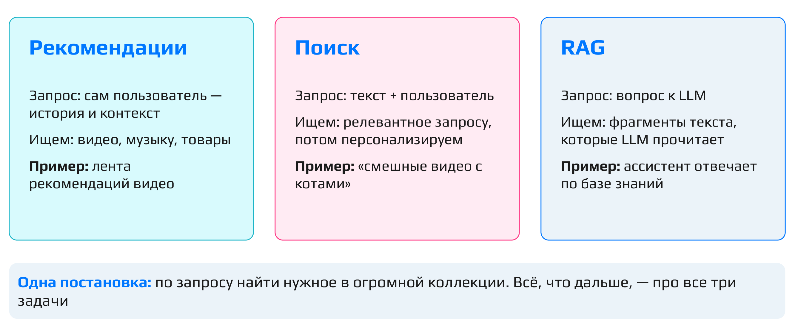

### Постановка: небольшой магазин

Начнём с модельной ситуации. Есть магазин с каталогом в 10 000 товаров; на главной пользователь видит около 20 карточек, которые рекомендует платформа. Цель — клики или покупки; для определённости будем оптимизировать клики. У нас есть логи прошлой рекомендательной системы, где одна строка — один показ: визит, контекст, товар, позиция, был ли клик. Например, в визите v1 («вечер, Android») на первой позиции стояла керамическая кружка — клик, на второй флисовый плед — без клика, на двадцатой набор ножей — без клика.

И есть универсальный аппроксиматор — **функция $f(u, i)$** от пользователя $u$ и айтема $i$, которая выдаёт скор. Вопрос: какую задачу поставить и какой лосс взять, чтобы по таким логам выучить что-то полезное?

### Обучение на показах

Естественный ответ — ранжирующие лоссы, знакомые по лекции «Ранжирование и метрики качества»:

- **pointwise** честно оценивает вероятность клика на каждом показе: $\sigma(f(u,i)) \approx P(\text{клик}\mid u,i)$, лосс — BCE;
- **pairwise** учит порядок в паре «кликнутый — некликнутый»: $\sigma(f_+ - f_-) \approx P(i_+ \text{ лучше } i_-)$, абсолютный уровень $f$ при этом не задан;
- **listwise** учит порядок внутри всей выдачи из 20: softmax по выдаче $\approx P($выберут $i$ из показанного$)$, уровень $f$ тоже не задан.

На практике их комбинируют: $L = \text{BCE} + \alpha\cdot\text{listwise}$ — BCE держит уровень вероятностей, listwise доводит порядок.

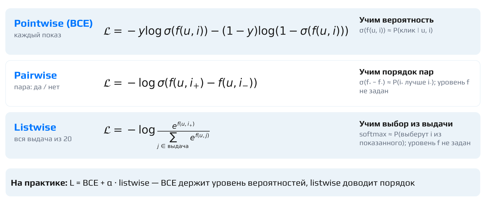

Такое обучение называется **impression-aware**. [**Показ (impression)**]{.gl key="Показ (impression)"} — это айтем, попавший на экран пользователю; aware означает, что мы знаем о показах и учимся только на показанном, а не на всём каталоге, то есть моделируем $P(\text{клик}\mid u, i, \text{показали})$. Что пользователь кликнул, считаем позитивами; на что не кликнул, с некоторым упрощением считаем негативами. Это неявный фидбек: мы судим по поведению. Остальные 9 980 непоказанных товаров в выборку не попадают вовсе.

Главный плюс такой постановки — **хард негативы**, то есть трудные для модели негативы. Если прошлая система выдаёт не случайный шум, показанные айтемы довольно релевантны, и некликнутые среди них отличить от позитива непросто. Научив модель правильно сортировать их относительно позитива, мы, скорее всего, научим её чему-то хорошему. Кроме того, позиция и контекст показа становятся признаками, а сессии вообще без кликов тоже дают сигнал (правда, только в pointwise).

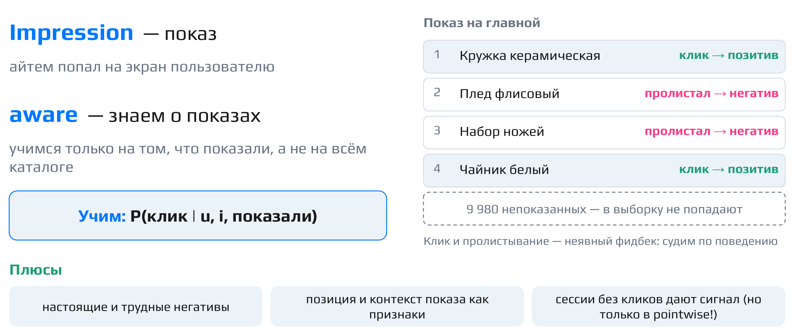

### Как может выглядеть f(u, i): раннее связывание

Классическая ранжирующая архитектура устроена так: на вход нейросети подаётся конкатенация признаков пользователя, признаков айтема и, возможно, кросс-признаков. Входы бывают категориальные (user id, item id, категория, позиция), вещественные (CTR айтема, длительность, возраст) и эмбеддинги сырых данных (история действий, картинка айтема). Дальше идут глубокие слои с residual-связями (ResNet / DenseNet) и блоки DCN-v2 для явных взаимодействий «пользователь × товар × контекст», а на выходе — несколько голов: P(клик), P(лайк), P(досмотр). Подробно такие модели разбираются в теме «Нейросетевое ранжирование».

Это модель с [**ранним связыванием**]{.gl key="Раннее связывание"}: пользователь и айтем «встречаются» в сети с самого начала, поэтому сеть видит их взаимодействия. **Акцент лектора:** это самая экспрессивная модель, и в продакшене она работает лучше всего. Цена — отдельный прогон сети на каждую пару $(u, i)$.

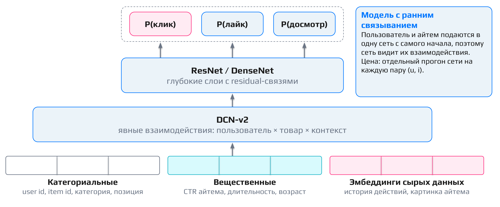

### Фолдинг

У impression-aware обучения есть принципиальная проблема. Хорошая рекомендательная система не показывает случайное, поэтому возникают группы пользователей, потребляющих определённый контент, и система рекомендует им только его. Целые группы айтемов этим пользователям в выдачу не попадают, а значит, модель невозможно научить правильному порядку для айтемов, которых пользователь никогда не видел.

Возьмём вегана. Он ест только растительную пищу, и со временем модель перестаёт рекомендовать ему мясо. Ранжирующий лосс сравнивает айтемы только внутри показанного, то есть внутри групп «веганы и растительное», «мясоеды и мясо». Взаимное расположение групп ничем не ограничено, и в пространстве эмбеддингов они могут наложиться друг на друга — сложиться (to fold). Скор «веган × стейк» становится произвольным, и в выдаче вегана могут всплыть мясные изделия. Этот эффект называется **фолдингом (folding)**; он описан в статье «Folding: Why Good Models Sometimes Make Spurious Recommendations» (RecSys 2017). Чтобы его избежать, нужно **глобальное сравнение**: для пользователя сравнивать все айтемы, а не только айтемы внутри «фолдов».

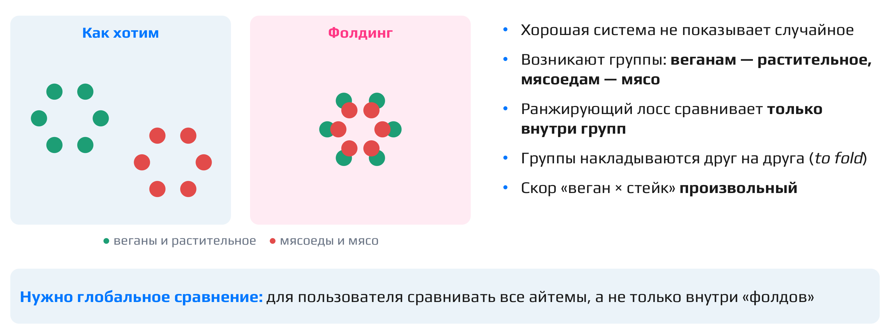

### Одностадийная система: фолдинг лечится сам?

Пусть система [**одностадийная**]{.gl key="Одностадийная система"}: есть только ранкер, который скорит все 10 000 товаров и показывает топ-20. Это очень реалистичная постановка, похожая на онлайн-обучение: модель, возможно ошибочно, скорит айтемы и отдаёт их пользователю не в самом правильном порядке, пользователь «размечает» их кликами и покупками, а модель дообучается на этом фидбеке. Цикл замыкается: скорим → показываем топ-20 → получаем фидбек → дообучаемся.

В такой петле завышения чинятся сами. Переоценённый айтем всплывает в топ, его показывают, на него не кликают — и он становится негативом. С занижениями хуже: недооценённый айтем в топ не попадает, и ошибку не видно; для них нужны слоты под исследование (exploration). Всё это работает, только если модель учится на своих собственных показах.

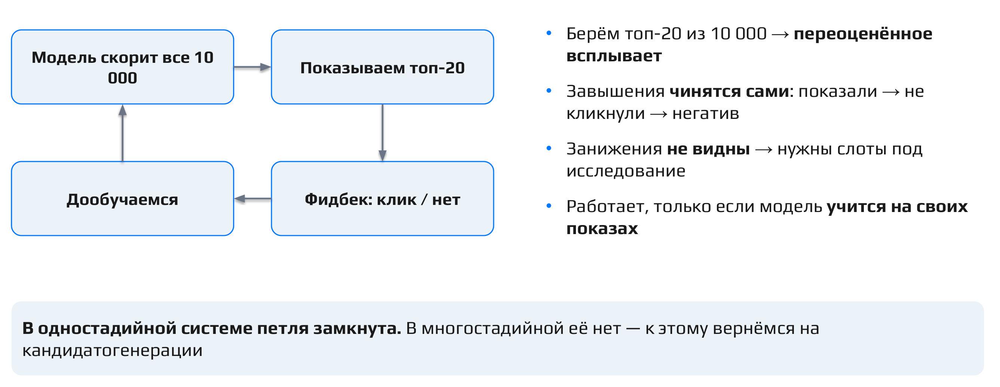

**Важный вывод:** в одностадийной системе петля обратной связи замкнута, и фолдинг частично исправляется сам. Как только между каталогом и ранкером появляются другие стадии, петля размыкается — к этому мы вернёмся, когда дойдём до генерации кандидатов.

## Большой каталог: две башни и многостадийная система

*Таймкод: 00:08:29 · слайды 12–16*

### Две башни и позднее связывание

Пусть теперь в каталоге не 10 000, а миллион айтемов, и мы по-прежнему пользуемся моделью с ранним связыванием. Напомню: в такой модели фичи пользователя и айтема конкатенируются и подаются на вход сети, поэтому для получения одного скора нужно прогнать всю модель. Чтобы отскорить каталог для одного пользователя, нужен миллион прогонов, а затем ещё сортировка. Это дорого, даже если считать всё в офлайне для всех пользователей разом и в онлайне только отдавать готовую выдачу: дорого по вычислениям, и хранить придётся огромное число пар — пользователей много, айтемов тоже.

Выход — разрезать модель на две части. **Башня пользователя** работает только с фичами пользователя (история, контекст) и выдаёт его эмбеддинг $g(u)$; **башня айтема** работает только с фичами айтема (признаки, контент) и выдаёт эмбеддинг $h(i)$. Соединить их естественно скалярным произведением:

$$f(u, i) = \langle g(u),\ h(i) \rangle .$$

Скалярное произведение учится как мера похожести: большое значение означает, что айтем хорошо подходит пользователю, маленькое — что не подходит. Учим модель так же, как раньше, — ранжирующим лоссом на показах. Такая схема называется [**поздним связыванием**]{.gl key="Позднее связывание"}: пользователь и айтем встречаются только в скалярном произведении своих эмбеддингов.

Главный выигрыш — в инференсе. Эмбеддинги айтемов считаются один раз в офлайне, эмбеддинги пользователей обновляются раз в сутки. Когда приходит запрос, берём эмбеддинг пользователя, перемножаем его со всеми эмбеддингами айтемов — это дешёвая операция, — сортируем по скорам и отдаём топ-20. Не самым изящным образом, но проблему эффективности мы частично решили.

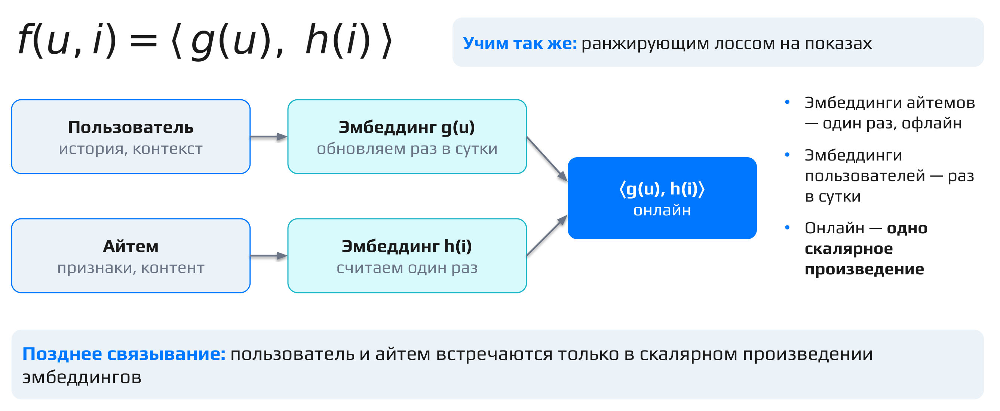

### Но этого мало

Каталог может быть ещё больше: в VK Видео около миллиарда видео, в YouTube — больше. Здесь трюк с двумя башнями уже не спасает, и по двум причинам. Во-первых, скорить всё равно нужно каждый айтем, а миллиард скалярных произведений на запрос не успеть. Во-вторых, двухбашенные ранжирующие модели по качеству заметно уступают моделям с ранним связыванием: пользователь и айтем встречаются только в скалярном произведении, и сеть не видит их взаимодействий.

### Многостадийная система

Поэтому от одностадийной системы переходят к **многостадийной рекомендательной системе**. Идея такая: у нас есть мощная, выразительная и тяжёлая ранжирующая модель, возможно с ранним связыванием. Применять её ко всему каталогу нельзя, значит, нужно сначала каким-то образом отобрать из каталога самые релевантные для пользователя айтемы и ранжировать только их.

Отбором занимаются **генераторы кандидатов** — в обиходе **кангены**, в литературе **retrieval**. Это лёгкие быстрые модели; каждая собирает свою порцию кандидатов, и вместе они образуют **шортлист** — небольшой список, порядка тысячи айтемов, который передаётся ранжирующей модели. После ранжирования получаем выдачу — например, 20 айтемов на главной. Получается каскад: миллиард → ~1000 → 20. У стадий разные цели. Ранние стадии используют быстрые модели, и их задача — не потерять хорошее. Поздние стадии используют тяжёлые модели, и их задача — точно расставить порядок; их учат на показах, BCE вместе с listwise-лоссом.

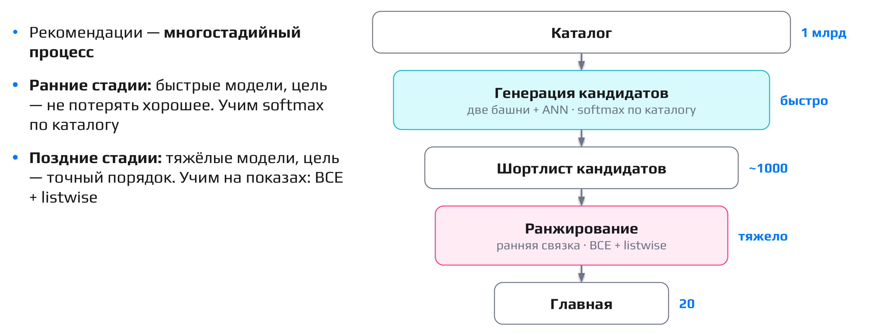

### Классические генераторы кандидатов

Генераторы кандидатов существовали задолго до нейросетей. Простейший **классический генератор кандидатов** — топ популярного. Другой вариант — история пользователя: например, в музыке можно считать кандидатами всё, что пользователь уже слушал, и отдать это на скоринг рекомендательной модели. Очень популярны, в том числе в музыке VK, генераторы item-to-item: для каждого айтема хранится список похожих на него айтемов. Наконец, кандидатов дают разные матричные факторизации, разобранные в лекции «Признаки и классические рекомендательные модели». У каждого из этих подходов свой минус:

|Генератор|Минус|
|:----|:----------|
|Топ популярного|нет персонализации, не рекомендует новое|
|История пользователя|нет discovery|
|Item-to-item|мало персонализации и discovery, нет контекста|
|User-to-item|плохо на новых пользователях и новых айтемах|
|Матричная факторизация|плохо на новых айтемах и пользователях, нет контекста|

Здесь **discovery** — способность показать пользователю что-то новое для него, чего нет в его истории.

Кроме того, у всех этих генераторов, кроме item-to-item, плохое качество на редких, непопулярных айтемах. Каждый работает «в целом неплохо», но у каждого свои недостатки. Отсюда естественное желание построить нейросетевой генератор кандидатов, который вылечит эти недостатки и потенциально заменит все эвристики. Таким генератором и станет двухбашенная модель.

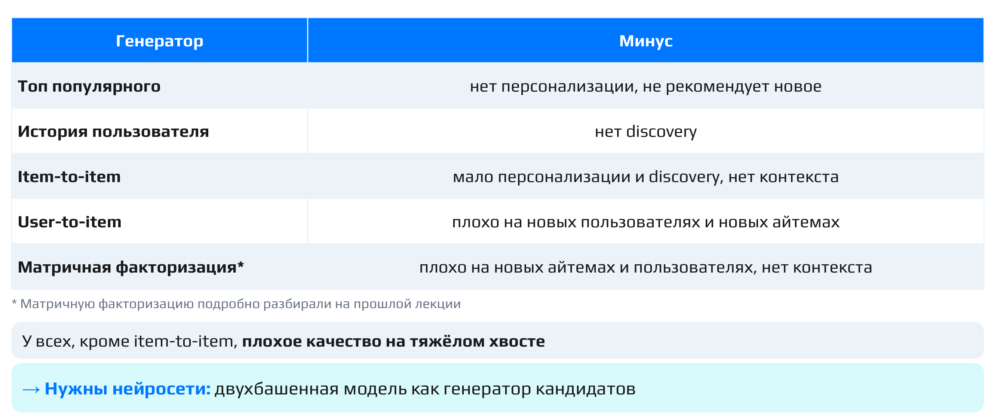

## Нейросетевой канген: полный softmax, двухбашенная модель и HNSW

*Таймкод: 00:14:31 · слайды 17–26*

Итак, мы хотим построить нейросетевой генератор кандидатов — архитектуру, которая потенциально заменит весь набор эвристических алгоритмов[^n3a]. Чтобы обучить такую модель, нужно ответить на два вопроса: **на что её учить** и **как её эффективно инферить**. Начнём с обучения.

### На что учить: ранжирующие лоссы кангену не подходят

Первое, что приходит в голову, — взять уже знакомые ранжирующие лоссы (pointwise, pairwise, listwise) и учить канген на показах. Для ранкера они работают неплохо, но страдают от фолдинга. В одностадийной системе фолдинг частично лечится сам: модель ошибается, показывает пользователю переоценённые айтемы, получает на них отрицательную реакцию и учитывает свои ошибки при следующем обучении.

В многостадийной системе эта петля обратной связи не замыкается. Если канген, обученный на показах, начнёт рекомендовать неправильно, он будет «сильно шуметь», и узнаем мы об этом не сразу. Плохие айтемы, которые он выдал, могут просто не пройти ранжирование, и тогда мы не получим от пользователя никакого сигнала, хороший это был кандидат или плохой. Переоценённое отфильтрует ранкер, и канген об этом не узнает. Недооценённое вообще не попадёт в кандидаты. К тому же обучение на показах означает обучение на 20 айтемах из миллиарда, а позитивы, которые пользователь нашёл сам, через поиск или каталог, в такую выборку не попадают.

**Важный вывод:** в многостадийной системе фолдинг сам не лечится, поэтому кангену нужно глобальное сравнение позитива со всем каталогом, а не только с соседями по выдаче.

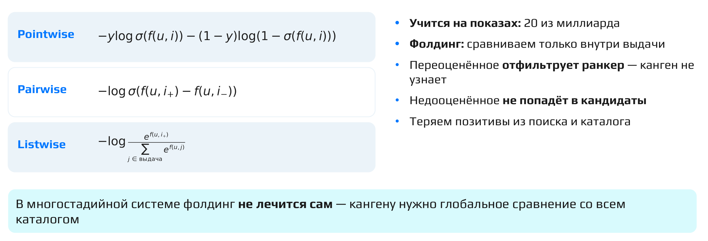

### Полный softmax по каталогу

Чтобы получить глобальное сравнение, меняем постановку задачи. В pointwise-подходе мы моделировали вероятность клика для конкретной пары «пользователь — айтем». Теперь будем моделировать другое: при условии, что пользователь совершит целевое действие (клик, покупку), какой именно айтем это будет?

$$P(y=1\mid u,i)\ \longrightarrow\ P(i\mid u, y=1)$$

Слева стоит вероятность клика ($y=1$) по паре $(u, i)$, справа — вероятность того, что из всех айтемов пользователь $u$ выберет именно $i$. Каждый айтем каталога становится отдельным классом, поэтому такую постановку называют **экстремальной классификацией**: классов столько же, сколько айтемов, то есть миллионы.

Обучаем её [**полным softmax по каталогу**]{.gl key="Полный softmax по каталогу"}:

$$\mathcal{L} = -\log\frac{e^{f(u,i_+)}}{\sum_{j\in\mathcal{D}} e^{f(u,j)}}$$

Здесь $i_+$ — позитив, то есть айтем, с которым пользователь совершил целевое действие, $\mathcal{D}$ — весь каталог, а $f(u, i)$ — функция похожести пользователя и айтема. Её значение называют **логитом**: это ненормированный скор, который softmax превращает в вероятность.

От listwise-лосса эта формула отличается знаменателем. В listwise там стоят только показанные айтемы, а здесь стоят все айтемы каталога: негативом считается всё, на что пользователь не кликнул. Это более честная постановка, и она частично решает проблему фолдинга: позитив соревнуется со всем каталогом, а не только с соседями по выдаче. Кроме того, позитивы теперь могут быть любыми, а не только из выдачи. Итог: правильный лосс для кангена — softmax по всему каталогу.

Архитектура под такой лосс в простейшем виде выглядит так. На вход подаём пользователя, энкодер превращает его в вектор $g(u)$, декодер выдаёт логиты по всем айтемам каталога, а softmax поверх них даёт вероятностное распределение по каталогу:

$$P(i\mid u) := P(i\mid u, y=1), \qquad P(i\mid u) = \frac{e^{f(u,i)}}{\sum_{j\in\mathcal D} e^{f(u,j)}}$$

Это очень широкая модель: её выходной слой по размеру совпадает с каталогом.

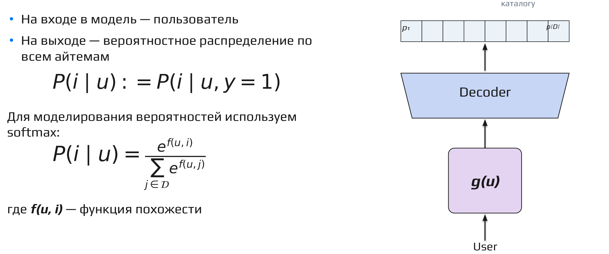

### Softmax сам майнит хард негативы

Здесь возникает закономерный вопрос. При обучении на показах ценность была в том, что мы учились на хард негативах: показанных, но не кликнутых айтемах. Теперь негативы — весь каталог, и большая часть из них для пользователя заведомо нерелевантна. Учитывает ли модель, что разные негативы имеют разную важность?

Ответ даёт производная лосса по логитам негативов. Пусть $s_+$ — логит позитива, $s_1, \dots, s_n$ — логиты негативов, а $\tau$ — множитель, масштабирующий логиты (подробно он разбирается в разделе про косинус и температуру; пока можно считать $\tau = 1$):

$$\mathcal L = -\frac{s_+}{\tau} + \log\Big(e^{s_+/\tau} + \sum_{j=1}^{n} e^{s_j/\tau}\Big)$$

$$\frac{\partial \mathcal L}{\partial s_j} = \frac{p_j}{\tau}, \qquad \frac{|\partial\mathcal L/\partial s_j|}{|\partial\mathcal L/\partial s_k|} = e^{(s_j - s_k)/\tau}$$

Градиент по негативу $j$ пропорционален вероятности $p_j$, которую модель ему приписывает. Чем выше логит негатива, то есть чем охотнее модель выбрала бы его вместо позитива, тем сильнее он штрафуется, причём сила штрафа растёт экспоненциально с логитом. Отношение вкладов двух негативов зависит от разности их логитов экспоненциально. При этом суммарный градиент по всем негативам фиксирован:

$$\sum_n \frac{\partial \mathcal L}{\partial s_n} = \frac{1-p_+}{\tau}$$

Негативы конкурируют за общий «бюджет» градиента, и побеждают в этой конкуренции хард негативы: айтемы, которые релевантны, но не являются позитивами, штрафуются гораздо сильнее совершенно нерелевантных. Чем меньше $\tau$, тем резче это выражено: при $\tau = 0{,}1$ почти весь градиент достаётся негативу, который сильнее всего похож на пользователя. Получается, softmax неявно выполняет **майнинг хард негативов**: сам находит среди всего каталога самые сложные негативы и учится в основном на них.

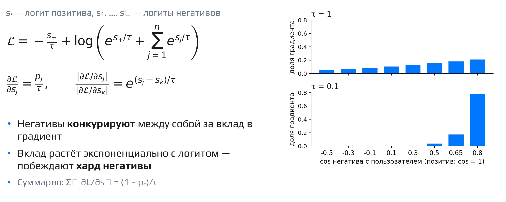

### Как инферить: двухбашенная модель

Второй вопрос — эффективный инференс. Широкая модель с отдельным логитом на каждый айтем при каталоге в несколько миллионов айтемов становится тяжёлой. Здесь на помощь приходит **двухбашенная модель**: пользователи и айтемы раздельно кодируются в эмбеддинги своими башнями, и встречаются только в скалярном произведении (позднее связывание):

$$g(u),\ u\in\mathcal U \quad\text{и}\quad h(i),\ i\in\mathcal D, \qquad f(u,i) = \langle g(u),\, h(i)\rangle$$

Впервые двухбашенные модели появились в информационном поиске: в 2013 году была предложена модель **DSSM** (Deep Structured Semantic Model), первая двухбашенная нейросеть для поиска. Позже идею адаптировали для рекомендаций (статья «Deep Neural Networks for YouTube Recommendations»).

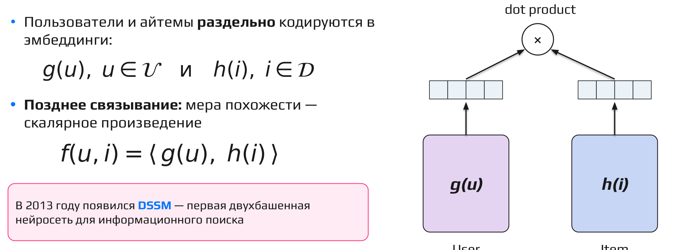

Двухбашенность — это факторизация вычислений по пользователю и айтему, и главное её преимущество в том, что под неё есть эффективная структура данных: индекс **приближённого поиска ближайших соседей (ANN, approximate nearest neighbors)**. Самая популярная его реализация — **HNSW** (Hierarchical Navigable Small World). Это графовый алгоритм, тонкий и сложный внутри; в детали вдаваться не будем. Достаточно понимать, что он очень быстро находит ближайших соседей заданного вектора. Граф устроен по слоям: поиск начинается на верхнем, самом разреженном слое и спускается вниз, с каждым слоем сужая область поиска.

Чтобы найти для пользователя **top-K** кандидатов, то есть K айтемов с наибольшим скором:

1. кодируем пользователя в эмбеддинг $g(u)$;
2. идём в индекс, заранее построенный по эмбеддингам айтемов $h(i)$;
3. получаем приближённый top-K айтемов с максимальным скалярным произведением.

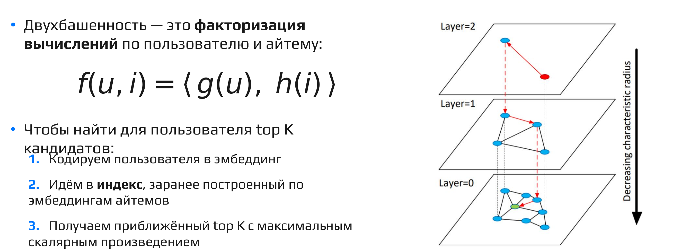

### Как это работает в продакшене

Схема делится на две части.

- **Офлайн:** обучаем двухбашенную модель, прогоняем все айтемы через айтемную башню $h$ и по полученным эмбеддингам строим HNSW-индекс.
- **Онлайн:** считаем эмбеддинг пользователя $g(u)$ через пользовательскую башню, ищем в HNSW top-K ближайших айтемов, а найденных кандидатов передаём ранкеру.

**Важно:** модель в сервисе и индекс должны быть из одной версии. Иначе пользовательский вектор и векторы айтемов окажутся в разных пространствах, и их скалярное произведение потеряет смысл.

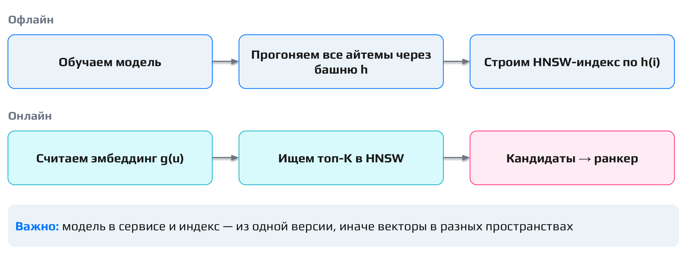

### Итог: две мысли, которые приводят к двухбашенному кангену

К двухбашенным моделям ведут две независимые мысли.

**Первая — ускорить ранкер.** Лучшее качество при ранжировании дают модели с ранним связыванием, но скоры для всех пар «пользователь — айтем» не посчитать заранее в офлайне, а в онлайне тем более. Поэтому модель режут посередине на две башни: айтемную часть, а иногда и пользовательскую, считают в офлайне, а в онлайне остаётся только дешёвое скалярное произведение.

**Вторая — нужен канген.** Двухбашенный ранкер хуже модели с ранним связыванием, а на каталоге в $10^9$ айтемов даже все скалярные произведения $\langle g(u), h(i)\rangle$ посчитать — уже большая проблема. Нужна отдельная стадия кандидатогенерации с быстрыми моделями. Нейросетевой канген нельзя учить impression-aware из-за фолдинга, его учат полным softmax по каталогу. А для эффективного инференса его тоже делят на две башни и строят HNSW-индекс по айтемным эмбеддингам.

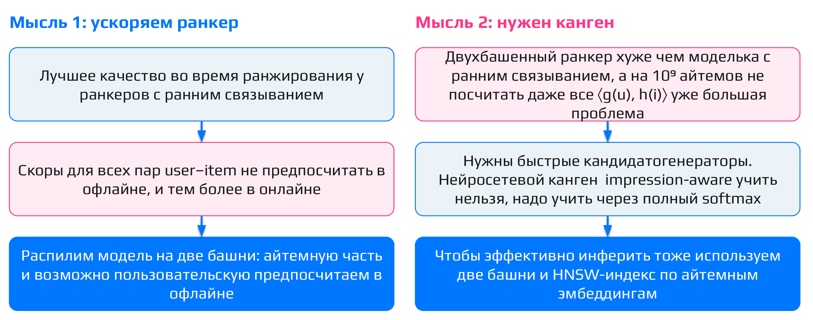

::: {.qa title="Вопросы из зала"}
**В чём суть двух башен: мы просто разделяем пользователей и айтемы и прогоняем каждого через свою сеть? В чём кардинальная разница?** Вся суть в скорости инференса. Лучшая базовая архитектура для ранжирования — модель с ранним связыванием: никаких башен, одна нейросеть, на вход которой подаются и фичи пользователя, и фичи айтема. Работает она очень хорошо, но чтобы получить скор одной пары, нужно прогнать всю сеть. В офлайне это $M \times N$ прогонов ($M$ — число пользователей, $N$ — число айтемов), огромная вычислительная сложность. В онлайне тоже трудно: для одного пользователя сеть приходится прогонять на множестве айтемов. Если разрезать модель на пользовательскую и айтемную части, айтемную можно посчитать офлайн, пользовательскую — офлайн или онлайн, в зависимости от задачи, а затем очень дёшево перемножить эмбеддинги. Для ранжирования это способ ускориться. Для кандидатогенерации это, пожалуй, самый эффективный способ сделать нейросетевую модель: благодаря ANN-индексам вроде HNSW в онлайне не нужно инферить айтемную башню вовсе, достаточно прогнать пользовательскую и сходить с полученным эмбеддингом в индекс. То есть разница именно в оптимизации и скорости.
:::

[^n3a]: Примечание составителя: здесь, по-видимому, имеется в виду эссе Ричарда Саттона «The Bitter Lesson» («Горький урок», 2019): в долгосрочной перспективе общие методы, которые масштабируются с ростом вычислений (обучение, поиск), выигрывают у подходов, построенных на ручных эвристиках и знаниях экспертов.

## Косинус и температура

*Таймкод: 00:33:30 · слайды 27–33*

Мы выяснили, что кандидатогенерацию лучше всего учить полным softmax по каталогу. Прежде чем разбираться, как считать его на миллионах айтемов, нужно решить две технические задачи, без которых такое обучение плохо работает: что брать в качестве логита и как управлять «остротой» распределения.

### Косинус вместо скалярного произведения

Полный softmax вычислительно нестабилен. Логит $f(u,i)=\langle g(u),h(i)\rangle$ может принимать любые значения от $-\infty$ до $+\infty$, а экспонента от большого числа — огромное число, с которым неудобно работать. Поэтому вместо скалярного произведения выходных эмбеддингов башен берут **косинусную близость**, то есть скалярное произведение нормированных векторов. Она лежит в отрезке $[-1;1]$, логиты ограничены по масштабу, и обучение становится стабильнее.

Есть и второй довод. Замечено, что нормы эмбеддингов айтемов выучивают популярность. Модель ориентируется на логит, а у популярного айтема скалярное произведение с пользователями в среднем должно быть больше. Проще всего добиться этого, увеличив норму айтема. В итоге модель начинает тяготеть к рекомендации популярных айтемов, а это не всегда то, чего мы хотим. С таким перекосом борются по-разному. Косинус убирает влияние нормы и поэтому тоже его ослабляет. Кроме того, когда эмбеддинги лежат на сфере, а объекты достаточно хорошо кластеризованы, классы становятся линейно разделимыми. Подробнее об этом — в статье «Understanding Contrastive Representation Learning through Alignment and Uniformity on the Hypersphere» и в статье WB на Хабре «Неочевидные подробности обучения двухбашенных моделей».

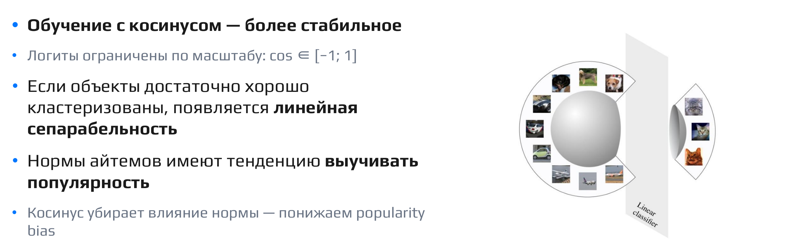

### Температура

У косинуса есть обратная сторона. Раз логиты заперты в отрезке $[-1;1]$, softmax получается очень «гладким» и не может стать острым. Поэтому логит делят на **температуру τ**:

$$f(u,i)=\frac{\cos\big(g(u),\,h(i)\big)}{\tau}.$$

Температура масштабирует логиты: теперь они лежат в диапазоне $[-1/\tau;\,1/\tau]$.

Возьмём идеальную модель. У пользователя один позитив, причём суперрелевантный: вектор айтема совпадает с вектором пользователя, косинус равен 1. Ещё есть четыре совершенно нерелевантных негатива, которые смотрят ровно в противоположную сторону, у них косинус равен $-1$. Лучше разделить нельзя, но при $\tau=1$ вероятность позитива всего

$$p_+=\frac{e^{1}}{e^{1}+4e^{-1}}\approx 0{,}65,$$

а лосс $-\log 0{,}65\approx 0{,}43$. Модели просто не дают стать уверенной. Если уменьшить температуру, вероятность позитива сильно вырастет:

| $\tau$ | P(позитив) | P(негатив) |
|:--|:--|:--|
| 1 | 0,649 | 0,088 |
| 0,5 | 0,932 | 0,017 |
| 0,1 | ≈ 1,0 | ≈ 0 |

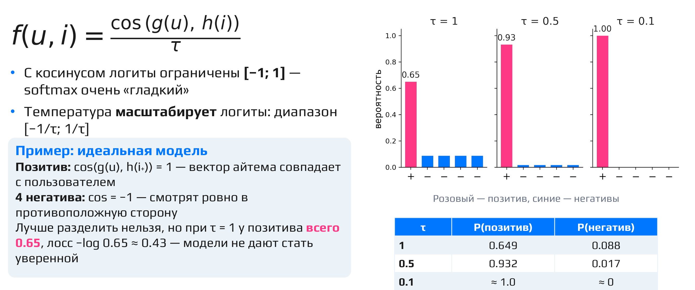

### Температура как мера неопределённости

Softmax с температурой внешне совпадает с **распределением Больцмана (Гиббса)** из физики, если считать энергией состояния минус логит, $E_k=-s_k$:

$$p_k=\frac{e^{s_k/\tau}}{\sum_i e^{s_i/\tau}}=\frac{e^{-E_k/\tau}}{\sum_i e^{-E_i/\tau}}=\frac{e^{-E_k/\tau}}{Z},$$

где $Z$ — нормировочная константа. В физике температура служит мерой неопределённости, и у нас она играет ту же роль. Неопределённость распределения измеряет **энтропия** $H$. Она равна нулю, когда вся вероятность сосредоточена на одном исходе, и максимальна у равномерного распределения: для $K$ исходов это $\log K$.

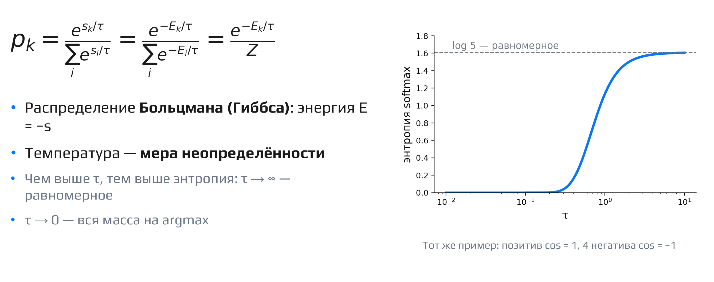

Энтропия softmax растёт с температурой:

$$\frac{\partial H}{\partial \tau}=\frac{\operatorname{Var}_p[s]}{\tau^3}\ \ge\ 0.$$

Производная энтропии по $\tau$ равна дисперсии логитов под распределением модели, делённой на $\tau^3$. Поэтому она неотрицательна, и энтропия не убывает с ростом температуры. В пределе $\tau\to 0$ вся масса уходит на argmax, и $H\to 0$. При $\tau\to\infty$ распределение становится равномерным, и $H\to\log K$. В примере с идеальной моделью энтропия при росте $\tau$ поднимается от нуля до $\log 5\approx 1{,}61$. Возьмём другой пример: логиты пяти айтемов равны 1; 0,6; 0,2; −0,3; −1. При малой температуре пик на argmax выражен сильнее всего, и вероятность взять максимум близка к единице. По мере роста температуры все вероятности сходятся практически к одному значению $1/K=0{,}2$, то есть распределение вырождается в равномерное.

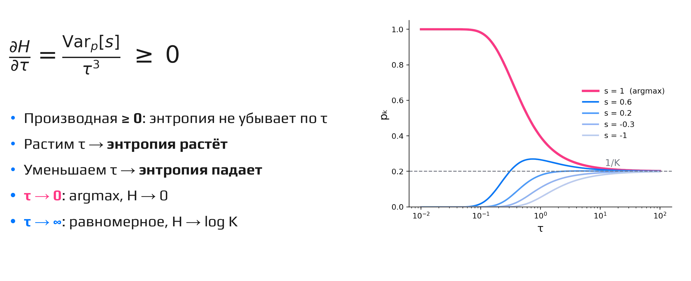

### Alignment и uniformity

Температура влияет и на геометрию пространства эмбеддингов. От этого пространства мы хотим двух свойств. **Alignment**: похожие объекты должны находиться рядом. **Uniformity**: объекты должны равномерно покрывать сферу. Сами по себе эти требования тянут в разные стороны. Если гнаться только за близостью, в экстремальном случае модели выгодно «спихнуть» все айтемы в какую-то очень маленькую локальную область. Uniformity этого не допускает: айтемы должны быть равномерно разбросаны по шару, чтобы пространство сохраняло максимум информации. Температура задаёт баланс: при её уменьшении растёт uniformity и падает alignment.[^n4a] Подробнее — в статьях «Understanding Contrastive Representation Learning through Alignment and Uniformity on the Hypersphere» и «Understanding the Behaviour of Contrastive Loss».

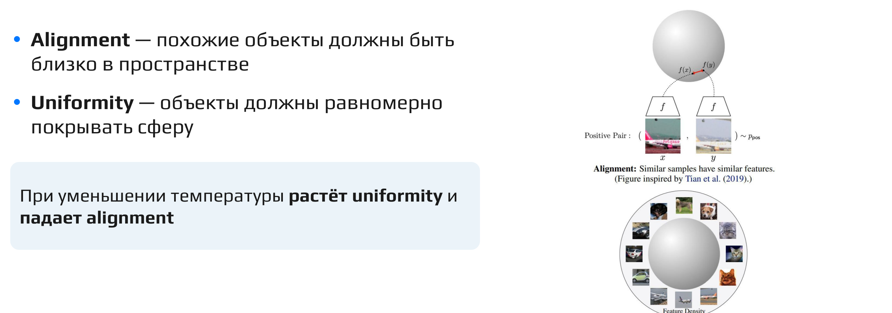

### Как задавать температуру

Есть три варианта. Температуру можно зафиксировать: до сих пор мы так и поступали. Можно задать расписание, при котором её постепенно уменьшают. Это аналог **curriculum learning**, когда задачу для модели усложняют по ходу обучения. Наконец, можно сделать **обучаемую температуру**: это обычный параметр, который подбирается в процессе обучения вместе с остальными. Тогда её можно интерпретировать как неуверенность модели: чем выше температура, тем менее уверенны предсказания, чем ниже — тем увереннее.

Как такой параметр меняется при обучении, видно из градиента. Обозначим обратную температуру $\gamma=1/\tau$, логит позитива — $s_+$:

$$\mathcal L=-\gamma s_+ + \log Z,\qquad \frac{\partial\mathcal L}{\partial\gamma}=-s_+ + \mathbb E_p[s].$$

Здесь $\mathbb E_p[s]$ — средний логит по распределению модели. Если позитив уже выше среднего ($s_+>\mathbb E_p[s]$), производная отрицательна. Тогда градиентный спуск увеличивает $\gamma$, то есть понижает температуру, и уверенность модели растёт.

::: {.qa title="Вопросы из зала"}
**Зачем вообще подбирать температуру? Если высокая даёт хаос, а низкая — предсказуемое поведение, почему бы не выставить её раз и навсегда низкой или высокой?** Двухбашенная модель строит семантическое пространство над эмбеддингами юзеров и айтемов, которые выдают башни. Мы хотим, чтобы у этого пространства были хорошие свойства: объекты равномерно разбросаны по сфере, а похожие находятся близко друг к другу. Температура — один из инструментов, которым эти свойства настраиваются: ею можно отдалить объекты друг от друга или, наоборот, сконцентрировать их вокруг отдельных точек. На кандидатогенерации это проявляется напрямую: мы идём в HNSW-индекс и берём ближайших соседей пользователя. При высокой температуре кандидатов много, среди них попадаются не очень релевантные и не очень полезные, зато больше discovery. При низкой discovery меньше, распределение вырождается в выраженные пики, и наружу выходят самые релевантные кандидаты с точки зрения логов обучения. Обе крайности плохи. Если выкрутить температуру в максимум, распределение становится равномерным: это чистый хаос, из которого ничего полезного не извлечь. Если выкрутить её в ноль, вытаскиваются только самые вероятные айтемы, и пространство вырождается. Нужно что-то посередине, поэтому параметр и приходится настраивать.[^n4b]

**Значит, в выдаче YouTube или поисковика у первой строки самая низкая температура, а дальше она всё выше?** Нет, это про другое. Температура нужна, чтобы построить пространство, из которого кандидатогенерация вытащит как можно больше релевантных кандидатов. Порядок выдачи определяется на следующем этапе: кандидаты передаются на ранжирование, там они скорятся и только потом попадают в выдачу.
:::

[^n4a]: Примечание составителя: это согласуется с тем, что softmax сам майнит хард негативы. При малой температуре почти весь градиент достаётся самым похожим негативам, и модель сильнее расталкивает близкие объекты по сфере. Равномерность растёт, но расталкиваются и семантически похожие пары, поэтому alignment падает.

[^n4b]: Примечание составителя: «равномерность» и «хаос» при высокой температуре в этом ответе относятся к выходному распределению softmax, как в примере с энтропией. Это не то же самое, что uniformity эмбеддингов на сфере: геометрия пространства, наоборот, становится равномернее при *уменьшении* температуры.

## Softmax loss на большом каталоге: sampled softmax, негативы и logQ-коррекция

*Таймкод: 00:40:42 · слайды 34–44*

### Почему полный softmax не посчитать

Кандидатогенерацию мы учим через **softmax loss**: он максимизирует правдоподобие реальных положительных взаимодействий, то есть вероятность того, что пользователь $u$ провзаимодействует именно со своим позитивом $i_+$:

$$\mathcal{L}_{\text{softmax}}(u, i_+) = -\log P(i_+ \mid u) = -\log \frac{e^{f(u,i_+)}}{\sum_{j \in D} e^{f(u,j)}}$$

Здесь $D$ — весь каталог, а $f(u,i)$ — скор пары, то есть скалярное произведение или косинус выходов башен $g(u)$ и $h(i)$, поделённый на температуру. В числителе стоит только позитив, и с ним проблем нет. Тяжёлым оказывается знаменатель: в нём сумма по всем айтемам каталога. Если в каталоге миллион айтемов и больше (на практике уже от $10^5$), эту сумму нельзя эффективно посчитать ни на forward, ни на backward: пришлось бы прогнать через айтемную башню весь каталог на каждом шаге обучения, а это слишком дорого и по вычислениям, и по памяти.

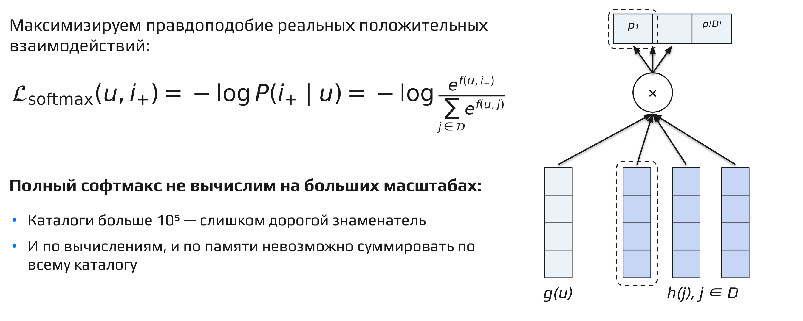

### Sampled softmax

Выход — не считать знаменатель точно, а оценить его, **сэмплируя негативы**. Так получается **sampled softmax**: сумма в знаменателе берётся не по всему каталогу, а по небольшому сэмплированному подмножеству $N$:

$$\mathcal{L}_{\text{sampled}}(u, i_+, N) = -\log \frac{e^{f(u,i_+)}}{e^{f(u,i_+)} + \sum_{j \in N} e^{f(u,j)}}, \qquad N = \{j_1, \dots, j_{|N|}\},\ j_n \sim Q$$

Негативы $j_n$ берутся из некоторого распределения $Q$, и обычно их сильно меньше, чем айтемов в каталоге: $|N| \ll |D|$. По сути это та же задача классификации, только классами служит не весь каталог, а его подмножество, и башню $h$ нужно считать лишь для позитива и негативов.

Сразу возникают два вопроса, которые определяют всё дальнейшее: откуда брать негативы и как их брать так, чтобы сэмплирование не смещало обучение.

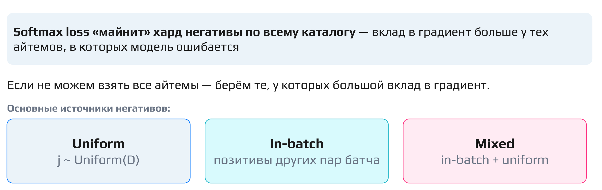

### In-batch негативы

Первая идея опирается на то, что модель всё равно учится батчами. В батче лежат положительные пары разных пользователей, и у каждого свой позитив. Позитивы *других* пользователей можно использовать как негативы для данного. Это и есть **in-batch негативы**. Удобно представить их как матрицу логитов $g(U)\,h(I)^\top$ размера «пользователи батча × айтемы батча»: на диагонали стоят позитивы, всё остальное в строке служит негативами.

Такой подход очень эффективен: эмбеддинги этих айтемов уже посчитаны для их собственных пар, отдельно считать негативы не нужно. Он хорошо работает и при распределённом обучении на нескольких видеокартах: к негативам можно добавить позитивы пользователей с других GPU (cross-device негативы). Ещё один приём — memory queue, переиспользование негативов из прошлых батчей.

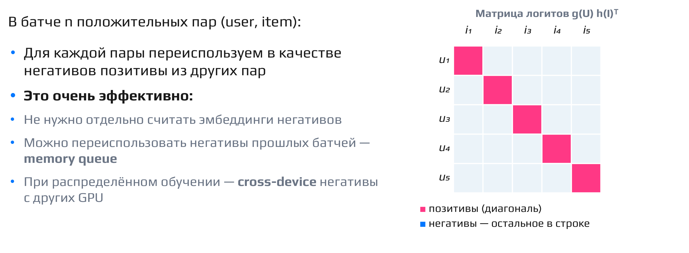

Та же конструкция известна в более общем виде как **contrastive learning**: похожие объекты сближаем, непохожие отдаляем. Для батча из положительных пар $(u_1, i_1), \dots, (u_n, i_n)$ лосс **InfoNCE** выглядит так:

$$\mathcal{L}_{\text{InfoNCE}}(u_k, i_k) = -\log \frac{e^{\cos(g(u_k),\, h(i_k))/\tau}}{\sum_{m=1}^{n} e^{\cos(g(u_k),\, h(i_m))/\tau}}$$

Это sampled softmax с косинусом и температурой, где негативы для $u_k$ — айтемы остальных пар батча. Косинус здесь стабильнее скалярного произведения: логиты ограничены, и остроту распределения задаёт $\tau$, а не нормы векторов.

### Uniform негативы и смешанная стратегия

У in-batch негативов есть забавное свойство: в них попадают в основном популярные айтемы. Чем популярнее айтем, тем чаще он оказывается чьим-то позитивом, а значит, тем чаще служит негативом для остальных. Обратная сторона: редкие айтемы из длинного хвоста почти никогда не попадают в батч, и модель их как негативы фактически не видит.

Чтобы закрыть хвост, добавляют **uniform негативы**: айтемы, взятые равномерно случайно из всего каталога, $j \sim \text{Uniform}(D)$. Они распределены по каталогу равномерно, и смещения к популярному у них нет. Но у них другой недостаток. Вспомним, что softmax «майнит» хард негативы: сильнее всего он штрафует те айтемы, на которых модель ошибается. Случайный айтем из огромного каталога почти всегда совершенно нерелевантен пользователю, то есть это лёгкий негатив, и его вклад в градиент мал. Поэтому uniform негативов нужно много. In-batch негативы, наоборот, сложнее (в среднем у них больше $f(u,j)$): они дают больший вклад в градиент, и их нужно сильно меньше, они ценнее.

| | Uniform | In-batch |
|:-------|:--------|:------------|
| Распределение | равномерное по каталогу | частотное (униграммное), частота в батче ∝ популярности |
| Сложность для модели | очень «простые» | сложнее: $f(u,j)$ в среднем больше |
| Вклад в градиент | небольшой | больший |
| Сколько нужно | много | сильно меньше |
| Главный недостаток | нужно очень много | смещение к популярному |

Поэтому на практике обычно применяют **смешанную стратегию (Mixed Negative Sampling)**: in-batch негативы дают популярное, uniform — длинный хвост, который в батч почти не попадает.

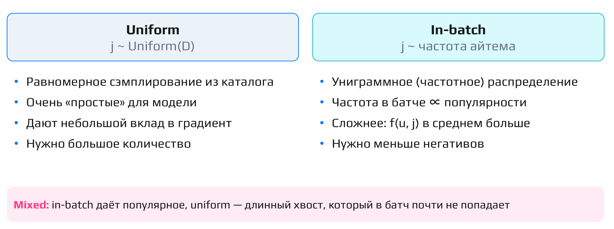

### Смещение in-batch негативов

Вернёмся к перекосу in-batch негативов к популярному. В батче размера $B$ популярный айтем встречается один раз как позитив и $B-1$ раз как негатив, а айтем из хвоста почти не встречается ни в той, ни в другой роли. Модель видит корреляцию между популярностью и «негативностью» и начинает сильнее штрафовать популярные айтемы. Это и есть **popularity bias** in-batch негативов: оценка градиента систематически смещена.

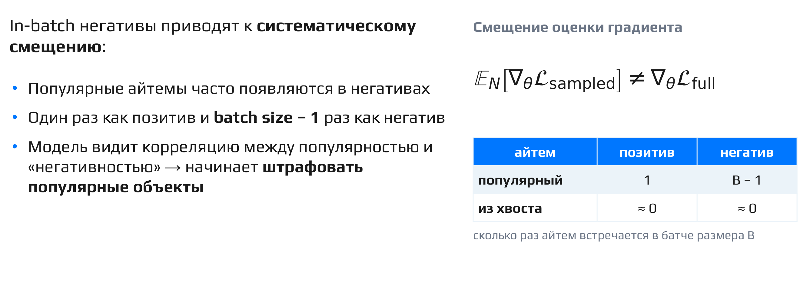

### logQ-коррекция

Учесть это смещение позволяет **logQ-коррекция**. В её основе лежит **importance sampling** — перевзвешивание сэмплов. Негативы мы берём не равномерно, а из распределения $Q$ (для in-batch $Q$ — популярность айтема), поэтому наивная оценка знаменателя смещена. Importance sampling перевзвешивает каждый сэмпл на $1/Q$:

$$Z = \sum_{j \in D} e^{f(u,j)} \approx \frac{1}{n}\sum_{k=1}^{n} \frac{e^{f(u,j_k)}}{Q(j_k)} = \frac{1}{n}\sum_{k=1}^{n} e^{f(u,j_k) - \log Q(j_k)}, \qquad j_k \sim Q$$

То, что часто попадает в выборку, весит меньше, а редкое — больше. В логитах такое перевзвешивание сводится просто к вычитанию $\log Q(j)$. Отсюда sampled softmax с logQ-коррекцией:

$$\mathcal{L}_{\log Q}(u, i_+, N) = -\log \frac{e^{f(u,i_+) - \log Q(i_+)}}{e^{f(u,i_+) - \log Q(i_+)} + \sum_{j \in N} e^{f(u,j) - \log Q(j)}}$$

Здесь $Q$ — распределение, из которого сэмплируются негативы, $N$ — пул негативов. Поправка компенсирует популярность айтемов среди негативов.[^n5a]

**Важно:** поправка нужна только при обучении. Модель учится с ней, а на инференсе $\log Q$ выбрасывают и используют чистый скор $f(u,i)$.

Подробный вывод формулы хорошо разобран в лекции 3 Кирилла Хрыльченко из курса DeepRecSys (ФКН ВШЭ).

### Исправленная logQ-коррекция

Около года назад вышла работа **Correcting the LogQ Correction** исследователей из Яндекса, в том числе самого Хрыльченко. Она показала, что в исходном выводе logQ-коррекции была ошибка: позитив не сэмплируется из $Q$, а значит, корректировать его так же, как негативы, нельзя. Уточнённая формула:

$$\mathcal{L}^{\text{corrected}}_{\log Q}(u, i_+, N) = -\,w_{ui_+} \log \frac{e^{f(u,i_+)}}{\sum_{j \in N} e^{f(u,j) - \log Q(j)}}$$

$$w_{ui_+} = \mathrm{sg}\big(1 - P(i_+ \mid u)\big), \qquad P(i_+ \mid u) \approx \frac{e^{f(u,i_+)}}{e^{f(u,i_+)} + \frac{1}{|N|}\sum_{j \in N} e^{f(u,j) - \log Q(j)}}$$

В знаменателе позитив больше не участвует. Зато каждый пример получает вес $w_{ui_+}$, равный вероятности того, что модель на нём ошибётся. $\mathrm{sg}$ — stop-gradient: вес считается константой, градиент через него не идёт. Если есть выбор, лучше пользоваться исправленной версией.

### Итог

Логика обучения кангена на большом каталоге такая:

1. Полный softmax — правильный лосс для кангена.
2. Косинус делает обучение устойчивее.
3. Температура задаёт масштаб логитов, служит мерой неопределённости и меняет свойства семантического пространства.
4. Знаменатель полного softmax слишком тяжёлый, поэтому его оценивают сэмплированием негативов: in-batch и uniform, обычно в смеси.
5. In-batch негативы смещены к популярному, поэтому нужна logQ-коррекция, лучше в исправленном виде.

::: {.qa title="Вопросы из зала"}
**Лосс в двухбашенной модели один на обе башни и зависит от скалярного произведения их эмбеддингов? Тогда как идёт обратное распространение: башни замораживают по очереди?** Да, лосс один, и обе башни учатся одновременно. Внутри можно использовать дропауты, регуляризацию и вообще все современные нейросетевые приёмы. Сравните с коллаборативной фильтрацией: там матрицу взаимодействий user–item представляют в виде произведения двух матриц, юзерских и айтемных эмбеддингов, и ищут такую пару, произведение которой лучше всего её приближает. Здесь же берётся экспрессивная архитектура, которая ради эффективного инференса должна быть двухбашенной, и её учат моделировать softmax, то есть вероятность $P(i \mid u)$ того, что пользователь провзаимодействует с конкретным айтемом.

**Этот softmax полный или выборочный?** В идеале хотим полный, но в его знаменателе сумма по всему каталогу, а это вычислительно слишком дорого. Поэтому на практике полный softmax loss приближают sampled softmax: в знаменатель берут подмножество — in-batch негативы (позитивы соседних пользователей батча) и uniform негативы (случайные айтемы каталога). Называть это «матрицей оценок», по которой берётся softmax и кросс-энтропия, не вполне корректно: суть в том, что полный softmax loss аппроксимируется сэмплированным.
:::

[^n5a]: Примечание составителя: у популярного айтема $Q$ велико, поэтому $-\log Q$ мало, а у редкого $Q$ мало и $-\log Q$ велико. После вычитания $\log Q$ популярные айтемы получают меньшую прибавку к логиту, чем редкие, и их вклад в знаменатель относительно ослабевает. Поэтому модели уже не нужно занижать скор популярных айтемов только из-за того, что они часто попадаются среди негативов.

## Кодирование айтема: обучаемые и контентные эмбеддинги

*Таймкод: 00:54:49 · слайды 45–51*

### Два способа подать айтем в башню

До сих пор айтемная башня $h(i)$ была просто «чем-то, что выдаёт вектор айтема». Теперь разберёмся, что подаётся ей на вход. Вариантов два.

Первый — **обучаемые эмбеддинги** (их ещё называют **ID-эмбеддингами**, ID-based embeddings). Заводим таблицу, в которой у каждого айтема своя строка-вектор, объявляем её параметрами модели и учим вместе со всем остальным. Это [**матрица эмбеддингов $N \times d$**]{.gl key="Матрица эмбеддингов N × d"}, где $N$ — число айтемов, $d$ — размерность эмбеддинга. Такие эмбеддинги учатся прямо под нашу задачу, поэтому они самые выразительные. Зато таблица получается огромной. Каталог в 100 млн айтемов при размерности 128 в fp32 занимает около 50 ГБ, а с состояниями оптимизатора Adam — втрое больше[^n6a]. У видеокарт порядка 80 ГБ памяти, так что положить такую таблицу на GPU удаётся не всегда.

У обучаемых эмбеддингов есть ещё два минуса. Первый — **холодный старт**: у нового айтема нет ни взаимодействий, ни обученной строки в таблице, поэтому двухбашенную модель на ID-эмбеддингах нельзя просто так заставить с ним работать. Второй — переобучение на редких айтемах. Взаимодействий у них мало, а обучаемых параметров на каждый айтем много: целый вектор. Модели проще всего запомнить такие айтемы в данных, и она перестаёт обобщать.

Второй вариант — **контентные эмбеддинги**: вектор айтема получают из его содержимого (текста, картинки, видео) готовым энкодером. Их удобно учить и применять: скорее всего, они уже предпосчитаны другой командой, и их остаётся только подать на вход. С ними модель обычно быстрее сходится, и для новых айтемов они работают из коробки.

Минус контентных эмбеддингов проявляется, когда данных много: тогда они, скорее всего, проигрывают обучаемым. В обучаемый вектор модель может «запихнуть» коллаборативный сигнал, то есть запомнить, как пользователи ведут себя с конкретным айтемом, а не только каков он по содержанию. Такое запоминание поведенческих паттернов на уровне отдельных айтемов называют **мемоизацией**. Контентный вектор этого не позволяет, потому что он одинаков при любых пользовательских логах. Практика подтверждает, что мемоизация важна: ID-эмбеддинги очень нужны и дают довольно много качества.

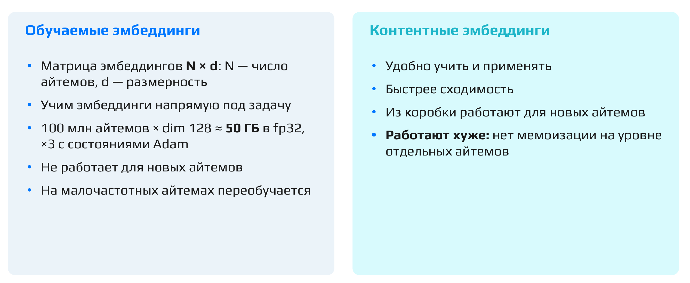

### Две башни как низкоранговое разложение

Обучаемые векторы айтемов возникли у нас естественным образом ещё в softmax-модели. Пользователь проходит через башню $g(u)$, а айтемы задаются декодер-матрицей — таблицей эмбеддингов, которая играет роль айтемной башни (иногда после неё стоит ещё линейный или нелинейный слой). Умножая вектор пользователя на эту матрицу, получаем логиты по всему каталогу. Строки таблицы — обычные параметры модели: они оптимизируются градиентным спуском вместе с остальными весами под downstream-задачу.

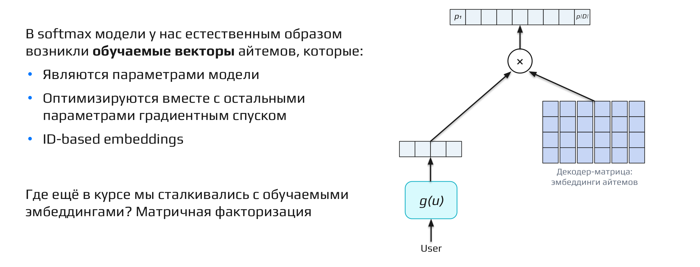

Здесь просматривается знакомая аналогия с SVD и вообще с матричной факторизацией из прошлой лекции: и там, и тут учатся эмбеддинги пользователей и айтемов. Запишем это точнее. Интерес пользователей к айтемам описывает **матрица релевантности**

$$\mathcal{R} \in \mathbb{R}^{|U| \times |D|},$$

где $U$ — множество пользователей, $D$ — каталог. Двухбашенная модель учит её **низкоранговое разложение**:

$$\mathcal{R} \approx V_u \times V_d^\top,$$

где $V_u$ — матрица эмбеддингов пользователей размера $|U| \times dim$, а $V_d$ — матрица эмбеддингов айтемов размера $|D| \times dim$. Значит, каждый скор $f(u, i)$ — это элемент произведения двух «узких» матриц. Размерность эмбеддинга $dim$ служит информационным горлышком: ранг приближения не может её превысить. Матричная факторизация оказывается частным случаем двухбашенной модели, в котором обе башни — просто таблицы обучаемых векторов.

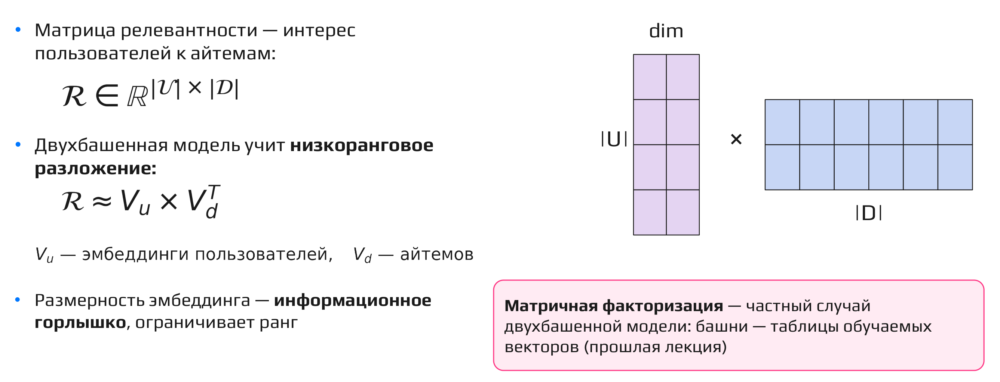

Насколько выразительна такая модель с обучаемыми эмбеддингами? На самом деле очень. Достаточно широкий эмбеддинг может выучить **любую** матрицу релевантности. Закодируем пользователя вектором **one-hot** — вектором длины $|U|$, в котором единица стоит только на позиции этого пользователя, а остальные элементы нулевые. Вектором айтема возьмём его столбец матрицы $\mathcal{R}$:

$$v_u = (0, \dots, 1, \dots, 0) \in \mathbb{R}^{|U|}, \qquad v_i = (\mathcal{R}_{ui})_{u=1}^{|U|}, \qquad f(u, i) = \langle v_u, v_i \rangle = \mathcal{R}_{ui}.$$

Скалярное произведение one-hot вектора пользователя с вектором айтема просто «вынимает» нужное значение для пары $(u, i)$. Так можно воспроизвести произвольную функцию, но только при размерности эмбеддинга, равной числу пользователей. На практике такую размерность себе не позволить ни по памяти, ни по скорости: используют сотни, максимум тысячи. Конструкция взята из работы «Retrieval with Learned Similarities».

### Сравнение: что выбрать

Сведём плюсы и минусы обоих подходов.

| | Обучаемые (ID) эмбеддинги | Контентные эмбеддинги |
|:----------|:--------------------------------|:--------------------------------|
| Плюсы | максимальная выразительность: таблица может выучить любые представления под задачу | работают с новыми объектами за счёт сходства по контенту |
| | совместимы с контентными: их можно сконкатенировать или инициализировать обучаемые предобученными контентными | меньше переобучаются, лучше на редких айтемах |
| | скейлинг и мемоизация: таблица — память модели | учитывают изменения объекта, ускоряют сходимость |
| Минусы | холодный старт | без ID-сигнала ниже потолок качества |
| | переобучение на редких айтемах | риск потерять скейлинг |
| | много памяти | |

Несколько пунктов стоит пояснить. **Скейлинг** — рост качества модели при увеличении данных и числа параметров. Обучаемые эмбеддинги его обеспечивают: таблица работает как память модели. Важные паттерны пользователей запоминаются в ней, а иначе модели пришлось бы хранить их в весах сети.

Главное свойство контентных эмбеддингов — **индуктивность**: модель умеет работать с объектами, которых не видела при обучении, потому что похожий контент даёт похожий вектор. Энкодер задаёт **inductive bias** — заложенное в модель предположение, что объекты, близкие по содержанию, должны быть близки и в пространстве эмбеддингов. Поэтому контентные эмбеддинги меньше переобучаются и лучше работают на редких айтемах: такой айтем описывается своим контентом, даже если взаимодействий с ним почти нет. Отсюда же умение учитывать изменения объекта. Если объект изменился, достаточно заново прогнать его через айтем-энкодер. Получим эмбеддинг в том же семантическом пространстве, подадим его в модель, и, скорее всего, ничего плохого не произойдёт.

Обратная сторона в том, что контентные эмбеддинги под задачу не обучаются. Выучить пользовательский (коллаборативный) сигнал им гораздо сложнее, поэтому качество, скорее всего, заметно хуже. **Важно:** в продакшене многие команды замечали, что на одних контентных эмбеддингах модель плохо скейлится. Поэтому на практике ID-эмбеддинги не выбрасывают, а ищут способы сделать их компактнее и устойчивее к переобучению.

::: {.qa title="Вопросы из зала"}
**Двухбашенная модель — это матричная факторизация? Какие методы в ней используются?** Это другая архитектура, но на неё можно смотреть как на разновидность и развитие матричной факторизации. В ней тоже есть обучаемые эмбеддинги, а юзерская башня — в некотором смысле аналог матрицы пользователей из коллаборативной фильтрации. При этом нейросетевые модели экспрессивнее. Их можно учить на разные лоссы и подавать им на вход контентную информацию об айтеме. У ALS, SLIM и других методов коллаборативной фильтрации такой возможности физически нет: аудио или картинку айтема в ALS никак не передать. Поэтому двухбашенные модели можно считать как развитием коллаборативной фильтрации, так и отдельным классом нейросетевых методов с красивой аналогией с ней.

**Если подавать в башни только ID пользователя и айтема, а башни сделать линейными, модель выродится в классическую матричную факторизацию?** Да, именно в этом частном случае они совпадают: матричная факторизация линейна. Ценность двухбашенной модели в том, что на вход можно подать контентные векторы. Это уже не просто информация о том, что пользователь лайкал и с чем взаимодействовал, но и о том, с каким контентом он взаимодействовал. Кроме того, модель можно сделать нелинейной и учить на разные лоссы, например на softmax loss.
:::

[^n6a]: Примечание составителя: $10^8 \cdot 128 \cdot 4$ байта $\approx 51$ ГБ. Множитель «×3» объясняется тем, что Adam хранит для каждого параметра ещё два состояния — оценки первого и второго моментов градиента.

## Hashing trick, Semantic ID и переобучение на тяжёлом хвосте

*Таймкод: 01:04:43 · слайды 52–57*

Обучаемые эмбеддинги дают максимальную выразительность, но за неё приходится платить памятью: каждому айтему нужна своя строка в матрице эмбеддингов $N \times d$, а айтемов в больших каталогах очень много. Посмотрим, как сжать эту таблицу и что при этом происходит с качеством.

### Hashing trick

Идея **hashing trick** простая. Вместо того чтобы держать отдельную строку для каждого айтема, заводим сжатую таблицу на $K$ строк, где $K$ намного меньше числа айтемов $N$. Для айтема считаем хэш, например от его номера (ID), и берём остаток по какому-нибудь разумному модулю — скажем, 1024 или 512. Полученное число — индекс строки в таблице обучаемых эмбеддингов. По нему достаём эмбеддинг и используем его при обучении так же, как обычный ID-эмбеддинг.

$$E \in \mathbb{R}^{K \times d}, \quad K \ll N; \qquad i \mapsto h_1(i), h_2(i), \dots, h_k(i) \in \{1, \dots, K\}$$

Здесь $E$ — сжатая таблица из $K$ строк размерности $d$, а $h_1, \dots, h_k$ — разные хэш-функции, каждая из которых отображает айтем $i$ в номер строки.

Раз строк меньше, чем айтемов, неизбежно возникают **коллизии**: разные айтемы попадают в одну строку и вынуждены делить один эмбеддинг. Чтобы смягчить эту проблему, используют **мульти-хэши**: берём от айтема не один хэш, а несколько (hash1, hash2, …), достаём несколько эмбеддингов и суммируем их. Два айтема могут совпасть по одному хэшу, но вряд ли совпадут по всем сразу, поэтому итоговые суммы у них будут разными. Это довольно популярная техника: её используют в YouTube, в Google и вообще в рекламе.

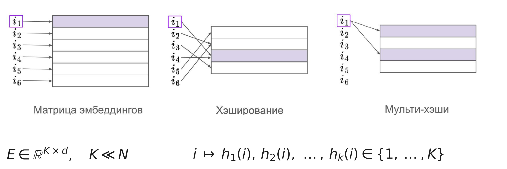

### Semantic ID

У hashing trick есть два недостатка. С маленькой матрицей действительно намного проще работать, но проблема холодного старта никуда не девается: новый айтем по-прежнему получает необученный эмбеддинг. Кроме того, коллизии здесь **неосмысленные**: какие айтемы делят общий эмбеддинг, решает случайный хэш. Коллизии можно сделать осмысленными, если назначать номера не случайно, а по контентной близости, опираясь на контентный эмбеддинг айтема. Тогда общие эмбеддинги будут делить семантически похожие айтемы. В этом и состоит **Semantic ID**: айтем переводится в набор разделяемых «осмысленных» айдишников, и уже по ним идёт обращение в таблицы обучаемых эмбеддингов.

Получить такие айдишники можно несколькими алгоритмами. Первый из них — **RQ-KMeans**. На входе — контентные эмбеддинги айтемов $Y \in \mathbb{R}^{N \times m}$. Дальше алгоритм работает так:

1. Кластеризуем эмбеддинги k-means на $c$ кластеров и находим их **центроиды** $C \in \mathbb{R}^{c \times m}$ — центры кластеров.
2. Приписываем каждый вектор $Y_i$ к ближайшему центроиду и вычитаем центроид из вектора. Получаем **остаток** (residual) — то, что центроид не объяснил.
3. Повторяем шаги 1–2 уже на остатках: кластеризуем их, приписываем каждый остаток к ближайшему центроиду, вычитаем и получаем остатки второго порядка. И так несколько раз.

Ответ — последовательность номеров центроидов, к которым приписывались сам айтем и его остатки, например $(3, 4, 1)$ при трёх уровнях. Каждый уровень имеет свой набор центроидов (codebook), и номера используются как индексы в таблицах обучаемых эмбеддингов.[^n7a]

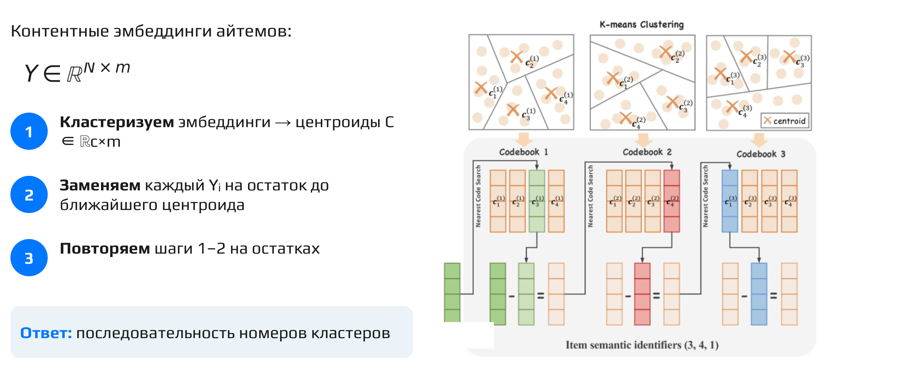

Второй алгоритм — **RQ-VAE**. Он устроен как вариационный автокодировщик: энкодер переводит вход $x$ в латентный вектор $z$, а декодер восстанавливает из латентного пространства $\hat{x}$. Внутри происходит та же иерархическая кластеризация остатков, что и в RQ-KMeans, только не в исходном семантическом пространстве контентных эмбеддингов, а в латентном пространстве энкодера. Для $z$ ищется ближайший вектор первого кодбука, остаток $r_1$ квантуется вторым кодбуком и так далее. Сумма выбранных векторов даёт $\hat{z}$, из которого декодер восстанавливает $\hat{x}$. Обучается модель с двумя лоссами:

$$\mathcal{L}_{recon} = \|x - \hat{x}\|^2, \qquad \mathcal{L}_{rqvae} = \sum_{l=1}^{L} \beta\, \|r_l - \mathrm{sg}[e_{c_l}]\|^2 + \|\mathrm{sg}[r_l] - e_{c_l}\|^2$$

Первый лосс требует, чтобы декодер точно восстанавливал вход. Второй связывает остаток $r_l$ на уровне $l$ с выбранным вектором кодбука $e_{c_l}$.[^n7b]

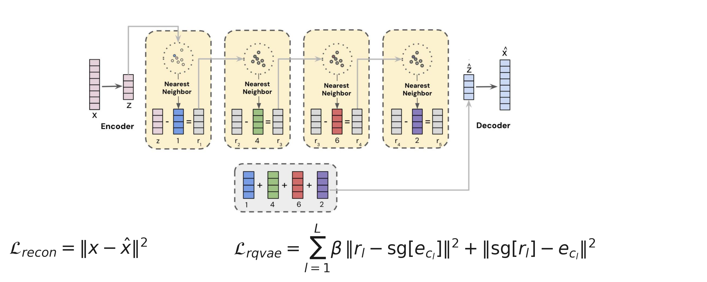

### Тяжёлый хвост и one-epoch problem

Среди минусов обучаемых эмбеддингов уже упоминалось, что они легко переобучаются. Особенно сильно это проявляется на [**тяжёлом хвосте**]{.gl key="Тяжёлый хвост"} — массе редких айтемов, у каждого из которых мало взаимодействий. Хорошо это видно на графике из статьи *Towards Understanding the Overfitting Phenomenon of Deep Click-Through Rate Prediction Models*: модель учат 11 эпох и смотрят AUC на валидации. Модель со всеми признаками на каждом переходе к новой эпохе резко проседает ступенькой: примерно с 0,67 до 0,63, затем до 0,60 и так далее до 0,55. Та же модель без item ID и ID айтемов из истории идёт ровно, около 0,66.

Просадку дают именно обучаемые эмбеддинги айтемов из тяжёлого хвоста. За первую эпоху модель видит редкий айтем один-два раза. Как только на второй эпохе она встречает его повторно, она сильно на него переобучается, и качество на валидации падает.

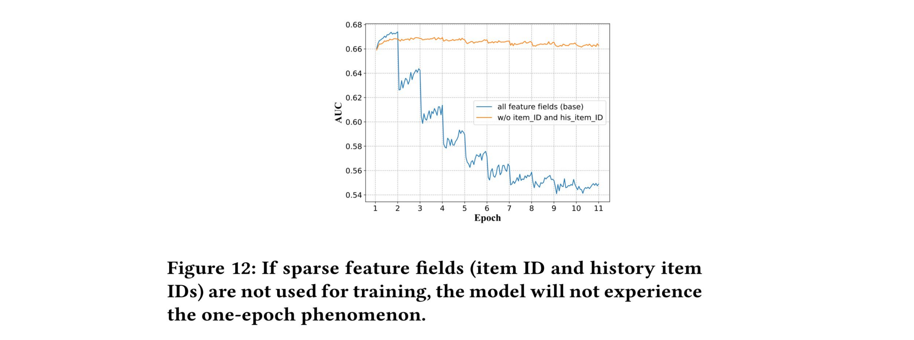

Эффект хорошо известен в литературе и называется **one-epoch problem**: ID-эмбеддинги склонны к переобучению из-за длинного хвоста распределения данных, поэтому обучение часто ограничивают одной эпохой (*Taming the One-Epoch Phenomenon in Online Recommendation System by Two-stage Contrastive ID Pre-training*).

**Важный вывод:** обучаемые эмбеддинги во всех вариантах — обычные, через hashing trick и через Semantic ID — очень быстро переобучаются, поэтому их почти никто не учит больше одной эпохи.

[^n7a]: Примечание составителя: интуитивно первый номер задаёт грубый кластер, а следующие уточняют положение айтема внутри него. Поэтому у похожих айтемов совпадают начальные номера кода, и они делят соответствующие обучаемые эмбеддинги.

[^n7b]: Примечание составителя: лоссы RQ-VAE в лекции не разбирались. $\mathrm{sg}$ — stop-gradient (градиент через этот аргумент не проходит), $\beta$ — вес слагаемого. Первое слагаемое суммы подтягивает остаток энкодера к вектору кодбука, второе — вектор кодбука к остатку. Так одновременно обучаются энкодер и кодбуки.

## Кодирование пользователя: от пулинга событий к трансформерам

*Таймкод: 01:12:00 · слайды 58–63*

До сих пор речь шла о том, как закодировать айтем. Теперь нужно решить ту же задачу для второй башни: как превратить пользователя в вектор. Самый естественный источник информации о пользователе — его история, то есть логи взаимодействий с айтемами. Поэтому все подходы ниже по-разному отвечают на один вопрос: как свернуть последовательность событий в один эмбеддинг.

### Event pooling

Простейший способ — **event pooling**. Пользователь представляется набором айтемов из его истории: берём последние $N$ взаимодействий, каждому айтему сопоставляем эмбеддинг (обучаемый или контентный) и агрегируем эти эмбеддинги в профиль пользователя. Чаще всего агрегируют через **mean pooling**, то есть просто усредняют векторы. Если событий несколько типов (просмотр, лайк, покупка), для каждого типа вводится свой обучаемый вес. Техника популярная и используется во многих системах, например в **YoutubeDNN** и VideoBERT.

Главное дизайн-решение здесь — откуда брать векторы взаимодействий. Есть три варианта: обучаемые эмбеддинги айтемов (как в YoutubeDNN), предобученные эмбеддинги (как в VideoBERT) или кодирование, которое обучается end-to-end вместе с моделью (например, мешок слов).

### Минусы пулинга и time decay

У агрегации есть принципиальная проблема: она никак не учитывает порядок событий. Отсюда два недостатка.

Во-первых, интуитивно недавние события должны влиять на представление пользователя сильнее, чем давние, а при простом усреднении они весят одинаково. Это исправляется функцией затухания, **time decay**: событиям из истории даются более осмысленные веса в зависимости от свежести, и агрегация идёт уже с этими весами. Например, так:

$$w(t)=\frac{1}{2^{(t_{\text{now}}-t)/\tau}},$$

где $t$ — время события, $t_{\text{now}}$ — текущий момент, $\tau$ — масштаб затухания. Чем старше событие, тем меньше его вес[^n8a]. Взвешенный пулинг даёт заметно лучшие представления пользователя, чем простое среднее.

Во-вторых, пулинг не распознаёт **sequential patterns**, то есть закономерности в самой последовательности действий: что за чем обычно следует. Весами это не исправить, тут нужны более сложные последовательные (sequential) энкодеры.

### Рекомендательные трансформеры

Таким энкодером служит **рекомендательный трансформер**. Это нейросеть, которая обрабатывает историю пользователя как последовательность. Механизм **self-attention** позволяет каждому событию «смотреть» на остальные события истории, а порядок событий модель узнаёт через **позиционное кодирование** — вектор, который кодирует место события в последовательности.

Про каждое взаимодействие известны три вещи: айтем, тип взаимодействия и его хронологическая позиция в истории. Каждую кодируем в вектор, векторы складываем и получаем эмбеддинг события. Последовательность таких эмбеддингов подаём в трансформер. На выходе получается по скрытому состоянию на каждое событие, и из них нужно собрать один вектор пользователя. Есть три стандартных способа: взять состояние специального токена CLS, который добавляется в последовательность именно для того, чтобы собирать сводку о ней; усреднить скрытые состояния последнего слоя (average pooling); взять последнее скрытое состояние.

**Акцент лектора:** очень многие современные модели получают пользовательский вектор именно так, трансформером над историей пользователя.

Пример такой архитектуры: пользовательская башня — двунаправленный трансформер-энкодер над событиями и токеном CLS. Эмбеддинг события — сумма контентного эмбеддинга, позиционного эмбеддинга и эмбеддинга типа события. Контентный эмбеддинг строится по тексту запроса или названию айтема: текст токенизируется и сворачивается в Embedding Bag. Айтемная башня — стопка блоков «линейный слой → ReLU → сложение с входом и нормализация» над эмбеддингом названия айтема. Башни сравниваются по косинусной близости.

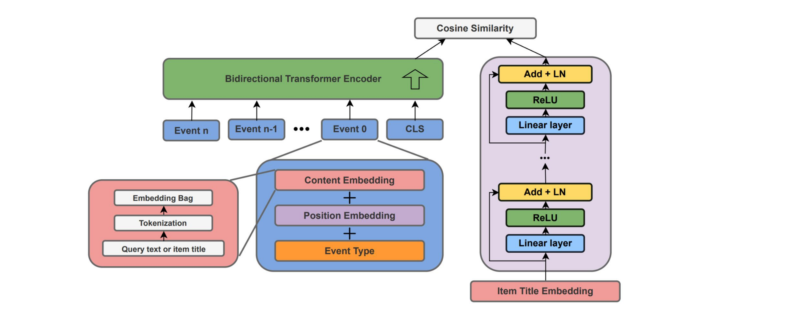

### Encoder-decoder башня пользователя

Пользовательскую башню можно строить не только одним трансформером, но и моделью из энкодера и декодера — [**encoder-decoder башней**]{.gl key="Encoder-decoder башня"}. Пусть есть поисковая модель, которая принимает запрос пользователя, и хочется, чтобы она учитывала ещё и его историю. Историю прогоняем через энкодер, он сжимает события в последовательность скрытых состояний. Декодер принимает текст запроса и через **cross-attention** смотрит на эти состояния. Cross-attention — это внимание, при котором одна последовательность (запрос) обращается к состояниям другой (истории). Декодером может быть предобученная LLM вроде Qwen: текст запроса она понимает из коробки.

**Важно:** декодер здесь ничего не генерирует. Его выход — вектор пользователя $u$, обусловленный на историю. Дальше всё как обычно: скалярное произведение $\langle u, v\rangle$ с вектором айтема $v$ из айтемной башни и поиск в ANN-индексе. Главное преимущество подхода — одна и та же история даёт разные векторы под разные запросы: по запросу «рецепт пасты» вектор будет тянуть к рецептам с учётом того, что пользователь смотрел раньше.

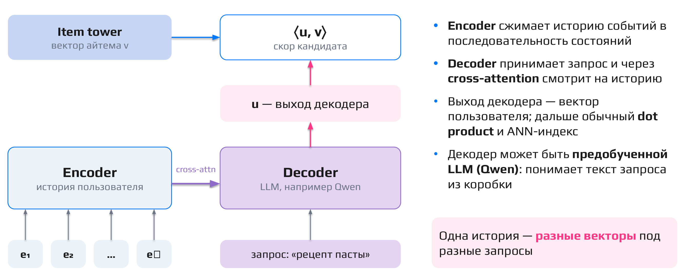

::: {.qa title="Вопросы из зала"}
**В каком виде история пользователя попадает в модель: символы, числа, веса?** Каждое событие — это набор эмбеддингов. Возьмём видео. У него есть видеоряд, аудио, текст, описания; каждое прогоняем через свой энкодер и получаем контентные эмбеддинги. Для самого видео можно завести и обучаемый эмбеддинг через hashing trick, Semantic ID или иначе. Отдельными сущностями можно считать теги и автора (автор довольно информативен), и для каждого автора и тега тоже завести обучаемый эмбеддинг. Получается набор векторов, часть обучаемые, часть контентные. Их сводят в один эмбеддинг события и подают в трансформер. Сводить можно с обучаемыми весами, а можно сконкатенировать и прогнать через небольшую сеть. Самый простой вариант — просто сложить.

**Нужна ли достаточно длинная история пользователя?** Чем длиннее история, тем больше пользовательских сигналов модель может учесть и тем она потенциально экспрессивнее. Но вместе с длиной растут и вычисления, и на обучении, и на инференсе. Поэтому оптимальную длину подбирают экспериментами, и результат сильно зависит от домена: в музыке получится одно, на данных Amazon — другое. В целом чем длиннее история, тем, скорее всего, лучше, если хватает данных для обучения.

**Как устроены маски, чтобы не было утечки, то есть заглядывания в будущее?** История пользователя до момента $t$ подаётся в пользовательскую башню, а позитив в момент $t$ — в айтемную. Будущее событие не попадает на вход пользовательской башни, поэтому [**утечки (leak)**]{.gl key="Утечка (leak)"} — ситуации, когда модель при обучении видит информацию, недоступную в момент предсказания, — здесь нет[^n8b].

**А что с холодным стартом для новых пользователей?** Для совсем холодных пользователей такие модели использовать нельзя: они полностью опираются на историю, и трансформеру просто нечего подать на вход. Для них нужны другие генераторы кандидатов, рассчитанные именно на холодных пользователей и рекомендующие то, что полезно в среднем.
:::

[^n8a]: Примечание составителя: событие давностью ровно $\tau$ получает вес $1/2$, давностью $2\tau$ — вес $1/4$ и так далее, то есть $\tau$ играет роль «периода полураспада» интереса.

[^n8b]: Примечание составителя: устройство масок внимания внутри самого трансформера (чтобы позиция не видела следующих событий) в ответе не разбиралось; последовательные модели подробно рассматриваются в теме «Sequential Recommendation».

## Ограничения двухбашенных моделей

*Таймкод: 01:29:41 · слайды 64–70*

У двухбашенной модели три основных ограничения: невысокий ранг, однообразная выдача и дорогой ANN-индекс. Разберём их по очереди, а затем посмотрим, чего хотелось бы от генератора кандидатов вместо этого.

### Низкий ранг: сколько информации помещается в эмбеддинг

На двухбашенную модель можно смотреть как на низкоранговое разложение матрицы релевантности, то есть как на развитие идей матричной факторизации:

$$R \approx U \cdot V^T,$$

где строки $U$ — эмбеддинги пользователей, строки $V$ — эмбеддинги айтемов. Башни могут быть сколь угодно сложными, но в самом конце модели стоит скалярное произведение юзерского и айтемного эмбеддингов. Поэтому **ранг разложения, а значит и мощность модели, ограничены размерностью эмбеддинга**. Интуиция простая: в маленький вектор пользователя много информации не запихнёшь, и ретривер, который ищет по этому вектору в HNSW, ограничен его размерностью.

Насколько это ограничение жёсткое, показывает эксперимент DeepMind из статьи **On the Theoretical Limitations of Embedding-Based Retrieval**. Авторы генерируют синтетический датасет из запросов и документов. Фиксируются число документов $N$ и $K$ для top-K, и каждой возможной комбинации из $K$ документов сопоставляется свой запрос: в эксперименте $K = 2$, то есть запрос заводится для каждой пары документов. Обучаемые эмбеддинги запросов и документов размерности $d$ настраиваются на предсказание правильных документов. Для каждого $d$ ищут **критический размер каталога** — число документов, начиная с которого идеальной точности добиться уже не получается.

Результат такой: для каталога примерно из 600 документов нужна размерность около 45. Если каталог заметно больше, размерность должна сильно расти, иначе семантическое пространство, в котором выполняется такой top-2, просто не обучить. Зависимость хорошо описывается полиномом третьей степени:

$$y = -10{,}5322 + 4{,}0309\,d + 0{,}0520\,d^2 + 0{,}0037\,d^3, \quad r^2 = 0{,}999,$$

где $y$ — критический размер каталога, $d$ — размерность эмбеддинга. Если продолжить кривую, получается около 500 тысяч документов при $d = 512$, 4 млн при $d = 1024$, 250 млн при $d = 4096$. И это лучший случай: векторы оптимизируются прямо под тестовые пары, без каких-либо ограничений реальной модели. Значит, даже самых больших размерностей не хватает, чтобы представить все комбинации в каталоге веб-масштаба.

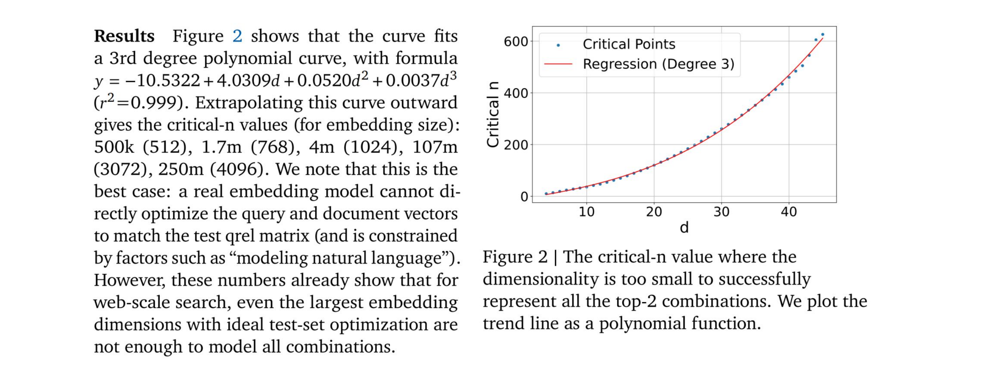

### Однообразная выдача

Вторая проблема касается **разнообразия выдачи**. Допустим, мы построили тематическое пространство, где по пользователю ищутся айтемы, и пользователь сейчас тяготеет к айфону: хочет его купить. Рядом с этим айфоном в пространстве, скорее всего, лежат другие айфоны. Пройдя по пользовательскому вектору и собрав ближайших соседей, мы заберём в выдачу их все. Нам же нужны разнообразные рекомендации, а генератор выдаёт однотипных кандидатов.

### ANN-индекс: память и перестроение

ANN-индексы — дорогие структуры данных: им нужно много памяти и CPU. Прикинем: десятки миллионов эмбеддингов размерности 128 в формате fp32 — это уже очень много памяти[^n9a].

Ещё неприятнее то, что индекс приходится постоянно пересобирать. Это **перестроение ANN-индекса**. После того как модель (до)обучили, старые эмбеддинги теряют ценность: они лежат в другом пространстве. Нужно заново посчитать эмбеддинги всех айтемов, построить по ним индекс, подменить индекс в продакшене и одновременно обновить модель в сервисе, который считает вектор запроса. Если индекс и модель рассинхронизируются, качество может сильно упасть. С новыми айтемами та же история. Даже если айтемная башня работает на контентных эмбеддингах и новый айтем можно закодировать сразу, мало прогнать его через башню: нужно ещё обновить индекс, а это сложная и дорогая по памяти процедура.

Есть и ещё одна проблема. Близость в модели задаётся вероятностью целевого клика по айтему через полный softmax, а на практике обучить можно только его приближение — sampled softmax, и это приближение не идеально.

### Чего хотим и почему не MLP

Отсюда список пожеланий к генератору кандидатов:

- более мощная функция близости;
- больше разнообразия, хочется discovery-выдачи;
- расчёт эмбеддингов и индекс объединены в одном сервисе, в одной модели, без отдельного похода в ANN-индекс. Такой подход называется **model-based ретривал**;
- при этом сохраняются эффективность и скорость, нужные стадии генерации кандидатов.

Естественная идея для более мощной функции близости — заменить скалярное произведение на MLP поверх эмбеддингов, как в Neural Collaborative Filtering. Но сравнение **MLP vs dot product** в статье «Neural Collaborative Filtering vs. Matrix Factorization Revisited» говорит не в пользу MLP. Скалярное произведение на самом деле очень экспрессивно, и MLP-слоем его не всегда удаётся эффективно аппроксимировать: хотя теоретически MLP приближает любую функцию, выучить им dot product нетривиально. При правильном подборе гиперпараметров простой dot product существенно превосходит обучаемые MLP-близости. Вдобавок MLP слишком дорог для продакшена, а dot product позволяет пользоваться эффективными алгоритмами ретривала. Поэтому MLP как способ комбинировать эмбеддинги стоит применять осторожно, а скалярное произведение остаётся лучшим выбором по умолчанию.

Подходы, которые отвечают на этот список пожеланий иначе, — генеративный ретривал и multi-interest модели — подробно разбираются в теме «Нейросетевая кандидатогенерация».

[^n9a]: Примечание составителя: сырые векторы занимают $N \cdot d \cdot 4$ байта. При $N = 5 \cdot 10^7$ и $d = 128$ это около 25,6 ГБ — и это без графа HNSW, который добавляет ещё заметный объём.

## Главное из лекции {.unnumbered}

::: keypoints
- Рекомендации, поиск и RAG — одна задача: по запросу найти нужное в огромной коллекции. Различается только то, что считать запросом, поэтому двухбашенные модели применяются во всех трёх областях.
- Ранжирующие лоссы на показах (impression-aware) дают хард негативы, но страдают от фолдинга: группы пользователей и айтемов, которые никогда не встречаются в выдаче, могут «сложиться» в пространстве эмбеддингов. В одностадийной системе петля обратной связи частично лечит фолдинг, в многостадийной — нет.
- Модель с ранним связыванием — самая качественная, но требует прогона сети на каждую пару (u, i). На больших каталогах систему делают многостадийной: лёгкие генераторы кандидатов собирают шортлист, тяжёлый ранкер расставляет порядок.
- Правильный лосс для нейросетевого кангена — полный softmax по каталогу $P(i \mid u)$: позитив сравнивается со всем каталогом, а softmax сам майнит хард негативы — градиент по негативу пропорционален его вероятности.
- Двухбашенная модель кодирует пользователя и айтем раздельно, $f(u,i) = \langle g(u), h(i)\rangle$. Эмбеддинги айтемов считаются офлайн и кладутся в ANN-индекс (HNSW); в онлайне считается только $g(u)$ и ищется top-K. Модель и индекс должны быть из одной версии.
- Косинус вместо скалярного произведения стабилизирует обучение и ослабляет popularity bias; температура τ возвращает softmax остроту, служит мерой неопределённости и задаёт баланс alignment / uniformity.
- Полный softmax на большом каталоге не посчитать, его заменяют sampled softmax. In-batch негативы дешёвые и сложные, но смещены к популярному; uniform негативы закрывают хвост, но лёгкие. Смещение исправляет logQ-коррекция — лучше в исправленном виде (Correcting the LogQ Correction).
- Айтем кодируют обучаемыми (ID) эмбеддингами — максимальная выразительность и мемоизация, но память, холодный старт и переобучение — или контентными: индуктивность, но ниже потолок качества. Hashing trick и Semantic ID сжимают таблицу ID-эмбеддингов; из-за one-epoch problem ID-эмбеддинги почти не учат дольше одной эпохи.
- Пользователя кодируют пулингом событий истории (лучше с time decay) или трансформером над историей; encoder-decoder башня даёт разные векторы под разные запросы.
- Ограничения двухбашенных моделей: ранг разложения ограничен размерностью эмбеддинга (эксперимент DeepMind с критическим размером каталога), выдача однообразна, ANN-индекс дорог и требует перестроения после каждого переобучения. MLP вместо dot product не помогает: скалярное произведение очень экспрессивно.
:::

## Что подчеркнул лектор {.unnumbered}

::: emphasis
- Модель с ранним связыванием — самая экспрессивная и лучше всего работает в продакшене; двухбашенность — это прежде всего оптимизация скорости инференса, а не выигрыш в качестве.
- Канген нельзя учить на показах ранжирующими лоссами: в многостадийной системе ошибки кангена отфильтровывает ранкер, и сигнала о них нет. Учить нужно полным softmax по каталогу или его приближением.
- Модель в сервисе и ANN-индекс должны быть из одной версии, иначе вектор пользователя и векторы айтемов окажутся в разных пространствах.
- Температуру нельзя выставить «раз и навсегда» в крайнее значение: высокая даёт хаос, низкая вырождает пространство. Её фиксируют, задают расписанием или делают обучаемой.
- In-batch негативы смещены к популярному — без logQ-коррекции модель начинает штрафовать популярные айтемы. На инференсе поправку $\log Q$ выбрасывают.
- ID-эмбеддинги очень нужны: на одних контентных эмбеддингах модель плохо скейлится. Но они быстро переобучаются на тяжёлом хвосте, поэтому их почти не учат больше одной эпохи.
- Многие современные модели получают вектор пользователя трансформером над историей. Для совсем холодных пользователей такие модели не годятся — нужны отдельные генераторы кандидатов.
:::

## Стоит посмотреть в видео {.unnumbered}

::: watch
- **00:05:30–00:08:29** — фолдинг на примере вегана и петля обратной связи в одностадийной системе (слайды 9–11).
- **00:20:45–00:22:33** — как softmax майнит хард негативы: графики распределения градиента по негативам (слайд 21).
- **00:22:33–00:25:42** — устройство HNSW и схема «офлайн / онлайн» в продакшене (слайды 24–25).
- **00:35:21–00:40:00** — пример с идеальной моделью и температурой, энтропия, alignment и uniformity (слайды 29–32); объяснение местами скомкано.
- **00:46:59–00:49:00** — logQ-коррекция и её исправленная версия: формулы со слайдов 41–43 вслух почти не разбирались.
- **01:06:59–01:09:56** — Semantic ID: схемы RQ-KMeans и RQ-VAE (слайды 54–55); RQ-VAE изложен очень кратко.
- **01:09:58–01:11:35** — график one-epoch problem (слайд 56).
- **01:32:38–01:34:37** — эксперимент DeepMind и график критического размера каталога (слайды 66–67).
- **Вся запись** — распознавание речи очень плохое (лектор говорил в шумных условиях), поэтому формулировки в конспекте восстановлены по смыслу и по слайдам; спорные места лучше переслушать.
:::

## Глоссарий {.unnumbered}

| Термин | Коротко |
|:-------------|:----------------------------------|
| **Функция f(u, i)** | скор пары «пользователь — айтем», который выдаёт модель |
| **Pointwise / pairwise / listwise** | ранжирующие лоссы: по отдельному показу, по паре «кликнутый — некликнутый», по всей выдаче |
| **Показ (impression)** | айтем, попавший на экран пользователю |
| **Impression-aware** | обучение только на показанных айтемах, моделирует P(клик \| u, i, показали) |
| **Хард негативы** | трудные для модели негативы: релевантные, но не выбранные айтемы |
| **Раннее связывание** | пользователь и айтем подаются в одну сеть с самого начала; лучшее качество, прогон сети на каждую пару |
| **Фолдинг (folding)** | наложение групп пользователей и айтемов, которые не встречаются в выдаче, в пространстве эмбеддингов |
| **Одностадийная система** | ранкер скорит весь каталог и сам показывает топ; петля обратной связи замкнута |
| **Башня пользователя / башня айтема** | части двухбашенной модели, выдающие эмбеддинги $g(u)$ и $h(i)$ |
| **Позднее связывание** | пользователь и айтем встречаются только в скалярном произведении эмбеддингов |
| **Многостадийная рекомендательная система** | каскад: генераторы кандидатов → ранжирование → выдача |
| **Генераторы кандидатов, кангены (retrieval)** | лёгкие модели, отбирающие из каталога релевантные айтемы для ранкера |
| **Шортлист** | список кандидатов (порядка тысячи), передаваемый ранжирующей модели |
| **Discovery** | способность показать пользователю новое для него |
| **Экстремальная классификация** | постановка, где каждый айтем каталога — отдельный класс |
| **Полный softmax по каталогу** | лосс $-\log P(i_+ \mid u)$ со знаменателем по всему каталогу |
| **Логит** | ненормированный скор, который softmax превращает в вероятность |
| **Майнинг хард негативов** | свойство softmax: основная часть градиента достаётся самым похожим негативам |
| **Двухбашенная модель** | модель $f(u,i) = \langle g(u), h(i)\rangle$ с раздельным кодированием пользователя и айтема |
| **DSSM** | Deep Structured Semantic Model (2013), первая двухбашенная модель, предложенная для поиска |
| **ANN (approximate nearest neighbors)** | приближённый поиск ближайших соседей |
| **HNSW** | Hierarchical Navigable Small World — самая популярная реализация ANN-индекса |
| **Top-K** | K айтемов с наибольшим скором |
| **Косинусная близость** | скалярное произведение нормированных векторов, лежит в $[-1; 1]$ |
| **Температура τ** | делитель логитов, задаёт остроту softmax и меру неопределённости |
| **Распределение Больцмана (Гиббса)** | физическое распределение, с которым совпадает softmax с температурой |
| **Энтропия** | мера неопределённости распределения, от 0 до $\log K$ |
| **Alignment / uniformity** | близость похожих объектов / равномерное покрытие сферы эмбеддингами |
| **Curriculum learning** | постепенное усложнение задачи при обучении (например, снижение температуры) |
| **Обучаемая температура** | τ как обучаемый параметр модели |
| **Softmax loss** | лосс, максимизирующий правдоподобие реальных положительных взаимодействий |
| **Sampled softmax** | softmax, у которого знаменатель оценивается по сэмплированным негативам |
| **In-batch негативы** | позитивы других пользователей батча, используемые как негативы |
| **Contrastive learning** | обучение, сближающее похожие объекты и отдаляющее непохожие |
| **InfoNCE** | contrastive-лосс: sampled softmax с косинусом и температурой по батчу |
| **Uniform негативы** | айтемы, взятые равномерно случайно из каталога |
| **Смешанная стратегия (Mixed Negative Sampling)** | комбинация in-batch и uniform негативов |
| **Popularity bias** | смещение модели к популярным айтемам или против них |
| **Importance sampling** | перевзвешивание сэмплов на $1/Q$ для несмещённой оценки |
| **LogQ-коррекция** | вычитание $\log Q$ из логитов при обучении, компенсирует популярность среди негативов |
| **Correcting the LogQ Correction** | уточнённая logQ-коррекция: позитив не корректируется, пример получает вес |
| **Обучаемые эмбеддинги (ID-эмбеддинги)** | таблица векторов айтемов, обучаемая вместе с моделью |
| **Матрица эмбеддингов N × d** | таблица ID-эмбеддингов: N айтемов, размерность d |
| **Холодный старт** | отсутствие данных о новом айтеме или пользователе |
| **Контентные эмбеддинги** | векторы, полученные из содержимого айтема готовым энкодером |
| **Мемоизация** | запоминание поведенческих паттернов отдельных айтемов в обучаемых векторах |
| **Матрица релевантности** | матрица интереса пользователей к айтемам $\mathcal{R}$ |
| **Низкоранговое разложение** | $\mathcal{R} \approx V_u V_d^\top$; ранг ограничен размерностью эмбеддинга |
| **One-hot** | вектор с единицей на одной позиции и нулями на остальных |
| **Скейлинг** | рост качества при увеличении данных и числа параметров |
| **Индуктивность** | умение работать с объектами, не встречавшимися при обучении |
| **Inductive bias** | заложенное в модель предположение (здесь: близкие по контенту — близки в пространстве) |
| **Hashing trick** | сжатие таблицы ID-эмбеддингов: строка выбирается по хэшу ID |
| **Коллизии** | попадание разных айтемов в одну строку таблицы |
| **Мульти-хэши** | несколько хэшей на айтем, эмбеддинги суммируются |
| **Semantic ID** | осмысленные разделяемые ID айтема, назначенные по контентной близости |
| **RQ-KMeans** | Semantic ID через иерархическую кластеризацию остатков k-means |
| **Центроиды** | центры кластеров |
| **Остаток (residual)** | разность вектора и ближайшего центроида |
| **RQ-VAE** | Semantic ID через квантование остатков в латентном пространстве автокодировщика |
| **Тяжёлый хвост** | масса редких айтемов с малым числом взаимодействий |
| **One-epoch problem** | переобучение ID-эмбеддингов со второй эпохи из-за длинного хвоста |
| **Event pooling** | вектор пользователя как агрегат эмбеддингов айтемов из истории |
| **Mean pooling** | усреднение векторов |
| **YoutubeDNN** | рекомендательная модель YouTube с event pooling по обучаемым эмбеддингам |
| **Time decay** | затухание веса событий истории с их давностью |
| **Sequential patterns** | закономерности порядка действий в истории |
| **Рекомендательный трансформер** | трансформер над историей пользователя, выдающий его вектор |
| **Self-attention** | механизм, при котором каждое событие последовательности «смотрит» на остальные |
| **Позиционное кодирование** | вектор, кодирующий место события в последовательности |
| **Encoder-decoder башня** | башня пользователя: энкодер над историей + декодер (LLM) над запросом |
| **Cross-attention** | внимание одной последовательности к состояниям другой |
| **Утечка (leak)** | информация, недоступная в момент предсказания, попавшая в обучение |
| **Критический размер каталога** | число документов, с которого эмбеддинги размерности d не дают идеальной точности |
| **On the Theoretical Limitations of Embedding-Based Retrieval** | статья DeepMind об ограничениях ретривала по эмбеддингам |
| **Разнообразие выдачи** | различие айтемов в выдаче; двухбашенный ретривал склонен к однотипным кандидатам |
| **Перестроение ANN-индекса** | пересчёт эмбеддингов и пересборка индекса после переобучения модели |
| **Model-based ретривал** | ретривал, где эмбеддинги и индекс объединены в одной модели |
| **MLP vs dot product** | сравнение обучаемой MLP-близости со скалярным произведением; dot product выигрывает |
