::: {.abstract title="О чём семинар"}
Семинар — практическое продолжение лекции «Признаки и классические рекомендательные модели»: классические методы рекомендаций разбираются на коде, от разбора данных до двухэтапного пайплайна, как его строят в индустрии. Сначала обсуждается, как честно разбить данные на обучение и валидацию (случайно, leave-one-out, last-K, по времени). Затем на MovieLens с явными оценками ItemKNN, UserKNN и ALS реализуются своими руками: меры сходства, прогноз оценки, центрирование рейтингов, матричная факторизация и сравнение по RMSE. Вторая половина посвящена неявному фидбэку на датасете онлайн-кинотеатра KION. Там разбираются особенности данных о просмотрах, сравниваются бейзлайны Random и Popular с ItemKNN и iALS в библиотеке RecTools, и собирается двухэтапная модель: генераторы кандидатов плюс ранкер на CatBoost. В конце — сравнение линейных моделей SLIM и EASE с матричной факторизацией, вопросы о чистке данных и смещении из-за предыдущей модели, а также несколько слов о домашнем задании.

Для чтения нужны материалы лекции 3 и лекции 2 (метрики ранжирования: Recall, MAP, NDCG), а также основы Python и pandas. Организационной части немного, это короткий последний раздел. Вопросы из зала собраны в серые блоки мелким шрифтом, их можно пропустить при беглом чтении. Слайдов на семинаре не было: материал опирается на ноутбук, и графики из него вставлены в текст. Пояснения, которых не было на семинаре, вынесены в сноски «Примечание составителя».
:::

## Как разбить данные на обучение и валидацию

*Таймкод: 00:00:24 · без ноутбука*

Этот семинар практический. Классические модели рекомендаций из лекции «Признаки и классические рекомендательные модели» разбираются на коде: смотрим, как из них получаются первые работающие рекомендательные системы. Все датасеты семинара открытые, их берут из опенсорса. По теме семинара будет домашнее задание.

Начнём не с моделей, а с данных. Главное, с чем мы работаем, — это данные, и от того, как они подаются в модель, полностью зависит результат на выходе. Первый вопрос здесь — как разделить имеющиеся взаимодействия на две части. На **обучающей выборке (train)** модель учится, а на **валидационной выборке (validation)** её проверяют на данных, которых она не видела. От способа разбиения зависит, что именно мы в итоге измеряем.

### Какие бывают варианты

Самый очевидный вариант — **случайное разбиение**. Взаимодействия перемешивают и, например, 80 % отдают в обучение, а 20 % в валидацию. Если пользователь посмотрел цепочку фильмов или прослушал подряд несколько треков, часть из них случайным образом откладывается на проверку. Можно делить и по пользователям: одни пользователи целиком попадают в train, другие в тест. Иногда перед этим взаимодействия сортируют. Можно стратифицировать выборку. Наконец, можно делить по времени: отсортировать взаимодействия, последние одну-две недели отправить в тест, а всё остальное в обучение.

У каждого подхода есть свои плюсы и минусы. В рекомендациях чаще всего используют последний: данные сортируют по времени, несколько последних дней относят в тест, остальное в обучение. Минус этого подхода в том, что модель обучается уже не на самых свежих данных. Последние дни, которые лучше всего отражают текущие интересы пользователей, ушли на проверку.[^n1a]

### Три схемы для последовательностей

Посмотрим на данные как на последовательность действий: пользователь провзаимодействовал с одним айтемом, потом с другим и так далее. Для таких данных есть три типичные схемы разбиения.

- **Leave-one-out**: у пользователя скрывают последний элемент последовательности, и модель пытается его предсказать. На этом элементе и проводится валидация.
- **Last-K**: скрывают K последних взаимодействий. Единой границы по времени здесь нет. У каждого пользователя просто отрезают хвост его собственной последовательности длиной K, когда бы эти взаимодействия ни произошли.
- **Time split (разбиение по времени)** в основном и используется в индустрии. Выбирают дату, например начало последней недели. Все взаимодействия до неё идут в обучение, все после неё — в валидацию.

Главное отличие last-K от time split — где проходит граница. В last-K она у каждого пользователя своя, а в time split — одна для всех пользователей.[^n1b]

Дальше в семинаре мы будем работать с датасетом, разбитым именно по времени, поэтому важно понимать, как устроена эта схема и что мы на ней проверяем.

[^n1a]: Примечание составителя: обычно это противоречие снимают так. Модель и её гиперпараметры выбирают на разбиении по времени, а затем финальную модель переобучают на всех данных, включая последние дни.

[^n1b]: Примечание составителя: поэтому time split ближе всего к реальной работе системы. В обучение не попадают события, которые произошли позже проверяемых, и модель предсказывает будущее по прошлому. При случайном разбиении и last-K модель может «подсмотреть» более поздние действия других пользователей.

## MovieLens: матрица оценок и её особенности

*Таймкод: 00:07:24 · ноутбук: ячейки 0–11*

Прежде чем что-то делать в рекомендациях, полезно познакомиться с данными: посмотреть, что они собой представляют и какие закономерности в них заметны сразу. Возьмём MovieLens 1M — датасет, знакомый по первому семинару. Это датасет с рейтингами: каждая строка говорит, что некоторый пользователь поставил некоторому фильму оценку от 1 до 5, и известно, когда он это сделал (timestamp). Всего в нём 1 000 209 оценок от 6 040 пользователей. Оценки есть у 3 706 фильмов, а в каталоге их 3 883.

### Матрица оценок и разреженность

Такие данные удобно представлять как **матрицу оценок (user–item)**: строки — пользователи, столбцы — фильмы, в клетке стоит оценка, если она известна. Для MovieLens это матрица 6 040 × 3 883, и заполнено в ней всего 4,26 % клеток, остальные 95,7 % пусты. Это и есть **разреженность**: о подавляющем большинстве пар «пользователь — фильм» мы ничего не знаем, поэтому такую матрицу хранят в разреженном (sparse) формате.

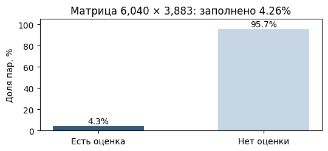

**Важно:** пустая клетка означает «оценка неизвестна», а не «пользователю не понравилось». Пользователь просто ещё не взаимодействовал с этим фильмом.

Известные клетки разбросаны по матрице неравномерно. Разобьём пользователей и фильмы на группы по активности (по квантилям числа оценок) и для каждой пары групп посчитаем долю заполненных клеток. На получившейся тепловой карте почти всё поле близко к нулю, а известные пары сосредоточены в правом верхнем углу. Там активные пользователи (до 2 314 оценок у одного человека) встречаются с популярными фильмами (до 3 428 оценок у одного фильма).

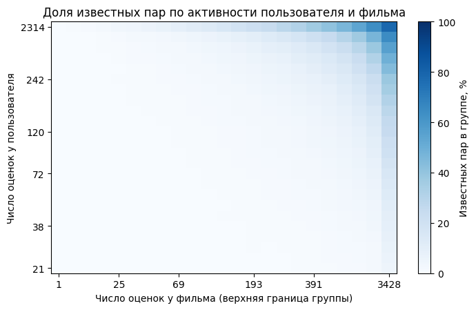

### Какие оценки ставят

Распределение оценок тоже неравномерное: единиц 5,6 %, двоек 10,8 %, троек 26,1 %, четвёрок 34,9 %, пятёрок 22,6 %. Четвёрки и пятёрки вместе дают больше половины всех оценок. Это нормально и отражает **смещение оценок вверх**, а заодно и знакомый по лекции bias пользователей: люди по-разному обращаются со шкалой, кто-то систематически завышает оценки, кто-то занижает. Практический вывод: «нравится» и «не нравится» нужно отделять не по абсолютному значению оценки, а относительно привычек конкретного пользователя. К этому мы ещё вернёмся, когда будем строить прогнозы оценок.

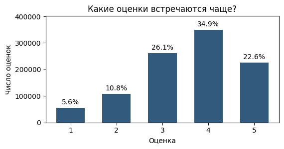

### Длинный хвост популярности

Отсортируем фильмы по числу полученных оценок, самый популярный — слева, и отложим по вертикали число оценок у каждого. Кривая круто падает в начале и затем долго тянется почти у нуля. Это **длинный хвост (long tail)** — характерная особенность рекомендательных данных: небольшая доля популярных фильмов собирает большую часть оценок, а огромное число фильмов получает единицы. Топ-1 % фильмов собирает 9,1 % всех оценок, топ-10 % — 45,7 %, топ-20 % — уже две трети (66,7 %). Если убрать с графика сотню самых популярных фильмов, форма кривой почти не меняется: хвост остаётся таким же длинным.

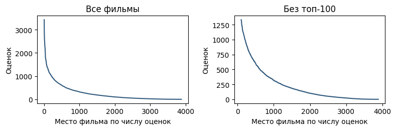

Длинный хвост создаёт две проблемы. Первая касается оценки сходства: у редких фильмов очень мало данных, и для них труднее найти похожие. Вторая касается разнообразия рекомендаций: у популярных фильмов гораздо больше взаимодействий, поэтому модель может систематически рекомендовать только популярное и при этом хорошо выглядеть по метрикам.

Итак, из знакомства с данными стоит запомнить три вещи: матрица почти пуста, а пустота не означает отрицательного отношения; оценки смещены вверх, и их надо читать относительно привычек пользователя; популярность распределена с длинным хвостом, и это мешает как оценке сходства, так и разнообразию.

## Memory-based: ItemKNN и UserKNN своими руками

*Таймкод: 00:12:47 · ноутбук: ячейки 12–29*

**Memory-based подход** не обучает никаких параметров. Модель — это сами данные: на вопрос «как пользователь $u$ оценил бы фильм $i$?» отвечают соседи. Соседей можно искать с двух сторон матрицы оценок. В **ItemKNN** за фильм $i$ «голосуют» похожие на него фильмы из истории пользователя $u$. В **UserKNN** голосуют своими оценками похожие на $u$ пользователи, которые уже видели $i$.

Механику удобно разобрать на одном примере. Возьмём пользователя 1 и спрячем его оценку фильма *Toy Story 2* («История игрушек 2», 1999). Всё остальное считается известной историей, а в конце прогноз сравним с настоящей оценкой. Для поиска соседей берутся только положительные взаимодействия, то есть оценки 4 и 5. Это именно разбор механики, а не измерение качества: по одному фильму о качестве метода судить нельзя.

### Как измерить похожесть двух фильмов

Функцию похожести можно считать по-разному. Пусть $U_i$ — множество пользователей, положительно оценивших фильм $i$, а $|U|$ — число всех пользователей. Три популярные меры:

$$
s_{\mathrm{Jaccard}}(i,j)=\frac{|U_i\cap U_j|}{|U_i\cup U_j|},\qquad
s_{\cos}(i,j)=\frac{|U_i\cap U_j|}{\sqrt{|U_i|\,|U_j|}},\qquad
s_{\mathrm{PMI}}(i,j)=\log\frac{|U_i\cap U_j|\,|U|}{|U_i|\,|U_j|}.
$$

**Мера Жаккара** — это доля общих зрителей среди всех, кто положительно оценил хотя бы один из двух фильмов: пересечение делится на объединение. **Косинусное сходство** опирается на те же общие зрители, но нормирует их число на среднее геометрическое размеров двух множеств. **PMI** (pointwise mutual information) показывает, насколько совместные взаимодействия неожиданны: он сравнивает реальное число общих зрителей с тем, которое получилось бы, если бы фильмы смотрели независимо. Числитель у всех трёх мер один, $|U_i\cap U_j|$, а различаются они тем, как штрафуют популярность.

Разница хорошо видна на четырёх ближайших соседях *Toy Story 2*. У Жаккара и косинуса на первом месте ожидаемо *Toy Story* (870 общих зрителей), на втором — *A Bug's Life* (623). Дальше списки расходятся только в одном фильме: у Жаккара *Babe* и *Groundhog Day*, у косинуса *The Sixth Sense* и *Babe*. Сходство здесь держится на сотнях общих зрителей. У PMI в топе вообще нет «Истории игрушек»: *We're Back! A Dinosaur's Story*, *Thomas and the Magic Railroad*, *Digimon: The Movie*, *The Tie That Binds* — редкие фильмы, совпавшие с целевым у 6, 4, 3 и 2 зрителей. Деление на произведение популярностей сильно поднимает такие фильмы.

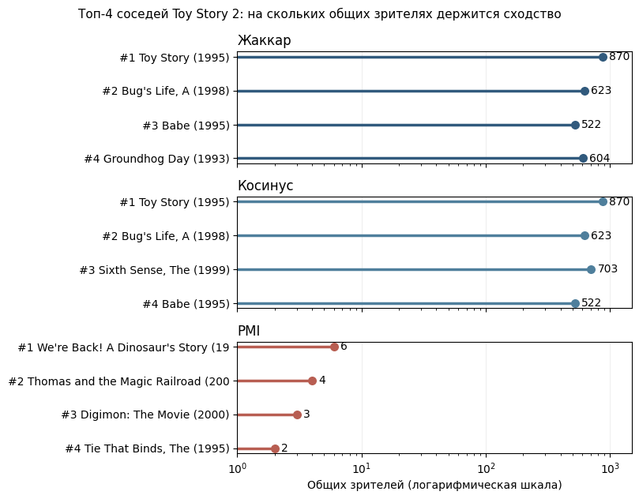

Какую меру брать, зависит от задачи: какие данные есть и какую бизнес-задачу мы решаем.

### Соседи по порогу

Соседями фильма считаются фильмы, похожесть которых выше **порога близости** $\alpha$:

$$
N(i)=\{j \mid s(i,j) > \alpha\}.
$$

На практике порог подбирается как гиперпараметр. Для демонстрации зафиксируем $\alpha = 0{,}4$, чтобы результат легко было интерпретировать. Основная масса косинусных сходств с *Toy Story 2* лежит в диапазоне 0–0,2, и порог проходят всего 7 фильмов: *Toy Story* (0,593), *A Bug's Life* (0,500), *The Sixth Sense* (0,419), *Babe* (0,412), *Groundhog Day* (0,411), *Back to the Future* (0,407) и *Shakespeare in Love* (0,404).

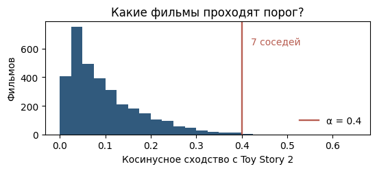

### Прогноз оценки

Прогноз — взвешенное среднее оценок пользователя по тем соседям, которые он оценил:

$$
\hat r_{ui}=\frac{\sum_{j\in N(i)} s(i,j)\, r_{uj}}{\sum_{j\in N(i)} |s(i,j)|}.
$$

Здесь $r_{uj}$ — оценка, которую пользователь поставил соседу $j$, а похожесть $s(i,j)$ служит её весом. Знаменатель — сумма модулей весов: он нормирует результат, чтобы прогноз остался на шкале оценок. Соседи, которых пользователь не оценивал, не входят ни в числитель, ни в знаменатель.

Из семи соседей *Toy Story 2* пользователь 1 оценил четыре:

| Сосед | $r_{uj}$ | $s(i,j)$ | $s\cdot r$ |
|:--|:--|:--|:--|
| Toy Story | 5 | 0,593 | 2,965 |
| A Bug's Life | 5 | 0,500 | 2,501 |
| The Sixth Sense | 4 | 0,419 | 1,676 |
| Back to the Future | 5 | 0,407 | 2,033 |

Прогноз равен $9{,}175 / 1{,}919 = 4{,}78$, а настоящая скрытая оценка — 4.

### От прогноза к списку рекомендаций

Тот же расчёт можно сделать сразу для всех фильмов, которые пользователь ещё не оценивал. В матричном виде числитель равен `R[u] @ S`, знаменатель — `(R[u] > 0) @ |S|`. Фильмы из истории исключаются, остальные сортируются по прогнозу. У пользователя 1 в истории 52 оценки, и прогноз удалось посчитать лишь для 163 из 3831 неоценённого фильма: у остальных нет ни одного оценённого соседа.

В топе ItemKNN оказываются *The Rock*, *Contact*, *The Truman Show*, *As Good As It Gets*, *Back to the Future Part II*, *A Few Good Men*, *Patriot Games* — все с прогнозом 5,00. Выглядит так, будто эти фильмы пользователю почти наверняка понравятся. Но у большинства из них прогноз держится на **одном** оценённом соседе. Поэтому, кроме самого прогноза, нужно учитывать и то, на скольких соседях он основан.

### UserKNN

UserKNN идёт не по столбцам матрицы, а по строкам: близость считается между векторами пользователей по тем же положительным оценкам. Предположение такое: если два пользователя смотрели похожее, их предпочтения, скорее всего, совпадут. Соседство снова задаёт порог:

$$
N(u)=\{v\neq u \mid s(u,v)>\alpha\}.
$$

Распределение сходств между пользователями другое, чем между фильмами, поэтому порог 0,4 здесь ничего не даёт: максимальная похожесть с пользователем 1 — всего 0,388. Берём $\alpha=0{,}25$, и находится 58 соседей. Самые близкие — пользователи 5343 (0,388, 15 общих положительных оценок), 5190 (0,367, 14) и 1481 (0,330, 21).

Прогноз устроен симметрично ItemKNN, только голосуют соседи-пользователи, которые оценили фильм $i$:

$$
\hat r_{ui}=\frac{\sum_{v\in N_i(u)} s(u,v)\, r_{vi}}{\sum_{v\in N_i(u)} |s(u,v)|},
$$

где $N_i(u)$ — соседи $u$, у которых есть оценка фильма $i$, а $r_{vi}$ — оценка соседа $v$. За *Toy Story 2* проголосовали 35 соседей, прогноз 4,68 при настоящей оценке 4. В топе UserKNN та же картина, что у ItemKNN: прогноз 5,0, в основном по одному соседу (*Cry, the Beloved Country*, *Beautiful Girls*, *Queen Margot* и другие).

### Центрирование рейтингов

Оценки смещены вверх, и у каждого пользователя смещение своё. Один пятёрки ставит очень редко, другой почти всегда ставит выше четырёх. Абсолютные оценки таких людей несравнимы. Отсюда **центрирование рейтингов** (mean-centering), которое здесь и понимается под **нормализацией**: из каждой оценки вычитается средняя оценка этого пользователя. Это не min–max-нормализация и не деление на длину вектора. Пусть $\Omega_u$ — множество фильмов, которые оценил $u$. Среднее считается только по наблюдаемым оценкам:

$$
\bar r_u = \frac{1}{|\Omega_u|}\sum_{i\in\Omega_u} r_{ui},\qquad
\tilde r_{ui} = r_{ui} - \bar r_u,\quad i\in\Omega_u.
$$

Величина $\tilde r_{ui}$ показывает, насколько пользователь оценил фильм выше или ниже своего обычного уровня.

Посчитаем косинусное сходство пользователя 1 (его средняя оценка 4,19) с остальными по сырым оценкам и по отклонениям. Топ-5 соседей меняется полностью: по оценкам это 5343, 5190, 1481, 1283, 5762 со сходством 0,35–0,39, по отклонениям — 1337, 379, 5404, 49, 2495 со сходством 0,15–0,20. Ни одного совпадения.

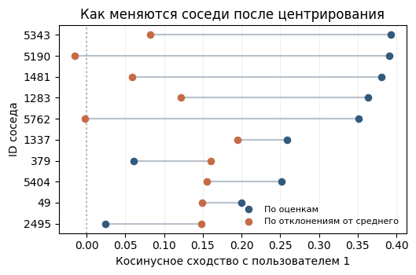

**Важно:** то, что соседи изменились, ещё не доказывает, что рекомендации стали лучше. Это проверяется только на валидации, по метрикам на многих скрытых оценках.

### ItemKNN и UserKNN рядом

Если поставить топ-8 двух методов для пользователя 1 рядом, совпадений не будет ни одного. *Toy Story 2* стоит на 9-м месте у ItemKNN и на 93-м у UserKNN. Различие связано со спецификой взаимодействий: на уровне пользователей общих данных гораздо меньше, и в этой задаче ItemKNN работает лучше.[^n3b]

::: {.qa title="Вопросы из зала"}
**Мера Жаккара работает с бинарными данными и лежит в $[0,1]$, а косинус — в $[-1,1]$. Как их вообще сравнивать?** Обе меры используют одну и ту же информацию о взаимодействиях — пересечение множеств — и различаются только нормировкой. Жаккар показывает, какую долю среди пользователей, которым понравился хотя бы один из двух фильмов, составляют те, кому понравились оба: пересечение нормируется через объединение. Косинус нормирует через длины векторов. Он учитывает направление, Жаккар — долю общих взаимодействий. Косинус не всегда лучше Жаккара.[^n3a]

**Жаккар сильно зависит от мощности множеств, а косинус устойчив к разной длине векторов. Стоит ли проверять статистическую значимость, прежде чем выбирать метод?** Да, Жаккар зависит от мощности множеств, а косинус устойчивее к дисбалансу размеров. Но статистически устойчивой оценки по сравнению с Жаккаром косинус тоже не гарантирует.

**Зато к косинусу можно подключить TF-IDF, эмбеддинги и т. п.?** Да, и на практике в основном используются именно косинусные меры, в том числе в item-based методах.
:::

[^n3a]: Примечание составителя: на бинарных данных, как в формулах выше, косинус тоже неотрицателен и лежит в $[0,1]$. Отрицательные значения появляются только на вещественных векторах с разными знаками, например после центрирования рейтингов.

[^n3b]: Примечание составителя: количественного сравнения качества ItemKNN и UserKNN в этой части нет: оно делается позже, на многих скрытых оценках. На демо-примере UserKNN даже ближе к настоящей оценке (4,68 против 4,78 при оценке 4), а в пользу ItemKNN говорит только место *Toy Story 2* в списке (9-е против 93-го).

## Model-based: ALS своими руками

*Таймкод: 00:26:35 · ноутбук: ячейки 30–38*

У ItemKNN и UserKNN есть общее ограничение: прогноз строится только по ближайшим соседям, а всё, что лежит за ними, не используется. **Model-based подход** устроен иначе. Мы не храним матрицу оценок и не ищем в ней похожих, а обучаем модель с параметрами, которые подбираются так, чтобы она как можно лучше объясняла известные оценки. Классический пример такой модели — матричная факторизация. Разберём её на том же датасете MovieLens, чтобы честно сравнить с ItemKNN.

### Матричная факторизация

Идея **матричной факторизации** в том, чтобы приблизить разреженную матрицу оценок произведением двух небольших матриц. Каждому пользователю $u$ сопоставляется вектор $p_u$, каждому фильму $i$ — вектор $q_i$. В обоих векторах по $f$ чисел, это **скрытые факторы**. Их смысл заранее не задаётся: модель сама подбирает их так, чтобы скалярное произведение векторов приближало оценку:

$$
\hat r_{ui} = p_u^\top q_i, \qquad
\min_{P,Q} \sum_{(u,i)\in\Omega} (r_{ui} - p_u^\top q_i)^2 + \lambda\left(\|P\|_F^2 + \|Q\|_F^2\right).
$$

Здесь $P$ и $Q$ — матрицы, составленные из векторов пользователей и фильмов, $\Omega$ — множество пар «пользователь — фильм», для которых оценка известна. Первое слагаемое — квадратичная ошибка восстановления. Второе — регуляризация: $\|\cdot\|_F$ означает норму Фробениуса (корень из суммы квадратов всех элементов матрицы), а коэффициент $\lambda$ не даёт факторам разрастись. **Важно:** сумма идёт только по известным парам. Пустые клетки матрицы в функцию потерь не входят, мы оптимизируем ошибку только на тех фильмах, с которыми пользователь взаимодействовал.

### Почему ALS

Минимизировать сразу по $P$ и $Q$ неудобно: функция потерь содержит их произведение. Но если зафиксировать все векторы фильмов, то для каждого пользователя остаётся обычная ridge-регрессия, и у неё есть решение в закрытой форме:

$$
p_u = (Q_u^\top Q_u + \lambda I)^{-1} Q_u^\top r_u,
$$

где $Q_u$ — факторы фильмов, которые пользователь оценил, а $r_u$ — его оценки этих фильмов. Затем фиксируем $P$ и точно так же находим векторы всех фильмов. На этом построен **ALS (Alternating Least Squares)**: две группы параметров оптимизируются поочерёдно, и шаги повторяются, пока ошибка не перестанет падать.

В реализации это две функции. Функция `als_step` делает один шаг оптимизации одной матрицы: для каждой строки (пользователя или фильма) она берёт факторы объектов с известными оценками и решает линейную систему из формулы выше. Функция `fit_als` — цикл обучения. Векторы фильмов инициализируются случайно, затем на каждой итерации сначала пересчитываются пользователи при фиксированных фильмах, потом фильмы при фиксированных пользователях. Обучаем 32 фактора, $\lambda = 5$, 10 итераций.

### Бейзлайны и метрика

Чтобы было с чем сравнивать, случайные 10 % оценок откладываем в тест (900 474 оценки в train, 99 735 в test) и считаем два простых прогноза: средняя оценка по всем и средняя оценка пользователя. Качество меряем через **RMSE** — корень из среднеквадратичной ошибки на скрытых оценках $T$:

$$
\mathrm{RMSE} = \sqrt{\frac{1}{|T|}\sum_{(u,i)\in T} (r_{ui} - \hat r_{ui})^2}.
$$

Метрика показывает, насколько в среднем прогноз отклоняется от настоящей оценки: чем она меньше, тем модель точнее. ItemKNN для массового прогноза слегка меняется: вместо порога близости у каждого фильма берётся $K = 30$ ближайших соседей, чтобы почти у всех фильмов нашлось хоть несколько оценённых соседей.

### Что получилось

ALS быстро сходится: уже со второй итерации RMSE на тесте держится около 0,90, на обучении опускается примерно до 0,65. Ошибка на тесте заметно выше, чем на обучении, но стабильна и не растёт. Роль регуляризации видна, если перебрать $\lambda$ (8 итераций):

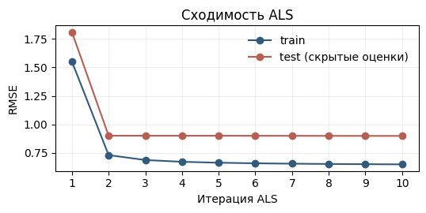

| $\lambda$ | RMSE train | RMSE test |
|:--|:--|:--|
| 0,05 | 0,614 | 1,091 |
| 5 | 0,651 | 0,898 |
| 50 | 0,948 | 0,971 |

При слишком маленьком $\lambda$ модель подгоняется под обучение и проваливается на тесте, при слишком большом недообучается.

Итоговое сравнение на скрытых оценках:

| Модель | RMSE |
|:--|:--|
| Среднее по всем | 1,1133 |
| Среднее пользователя | 1,0316 |
| ItemKNN, $K = 30$ | 0,9584 |
| ALS, 32 фактора | 0,8975 |

ALS точнее всех, а его рекомендации очень сильно отличаются от рекомендаций ItemKNN. Возьмём того же пользователя 1 и его топ-8 непросмотренных фильмов. ItemKNN ставит наверх *Rock*, *Contact*, *Truman Show*, *As Good As It Gets*. У ALS — *Forrest Gump*, *Gone with the Wind*, *Dances with Wolves*, *Shawshank Redemption*, *Braveheart*, то есть широко известная классика.

## Implicit feedback на KION: данные, разбиение и метрики

*Таймкод: 00:29:11 · ноутбук: ячейки 39–49*

До сих пор у нас были явные оценки MovieLens. Теперь возьмём боевой пример — датасет **KION**. KION — онлайн-кинотеатр, и датасет представляет собой его логи: кто, что и как долго смотрел за определённый период. Оценок здесь нет. Это **implicit feedback** (неявная обратная связь): о предпочтениях пользователя мы судим не по выставленной им оценке, а по его поведению — по факту просмотра, длительности и тому, какую часть видео он досмотрел.

### Что лежит в данных

Датасет состоит из трёх таблиц. Это взаимодействия, пользователи (возраст, доход, пол, есть ли дети) и видео (тип контента, название, год выхода, жанры, возрастной рейтинг). Одна строка взаимодействий — агрегат по паре «пользователь – видео». В ней хранится дата последнего просмотра `last_watch_dt`, суммарная длительность просмотра `total_dur` в секундах и **доля досмотра** `watched_pct` — сколько процентов полной длительности видео пользователь посмотрел. Всего 5 476 251 взаимодействие, 962 179 пользователей и 15 706 видео за период с 13.03.2021 по 22.08.2021.

Когда вместо оценок у нас просмотры, меняются сразу три вещи. Во-первых, надо решить, что считать сигналом. Договоримся, что положительное событие — это просмотр не короче 300 секунд, а короткие клики («включил и выключил») в обучение не берём. Во-вторых, меняется то, что мы предсказываем: уже не оценку, а будет ли новый просмотр. Поэтому RMSE больше не подходит, нужны ранжирующие метрики по топ-10. В-третьих, нужна другая функция потерь. ALS из предыдущего раздела минимизирует ошибку только на известных парах. Здесь же все известные пары — «единицы», и такая модель просто выучила бы константу. Как устроен вариант ALS для неявных данных, разберём вместе с моделями.

### Разведочный анализ

Прежде чем что-то обучать, проведём **EDA** (exploratory data analysis, разведочный анализ данных): посмотрим на распределения и поймём, что представляют собой данные.

Первое, что видно, — снова длинные хвосты. Среди пользователей есть небольшая группа, около 1 %, у которых взаимодействий очень много. Из-за них графики приходится строить дважды — по всем и без топ-1 %. Медиана при этом совсем небольшая: 2 взаимодействия на пользователя и 12 на видео. Много взаимодействий, кстати, набирают те, кто смотрит короткие мультики. Каждый мультик — отдельная запись в таблице, и пятиминутных мультиков набирается гораздо больше, чем фильмов по полтора-два часа.

У видео тот же длинный хвост, с которым в рекомендациях сталкиваешься постоянно. Есть популярные элементы, которые смотрят все, и есть нишевый контент. Задача рекомендаций — не просто отдавать популярное, а подбирать пользователю релевантное, в том числе из длинного хвоста: то, что могло бы ему понравиться, хотя смотрят это немногие.

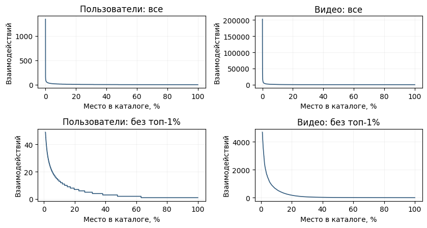

По времени число взаимодействий растёт: с марта по август оно увеличивается примерно со 100 тыс. до 420 тыс. в неделю.

Самое интересное — гистограмма доли досмотра. По оси X отложена доля просмотра, по оси Y — число взаимодействий. На ней видны два характерных паттерна. Либо пользователи досматривают до конца (последний бин, около 1,6 млн взаимодействий), либо начинают смотреть и быстро бросают (первый бин, около 1,4 млн). Между ними лежит почти равномерный средний слой: кто-то начал смотреть и по какой-то причине остановился. Если считать статистики, не учитывая, сколько пользователь посмотрел, эта картина нивелируется. **Важный вывод:** долю просмотра нужно использовать как сигнал при обучении модели.

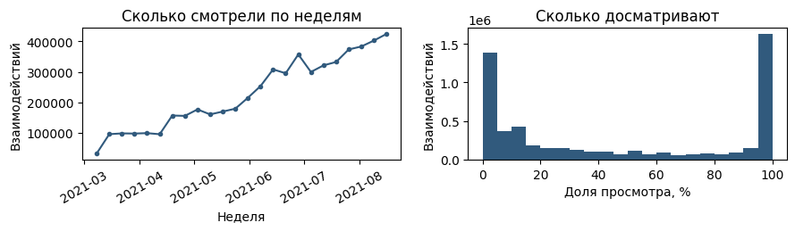

Но и сама доля просмотра не равнозначна оценке. В каталоге есть ролики по 5–10 минут и фильмы по 60 минут и больше. 50 % пятиминутного ролика — совсем не то же самое, что 50 % двухчасового фильма, а тем более сериала. Это хорошо видно, если сгруппировать просмотры по потраченному времени и посчитать в каждой группе медиану доли досмотра. У просмотров короче 30 секунд она почти нулевая, у просмотров от часа — около 100 %. Одни и те же 50 % могут означать и минуту, и час.

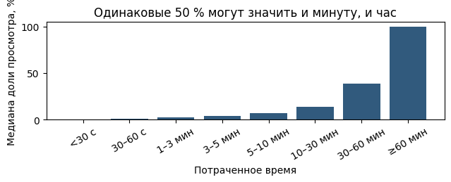

Отсюда общий практический совет. Работая с данными, полезно посмотреть, что они собой представляют: какие там фильмы, есть ли сериалы, как сериалы попадают в данные — по сериям или целиком. Такие случаи обрабатываются отдельно.

### Подготовка данных

Оставляем только просмотры длительностью не меньше 300 секунд, чтобы короткие включения не засоряли данные. Каждому оставшемуся событию даём вес 1. Тем самым мы сознательно упрощаем задачу: «досмотрел» и «посмотрел половину» не различаются. Делать именно так не обязательно. **Важно** другое: не все полученные данные стоит сразу отправлять в модель. Сначала нужно посчитать статистики, сделать фильтрации, провести качественный EDA — и только потом обучать.

Данные делим по времени. В тест идут последние 7 дней, в обучение — всё, что было раньше (до 15.08.2021 включительно). Это имитирует работу сервиса: обучились на прошлом, проверяем на будущем. В train получается 3 881 529 просмотров у 763 877 пользователей по 14 034 видео, в test — 229 165 просмотров за следующую неделю. В тесте оставляем только «тёплых» пользователей, то есть тех, кто есть и в train: о новых пользователях у моделей без признаков нет никакой информации. Таких пользователей 92 532.

Из рекомендаций нужно исключать то, что пользователь уже смотрел. Не все модели способны сами выдавать то, чего не было в истории просмотров, поэтому фильтр включается явно: при запросе рекомендаций передаётся параметр `filter_viewed=True`.

Дальше работаем с библиотекой **RecTools**. В ней много моделей для рекомендаций, у неё достаточно приятный API: единый интерфейс `fit` / `recommend` для всех моделей и готовые метрики. Поэтому сравнение получается честным автоматически: одни данные, одни пользователи, один способ считать. RecTools ожидает таблицу взаимодействий с колонками `user_id`, `item_id`, `weight` и `datetime`.

### Метрики

Для каждого пользователя из теста модель выдаёт 10 видео, которые он ещё не смотрел. Релевантными считаем видео, которые он посмотрел на тестовой неделе. Качество оцениваем тремя метриками ранжирования:

- **Recall@10** — какую долю релевантных видео из теста модель смогла включить в топ-10 рекомендаций;
- **MAP@10** — средняя точность с учётом позиций, на которых случились попадания;
- **NDCG@10** — метрика, которая придаёт вес позиции элемента: попадания выше в списке ценятся дороже.

Ещё две метрики описывают не качество, а характер выдачи:

- **Coverage** (покрытие) — какую долю каталога модель вообще использует в рекомендациях;
- **Novelty** (новизна) — насколько непопулярные элементы модель рекомендует.[^n5a]

Все метрики считаются сначала для каждого пользователя, а затем усредняются. Вручную ничего писать не нужно: все они есть в RecTools и импортируются из `rectools.metrics` (`Recall`, `MAP`, `NDCG`, `CatalogCoverage`, `MeanInvUserFreq`) вместе с функцией `calc_metrics`, которая считает их все разом.

[^n5a]: Примечание составителя: в RecTools Coverage считается классом `CatalogCoverage` (с `normalize=True` — доля видео каталога train, попавших хотя бы в одну выдачу), а Novelty — классом `MeanInvUserFreq`: для каждого рекомендованного видео берётся $-\log_2$ доли пользователей, которые его смотрели, и результат усредняется. Чем реже смотрят рекомендованное, тем выше Novelty.

## Четыре модели на KION: бейзлайны против персонализации

*Таймкод: 00:37:50 · ноутбук: ячейки 50–56*

Данные KION подготовлены, метрики выбраны. Теперь можно сравнить несколько моделей. В RecTools у всех моделей один интерфейс, поэтому сравнение делается одной функцией. Сначала модель обучается на train (`fit`). Затем идёт инференс: для каждого тестового пользователя строится топ-10 (`recommend`), уже просмотренное из него исключается (`filter_viewed=True`). По этому топу на отложенной неделе считаются метрики. Ничего не нужно писать вручную: и модели, и метрики импортируются из библиотеки.

### Две нижние планки: Random и Popular

Прежде чем радоваться числам сложной модели, нужно понять, с чем их сравнивать. Для этого строят **бейзлайн** — простейшее решение, которое задаёт планку качества. Самый базовый бейзлайн, который стоит делать всегда, — **Random**: пользователю показывают случайные видео из каталога. Если ваша модель лучше рандома, вы идёте в правильном направлении. Метрики ранжирования у Random, естественно, самые низкие. Зато Novelty у него большая, а Coverage равна 1. Но смотреть нужно не на это. Coverage и Novelty описывают характер выдачи, а в первую очередь нас интересуют метрики ранжирования.

Второй бейзлайн — **Popular**: каждому пользователю рекомендуется один и тот же список самых просматриваемых видео. Под пользователя этот список никак не ранжируется, из него только убирается то, что человек уже смотрел.

Против двух бейзлайнов выступают две персональные модели. Первая — уже знакомый ItemKNN: косинусное сходство видео по бинарной матрице просмотров, 100 соседей на видео. Вторая — **iALS** (implicit ALS, Hu, Koren, Volinsky, 2008), вариант ALS для implicit feedback. На одних известных «единицах» обычный ALS выучил бы константу, поэтому iALS смотрит на все пары «пользователь — видео»:

$$
\min_{P,Q}\ \sum_{u,i} c_{ui}\,(p_{ui}-p_u^\top q_i)^2+\lambda\left(\|P\|_F^2+\|Q\|_F^2\right).
$$

Здесь $p_{ui}=1$, если пользователь $u$ смотрел видео $i$, и $p_{ui}=0$ в противном случае. Вес уверенности $c_{ui}$ равен $1+\alpha$ для просмотренных пар и $1$ для остальных. Ноль означает не «не понравилось», а «не знаем», поэтому таким парам модель доверяет слабо. Обучается iALS тем же чередованием шагов, что и ALS, только с весами. В примере взяты 16 факторов, $\lambda = 0{,}1$, $\alpha = 10$ и 15 итераций.

| Модель | Recall@10 | NDCG@10 | MAP@10 | Novelty@10 | Coverage@10 | Обучение, с |
|:-------|--------:|-------:|------:|---------:|----------:|---------:|
| ItemKNN | 0,1842 | 0,0442 | 0,0855 | 5,80 | 0,583 | 1,8 |
| Popular | 0,1666 | 0,0380 | 0,0779 | 3,75 | 0,0024 | 0,8 |
| iALS | 0,1393 | 0,0328 | 0,0604 | 5,75 | 0,0226 | 57,3 |
| Random | 0,0007 | 0,0002 | 0,0002 | 15,59 | 1,000 | 0,0 |

Popular оказывается сильным бейзлайном: по метрикам ранжирования он обходит обученный iALS. Лучше него только ItemKNN, и то ненамного.

### Почему популярное так хорошо выглядит

Казалось бы, алгоритм, который подбирает контент под интересы конкретного человека, должен выигрывать у списка, одинакового для всех. Дело в длинном хвосте и в концентрированном спросе. Большое число пользователей смотрит одни и те же популярные видео. Поэтому популярное видео с большой вероятностью окажется в тестовой неделе пользователя, то есть будет «релевантным» с точки зрения метрик. С точки зрения разнообразия и настоящих интересов пользователя это не так. Цена видна в той же таблице: у Popular самые низкие Coverage (0,0024 — он показывает крошечную долю каталога) и Novelty.

### Срез по длине истории

Средняя метрика по всем пользователям скрывает, кому именно помогает персонализация. Поэтому очень полезно смотреть **срез по длине истории**: тестовых пользователей делят на группы по числу просмотров в train и внутри каждой группы считают Recall@10.

| История в train | Пользователей | Popular | ItemKNN | iALS |
|:--|--:|--:|--:|--:|
| 1–2 | 23 634 | **0,2433** | 0,2324 | 0,1855 |
| 3–5 | 20 257 | 0,1927 | **0,2191** | 0,1590 |
| 6–20 | 34 627 | 0,1367 | **0,1654** | 0,1221 |
| 21–50 | 11 093 | 0,0810 | **0,1063** | 0,0816 |
| 50+ | 2 921 | 0,0453 | **0,0710** | 0,0537 |

На коротких историях recall у Popular гораздо выше, чем на длинных. При одном-двух взаимодействиях Popular лучше всех: о пользователе почти ничего не известно, и угадать его интересы точнее, чем «то, что смотрят все», трудно. Уже при 3–5 просмотрах ItemKNN заметно обгоняет Popular, и дальше эта картина сохраняется во всех группах. Значит, общая средняя у Popular высокая потому, что пользователей с короткой историей много. Персонализация выигрывает там, где о человеке знают больше.

### Что модель рекомендует конкретному человеку

Модель — чёрный ящик: мы отдаём ей историю и информацию о пользователях, она выдаёт рекомендации. Поэтому, кроме чисел, очень полезно посмотреть, что именно она выдаёт. Для этого берут пользователя с заметной историей и сравнивают его последние просмотры (название, жанры, процент досмотра) с топ-5 каждой модели. Жанры нужны только для чтения человеком, модели их не видят.

Возьмём пользователя, в истории которого есть мультфильмы, драмы, боевики и военные фильмы. Драмы и боевики он досматривает редко, а мультфильмы — с высоким процентом досмотра, военные фильмы тоже. Popular — это просто статистика по всем, кто что-то смотрит, поэтому мультфильмов в его топе нет. У ItemKNN мультфильмы уже «просачиваются» в выдачу, то есть появляется то, что скорее всего соответствует интересам именно этого человека. У iALS мультфильмы тоже встречаются, но больше боевиков и драм.[^n6a]

Здесь же виден минус коллаборативных моделей: они никак не используют порядок, в котором пользователь совершал взаимодействия, а работают с «мешком» элементов. Если человек смотрел драмы, а потом мультики, мультики, то сейчас ему, наверное, уместнее предложить ещё один мультик. Мешок этого не видит.[^n6b]

### Один аккаунт на всю семью

У истории просмотров онлайн-кинотеатра есть ещё одна проблема. Дома стоит телевизор, и им под одним аккаунтом пользуются все, кто живёт в квартире. Мама смотрит мелодрамы, папа — боевики, ребёнок — мультики. Хотелось бы понимать, кто сейчас перед экраном, и подстраивать рекомендации под него. Для этого используют разбиение истории на сессии и предсказание того, кто сейчас смотрит. Главное здесь вот что: история аккаунта не обязательно отражает интересы одного конкретного человека, и в рекомендациях это нужно учитывать. На следующих лекциях и семинарах это станет понятнее на практике.

[^n6a]: Примечание составителя: в сохранённом выводе ноутбука показан другой пользователь (выбирается случайно), 1036788 с 20 просмотрами в train. В его последних просмотрах комедии, драмы, мелодрамы и семейное кино, мультфильмов нет. У Popular и ItemKNN в топ-5 одни и те же пять видео в разном порядке («Девятаев», «Гнев человеческий», «Хрустальный» и др.). iALS даёт другой набор: «Маша», «Дуров», «Девятаев» (сериал), «1+1», «Фемида видит». Разобранный выше пример взят из запуска, показанного на семинаре.

[^n6b]: Примечание составителя: модели, которые учитывают порядок взаимодействий, разбираются в лекции «Sequential Recommendation».

## Двухэтапная модель: генераторы кандидатов и CatBoost

*Таймкод: 00:49:15 · ноутбук: ячейки 57–70*

В промышленных системах рекомендации почти всегда строятся в два этапа, и последний блок ноутбука собирает именно такой пайплайн. Первый этап — **генератор кандидатов (кандген)**: быстрая модель, которая из всего каталога отбирает для каждого пользователя несколько десятков видео. Второй этап — **ранкер**: обычно градиентный бустинг, который получает этих кандидатов и расставляет их по порядку. Вместе это и есть **двухэтапная модель**.

### Несколько генераторов, скоры как признаки

Генератором не обязательно должна быть одна модель — iALS, ItemKNN или какая-то ещё. Можно взять сразу несколько моделей, объединить их кандидатов, а их скоры подать ранкеру как признаки. Каждая модель смотрит на данные по-своему, поэтому объединённый список богаче, чем список любой из них. Мы возьмём те же три модели, что сравнивали раньше: Popular, ItemKNN и iALS, — и каждая предложит по 30 кандидатов на пользователя. Её ранг (место кандидата в её списке) и скор станут колонками в таблице для бустинга.

Бустингу нужны и обычные признаки пользователя и айтема. Генерация признаков — большая отдельная задача, здесь на ней не останавливаемся и берём несколько штук. По пользователю — возраст, доход и пол, в KION они уже даны интервалами вроде `age_25_34` или `income_60_90`. По видео — тип контента, год выпуска и возрастной рейтинг. Удобно, что CatBoost умеет работать с категориальными признаками напрямую: их не нужно заранее переводить в числа, достаточно передать строками и указать, какие колонки категориальные. Есть одна тонкость: пропуски в категориальных признаках CatBoost не принимает, поэтому их заполняем явным значением `"unknown"`. Анкета ведь есть не у всех пользователей из логов.

### Сборка в RecTools и откуда берутся метки

В RecTools вся схема собирается классом `CandidateRankingModel` из нескольких частей:

- генераторы — `CandidateGenerator` для каждой из трёх моделей с `num_candidates=30`; флаги `keep_ranks` и `keep_scores` превращают ранги и скоры в признаки;
- сборщик признаков — наследник `CandidateFeatureCollector`, который подмешивает к кандидатам признаки пользователей и видео;
- разбиение для меток — `TimeRangeSplitter("7D")`;
- сэмплер негативов — `PerUserNegativeSampler` с пятью негативами на пользователя;
- ранкер — **CatBoostClassifier** (300 итераций, глубина 6), завёрнутый в `CatBoostReranker` со списком категориальных признаков.

CatBoostClassifier — это обычный бинарный классификатор: для каждой пары «пользователь – кандидат» он предсказывает вероятность просмотра, и кандидаты пересортировываются по этой вероятности.

Чтобы обучить такой классификатор, нужны метки, и берутся они так. Внутри train ещё раз отрезаем последнюю неделю. Генераторы учатся на истории до неё и формируют кандидатов. Кандидаты, которых пользователь посмотрел на этой неделе, получают метку 1, остальные — 0. Ноль здесь означает не «не понравилось», а «просмотра не было», поэтому все нули брать незачем: на пользователя оставляем все единицы и только пять случайных нулей. Тестовая неделя в обучении не участвует вообще.

### Обучающая таблица второго этапа

Прежде чем что-то обучать, полезно посмотреть на таблицу, на которой будет учиться бустинг. Каждая строка — пара «пользователь – кандидат». В колонках — скор и ранг от Popular, от ItemKNN и от iALS, признаки пользователя и видео, а в `target` — метка. В нашем случае это 507 878 пар, единиц среди них 13,7%.

**Важно:** пропуски (NaN) в колонках генераторов — это нормально. Задача кандгена — собрать как можно больше элементов из разных источников, а отранжирует их уже ранкер. Если видео предложил только ItemKNN, то у Popular и iALS для этой пары нет ни ранга, ни скора. Пустой ранг — тоже информация: бустинг видит, что кандидата нашёл только один генератор.

### Результат и важность признаков

При обучении сначала обучаются генераторы, затем на их кандидатах собирается таблица и обучается бустинг, после чего генераторы переобучаются на полном train. Всё это заметно дольше одностадийных моделей: около 386 секунд, из них примерно 170 уходит только на сборку таблицы.

| Модель | Recall@10 | NDCG@10 | MAP@10 | Novelty@10 | Coverage@10 |
|:--|--:|--:|--:|--:|--:|
| Two-stage | 0,2011 | 0,0440 | 0,0813 | 5,331 | 0,3107 |
| ItemKNN | 0,1842 | 0,0442 | 0,0855 | 5,797 | 0,5827 |
| Popular | 0,1666 | 0,0380 | 0,0779 | 3,747 | 0,0024 |
| iALS | 0,1393 | 0,0328 | 0,0604 | 5,753 | 0,0226 |
| Random | 0,0007 | 0,0002 | 0,0002 | 15,587 | 1,0000 |

По Recall@10 двухэтапная модель обгоняет лучшую одиночную модель ItemKNN: 0,2011 против 0.1842. При этом NDCG@10 и MAP@10 у неё практически те же, что у ItemKNN, или чуть ниже, а покрытие каталога меньше.

Дальше стоит посмотреть, на какие признаки опирается обученный CatBoost. **Важность признаков** показывает, какой вклад каждый признак вносит в предсказания модели, в процентах от общего. Самый важный признак — скор Popular, около 27%. Это тот самый эффект, который мы уже видели: популярное «просачивается» везде. В рекомендациях с этим стараются бороться. Есть, например, методы **андерсэмплинга** — при обучении они делают так, чтобы модель старалась не рекомендовать популярные элементы[^n7a]. Следом идут год выпуска (около 16%) и скор ItemKNN (около 12,5%). Затем — возрастной рейтинг, тип контента и ранг ItemKNN, примерно по 8%. Ниже — ранг Popular и признаки iALS. Пол, возраст и доход для модели почти ничего не значат: их важность близка к нулю.

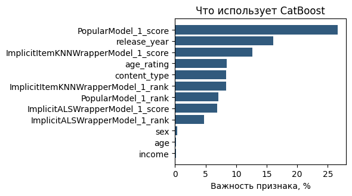

### Какие метрики смотреть на каждом этапе

Раз этапов два, их и оценивать нужно по-разному. Если мы сравниваем два генератора кандидатов, главная метрика — Recall: генератору важно накрыть как можно больше будущих просмотров. Полезно смотреть и на novelty. На этапе ранжирования важно, как найденное расставлено по позициям, поэтому там смотрят NDCG и precision. MAP тоже используют, но основная метрика ранжирования — NDCG.

### Потолок второго этапа

Отсюда вытекает важное ограничение. Ранкер получает список от кандгена и только переупорядочивает его. Ничего нового сверх того, что ему подали, он выдать не может. Поэтому качество второго этапа ограничено сверху тем, насколько хорошо генераторы накрыли будущие просмотры. Это и есть **потолок второго этапа**.

Его легко посчитать: объединяем кандидатов от трёх генераторов (в среднем выходит 47,2 кандидата на пользователя) и считаем Recall объединённого списка. Получается 0.3299. Это максимум, который вообще можно выжать из ранкера при таких кандидатах; лучшая модель пока даёт Recall@10 0.2011.

**Важный вывод:** важны оба этапа. Если после второго этапа метрики низкие, проблема не обязательно в ранкере или в выборе модели для него. Сначала имеет смысл проверить первый этап: собрать качественную генерацию кандидатов, провалидировать её и уже потом дорабатывать ранжирование.

### Классификатор или ранкер: YetiRank

В нашем пайплайне на втором этапе обучался классификатор. Он для каждой пары отдельно отвечает на вопрос, будет ли просмотр, и никак не учитывает, что кандидаты одного пользователя конкурируют между собой за места в выдаче. В лекции «Ранжирование и метрики качества» разбирались лоссы ранжирования, которые учат модель именно упорядочивать элементы. Один из них — **YetiRank**. Если вместо классификатора взять **CatBoostRanker** с `loss_function="YetiRank"`, модель будет упорядочивать кандидатов внутри каждого пользователя, а это ближе к нашей задаче. В RecTools замена сводится к одной строке: `CatBoostReranker` сам передаст CatBoost `group_id`, то есть разобьёт пары на группы по пользователям. Обучение занимает столько же времени, сколько у классификатора, поэтому эту ячейку стоит запустить самостоятельно — после семинара или перед домашним заданием — и сравнить результат с классификатором.

На этом ноутбук заканчивается. Мы разобрали memory-based и model-based подходы, построили двухэтапный пайплайн из генераторов кандидатов и ранкера и посмотрели, на какие сложности стоит обращать внимание при работе с историческими данными.

[^n7a]: Примечание составителя: механизм андерсэмплинга на семинаре не раскрывался. В общем виде это прореживание обучающих примеров с популярными айтемами, чтобы они не доминировали в обучении.

## Линейные модели и вопросы о данных KION

*Таймкод: 01:00:32 · ноутбук: ячейки 41–47*

Основной ноутбук на этом закончен, но к нему стоит добавить ещё одно сравнение. Оно сделано в отдельном ноутбуке на том же датасете KION. В семинарский ноутбук его не включили, чтобы не перегружать.

### SLIM и EASE против матричной факторизации

В лекции о классических моделях, кроме матричной факторизации, разбирались линейные методы. Это **SLIM** и **EASE**: обе модели обучают матрицу весов, которая связывает айтемы между собой[^n8a]. Главное различие между ними — вид этой матрицы. У SLIM обученная матрица разреженная: большинство весов равно нулю. У EASE матрица плотная.

На KION сравнили четыре модели по трём метрикам: MAP, NDCG и Recall. Две из них, ALS и iALS, относятся к матричной факторизации, две другие — линейные SLIM и EASE. По всем трём метрикам линейные методы работают заметно лучше, чем ALS и iALS.

Решение здесь сознательно не раскрывается: домашнее задание будет устроено похоже, поэтому показаны только итоговые графики метрик. Для домашнего задания отсюда практический вывод: не стоит заранее делать ставку на одну модель. Имеет смысл попробовать всё, что получится, и выбрать то, что лучше решает задачу.

### Сначала данные, потом модель

Напомним, как устроены данные KION. Одна строка — это агрегат по паре «пользователь – видео»: дата последнего просмотра, суммарное время просмотра `total_dur` и доля досмотра `watched_pct`. Повторов пар в данных уже нет, так что за одной строкой может стоять несколько сессий.

С сырыми данными нужно работать очень аккуратно. Прежде чем обучать модель, их надо проанализировать и найти выбросы. Зачем это нужно, видно на двух типичных источниках проблем.

Первый источник — **автоплей**, то есть **фоновые просмотры**. Возьмём двадцатиминутные детские мультики: их включают утром, и они играют весь день, пока родители на работе. В логах видно, что пользователь «посмотрел» много серий и каждую досмотрел до титров. На деле сессия просто продолжалась без действий пользователя, а серии запускались одна за другой. Такие элементы отдельно отфильтровывают: при формировании датасета для обучения их удаляют на этапе чистки данных.

Второй источник — ошибки логирования. Бывает, что записанное время просмотра гораздо больше длительности самого фильма, то есть доля досмотра больше единицы (больше 100 %). Поэтому на гистограмме доли досмотра в ноутбуке значения обрезаются до диапазона от 0 до 100.

**Акцент лектора:** сырые данные сначала анализируют и чистят от выбросов и фоновых просмотров, и только потом обучают на них модель.

### Смещение от предыдущей модели

Из чата пришёл вопрос: как оценить влияние рекомендательной системы, которая уже работала, пока собирался датасет? Это действительно проблема. История взаимодействий пользователя связана с тем, что ему рекомендовала прежняя модель. Когда мы обучаем новую модель на этих логах, в неё закладывается и выбор старой. Это **смещение от предыдущей модели**[^n8b].

Корректное разбиение по времени это смещение никак не устраняет. Time split честно отделяет прошлое от будущего, но и в обучении, и в тесте лежат просмотры, которые сформировала одна и та же прежняя система.

На практике влияние предыдущей модели напрямую обычно не оценивают и смещение специально не корректируют: факторов слишком много. Работают с теми данными, что есть, а новую модель проверяют в A/B-тесте. Частично помогает **атрибуция источника просмотра**: в логах видно, откуда пришёл просмотр — из рекомендаций, из поиска или из другого места. По ней можно понять, какие сигналы получены от предыдущей модели.

### От офлайн-метрик к онлайну

Офлайн-метрики всегда проверяются онлайн-метриками в A/B-тесте. Модель выкатывают, если растут общие метрики (пользователи больше смотрят) и целевые бизнес-метрики, а остальные при этом не ухудшаются.

При анализе A/B-тестов отдельно следят за перетоком между рекомендациями и поиском. Улучшение рекомендаций может ухудшить метрики поиска, и наоборот. Если главная целевая бизнес-метрика не падает, всё в порядке, а перетоки разбирают отдельно. Рост метрик поиска не всегда заслуга самого поиска. Допустим, мы выкатили плохую рекомендательную модель. Пользователи не находят интересного в рекомендациях, идут в поиск и находят нужное там, и метрики поиска растут.

::: {.qa title="Вопросы из зала"}
**Как в KION учитываются пересмотры: если человек сначала посмотрел полфильма, потом досмотрел, а потом пересмотрел ещё дважды?** Доля досмотра суммируется. Допустим, вчера пользователь посмотрел фильм на 10 %, и общая доля стала 10 %. Сегодня он посмотрел ещё, и общая доля уже, например, 30 %. Так продолжается, пока доля не дойдёт до максимума — 100 %. Для моделей, которые смотрят на историю пользователя как на мешок взаимодействий без порядка, этого достаточно. Им неважно, что фильм открыли, бросили и досмотрели потом: важна итоговая доля досмотра. Для моделей на последовательностях порядок событий важен, и с ними так поступать уже нельзя (это тема «Sequential Recommendation»). Отдельно стоит учитывать детей: они склонны пересматривать любимые мультики много раз.
:::

[^n8a]: Примечание составителя: в SLIM (Sparse Linear Method) оценка пользователя для айтема — взвешенная сумма его взаимодействий с другими айтемами. Матрица весов «айтем – айтем» обучается с L1- и L2-регуляризацией, диагональ запрещена (айтем не может объяснять сам себя), и L1 делает матрицу разреженной. EASE (Embarrassingly Shallow Autoencoder) решает ту же задачу только с L2-регуляризацией. У этой задачи есть решение в замкнутой форме, и матрица получается плотной.

[^n8b]: Примечание составителя: это частный случай exposure bias и петли обратной связи (feedback loop) из лекции 1. Пользователь может взаимодействовать только с тем, что ему показали, а что показывать, решала прежняя модель.

## Домашнее задание

*Таймкод: 01:11:34 · без ноутбука*

Домашнее задание сдаётся на **AllCups** — платформе соревнований, где решение загружается по шаблону и проверяется автоматически. За задание можно получить до 15 баллов. Текст задания уже виден на странице AllCups, а доступ к самой сдаче может открыться не сразу. Если вместо задания появляется ошибка «страница не найдена», значит, доступ ещё не выдали, и его выдадут.

По содержанию задание похоже на сравнение ALS, iALS, SLIM и EASE на KION из предыдущего раздела.

**Важно:** в задании разрешено использовать только перечисленные в нём библиотеки. Значит, все алгоритмы придётся реализовать самостоятельно, так же как ItemKNN, UserKNN и ALS реализовывались «своими руками» в начале семинара. Это скорее плюс: так лучше видно, как модели устроены внутри.

## Главное из семинара {.unnumbered}

::: keypoints
- Способ разбиения определяет, что именно мы измеряем. В индустрии в основном используют time split: обучаемся на прошлом, проверяем на последних днях, граница одна для всех пользователей.
- Матрица оценок почти пуста (у MovieLens заполнено 4,26 % клеток), и пустая клетка означает «неизвестно», а не «не понравилось». Оценки смещены вверх, популярность распределена с длинным хвостом.
- ItemKNN и UserKNN ничего не обучают: прогноз — взвешенное среднее оценок соседей. Результат сильно зависит от меры сходства (Жаккар, косинус, PMI) и от порога. Прогноз «5,0», который держится на одном соседе, ненадёжен.
- Центрирование рейтингов убирает индивидуальную шкалу пользователя. То, что после него сменились соседи, ещё не доказывает, что качество выросло: это проверяется только метриками на валидации.
- ALS поочерёдно решает ridge-регрессии для пользователей и для айтемов. На MovieLens он точнее среднего и ItemKNN по RMSE (0,8975), а регуляризация $\lambda$ отделяет переобучение от недообучения.
- На implicit feedback меняются сигнал (просмотр от 300 секунд, доля досмотра), цель (будет ли новый просмотр) и метрики (Recall@10, MAP@10, NDCG@10 вместо RMSE). iALS учитывает все пары с весами уверенности.
- Popular — сильный бейзлайн: на KION он обходит iALS. Срез по длине истории показывает, что Popular выигрывает только у пользователей с 1–2 просмотрами, а начиная с 3–5 просмотров лучше персональный ItemKNN.
- Двухэтапная модель: несколько генераторов кандидатов, их скоры и ранги идут признаками в бустинг. Качество ранкера ограничено сверху Recall объединённых кандидатов (0,3299 на KION); кандген оценивают по Recall, ранкер — по NDCG.
- На KION линейные SLIM и EASE заметно лучше ALS и iALS по MAP, NDCG и Recall.
:::

## Что подчеркнул лектор {.unnumbered}

::: emphasis
- Главное в рекомендациях — данные. Прежде чем обучать модель, данные анализируют (EDA), чистят от выбросов, фоновых просмотров и ошибок логирования и только потом подают в модель.
- Random — бейзлайн, который стоит строить всегда: если модель лучше рандома, вы идёте в правильном направлении. Смотреть в первую очередь нужно на метрики ранжирования, а не на Coverage и Novelty.
- Полезно смотреть на метрики в срезе по длине истории и на рекомендации живому пользователю: средняя метрика скрывает, кому помогает персонализация.
- Пропуски (NaN) в колонках генераторов в обучающей таблице ранкера — это нормально.
- Важны оба этапа. Если после ранжирования метрики низкие, сначала проверьте генерацию кандидатов.
- Ячейку с CatBoostRanker и YetiRank стоит запустить самостоятельно и сравнить с классификатором.
- Time split не устраняет смещение от предыдущей модели. Офлайн-метрики всегда подтверждают A/B-тестом и следят за перетоком между рекомендациями и поиском.
- В домашнем задании не стоит делать ставку на одну модель: попробуйте разные и выберите лучшую по метрикам. Разрешены только перечисленные в задании библиотеки.
:::

## Стоит посмотреть в видео {.unnumbered}

::: watch
- **00:04:55–00:06:22** — схемы разбиения leave-one-out, last-K и time split, которые рисовались на доске (доски в материалах нет).
- **00:13:00–00:20:50** — пошаговый разбор ItemKNN и UserKNN в ноутбуке: соседи *Toy Story 2*, расчёт прогноза 4,78, смена соседей после центрирования.
- **00:30:00–00:34:50** — разведочный анализ KION по графикам: длинные хвосты, динамика по неделям, гистограмма доли досмотра.
- **00:49:15–00:58:30** — сборка двухэтапной модели в RecTools, обучающая таблица второго этапа и график важности признаков.
- **01:00:32–01:02:17** — графики сравнения SLIM, EASE, ALS и iALS из отдельного ноутбука, которого нет в материалах.
:::

## Глоссарий {.unnumbered}

| Термин | Коротко |
|:--|:----------|
| **Обучающая выборка (train)** | Часть взаимодействий, на которой модель обучается |
| **Валидационная выборка (validation)** | Отложенная часть данных для проверки модели на том, чего она не видела |
| **Случайное разбиение** | Взаимодействия перемешивают и делят в заданной пропорции, например 80/20 |
| **Leave-one-out** | У пользователя скрывают последнее взаимодействие и предсказывают его |
| **Last-K** | У каждого пользователя скрывают K последних взаимодействий; общей даты-границы нет |
| **Time split (разбиение по времени)** | Всё до выбранной даты — в обучение, после неё — в тест; граница одна для всех |
| **Матрица оценок (user–item)** | Строки — пользователи, столбцы — айтемы, в клетке — известная оценка |
| **Разреженность** | Доля пустых клеток матрицы; у MovieLens 1M — 95,7 % |
| **Смещение оценок вверх** | Пользователи чаще ставят 4 и 5, у каждого своя манера пользоваться шкалой |
| **Длинный хвост (long tail)** | Немногие популярные айтемы собирают большую часть взаимодействий, остальные — единицы |
| **Memory-based подход** | Методы без обучаемых параметров: прогноз строится по похожим соседям прямо из данных |
| **ItemKNN** | Прогноз по похожим айтемам из истории пользователя |
| **UserKNN** | Прогноз по оценкам похожих пользователей |
| **Мера Жаккара** | Доля общих пользователей: пересечение множеств, делённое на объединение |
| **Косинусное сходство** | Пересечение, нормированное на $\sqrt{|U_i|\,|U_j|}$ (на длины векторов) |
| **PMI** | Pointwise mutual information: насколько совместные взаимодействия неожиданны; поднимает редкие айтемы |
| **Порог близости** | Минимальное сходство $\alpha$, начиная с которого айтем или пользователь считается соседом |
| **Центрирование рейтингов** | Вычитание средней оценки пользователя из каждой его оценки (нормализация) |
| **Model-based подход** | Методы, которые обучают параметры модели, объясняющей известные оценки |
| **Матричная факторизация** | Приближение матрицы оценок произведением матриц факторов пользователей и айтемов |
| **Скрытые факторы** | Векторы пользователей и айтемов, смысл которых модель подбирает сама |
| **ALS (Alternating Least Squares)** | Поочерёдное точное решение ridge-регрессий для пользователей и для айтемов |
| **RMSE** | Корень из среднеквадратичной ошибки прогноза оценки |
| **KION** | Датасет онлайн-кинотеатра: просмотры, признаки пользователей и видео |
| **Implicit feedback** | Неявная обратная связь: предпочтения выводятся из поведения (просмотры, досмотры) |
| **Доля досмотра** (`watched_pct`) | Какой процент длительности видео пользователь посмотрел |
| **EDA** | Exploratory data analysis, разведочный анализ данных перед обучением |
| **RecTools** | Библиотека рекомендательных моделей и метрик с единым интерфейсом `fit` / `recommend` |
| **Recall@10** | Доля релевантных айтемов из теста, попавших в топ-10 |
| **MAP@10** | Средняя точность топ-10 с учётом позиций попаданий |
| **NDCG@10** | Метрика топ-10, в которой попадания выше в списке весят больше |
| **Coverage** | Доля каталога, которая вообще попадает в рекомендации |
| **Novelty** | Насколько непопулярные айтемы рекомендует модель |
| **Бейзлайн** | Простейшее решение, задающее планку качества |
| **Random** | Бейзлайн: случайные айтемы из каталога |
| **Popular** | Бейзлайн: одинаковый для всех список самых популярных айтемов |
| **iALS** | ALS для implicit feedback: учитывает все пары с весами уверенности $1+\alpha$ и 1 |
| **Срез по длине истории** | Метрики, посчитанные отдельно для групп пользователей с разным числом взаимодействий |
| **Генератор кандидатов (кандген)** | Первый этап: быстрая модель, отбирающая десятки кандидатов из каталога |
| **Ранкер** | Второй этап: модель, упорядочивающая кандидатов |
| **Двухэтапная модель** | Связка генераторов кандидатов и ранкера |
| **CatBoostClassifier** | Бинарный классификатор CatBoost: вероятность просмотра для каждой пары отдельно |
| **Важность признаков** | Вклад каждого признака в предсказания модели, в процентах |
| **Андерсэмплинг** | Прореживание обучающих примеров, чтобы популярные айтемы не доминировали |
| **Потолок второго этапа** | Recall объединённых кандидатов: больше ранкер выжать не может |
| **YetiRank** | Лосс ранжирования в CatBoost, учит упорядочивать кандидатов внутри группы |
| **CatBoostRanker** | Ранжирующая модель CatBoost, которая работает с группами (`group_id`) |
| **SLIM** | Линейная модель с разреженной матрицей весов «айтем – айтем» |
| **EASE** | Линейная модель с плотной матрицей весов «айтем – айтем» |
| **Автоплей / фоновые просмотры** | Просмотры, которые идут без участия пользователя; их удаляют при чистке |
| **Смещение от предыдущей модели** | Логи отражают то, что показывала прежняя рекомендательная система |
| **Атрибуция источника просмотра** | Отметка в логах, откуда пришёл просмотр: рекомендации, поиск и т. д. |
| **AllCups** | Платформа сдачи домашних заданий с автопроверкой |
