Работа переносит backend системы управления студентами общежития из второй лабораторной с Python на Java и превращает его в полноценное серверное приложение. Студенты (ИСУ, ФИО, группа, общежитие, комната, даты заселения и выселения, признак иностранца, заметки) теперь хранятся в PostgreSQL, а не в JSON-файле. Появились пользователи с регистрацией и входом по JWT (access- и refresh-токены) и две роли: ADMIN выполняет все операции со студентами, USER только читает. REST API сохранил контракт ЛР2 и получил сортировку, страницы, полное изменение `PUT`, единый формат ошибок, документацию OpenAPI, коллекцию Postman, логирование и конфигурацию через `.env`.

Вариант — Jakarta EE: приложение собирается в WAR и работает на сервере Open Liberty (Jakarta REST, CDI, JPA с реализацией EclipseLink, Bean Validation, JSON-B, JTA, MicroProfile Config и OpenAPI). Вопросы к защите идут тремя блоками: язык и платформа Java (JVM, Spring Boot и Jakarta EE, ООП, аннотации, внедрение зависимостей, архитектура слоёв, исключения), базы данных (реляционная модель, ключи, связи, ORM, транзакции) и безопасность (аутентификация и авторизация, JWT, роли, хеширование паролей, конфигурация и секреты).

Учебник опирается на условие работы и на репозиторий `github.com/fafakaj/web_lab_3` (коммит `cf45998`): блоки «В твоей работе» цитируют его код, секреты из него заменены на `***`. Остальные примеры кода — иллюстрации на той же предметной области, а не решение задания.

## Вопрос 1. Java в серверной веб-разработке. Особенности языка и платформы JVM.

Скрипт запускается, отрабатывает и завершается. Серверу живётся иначе: процесс работает неделями, одновременно обслуживает десятки клиентов, и одна необработанная ошибка или утечка памяти со временем кладёт его целиком. От серверной платформы поэтому ждут другого: высокой скорости на длинной дистанции, нормальной многопоточности, проверки ошибок до запуска, большого набора стандартных библиотек и того, что код, написанный десять лет назад, всё ещё запускается. Java закрывает эти потребности за счёт сочетания языка со строгой типизацией и **JVM** (Java Virtual Machine) — виртуальной машины, которая исполняет программу и управляет её памятью и потоками. Поэтому в этой работе backend из ЛР2 и переносится на Java.

### JDK, JRE, JVM

**JVM** исполняет байт-код. **JRE** (Java Runtime Environment) — это JVM плюс стандартная библиотека, всё, что нужно для запуска. **JDK** (Java Development Kit) — JRE плюс инструменты разработчика: компилятор `javac`, отладчик, `jar`. Начиная с Java 11 отдельную JRE почти не поставляют, ставят JDK. Версии выходят раз в полгода, раз в два года выходит **LTS** (Java 17, 21, 25) — их и берут для серверов.

### Как код попадает в процессор

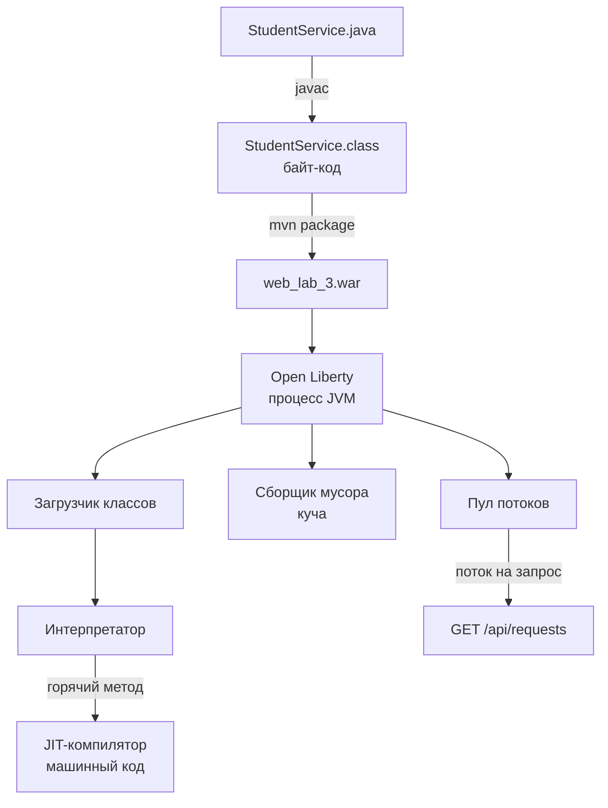

*Схема: компилятор переводит Java не в машинный код, а в байт-код; в машинный код его превращает уже JVM во время работы, и только для тех методов, которые вызываются часто. Сборщик мусора и пул потоков — тоже часть среды выполнения, а не кода приложения.*

Компилятор `javac` переводит исходник в **байт-код** — набор инструкций для виртуальной, а не для реальной машины, по файлу `.class` на класс. Один и тот же `.class` запускается на Linux, Windows и macOS: от процессора зависит JVM, а не программа. Отсюда принцип «write once, run anywhere».

При запуске **загрузчик классов** подгружает классы по мере первого обращения к ним и проверяет байт-код. Сначала код выполняет **интерпретатор**. JVM при этом считает вызовы, и методы, которые вызываются часто («горячие»), компилирует **JIT-компилятор** (Just-In-Time) в машинный код, причём с оптимизациями по реальной статистике: встраивает короткие методы, убирает лишние проверки. Отсюда **прогрев**: первые запросы к только что запущенному серверу обрабатываются медленнее, чем тысячный. На долгоживущем сервере это выгодно, а для коротких утилит и serverless-функций с холодным стартом мешает (решение — AOT-компиляция, например GraalVM Native Image).

### Память и сборка мусора

У каждого потока есть свой **стек**: в нём лежат локальные переменные и кадры вызовов, и он освобождается сам при выходе из метода. Объекты создаются в общей для всех потоков **куче**. Освобождать их вручную не нужно: **сборщик мусора** (GC) периодически находит объекты, до которых больше нельзя добраться по ссылкам, и освобождает их память. По умолчанию в серверной JVM работает G1, для больших куч с жёсткими требованиями к задержкам есть ZGC. Цена автоматической памяти — паузы, во время которых потоки приложения частично или полностью останавливаются. Современные сборщики держат их в пределах миллисекунд, но размер кучи (`-Xmx`) всё равно приходится настраивать под нагрузку.

### Особенности языка

**Статическая типизация.** Тип каждой переменной известен при компиляции, поэтому ошибку вроде `student.setCheckIn("2024-09-01")` вместо `LocalDate` отловит `javac`, а не пользователь в продакшене. Это же позволяет IDE безопасно переименовывать и находить все использования.

**Объектная модель** — классы, интерфейсы, наследование — разобрана в [вопросе 3](#q3), **исключения** — в [вопросе 7](#q7), **аннотации**, на которых построен серверный код, — в [вопросе 4](#q4).

**Современная Java (21)** сильно сократила шаблонный код:

| Возможность | Зачем на сервере |
|:--|:-----------|
| `record` | неизменяемые DTO в одну строку: конструктор, геттеры, `equals`, `hashCode`, `toString` генерируются |
| `switch`-выражение со стрелками `->` | нет «провала» в следующую ветку без `break` |
| `var` | вывод типа локальной переменной |
| виртуальные потоки | миллионы лёгких потоков, которые не держат поток ОС, пока ждут БД или сеть |

```java
// DTO ответа: одна строка вместо класса на 60 строк
public record StudentResponse(String isuId, String fullName, String room) {}
```

### Многопоточность: поток на запрос

Классическая модель серверов Java — **поток на запрос**: сервер берёт поток из пула и ведёт на нём весь запрос, от разбора HTTP до ответа. Двадцать одновременных клиентов — двадцать потоков, которые параллельно выполняют одни и те же методы. Объекты-сервисы при этом обычно одиночки на всё приложение (подробно об областях видимости — [вопрос 5](#q5)), и всё, что лежит в их полях, видят все потоки одновременно.

**Плохо:**

```java
@ApplicationScoped
public class StudentService {
    private Student current;          // общее поле одиночки

    public StudentResponse replace(String isuId, StudentRequest request) {
        current = findOrThrow(isuId);  // поток Б перезапишет поле, пока поток А
        StudentMapper.copyToEntity(request, current);  // ещё работает с ним
        return StudentMapper.toResponse(current);
    }
}
```

**Хорошо:**

```java
public StudentResponse replace(String isuId, StudentRequest request) {
    Student student = findOrThrow(isuId);   // локальная переменная — в стеке своего потока
    StudentMapper.copyToEntity(request, student);
    return StudentMapper.toResponse(student);
}
```

В первом варианте два администратора, одновременно редактирующие разных студентов, могут записать данные одного в другого. Ошибка проявляется редко, только под нагрузкой, и в тестах её почти не видно. Правило простое: у одиночки нет изменяемого состояния в полях. Только константы, внедрённые зависимости и неизменяемые настройки, а всё, что относится к запросу, живёт в локальных переменных.

### Артефакт: JAR, WAR и сервер приложений

Скомпилированные классы упаковываются в архив. **JAR** — обычная библиотека или самостоятельное приложение (`java -jar app.jar`). **WAR** (Web Application Archive) — веб-приложение, которое само не запускается: его разворачивают на **сервер приложений** или сервлет-контейнер. Сервер уже содержит реализации стандартных API (HTTP, JSON, JPA, транзакции, DI) и даёт приложению среду: пул потоков, пул соединений с БД, конфигурацию. Чем это отличается от подхода Spring Boot с встроенным сервером внутри JAR, разобрано в [вопросе 2](#q2).

> [!WARNING]
> **Подводный камень**
>
> Мерить скорость сервера по первым запросам после старта нельзя: в них входят загрузка классов, интерпретация и JIT-компиляция. Нагрузочные замеры делают после прогрева, иначе получаются цифры в разы хуже реальных.

> [!NOTE]
> **В твоей работе**
>
> Файл: `pom.xml`, строки 10–24
>
> ```xml
> <packaging>war</packaging>
>
> <properties>
>     <maven.compiler.release>21</maven.compiler.release>
>     ...
> </properties>
>
> <dependencies>
>     <!-- API Jakarta EE и MicroProfile: реализации уже есть в Open Liberty, поэтому scope provided -->
>     <dependency>
>         <groupId>jakarta.platform</groupId>
>         <artifactId>jakarta.jakartaee-api</artifactId>
>         <version>10.0.0</version>
>         <scope>provided</scope>
>     </dependency>
> ```
>
> `release 21` — байт-код для Java 21, и компилятор не даст использовать API более новых версий. Упаковка `war` и `provided` означают, что в архив попадает только твой код и библиотеки, которых в сервере нет (`java-jwt`, `jbcrypt`), а Jakarta REST, JPA и CDI предоставляет Open Liberty. Возможности Java 21 в коде: DTO сделаны записями (`PageResponse<T>` в `dto/PageResponse.java`, строка 8; `StudentRequest` с компактным конструктором для нормализации), `switch` со стрелками — в `exception/WebApplicationExceptionMapper.java`, строки 25–50.
>
> Файл: `src/main/java/ru/itmo/students/config/RequestLogFilter.java`, строки 22–32
>
> ```java
> private static final String START_TIME = "request-start-time";
>
> @Override
> public void filter(ContainerRequestContext request) {
>     request.setProperty(START_TIME, System.nanoTime());
> }
>
> @Override
> public void filter(ContainerRequestContext request, ContainerResponseContext response) {
>     Object start = request.getProperty(START_TIME);
>     long millis = start == null ? 0 : (System.nanoTime() - (long) start) / 1_000_000;
> ```
>
> Фильтр один на все запросы, поэтому время старта хранится не в поле фильтра, а в свойствах конкретного запроса. В поле лежит только константа-ключ. `StudentService` устроен так же: `@ApplicationScoped`, единственное поле — внедрённый репозиторий, всё остальное — локальные переменные. Вероятный вопрос по этому месту: «что будет, если сохранить время старта в обычное поле фильтра?». Ответ: при параллельных запросах один перезапишет значение другого, и время в логе будет неверным.

Виртуальные потоки в работе явно не используются: запросы обрабатывает пул потоков Open Liberty.

> [!TIP]
> **Могут спросить**
>
> **Почему Java не медленная, если она интерпретируется?** Интерпретируется только холодный код. Горячие методы JIT компилирует в машинный код с оптимизациями по реальному профилю выполнения, поэтому после прогрева сервер на Java по скорости сопоставим с программами на компилируемых языках. Заметно медленнее только старт.
>
> **Может ли в Java утечь память, если есть сборщик мусора?** Может. GC освобождает только недостижимые объекты, а если ссылка на объект остаётся (например, в статической коллекции-кэше без ограничения размера), то он живёт вечно. Куча растёт до `OutOfMemoryError`.
>
> **Чем виртуальный поток отличается от обычного?** Обычный поток — обёртка над потоком ОС: он дорогой (мегабайт стека) и простаивает, пока ждёт ответа БД. Виртуальный поток на время блокирующего ожидания JVM снимает с потока ОС и сажает на его место другой, поэтому их можно создавать сотни тысяч, а код остаётся в обычном блокирующем стиле.

## Вопрос 2. Spring Boot и Java EE / Jakarta EE: основные отличия и подходы к разработке.

Любой backend на Java решает одни и те же инфраструктурные задачи: принять HTTP-запрос и найти метод, который его обработает, превратить JSON в объект и обратно, создать объекты и связать их друг с другом, открыть транзакцию, сходить в базу, проверить права, прочитать настройки. Писать это заново в каждом проекте поверх голых сервлетов и JDBC долго и рискованно. В мире Java сложились два ответа. Первый — **Java EE / Jakarta EE**: набор стандартов, которые реализуют разные производители серверов. Второй — **Spring**: фреймворк одного разработчика со своей моделью, а **Spring Boot** — способ быстро собрать на нём готовое к запуску приложение. Условие разрешает оба (вариант 1 — Spring Boot, вариант 2 — Jakarta EE); работа сделана по второму.

### От Java EE к Jakarta EE

Платформа появилась в 1999 году как J2EE, с 2006 года называлась Java EE и развивалась под управлением Sun, затем Oracle. В 2017 году Oracle передал её Eclipse Foundation, но товарный знак «Java» оставил себе, поэтому платформу переименовали в **Jakarta EE**. Jakarta EE 8 (2019) — та же Java EE 8 под новым именем. В Jakarta EE 9 (2020) все пакеты переехали из `javax.*` в `jakarta.*`: `javax.persistence.Entity` стал `jakarta.persistence.Entity`, `javax.ws.rs.GET` — `jakarta.ws.rs.GET`. Работа использует Jakarta EE 10 (2022); актуальная версия — Jakarta EE 11.

> [!WARNING]
> **Подводный камень**
>
> Смена пакетов несовместима назад. Библиотека, собранная против `javax.persistence`, не увидит аннотации `jakarta.persistence` и наоборот: сущность просто не распознается, а ошибка может проявиться только при запуске. Поэтому при выборе библиотек и примеров из интернета первым делом смотрят, какой у них пакет. Переход затронул и Spring: Spring Boot 3 требует `jakarta.*`, Spring Boot 2 работал с `javax.*`.

### Jakarta EE: спецификации и реализации

Jakarta EE — это не библиотека, а набор **спецификаций**. Каждая спецификация состоит из API (интерфейсы, аннотации, классы исключений), текстового документа с правилами поведения и набора тестов совместимости (TCK). Реализацию пишут производители, и сервер, прошедший TCK, может называться совместимым.

| Спецификация | Что делает | Где видна в работе |
|:--|:-----------|:------|
| Jakarta REST (JAX-RS) | HTTP-ресурсы, фильтры, мапперы исключений | `@Path`, `@GET`, `ContainerRequestFilter`, `ExceptionMapper` |
| CDI | контейнер бинов и внедрение зависимостей | `@Inject`, `@ApplicationScoped` |
| Jakarta Persistence (JPA) | отображение объектов на таблицы | `@Entity`, `EntityManager` |
| Bean Validation | декларативная проверка данных | `@NotNull`, `@Pattern`, `@Size` |
| JSON-B, JSON-P | JSON ↔ объект, работа с JSON-деревом | `@JsonbProperty`, `JsonObject` в PATCH |
| Jakarta Transactions (JTA) | управление транзакциями | `@Transactional` |
| Jakarta Security, Annotations | аутентификация, роли | `@RolesAllowed`, `@PermitAll` |

**Сервер приложений** — программа, которая содержит реализации всех этих спецификаций и запускает в себе приложения. Примеры: Open Liberty (IBM, используется в работе), WildFly (Red Hat), Payara, GlassFish. Внутри сервера стоят конкретные реализации: у Open Liberty JPA реализована через EclipseLink, у WildFly — через Hibernate. Код приложения импортирует только `jakarta.*` и не знает, чья реализация под ним работает.

Не каждому приложению нужна вся платформа, поэтому спецификации сгруппированы в **профили**: полная Platform, Web Profile (то, что нужно веб-приложению: REST, CDI, JPA, валидация, транзакции) и появившийся в Jakarta EE 10 Core Profile — минимальный набор для микросервисов (REST, CDI Lite, JSON).

Поверх Core Profile Eclipse Foundation развивает **MicroProfile** — спецификации, которые нужны облачным сервисам, но в Jakarta EE не вошли: Config (настройки из окружения), OpenAPI (документация API), JWT Authentication, Health, Telemetry, Fault Tolerance, Rest Client. Работа использует две из них: MicroProfile Config для `@ConfigProperty` (подробнее — [вопрос 16](#q16)) и MicroProfile OpenAPI для Swagger UI, которого требует условие.

### Spring и Spring Boot

**Spring Framework** появился в 2003 году как реакция на тяжёлый J2EE того времени: вместо EJB, которые требовали сервера приложений даже для запуска теста, — обычные Java-объекты, связанные контейнером. У Spring собственный IoC-контейнер (`ApplicationContext`), собственный веб-слой (Spring MVC), собственная модель транзакций и безопасности. Это продукт одной компании (VMware, теперь Broadcom), а не стандарт, хотя часть стандартов Jakarta EE Spring использует как есть: Servlet (Tomcat под капотом), JPA (по умолчанию Hibernate), Bean Validation.

**Spring Boot** (2014) — надстройка над Spring, которая убирает ручную настройку. Её основа:

- **Стартеры** — готовые наборы зависимостей с согласованными версиями: `spring-boot-starter-web` приносит Spring MVC, Jackson и Tomcat, `spring-boot-starter-data-jpa` — Hibernate и Spring Data.
- **Автоконфигурация** — при старте Boot смотрит, какие классы лежат в classpath и какие свойства заданы, и сам создаёт нужные бины. Нашёл драйвер PostgreSQL и `spring.datasource.url` — создал пул соединений, `EntityManagerFactory` и менеджер транзакций. Любой автоматически созданный бин можно заменить своим.
- **Встроенный сервер** — Tomcat (или Jetty, Undertow) запускается внутри приложения.
- **Исполняемый fat JAR** — код, все библиотеки и сервер в одном файле, запуск `java -jar`.

Этот принцип называется **convention over configuration**: разумные умолчания вместо обязательной настройки. Для подключения к той же базе, что в работе, в Spring Boot достаточно нескольких строк:

```yaml
# application.yml — остальное Boot настроит сам
spring:
  datasource:
    url: jdbc:postgresql://${DB_HOST:localhost}:5432/students
    username: ${DB_USER}
    password: ${DB_PASSWORD}
  jpa:
    hibernate:
      ddl-auto: validate   # схему не создавать, только сверить с сущностями
```

### Модель развёртывания

Самое заметное отличие — кто кого содержит. В Jakarta EE сервер устанавливается отдельно и уже содержит реализации спецификаций, а приложение собирается в **WAR**, где лежит только свой код и библиотеки, которых в сервере нет. Зависимости на API Jakarta EE объявляются со scope `provided`: они нужны компилятору, но в архив не попадают, иначе свои копии классов конфликтовали бы с серверными. В Spring Boot наоборот: приложение содержит сервер, и для запуска нужна только JVM (о JVM и форматах артефактов — [вопрос 1](#q1)).

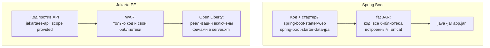

*Схема: в Spring Boot реализации всех механизмов едут внутри артефакта, и версии выбирает разработчик. В Jakarta EE они живут в сервере, и версии определяет сервер; приложение лёгкое, но без сервера не запускается.*

На практике граница размылась. Open Liberty умеет упаковать сервер вместе с приложением в один исполняемый JAR, Spring Boot можно собрать в WAR для внешнего Tomcat, а в Docker-образе в любом случае оказываются и сервер, и приложение. Есть и третий путь — Quarkus, Helidon, Micronaut: они реализуют спецификации Jakarta EE и MicroProfile, но собираются в самодостаточное приложение, как Spring Boot.

> [!NOTE]
> **В твоей работе**
>
> Файл: `pom.xml`, строки 10–24
>
> ```xml
> <packaging>war</packaging>
> ...
> <!-- API Jakarta EE и MicroProfile: реализации уже есть в Open Liberty, поэтому scope provided -->
> <dependency>
>     <groupId>jakarta.platform</groupId>
>     <artifactId>jakarta.jakartaee-api</artifactId>
>     <version>10.0.0</version>
>     <scope>provided</scope>
> </dependency>
> ```
>
> Файл: `src/main/liberty/config/server.xml`, строки 5–14
>
> ```xml
> <featureManager>
>     <feature>restfulWS-3.1</feature>      <!-- Jakarta REST: @Path, @GET, фильтры, ExceptionMapper -->
>     <feature>jsonb-3.0</feature>          <!-- JSON-B: объект <-> JSON -->
>     <feature>jsonp-2.1</feature>          <!-- JSON-P: JsonObject для PATCH -->
>     <feature>cdi-4.0</feature>            <!-- CDI: @Inject, @ApplicationScoped -->
>     <feature>persistence-3.1</feature>    <!-- JPA, реализация в Liberty — EclipseLink -->
>     <feature>beanValidation-3.0</feature> <!-- @NotNull, @Pattern, @Size -->
>     <feature>mpConfig-3.1</feature>       <!-- @ConfigProperty: настройки из переменных окружения -->
>     <feature>mpOpenAPI-4.0</feature>      <!-- Swagger UI по адресу /openapi/ui -->
> </featureManager>
> ```
>
> Это и есть модель Jakarta EE в чистом виде. Внутрь WAR попадают только `java-jwt` и `jbcrypt` — их в сервере нет. Всё остальное приложение получает от Open Liberty, причём сервер загружает только перечисленные фичи; это ответ Liberty на тяжесть «полного» сервера приложений. По этому месту обычно спрашивают, почему `provided` и что случится без `persistence-3.1` (код скомпилируется, но при развёртывании сервер не найдёт реализацию JPA и `EntityManager` не будет внедрён). Требование условия о выборе платформы и технологии доступа к данным закрыто связкой Jakarta EE + EclipseLink/JPA.

### Один эндпоинт на двух платформах

Разница в стиле лучше всего видна на одном и том же методе — `GET /api/requests/{isu_id}`, получение студента по номеру ИСУ.

Jakarta REST (по образцу `StudentResource` из работы, упрощённо):

```java
@Path("/requests")                       // префикс /api задаёт @ApplicationPath
@Produces(MediaType.APPLICATION_JSON)
@RolesAllowed({"USER", "ADMIN"})
public class StudentResource {

    @Inject
    StudentService service;              // бин CDI

    @GET
    @Path("/{isu_id}")
    public StudentResponse get(@PathParam("isu_id") String isuId) {
        return service.get(isuId);       // JSON-B превратит record в JSON
    }
}
```

Spring MVC:

```java
@RestController                          // JSON по умолчанию, через Jackson
@RequestMapping("/api/requests")
public class StudentController {

    private final StudentService service;

    public StudentController(StudentService service) {  // внедрение через конструктор
        this.service = service;
    }

    @GetMapping("/{isu_id}")
    @PreAuthorize("hasAnyRole('USER', 'ADMIN')")        // проверяет Spring Security
    public StudentResponse get(@PathVariable("isu_id") String isuId) {
        return service.get(isuId);
    }
}
```

Структура совпадает: класс с базовым путём, метод с HTTP-глаголом и шаблоном пути, параметр из адреса, вызов сервиса. Различаются имена аннотаций и то, кто стоит за ними. Слой доступа к данным различается сильнее: в Jakarta EE репозиторий пишется вручную поверх `EntityManager` и JPQL, а Spring Data JPA генерирует реализацию по интерфейсу.

```java
// Spring Data: реализацию создаст фреймворк, запрос выведется из имени метода
public interface StudentRepository extends JpaRepository<Student, String> {
    Page<Student> findByGroupAndDormitory(String group, String dormitory, Pageable pageable);
}
```

В Jakarta EE 11 появилась аналогичная спецификация Jakarta Data, но в Jakarta EE 10, на которой сделана работа, её нет.

| Задача | Jakarta EE (в работе) | Spring Boot |
|:--|:------|:------|
| Точка входа | `Application` + `@ApplicationPath("/api")` | класс с `@SpringBootApplication` и `main` |
| HTTP-ресурс | `@Path`, `@GET`, `@PathParam`, `@QueryParam` | `@RestController`, `@GetMapping`, `@PathVariable`, `@RequestParam` |
| Внедрение зависимостей | CDI: `@Inject`, `@ApplicationScoped` | `@Service`/`@Component`, внедрение через конструктор или `@Autowired` |
| Доступ к данным | `EntityManager`, JPQL в своём репозитории | Spring Data JPA: `JpaRepository`, запросы по имени метода |
| Транзакции | `jakarta.transaction.Transactional` (JTA) | `org.springframework.transaction.annotation.Transactional` |
| Валидация | Bean Validation | тот же Bean Validation + `@Valid`/`@Validated` |
| Ошибки | `ExceptionMapper<T>` | `@RestControllerAdvice` + `@ExceptionHandler` |
| Безопасность | `@RolesAllowed`; MicroProfile JWT, Jakarta Security или свои фильтры | Spring Security: `SecurityFilterChain`, `@PreAuthorize`, resource server для JWT |
| JSON | JSON-B (Yasson) | Jackson |
| Конфигурация | `server.xml`, MicroProfile Config `@ConfigProperty` | `application.yml`, `@Value`, `@ConfigurationProperties`, профили |
| OpenAPI | MicroProfile OpenAPI | springdoc-openapi |
| Артефакт | WAR на сервере приложений | исполняемый fat JAR |

Подробно механизмы из таблицы разобраны в других разделах: аннотации — [вопрос 4](#q4), CDI и DI — [вопрос 5](#q5), мапперы исключений — [вопрос 7](#q7), конфигурация — [вопрос 16](#q16). Одна деталь касается безопасности: в Open Liberty есть готовая фича `mpJwt`, которая сама проверяет токен и исполняет `@RolesAllowed`, но в работе JWT и роли проверяются собственными фильтрами Jakarta REST — почему и как это защищать, разобрано в [вопросе 14](#q14).

### Подходы к разработке

За различием в аннотациях стоят две философии.

**Jakarta EE — стандарт и переносимость.** Код пишется против спецификации, а не против продукта; теоретически WAR переносится с Open Liberty на WildFly без изменений кода. Спецификации меняются медленно и через согласование нескольких компаний, поэтому платформа консервативна и стабильна. Цена — меньше «магии»: то, что Spring Boot делает сам (пул соединений, репозитории по интерфейсу), здесь настраивается вручную или пишется руками. Переносимость тоже неполная: код переносится, а конфигурация сервера (`server.xml` у Liberty, `standalone.xml` у WildFly) у каждого своя.

**Spring Boot — один вендор, богатая экосистема, convention over configuration.** Новое появляется быстрее, чем проходит стандартизацию; вокруг ядра — Spring Data, Spring Security, Spring Cloud, Spring Batch, огромное сообщество и примеры на любой случай. Цена — зависимость от одного вендора и автоконфигурация, которая скрывает, что именно создано и почему: когда умолчание не подходит, нужно разбираться, какой автоконфигуратор его выставил.

| Критерий | Jakarta EE | Spring Boot |
|:--|:------|:------|
| Природа | набор стандартов, много реализаций | фреймворк одного вендора |
| Кто содержит сервер | сервер содержит приложение | приложение содержит сервер |
| Настройка | явная: фичи сервера, `persistence.xml` | автоконфигурация и умолчания |
| Темп развития | медленный, через согласование | быстрый |
| Типичное применение | корпоративные системы с уже развёрнутыми серверами приложений, требование стандарта | большинство новых сервисов и микросервисов |

На практике выбор чаще определяют не технические свойства, а окружение: что уже работает в компании, что знает команда, какие серверы поддерживает эксплуатация. Для учебной работы Jakarta EE полезна тем, что механизмы видны явно: подключение к базе описано в `server.xml`, единица персистентности — в `persistence.xml`, а не создаются неявно при старте.

> [!NOTE]
> **В твоей работе**
>
> Файл: `src/main/java/ru/itmo/students/StudentsApplication.java`, строки 14–21
>
> ```java
> @ApplicationPath("/api")
> @OpenAPIDefinition(info = @Info(
>         title = "Система управления студентами общежития",
> ...
> @SecurityScheme(securitySchemeName = "bearerAuth", type = SecuritySchemeType.HTTP, scheme = "bearer", bearerFormat = "JWT")
> public class StudentsApplication extends Application {
> }
> ```
>
> Пустой класс-наследник `Application` — точка входа Jakarta REST: сервер находит его, берёт корневой путь `/api` и сам регистрирует все классы с `@Path` и `@Provider`. В Spring Boot его место занимает класс с `@SpringBootApplication` и методом `main`, который запускает встроенный сервер. Здесь `main` нет вообще: приложение запускает сервер, а не наоборот. Аннотации MicroProfile OpenAPI на этом же классе закрывают требование документировать API через Swagger: они задают заголовок документации и схему авторизации `bearerAuth`, благодаря которой в Swagger UI появляется кнопка Authorize для JWT.

> [!TIP]
> **Могут спросить**
>
> **Зачем зависимости Jakarta EE объявлены со scope `provided`?** Это только API для компиляции: реализации уже есть в Open Liberty. Если положить их в WAR, в приложении окажутся вторые копии классов `jakarta.*`, и загрузчики классов сервера и приложения начнут конфликтовать.
>
> **Spring Boot 3 использует Jakarta EE — значит, это тоже Jakarta EE?** Нет. Spring использует отдельные спецификации (Servlet, JPA, Bean Validation), поэтому и переехал на `jakarta.*`, но DI, веб-слой, транзакции и безопасность у него свои, и совместимой реализацией платформы он не является.
>
> **Что пришлось бы переписать, чтобы перенести работу на Spring Boot?** Ресурсы — на контроллеры, `ExceptionMapper` — на `@RestControllerAdvice`, свои репозитории — на Spring Data, фильтры JWT и ролей — на Spring Security, `server.xml` и `@ConfigProperty` — на `application.yml`. Сущности JPA, DTO с аннотациями Bean Validation и бизнес-правила сервисов почти не изменились бы, если не считать аннотаций JSON-B, которые заменились бы аннотациями Jackson.

## Вопрос 3. ООП в Java: классы, интерфейсы, наследование и полиморфизм.

В серверном приложении много однотипных, но не одинаковых вещей. Ошибки бывают шести видов (не найден, конфликт, нет прав…), и каждую нужно превратить в JSON-ответ с правильным статусом. Пользователя можно опознать по JWT, а можно по сессии, но код ресурса должен спрашивать «кто это?» одинаково в обоих случаях. Данные студента нельзя давать менять как попало: дата выселения не может оказаться раньше даты заселения. Объектно-ориентированное программирование даёт для этого четыре инструмента. **Класс** объединяет данные и поведение. **Интерфейс** задаёт контракт без реализации. **Наследование** позволяет переиспользовать общее, а **полиморфизм** — обрабатывать разные типы одним кодом.

### Класс и объект

**Класс** — это описание: какие у объекта есть **поля** (состояние) и **методы** (поведение), какими **конструкторами** его создают. **Объект** — конкретный экземпляр в памяти: `new Student()` с ИСУ `"412345"` и комнатой `"1205"`. Поле с модификатором `static` принадлежит классу, а не объекту. Например, логгер `private static final Logger LOG` в каждом сервисе один на все экземпляры.

### Инкапсуляция

**Инкапсуляция** означает, что поля скрыты (`private`), а менять состояние объекта можно только через его методы. Так объект сам следит за своими **инвариантами** — условиями, которые должны выполняться всегда.

**Плохо:**

```java
public class Student {
    public LocalDate checkIn;
    public LocalDate checkOut;   // кто угодно запишет дату раньше заселения
}
```

**Хорошо:**

```java
public class Student {
    private LocalDate checkIn;
    private LocalDate checkOut;

    public void checkOutOn(LocalDate date) {
        if (!date.isAfter(checkIn)) {
            throw new IllegalArgumentException("Выселение раньше заселения");
        }
        this.checkOut = date;    // изменить поле можно только через проверку
    }
}
```

С открытыми полями правило о датах приходится повторять в каждом месте, где их меняют, и рано или поздно его где-нибудь забудут. Во втором варианте нарушить правило в обход метода нельзя.

Сущности JPA накладывают на инкапсуляцию свои ограничения. Нужен конструктор без аргументов: ORM сначала создаёт пустой объект, а потом заполняет его данными из строки таблицы. Класс и его поля не должны быть `final`. Если аннотации стоят на полях, JPA читает и пишет поля напрямую через рефлексию, в обход сеттеров. Поэтому сеттеры сущности нужны коду приложения, а не ORM. Подробнее об отображении — в [вопросе 10](#q10).

> [!NOTE]
> **В твоей работе**
>
> Файл: `src/main/java/ru/itmo/students/entity/User.java`, строки 22–24, 43–49
>
> ```java
> @Id
> @GeneratedValue(strategy = GenerationType.IDENTITY)
> private Long id;
> ...
> public Long getId() {
>     return id;
> }
>
> public String getUsername() {
>     return username;
> }
> ```
>
> У `id` есть геттер, но нет сеттера: ключ выдаёт база (`BIGSERIAL`), и код приложения не может его подменить. Это инкапсуляция в чистом виде. У `Student`, наоборот, сеттеры есть у всех полей, включая `setIsuId`. Запрет менять ИСУ живёт не в сущности, а в `StudentService.replace` (`"ИСУ менять нельзя"`) и в `StudentMapper`, который ИСУ не копирует. Если спросят, почему так, отвечай: это распространённая «анемичная» сущность — данные с геттерами и сеттерами, а правила в сервисе. Для CRUD-приложения это нормальный выбор, но защищает инвариант слабее, чем закрытый сеттер.

### Интерфейс как контракт

**Интерфейс** перечисляет методы, которые класс обязан реализовать, и ничего не говорит о том, как они устроены. Код, который работает через интерфейс, не зависит от конкретной реализации. С Java 8 в интерфейсе можно писать `default`-методы с реализацией по умолчанию, но полей с состоянием у интерфейса нет.

Класс наследует (`extends`) только один класс, а реализовать (`implements`) может сколько угодно интерфейсов. Так, `RequestLogFilter` реализует сразу `ContainerRequestFilter` и `ContainerResponseFilter`: один объект засекает время в начале запроса и пишет строку в лог в конце.

> [!NOTE]
> **В твоей работе**
>
> Файл: `src/main/java/ru/itmo/students/security/JwtSecurityContext.java`, строки 11–31
>
> ```java
> public class JwtSecurityContext implements SecurityContext {
>
>     private final String username;
>     private final String role;
>     private final boolean secure;
>     ...
>     @Override
>     public Principal getUserPrincipal() {
>         return () -> username;
>     }
>
>     @Override
>     public boolean isUserInRole(String role) {
>         return this.role.equals(role);
>     }
> ```
>
> `SecurityContext` — интерфейс из Jakarta REST. `AuthorizationFilter`, `RequestLogFilter` и метод `/me` спрашивают у него «кто это?», не зная, что ответ взят из JWT. Если перейти на сессии, достаточно написать другую реализацию, а код, который ею пользуется, менять не придётся. `() -> username` — лямбда: у `Principal` один абстрактный метод `getName()`, поэтому объект с этим интерфейсом можно создать короткой записью. Поля `final`: объект создаётся на один запрос и потом не меняется.

### Наследование и абстрактные классы

**Наследование** (`class B extends A`) означает, что `B` получает поля и методы `A` и может добавлять свои. Его используют для отношения «является»: `ConflictException` является ошибкой API. Конструктор наследника первым делом вызывает конструктор родителя через `super(...)`. Если этого не написать явно, компилятор подставит вызов `super()` без аргументов.

**Абстрактный класс** (`abstract`) нельзя создать через `new`: он существует только как общая основа для наследников. В отличие от интерфейса, у него могут быть поля и конструкторы.

| | Интерфейс | Абстрактный класс |
|:--|:-----------|:-----------|
| Состояние (поля) | только константы | любые поля |
| Конструктор | нет | есть, вызывается через `super(...)` |
| Сколько можно у одного класса | сколько угодно | один |
| Смысл | «умеет»: контракт | «является»: общая часть реализации |
| Пример в работе | `SecurityContext`, `ExceptionMapper<T>` | `ApiException` |

> [!NOTE]
> **В твоей работе**
>
> Файл: `src/main/java/ru/itmo/students/exception/ApiException.java`, строки 11–22
>
> ```java
> public abstract class ApiException extends RuntimeException {
>
>     private final int status;
>     private final String code;
>     private final List<ErrorDetail> details;
>
>     protected ApiException(int status, String code, String message, List<ErrorDetail> details) {
>         super(message);
>         this.status = status;
>         this.code = code;
>         this.details = details;
>     }
> ```
>
> Файл: `src/main/java/ru/itmo/students/exception/UnauthorizedException.java`, строки 8–17
>
> ```java
> public class UnauthorizedException extends ApiException {
>
>     public UnauthorizedException(String message) {
>         this("UNAUTHORIZED", message);
>     }
>
>     public UnauthorizedException(String code, String message) {
>         super(401, code, message, List.of());
>     }
> }
> ```
>
> Общие поля (статус, код, детали) лежат в абстрактном базовом классе, а каждый наследник только передаёт в `super(...)` свои значения. Конструктор базового класса `protected`: вызвать его могут только наследники. Сообщение уходит дальше в `RuntimeException`, и `getMessage()` наследуется от `Throwable`. Ожидаемый вопрос — почему абстрактный класс, а не интерфейс. Ответ: нужны общие поля и конструктор, а ещё ошибка обязана быть исключением, то есть наследником `Throwable`. Интерфейс не даёт ни того, ни другого.

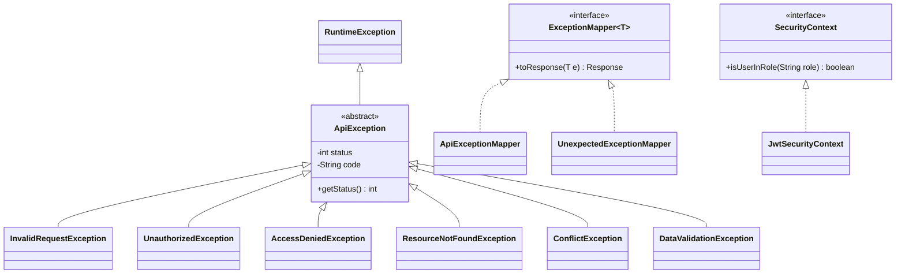

*Схема: сплошная стрелка — наследование класса, пунктирная — реализация интерфейса. Шесть ошибок отличаются только данными, которые передают в `super(...)`, поэтому одного маппера для базового типа `ApiException` хватает на все шесть. `UnexpectedExceptionMapper` реализует тот же интерфейс для `Throwable` и ловит всё остальное.*

### Полиморфизм

**Полиморфизм** — это возможность работать с объектами разных классов через общий тип. В Java у него две формы.

**Переопределение** (overriding): наследник или реализация интерфейса даёт свою версию метода с той же сигнатурой и помечает её `@Override`. Какую версию вызвать, решается во время выполнения по фактическому классу объекта — это **позднее (динамическое) связывание**. Jakarta REST держит мапперы как `ExceptionMapper` и вызывает `toResponse(e)`, не зная, какой класс перед ним.

**Перегрузка** (overloading): в одном классе несколько методов с одним именем, но разными параметрами. Нужную версию выбирает компилятор по типам аргументов. В работе так устроены два конструктора `UnauthorizedException` и два метода `filter` в `RequestLogFilter`: с одним параметром (запрос) и с двумя (запрос и ответ).

**Плохо:**

```java
// Маппер перебирает все виды ошибок
int status;
if (e instanceof ConflictException) status = 409;
else if (e instanceof ResourceNotFoundException) status = 404;
else if (e instanceof AccessDeniedException) status = 403;
else status = 500;   // забыли новый тип — получили 500
```

**Хорошо:**

```java
// Статус знает сама ошибка, маппер работает с базовым типом
ErrorResponse body = ErrorResponse.of(e.getStatus(), e.getCode(), e.getMessage(), e.getDetails());
return Response.status(e.getStatus()).entity(body).build();
```

Цепочку `instanceof` приходится дописывать при каждом новом типе ошибки, и забытая ветка тихо превращается в 500. Во втором варианте новая ошибка — это просто новый наследник, а маппер не меняется. Это и есть принцип открытости/закрытости: код открыт для расширения и закрыт для изменения. Второй вариант — строка 18 `ApiExceptionMapper`. Справедливости ради: в работе статус хранится полем базового класса, а не возвращается переопределённым методом `abstract int status()` в каждом наследнике. Оба способа полиморфны, поле просто короче.

> [!WARNING]
> **Подводный камень**
>
> `public boolean equals(Student other)` — это перегрузка, а не переопределение: у `Object.equals` параметр типа `Object`. Коллекции и JPA будут вызывать старый `equals` из `Object`, и два объекта с одним ИСУ окажутся разными. Аннотация `@Override` превращает эту ошибку в ошибку компиляции, поэтому её стоит ставить всегда.

### Особые классы: record, enum, обобщения

**`record`** — неизменяемый класс-носитель данных. Компилятор сам создаёт конструктор, методы доступа (`items()`, а не `getItems()`), `equals`, `hashCode` и `toString`. Record неявно `final` и не может наследовать другой класс, но может реализовывать интерфейсы. В **компактном конструкторе** удобно нормализовать данные: `StudentRequest` убирает лишние пробелы в ФИО и переводит группу в верхний регистр. Поэтому все DTO работы — record. Сущности ими быть не могут: JPA нужен конструктор без аргументов и изменяемые поля.

**`enum`** — класс с фиксированным набором экземпляров: `Role { ADMIN, USER }`. Создать третью роль через `new` нельзя. У перечисления могут быть поля и методы, и его можно использовать в `switch`.

**Обобщения** (generics) параметризуют класс типом. `PageResponse<T>(List<T> items, int page, int size, long total)` описывает одну страницу для любых элементов, а `ExceptionMapper<ApiException>` прямо в типе говорит, какие исключения обрабатывает этот маппер. Во время выполнения параметры типов стираются (type erasure), но в объявлении класса `implements ExceptionMapper<ApiException>` параметр сохраняется. Оттуда Jakarta REST его и читает, когда выбирает маппер (как именно — в [вопросе 7](#q7)).

### Композиция вместо наследования

`StudentService` не наследует `StudentRepository`, а *содержит* его: поле `@Inject StudentRepository repository` (строки 36–37). Это **композиция** — отношение «имеет», а не «является». Наследование жёстко связывает классы: наследник зависит от внутренностей родителя, а родитель у него может быть только один. Ссылку на объект, наоборот, легко подменить, например на заглушку в тесте. Кто создаёт и подставляет этот объект, разобрано в [вопросе 5](#q5), а как из композиции складываются слои — в [вопросе 6](#q6). Общее правило: наследование оставляют для настоящих иерархий «является», как ошибки API, а всё остальное собирают композицией.

> [!TIP]
> **Могут спросить**
>
> **Почему `ApiException` наследует `RuntimeException`, а не `Exception`?** Наследники `RuntimeException` непроверяемые (unchecked): их не нужно объявлять в `throws` каждого метода от репозитория до ресурса. К тому же `@Transactional` по умолчанию откатывает транзакцию именно на unchecked-исключениях. Подробнее — [вопрос 7](#q7) и [вопрос 11](#q11).
>
> **Работает ли полиморфизм для статических методов, например `StudentMapper.toResponse`?** Нет. Статический метод принадлежит классу, и вызов связывается при компиляции по объявленному типу. В наследнике метод с той же сигнатурой не переопределяет родительский, а скрывает его. Поэтому `StudentMapper` — просто набор функций, а не точка расширения.
>
> **Можно ли создать объект абстрактного класса или интерфейса?** Через `new` напрямую — нет. Можно создать объект анонимного класса или лямбду, которые их реализуют, как `() -> username` для `Principal`. Переменная при этом может иметь абстрактный тип: `ApiException e = new ConflictException(...)`.

## Вопрос 4. Аннотации в Java и их использование в серверных приложениях.

Серверному фреймворку нужно многое знать о коде приложения. Например, что метод `get` обрабатывает `GET /api/requests/{isu_id}`, что ФИО студента должно быть не длиннее 100 символов, что удалять студентов может только ADMIN, а поле `isuId` хранится в колонке `isu_id`. Раньше такие сведения писали в XML-дескрипторах (`web.xml`, `ejb-jar.xml`) отдельно от кода или выражали соглашениями об именах и интерфейсами-маркерами вроде `Serializable`. XML быстро расходился с кодом: при переименовании метода дескриптор молча переставал работать. В Java 5 появились **аннотации**: эти сведения записываются прямо над классом, полем или методом и проверяются компилятором.

### Что такое аннотация

**Аннотация** — это метаданные, привязанные к элементу программы. Сама по себе она ничего не делает: это пометка, которую кто-то должен прочитать и выполнить. Встроенные аннотации читает компилятор:

| Аннотация | Что делает компилятор |
|:--|:-----------|
| `@Override` | ошибка, если метод на самом деле ничего не переопределяет (опечатка в имени, не та сигнатура) |
| `@Deprecated` | предупреждение у всех, кто вызывает устаревший элемент |
| `@FunctionalInterface` | ошибка, если в интерфейсе не ровно один абстрактный метод |
| `@SuppressWarnings("unchecked")` | подавляет указанное предупреждение |

### Объявление своей аннотации

Аннотация объявляется ключевым словом `@interface`. Её **элементы** записываются как методы без параметров и могут иметь значение по умолчанию. Тип элемента ограничен: примитив, `String`, `Class`, `enum`, другая аннотация или массив из них. Если элемент один и называется `value`, при использовании его имя можно не писать: `@RolesAllowed("ADMIN")` вместо `@RolesAllowed(value = "ADMIN")`.

```java
@Target(ElementType.METHOD)              // ставится только на методы
@Retention(RetentionPolicy.RUNTIME)      // доступна во время работы
public @interface Audited {
    String action();                     // обязательный элемент
    boolean logBody() default false;     // необязательный, есть значение по умолчанию
}

@Audited(action = "Выселение студента")
public StudentResponse checkOut(String isuId) { ... }
```

### `@Retention`, `@Target` и другие метааннотации

Аннотации, которыми помечают другие аннотации, называются **метааннотациями**. Главные две — `@Retention` и `@Target`.

`@Retention` задаёт, как долго аннотация сохраняется:

| Значение | Где живёт | Кто читает | Пример |
|:--|:----|:----|:--|
| `SOURCE` | только в исходнике, в `.class` не попадает | компилятор, обработчики аннотаций | `@Override`, `@SuppressWarnings` |
| `CLASS` (по умолчанию) | в `.class`, но JVM её не загружает | инструменты, работающие с байт-кодом | редко используется явно |
| `RUNTIME` | в `.class` и в памяти JVM | код через рефлексию | `@Path`, `@Entity`, `@NotNull`, `@RolesAllowed` |

`@Target` перечисляет, куда аннотацию можно поставить: `TYPE` (класс), `METHOD`, `FIELD`, `PARAMETER`, `RECORD_COMPONENT`, `ANNOTATION_TYPE` (на другую аннотацию) и т. д. Кроме них есть `@Documented` (аннотация попадает в Javadoc), `@Inherited` (аннотация класса переходит к подклассам) и `@Repeatable` (аннотацию можно повторить на одном элементе).

Фреймворки определяют и собственные метааннотации, и на них держится расширяемость. Например, в Jakarta REST `@GET`, `@POST` и другие методы HTTP — это обычные аннотации, помеченные метааннотацией `@HttpMethod("GET")`. Свой метод HTTP добавляется так же, и работа этим пользуется (цитата ниже).

**Плохо:**

```java
@Target(ElementType.METHOD)
@HttpMethod("QUERY")
public @interface QUERY { }   // нет @Retention — по умолчанию CLASS
```

**Хорошо:**

```java
@Target(ElementType.METHOD)
@Retention(RetentionPolicy.RUNTIME)
@HttpMethod("QUERY")
public @interface QUERY { }
```

Первый вариант скомпилируется без ошибок, но JVM не загрузит аннотацию в память, и Jakarta REST её не увидит. Метод не станет обработчиком, и на запрос `QUERY /api/requests` сервер ответит 405. Ошибка не проявляется ни при сборке, ни при старте, только на запросе.

### Кто читает аннотации

Аннотации читают на трёх этапах.

1. **Компилятор** — встроенные аннотации из таблицы выше.
2. **Обработчики аннотаций** (annotation processors) — подключаемые к `javac` модули. Они работают на этапе компиляции и генерируют новый код: MapStruct по `@Mapper` пишет реализацию маппера, Hibernate по `@Entity` строит метамодель для Criteria API. В работе их нет.
3. **Фреймворк во время работы** через **рефлексию** — API, которое позволяет программе исследовать собственные классы. `Method.isAnnotationPresent(X.class)` отвечает, есть ли аннотация, а `Method.getAnnotation(X.class)` возвращает её экземпляр, из которого можно прочитать элементы. Так работает почти всё в серверных приложениях: при старте сервер сканирует классы WAR-архива, находит `@Path`, `@Entity`, `@Provider`, `@ApplicationScoped` и по ним строит таблицу маршрутов, модель данных и граф бинов.

Отсюда **декларативный стиль** серверной разработки: код описывает, *что* нужно («метод доступен только ADMIN», «поле обязательно»), а *как* это выполнить, решает фреймворк. Проверка ролей, разбор JSON и валидация не повторяются в каждом методе.

> [!NOTE]
> **В твоей работе**
>
> Файл: `src/main/java/ru/itmo/students/security/AuthorizationFilter.java`, строки 35–49
>
> ```java
> Method method = resourceInfo.getResourceMethod();
> Class<?> resourceClass = resourceInfo.getResourceClass();
>
> if (method.isAnnotationPresent(PermitAll.class)) {
>     return;
> }
>
> RolesAllowed rolesAllowed = method.getAnnotation(RolesAllowed.class);
> if (rolesAllowed == null) {
>     rolesAllowed = resourceClass.getAnnotation(RolesAllowed.class);
> }
>
> if (rolesAllowed == null && resourceClass.isAnnotationPresent(PermitAll.class)) {
>     return;
> }
> ```
>
> Это чтение аннотаций через рефлексию в чистом виде. Jakarta REST сообщает фильтру через `ResourceInfo`, какой метод выбран для запроса. Фильтр берёт `@RolesAllowed` сначала у метода, затем у класса: аннотация метода важнее. Затем `rolesAllowed.value()` сравнивается с ролью из токена. Подробно о ролях — [вопрос 14](#q14).

> [!WARNING]
> **Подводный камень**
>
> `@RolesAllowed` — стандартная аннотация из Jakarta Annotations, но в этой работе её исполняет только собственный `AuthorizationFilter`: фича безопасности контейнера (`mpJwt`, `appSecurity`) в `server.xml` не подключена. Если удалить фильтр, все `@RolesAllowed` останутся в коде, а USER сможет удалять студентов. На вопрос «где проверяется роль?» ответ не «в аннотации», а «в фильтре, который читает аннотацию».

### Аннотации в серверном приложении

| Группа | Аннотации в работе | Кто читает | Подробнее |
|:--|:-----------|:------|:--|
| Jakarta REST | `@ApplicationPath`, `@Path`, `@GET`/`@POST`/…, `@Produces`, `@Consumes`, `@PathParam`, `@BeanParam`, `@Context`, `@Provider`, `@Priority` | Jakarta REST: маршруты, извлечение параметров, регистрация фильтров и мапперов, порядок фильтров | [вопрос 2](#q2), [вопрос 7](#q7) |
| CDI | `@Inject`, `@ApplicationScoped`, `@PostConstruct`, `@Observes` | CDI-контейнер | [вопрос 5](#q5) |
| JPA | `@Entity`, `@Table`, `@Id`, `@Column`, `@Enumerated`, `@ManyToOne`, `@PersistenceContext` | EclipseLink | [вопрос 10](#q10) |
| Транзакции | `@Transactional` | интерсептор JTA | [вопрос 11](#q11) |
| Bean Validation | `@NotNull`, `@Pattern`, `@Size`, `@Email` | `Validator` | ниже |
| JSON-B | `@JsonbProperty("full_name")`, `@JsonbNillable` | Yasson при (де)сериализации | — |
| MicroProfile | `@ConfigProperty`, `@OpenAPIDefinition`, `@Operation`, `@Tag`, `@SecurityRequirement` | MP Config, генератор OpenAPI | [вопрос 16](#q16) |
| Безопасность | `@RolesAllowed`, `@PermitAll` | `AuthorizationFilter` работы | [вопрос 14](#q14) |

На одном классе обычно встречается несколько групп сразу. Например, у `StudentResource` маршрут (`@Path`), формат (`@Produces`), доступ (`@RolesAllowed`) и документация (`@Tag`) описаны четырьмя аннотациями подряд, и каждую читает своя подсистема.

### Bean Validation: как валидатор читает аннотации

Ограничение Bean Validation — это аннотация, помеченная метааннотацией `@Constraint(validatedBy = …)`. Метааннотация связывает ограничение с классом-проверщиком, реализующим `ConstraintValidator`. Вызов `validator.validate(obj)` рефлексией обходит поля объекта, находит на них аннотации-ограничения и запускает соответствующие проверщики. Найденные нарушения возвращаются множеством `ConstraintViolation`: в каждом есть путь к полю (`fullName`) и текст из элемента `message`. Валидатор не бросает исключений, а только сообщает о нарушениях. Что с ними делать, решает вызывающий код.

Своё ограничение объявляется так же, как встроенное:

```java
@Target({ElementType.FIELD, ElementType.RECORD_COMPONENT})
@Retention(RetentionPolicy.RUNTIME)
@Constraint(validatedBy = DormitoryCodeValidator.class)   // кто проверяет
public @interface DormitoryCode {
    String message() default "Неизвестный код общежития";
    Class<?>[] groups() default {};                       // обязательные элементы
    Class<? extends Payload>[] payload() default {};      // любого ограничения
}
```

> [!NOTE]
> **В твоей работе**
>
> Файл: `src/main/java/ru/itmo/students/dto/StudentRequest.java`, строки 20–32
>
> ```java
> @JsonbProperty("full_name")
> @NotNull(message = StudentRequest.REQUIRED)
> @Size(min = 5, max = 100, message = StudentRequest.FULL_NAME_HINT)
> @Pattern(regexp = StudentRequest.FULL_NAME_REGEX, message = StudentRequest.FULL_NAME_HINT)
> String fullName,
>
> @NotNull(message = StudentRequest.REQUIRED)
> @Pattern(regexp = "[A-Z][0-9]{4}", message = "Группа — латинская буква и 4 цифры, например M3301")
> String group,
>
> @NotNull(message = StudentRequest.REQUIRED)
> @Pattern(regexp = "sg|alp|bel|len|msg", message = "Общежитие — один из кодов: sg, alp, bel, len, msg")
> String dormitory,
> ```
>
> На одном компоненте record сошлись две подсистемы: `@JsonbProperty` читает JSON-B (имя в JSON — `full_name`), а `@NotNull`/`@Size`/`@Pattern` читает валидатор. `RequestValidator` вызывает `validator.validate(body)`, собирает все нарушения, переводит имена полей в snake_case и бросает одно `DataValidationException`. Клиент получает 422 со списком всех ошибочных полей сразу, а не только первого (формат ошибки — [вопрос 7](#q7)). Так закрыто требование серверной валидации. Те же аннотации на `RegisterRequest` проверяют логин, почту (`@Email`) и пароль при регистрации. Возможный вопрос: почему валидация вызывается вручную, а не через `@Valid` на параметре метода ресурса. В работе так сделано, чтобы собрать ответ 422 в своём формате и не зависеть от того, как сервер оформляет `ConstraintViolationException`.

> [!NOTE]
> **В твоей работе**
>
> Файл: `src/main/java/ru/itmo/students/resource/QUERY.java`, строки 16–20
>
> ```java
> @Target(ElementType.METHOD)
> @Retention(RetentionPolicy.RUNTIME)
> @HttpMethod("QUERY")
> public @interface QUERY {
> }
> ```
>
> Это единственная собственная аннотация в работе. Она нужна, чтобы сохранить метод `QUERY` из ЛР2 (фильтры в теле запроса) и выполнить требование не менять REST API. Все три метааннотации здесь обязательны. `@Target(METHOD)` не даёт поставить её на класс. `RUNTIME` нужен, чтобы её увидел Jakarta REST. `@HttpMethod` превращает обычную аннотацию в обозначение метода HTTP наравне с `@GET`. В `StudentResource` она стоит над методом `query` рядом с `@Operation(hidden = true)`.

> [!CAUTION]
> **Расхождение с практикой**
>
> `QUERY` не входит в стандартный набор методов HTTP: это предложение рабочей группы HTTP в IETF, и большинство инструментов его не знает. MicroProfile OpenAPI не умеет описать такую операцию, поэтому в работе она скрыта из Swagger (`@Operation(hidden = true)`) и проверяется только в Postman. Так же поступают прокси и кэши: незнакомый метод они обрабатывают как небезопасный. На защите стоит сказать, что метод сохранён ради совместимости с API из ЛР2, и назвать стандартные альтернативы: `GET` с параметрами строки запроса (в работе он тоже есть) или `POST /api/requests/search`.

> [!TIP]
> **Могут спросить**
>
> **Наследуются ли аннотации?** Только аннотации классов, помеченные `@Inherited`: они переходят к подклассам. Аннотации методов, полей и интерфейсов не наследуются: у переопределённого метода свои аннотации. Фреймворки иногда ищут аннотации по иерархии сами, но это их правило, а не правило языка.
>
> **Чем аннотации хуже XML-конфигурации?** Чтобы изменить настройку, нужно перекомпилировать код, а описание (например, всех ролей) разбросано по классам. Поэтому то, что зависит от окружения, в аннотации не пишут: адрес БД и секреты задаются снаружи (`server.xml`, переменные окружения), а `@ConfigProperty` только указывает, откуда взять значение.
>
> **Можно ли положить в аннотацию логику?** Нет. Аннотация — интерфейс с элементами-константами, во время работы её экземпляр — прокси, который возвращает записанные значения. Логика всегда живёт в том, кто аннотацию читает: в фильтре, валидаторе, контейнере.

## Вопрос 5. Dependency Injection и Inversion of Control.

`StudentService` нужен `StudentRepository`, репозиторию нужен `EntityManager`, а тому — пул соединений с PostgreSQL, адрес БД и пароль. Если каждый класс сам создаёт то, что ему нужно, сервис начинает знать, как устроен репозиторий, репозиторий — где лежит пароль базы, и вся цепочка намертво склеена через `new`. Подменить репозиторий заглушкой в тесте нельзя, неясно, сколько экземпляров создаётся и кто их закрывает, а транзакцию вокруг метода сервиса вручную придётся открывать и закрывать в каждом методе.

**Плохо:**

```java
public class StudentService {
    // сервис сам решает, какой репозиторий и как его построить
    private final StudentRepository repository =
            new StudentRepository(new JdbcConnection("jdbc:postgresql://...", "***"));
}
```

**Хорошо:**

```java
@ApplicationScoped
public class StudentService {
    @Inject
    StudentRepository repository;   // кто и как его создал — не забота сервиса
}
```

В первом варианте сервис отвечает и за правила заселения, и за сборку инфраструктуры, а строка подключения оказалась в коде. Во втором сервис только объявляет, что ему нужно, а готовый объект ему передаёт контейнер.

### Inversion of Control

**Инверсия управления** (IoC) — принцип, при котором не твой код вызывает инфраструктуру, а инфраструктура вызывает твой код в нужный момент. Её формулируют как «принцип Голливуда»: «не звоните нам, мы сами вам позвоним». Это граница между библиотекой и фреймворком: библиотеку вызываешь ты (`BCrypt.hashpw(...)`), фреймворк вызывает тебя.

В работе IoC встречается не только во внедрении зависимостей. Метода `main` нет: сервер Open Liberty сам разворачивает WAR, Jakarta REST сам находит `StudentResource` по `@Path`, разбирает JSON в `StudentRequest` и вызывает нужный метод. Фильтры безопасности и `ExceptionMapper` тоже никто явно не вызывает: их регистрирует `@Provider`, а запускает среда выполнения. `StartupData.onStart` выполняется потому, что контейнер рассылает событие о старте приложения, а метод объявил, что его слушает (`@Observes`).

### Dependency Injection

**Внедрение зависимостей** (DI) — частный случай IoC: объект не создаёт и не ищет свои зависимости, а получает их извне. Тот, кто связывает объекты, называется **контейнером** (в Jakarta EE это CDI, в Spring — `ApplicationContext`).

Зависимость можно передать тремя способами:

| Способ | Как выглядит | Плюсы | Минусы |
|:--|:----------|:------|:------|
| Через поле | `@Inject StudentRepository repository;` | коротко | поле нельзя сделать `final`; без контейнера объект неполный; зависимости не видны снаружи |
| Через конструктор | `@Inject StudentService(StudentRepository r)` | `final`, объект сразу целый, в тесте — просто `new` | многословнее; для проксируемых бинов нужен ещё конструктор без аргументов |
| Через сеттер | `@Inject void setRepository(...)` | можно заменить зависимость позже | объект может остаться без зависимости |

**Плохо:**

```java
@ApplicationScoped
public class AuthService {
    @Inject private PasswordHasher passwordHasher;  // в тесте без контейнера — null
}
```

**Хорошо:**

```java
@ApplicationScoped
public class AuthService {
    private final PasswordHasher passwordHasher;

    protected AuthService() { this.passwordHasher = null; } // нужен CDI для прокси

    @Inject
    public AuthService(PasswordHasher passwordHasher) {
        this.passwordHasher = passwordHasher;
    }
}

// модульный тест — без сервера и контейнера
AuthService service = new AuthService(new FakePasswordHasher());
```

Внедрение через конструктор делает зависимости явными: чтобы создать объект, их нужно передать, а если конструктор разросся до семи параметров, видно, что класс делает слишком много. При внедрении через приватное поле тест вынужден поднимать контейнер или лезть в поле рефлексией.

### CDI: бины и разрешение зависимостей

**CDI** (Jakarta Contexts and Dependency Injection) — стандартный DI-контейнер Jakarta EE; в Open Liberty его реализует Weld. **Бин** — объект, жизнью которого управляет контейнер. Файла `beans.xml` в работе нет, поэтому действует режим поиска `annotated`: бином становится только класс с аннотацией области видимости, например `@ApplicationScoped`.

Встречая `@Inject`, контейнер ищет бин **по типу** точки внедрения. Если подходящего бина нет или их два, приложение не развернётся: ошибка `Unsatisfied dependency` или `Ambiguous dependency` появляется при старте, а не на первом запросе. Чтобы выбрать один из нескольких бинов одного типа, используют **квалификатор** — аннотацию, уточняющую тип. В работе квалификатор — `@ConfigProperty(name = "JWT_SECRET")`: в `String secret` внедряется не «какая-нибудь строка», а значение настройки из MicroProfile Config (подробнее о конфигурации — [вопрос 16](#q16)). Механика аннотаций, на которой всё это держится, разобрана в [вопросе 4](#q4).

`@PersistenceContext` — тоже внедрение, но ресурса контейнера: `EntityManager` создаёт не CDI, а реализация JPA по persistence unit из `persistence.xml`.

### Области видимости и прокси

**Область видимости** (scope) определяет, сколько экземпляров бина существует и когда они создаются и уничтожаются.

| Область | Экземпляр | Где в работе |
|:--|:----------|:------|
| `@ApplicationScoped` | один на приложение | все сервисы, репозитории, `JwtService`, `StartupData` |
| `@RequestScoped` | один на HTTP-запрос | не используется |
| `@SessionScoped` | один на HTTP-сессию | не используется: API без сессий |
| `@Dependent` | новый для каждой точки внедрения, живёт столько же, сколько владелец | не используется явно |

Ресурсы `StudentResource` и `AuthResource` области не имеют: по умолчанию Jakarta REST создаёт экземпляр ресурса на каждый запрос, а зависимости в него внедряет связка Jakarta REST и CDI.

Для `@ApplicationScoped` и `@RequestScoped` контейнер внедряет не сам объект, а **клиентский прокси** — подкласс, который при каждом вызове находит настоящий экземпляр в нужном контексте. Отсюда два следствия. Во-первых, `@ApplicationScoped`-бин создаётся **лениво**, при первом вызове метода через прокси, а не при старте. Во-вторых, класс должен поддаваться проксированию: не `final` и с не-`private` конструктором без аргументов.

Один экземпляр `@ApplicationScoped` обслуживает все запросы сразу, каждый в своём потоке (модель «поток на запрос» — [вопрос 1](#q1)). Поэтому такой бин не должен хранить в полях изменяемое состояние, относящееся к запросу.

### Жизненный цикл: `@PostConstruct`

Контейнер создаёт бин по шагам: вызывает конструктор, внедряет поля и сеттеры, затем вызывает метод с `@PostConstruct`. В конструкторе внедрённые поля ещё `null`, поэтому инициализацию, которой они нужны, переносят в `@PostConstruct`. Перед уничтожением бина вызывается `@PreDestroy`.

### Интерсепторы

**Интерсептор** — код, который контейнер выполняет вокруг вызова метода бина. Из него сделаны декларативные транзакции: `@Transactional` на методе сервиса означает, что прокси перед вызовом начнёт транзакцию, а после зафиксирует или откатит её. Работает это только при вызове **через прокси**. Если бин вызывает собственный метод через `this`, вызов идёт мимо прокси, и аннотации на вызываемом методе не действуют. Что из этого следует для транзакций, разобрано в [вопросе 11](#q11).

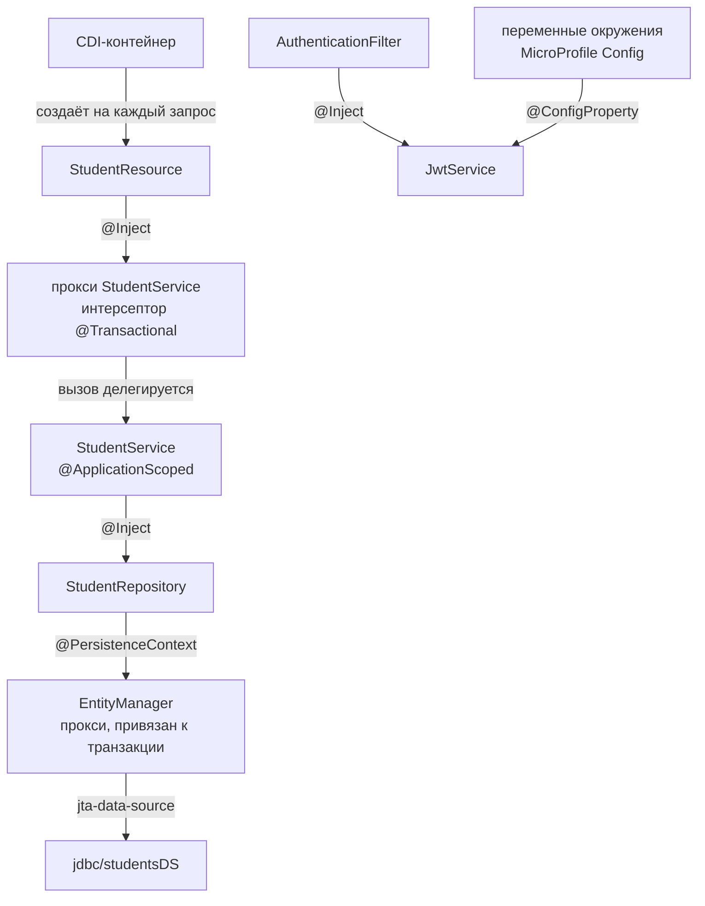

*Схема: ни один класс работы не вызывает `new` для своих зависимостей. Каждое ребро — точка внедрения, которую контейнер заполняет при создании объекта, а к сервису и `EntityManager` ресурс обращается через прокси. Поэтому один экземпляр `StudentService` безопасно обслуживает параллельные запросы: `EntityManager` за прокси у каждой транзакции свой.*

> [!WARNING]
> **Подводный камень**
>
> `@ApplicationScoped` не означает «создан при старте». Бин создаётся при первом обращении, и ошибка в его `@PostConstruct` проявится не при развёртывании, а на первом запросе пользователя, которому этот бин понадобился. Если ошибку конфигурации нужно поймать при запуске, бин надо вызвать в обработчике события старта, как это сделано в `StartupData`.

> [!NOTE]
> **В твоей работе**
>
> Файл: `src/main/java/ru/itmo/students/security/JwtService.java`, строки 32–55
>
> ```java
> @Inject
> @ConfigProperty(name = "JWT_SECRET")
> String secret;
> ...
> @PostConstruct
> void init() {
>     // HS256 требует ключ не короче 256 бит = 32 байта
>     if (secret.getBytes(StandardCharsets.UTF_8).length < 32) {
>         throw new IllegalStateException("JWT_SECRET должен быть не короче 32 символов");
>     }
>     algorithm = Algorithm.HMAC256(secret);
>     verifier = JWT.require(algorithm).withIssuer(ISSUER).build();
> }
> ```
>
> Проверка секрета стоит в `@PostConstruct`, а не в конструкторе: к этому моменту поле `secret` уже заполнено. Поля `algorithm` и `verifier` записываются один раз при создании и дальше только читаются, поэтому один экземпляр `JwtService` можно безопасно использовать из всех потоков. Остальные `@ApplicationScoped`-бины работы тоже хранят в полях только зависимости и константы.
>
> Файл: `src/main/java/ru/itmo/students/config/StartupData.java`, строки 64–67
>
> ```java
> void onStart(@Observes @Initialized(ApplicationScoped.class) Object event) {
>     // CDI создаёт бин при первом вызове. Вызываем сейчас: проверка секрета в JwtService.init()
>     // остановит запуск, а не сломает первый вход пользователя
>     jwtService.getAccessTtl();
> ```
>
> Здесь видны и IoC (метод вызывает контейнер по событию старта), и ленивое создание через прокси: вызов `getAccessTtl()` нужен только для того, чтобы бин создался сейчас. Могут спросить, почему результат вызова никуда не сохраняется. Ответ: значение не нужно, вызов просто заставляет контейнер создать бин заранее.
>
> Файл: `src/main/java/ru/itmo/students/repository/StudentRepository.java`, строки 34–35
>
> ```java
> @PersistenceContext(unitName = "students")
> private EntityManager em;
> ```
>
> Репозиторий существует в одном экземпляре, но `em` в нём — прокси контейнера: внутри транзакции он обращается к `EntityManager` именно этой транзакции. Поэтому два параллельных запроса не делят один контекст персистентности ([вопрос 10](#q10)).

> [!CAUTION]
> **Расхождение с практикой**
>
> Во всех классах работы зависимости внедряются через поля с доступом по умолчанию (`@Inject StudentRepository repository;`), а не через конструктор. В CDI так пишут часто, и для кода, который работает только в контейнере, это допустимо. Но сегодня в DI обычно советуют внедрять через конструктор: тогда поля можно сделать `final`, а сервис — создать в модульном тесте обычным `new`. На защите стоит сказать, что поле оставлено package-private, а не `private`, как раз ради тестов: тест в том же пакете может присвоить полю заглушку без рефлексии. Переход на конструкторы — понятный следующий шаг; для `@ApplicationScoped` при этом понадобится ещё и защищённый конструктор без аргументов для прокси.

Для сравнения со Spring: `@Service`/`@Component` соответствуют `@ApplicationScoped`, `@Autowired` — `@Inject`, `@Value` — `@ConfigProperty`. Главное отличие в умолчаниях. В Spring бин по умолчанию одиночка (singleton), а при единственном конструкторе зависимости внедряются через него даже без аннотации. В CDI область по умолчанию — `@Dependent`. `@Transactional` в Spring тоже работает через прокси и тоже не срабатывает при самовызове. Остальное сравнение — в [вопросе 2](#q2).

> [!TIP]
> **Могут спросить**
>
> **Чем IoC отличается от DI?** IoC — общий принцип: управление потоком выполнения передано фреймворку, и он вызывает твой код. DI — один из способов его реализовать: объект получает зависимости извне, а не создаёт их сам. Другие проявления IoC — обработчики событий, шаблонный метод, фильтры, которые вызывает Jakarta REST.
>
> **Что будет, если появятся две реализации одного интерфейса, например `PasswordHasher` на BCrypt и на Argon2?** Контейнер не сможет выбрать одну из них, и при развёртывании возникнет ошибка `Ambiguous dependency`. Выход — пометить реализации квалификаторами и указать нужный в точке внедрения, либо пометить одну из них как `@Alternative` и включить её через приоритет.
>
> **Зачем нужен контейнер, если зависимости можно передать вручную в `main`?** В маленькой программе ручная сборка (pure DI) работает. Контейнер дополнительно управляет временем жизни объектов (области видимости), оборачивает их интерсепторами (транзакции, безопасность) и внедряет ресурсы сервера (`EntityManager`, `DataSource`, конфигурацию). Вручную всё это пришлось бы писать самому.

## Вопрос 6. Архитектура backend-приложения. Разделение ответственности между слоями.

Самый короткий путь написать эндпоинт `PUT /api/requests/412345` — один метод, который разбирает JSON, проверяет формат ИСУ, сверяет даты заселения и выселения, пишет SQL `UPDATE students …` и собирает ответ. Пока эндпоинтов пять, это работает. Потом оказывается, что правило «выселение позже заселения» нужно и в PATCH, и при загрузке демо-данных. Колонку в таблице переименовали, а клиент ждёт старое имя поля. Правило дат хочется проверить тестом без HTTP-сервера и без базы. В одном методе всё это сделать нельзя: любое изменение задевает всё сразу. **Разделение ответственности** (separation of concerns) означает, что у каждой части кода одна причина для изменения. В backend оно обычно оформляется как **слоистая архитектура**.

### Слои и их обязанности

Классическая схема — три слоя, а рядом с ними два вида объектов-данных.

| Часть | Класс в работе | Отвечает за | Не знает про |
|:--|:--|:-----------|:-----------|
| Представление (контроллер, ресурс) | `StudentResource` | HTTP: адрес, метод, статус, заголовки, разбор тела, проверка формата | SQL, правила предметной области |
| Бизнес-логика (сервис) | `StudentService` | правила предметной области, границы транзакций | HTTP, JSON, статусы |
| Доступ к данным (репозиторий) | `StudentRepository` | запросы к БД через `EntityManager` и JPQL | HTTP, правила |
| Модель (сущность) | `Student` | отображение на таблицу `students` | API |
| DTO и маппер | `StudentRequest`, `StudentResponse`, `StudentMapper` | внешний контракт API, перекладка полей | БД |

**Контроллер** в Jakarta REST называется ресурсом. Это тонкий слой: он принимает запрос, проверяет его, вызывает сервис и превращает результат в HTTP-ответ. **Сервис** хранит правила: ИСУ уникален, дата заселения не раньше 01.01.2000, проживание не дольше 9 лет. **Репозиторий** прячет, как именно данные лежат в базе. Сервис просит у него «студента по ИСУ», а не пишет `SELECT`. **Сущность** описывает строку таблицы, **DTO** (Data Transfer Object) — то, что уходит и приходит по сети.

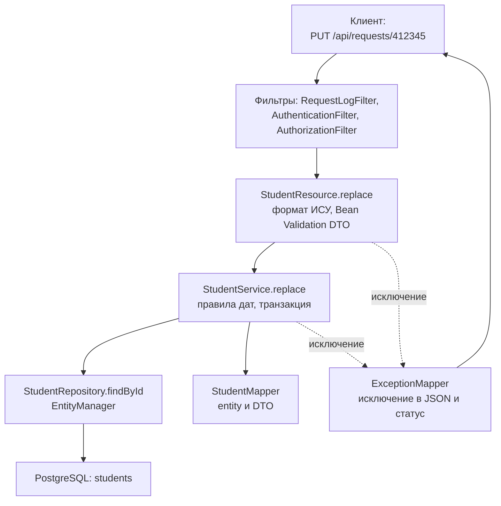

*Схема: запрос проходит слои строго сверху вниз, и каждый слой обращается только к соседу снизу. Ошибки не возвращаются по цепочке вызовов: их перехватывает отдельный компонент сбоку, поэтому сервису не нужно знать, какой HTTP-статус соответствует «студент не найден».*

Путь `PUT /api/requests/412345` выглядит так. Фильтры логируют запрос и проверяют токен и роль. Ресурс проверяет, что ИСУ состоит из 6 цифр, а тело проходит Bean Validation. Сервис находит студента через репозиторий, проверяет даты и копирует поля из DTO в сущность. При коммите транзакции JPA сам записывает изменения в базу (dirty checking — [вопрос 10](#q10)). В ответ сервис отдаёт `StudentResponse`, и Jakarta REST сериализует его в JSON.

### Направление зависимостей

Зависимости идут только сверху вниз: ресурс знает сервис, сервис знает репозиторий, но не наоборот. Связывает их CDI-контейнер через `@Inject` ([вопрос 5](#q5)). Отсюда главное правило: сервис ничего не знает про HTTP. Он сообщает о проблеме исключением, а в HTTP-ответ его переводит `ExceptionMapper` ([вопрос 7](#q7)).

**Плохо:**

```java
public Response replace(String isuId, StudentRequest request) {
    Student student = em.find(Student.class, isuId);
    if (student == null) {
        return Response.status(404).build();   // сервис решает, какой будет HTTP-статус
    }
    ...
}
```

**Хорошо:**

```java
public StudentResponse replace(String isuId, StudentRequest request) {
    Student student = repository.findById(isuId)
            .orElseThrow(() -> new ResourceNotFoundException("Студент с ИСУ " + isuId + " не найден"));
    ...
}
```

Первый вариант привязан к Jakarta REST. Его нельзя вызвать при старте приложения или из теста без HTTP-контекста, а каждый вызывающий код вынужден разбирать `Response`. Во втором варианте сервис говорит на языке предметной области, а соответствие «не найден → 404» задано в одном месте.

### Что где проверяется

Проверки тоже распределены по слоям, и это закрывает требование условия о серверной валидации:

| Проверка | Слой | Пример в работе | Ответ |
|:--|:--|:-----------|:--|
| Формат запроса | ресурс + DTO | ИСУ — 6 цифр, `@Pattern` на группе, обязательные поля | 400 / 422 |
| Правила предметной области | сервис | даты заселения и выселения, ИСУ не меняется, ИСУ уникален | 422 / 409 |
| Целостность данных | БД | `PRIMARY KEY`, `NOT NULL`, `UNIQUE`, `CHECK` | последний рубеж |

Правила стоят в сервисе, потому что у одного правила бывает несколько точек входа. Ограничения базы — страховка на случай, если код что-то пропустит ([вопрос 8](#q8)).

### DTO и сущность

Сущность описывает таблицу, DTO — контракт API. Совпадают они редко, поэтому условие требует их разделять.

**Плохо:**

```java
@GET @Path("/me")
public User me(@Context SecurityContext ctx) {
    return userRepository.findByUsername(ctx.getUserPrincipal().getName()).orElseThrow();
    // в JSON уйдут все поля сущности, включая passwordHash
}
```

**Хорошо:**

```java
public record UserResponse(Long id, String username, String email, String role) {
}
```

Если отдать сущность наружу, клиент получит хеш пароля и все служебные поля. Добавленное в таблицу поле автоматически попадёт в API, а переименование колонки сломает клиента. При ленивых связях ещё и сериализатор может начать подгружать из базы связанные объекты. Отдельный DTO даёт ещё три вещи. Имена полей можно задать в `snake_case` (`isu_id`, `check_out`), не трогая Java-имена. Модели запроса и ответа могут различаться: в `StudentRequest` ИСУ необязателен для PUT, в ответе он есть всегда. Наконец, правила формата из Bean Validation живут на DTO, а не на сущности.

Перекладку полей между сущностью и DTO делает **маппер**. В работе он ручной: `StudentMapper` с двумя статическими методами. В больших проектах маппер генерируют библиотекой MapStruct по интерфейсу, но на восьми полях ручной код проще и нагляднее.

### Сквозная функциональность и структура пакетов

Безопасность, логирование и обработка ошибок нужны каждому эндпоинту. Это **сквозная функциональность**: её не повторяют в каждом методе, а выносят в фильтры Jakarta REST (`AuthenticationFilter`, `AuthorizationFilter`, `RequestLogFilter`) и мапперы исключений. Роли разобраны в [вопросе 14](#q14), ошибки — в [вопросе 7](#q7).

В работе пакеты разбиты по слоям: `resource`, `service`, `repository`, `entity`, `dto`, `exception`, `security`, `config`. Для небольшого приложения это нормально. В больших системах чаще группируют по фичам (`student/`, `auth/`, внутри каждой свои слои), чтобы изменение одной фичи не расползалось по всем пакетам. Есть и более строгие схемы — гексагональная и «чистая» архитектура. В них бизнес-логика не зависит даже от JPA, а база и HTTP подключаются к ней через интерфейсы-«порты». Для лабораторной это избыточно, но назвать их стоит.

> [!NOTE]
> **В твоей работе**
>
> Файл: `src/main/java/ru/itmo/students/resource/StudentResource.java`, строки 103–111
>
> ```java
> @PUT
> @Path("/{isu_id}")
> @RolesAllowed("ADMIN")
> @Operation(summary = "Полностью заменить данные студента (только ADMIN)")
> public StudentResponse replace(@PathParam("isu_id") String isuId, StudentRequest request) {
>     checkIsu(isuId);
>     validator.validate(request);
>     return service.replace(isuId, request);
> }
> ```
>
> Файл: `src/main/java/ru/itmo/students/service/StudentService.java`, строки 71–84
>
> ```java
> @Transactional
> public StudentResponse replace(String isuId, StudentRequest request) {
>     if (request.isuId() != null && !request.isuId().equals(isuId)) {
>         throw new DataValidationException("isu_id", "ИСУ менять нельзя");
>     }
>
>     Student student = findOrThrow(isuId);
>     checkDates(request.checkIn(), request.checkOut());
>     StudentMapper.copyToEntity(request, student);
>
>     // Сущность «управляемая»: изменения полей сами запишутся в БД при завершении транзакции
>     LOG.info("Изменён студент " + isuId);
>     return StudentMapper.toResponse(student);
> }
> ```
>
> Ресурс делает только HTTP-работу и проверку формата, сервис — правила и транзакцию, а с базой говорит репозиторий за `findOrThrow`. Польза видна на старте приложения: `StartupData` загружает демо-студентов через `studentService.loadDemoIfEmpty`, минуя ресурс, и правила дат и уникальности всё равно срабатывают. Зато проверки формата (Bean Validation) на этом пути не выполняются: они живут в ресурсе. Преподаватель может спросить, почему сервис принимает и возвращает DTO, а не сущность. Так управляемая сущность не покидает транзакцию. Ресурс получает неизменяемый record и поэтому не может обратиться к ленивой связи после закрытия контекста персистентности или случайно сериализовать лишние поля.

> [!CAUTION]
> **Расхождение с практикой**
>
> Файл: `src/main/java/ru/itmo/students/resource/StudentResource.java`, строки 133–139
>
> ```java
> StudentResponse current = service.get(isuId);
> JsonObject currentJson = Json.createReader(new StringReader(JsonConfig.JSONB.toJson(current))).readObject();
> JsonValue merged = Json.createMergePatch(changes).apply(currentJson);
>
> StudentRequest request = JsonConfig.JSONB.fromJson(merged.toString(), StudentRequest.class);
> validator.validate(request);
> return service.replace(isuId, request);
> ```
>
> Частичное обновление собирается в контроллере. Ресурс читает студента одним вызовом сервиса, сливает изменения и пишет другим вызовом. Часть сценария «изменить студента» оказалась в HTTP-слое, а чтение и запись идут в разных транзакциях: чужая правка между ними потеряется (lost update — [вопрос 11](#q11)). На защите можно опереться на то, что JSON Merge Patch (RFC 7396) по определению работает над JSON-документом, то есть над представлением, и поэтому слияние на уровне ресурса допустимо. Улучшение стоит назвать сразу: метод сервиса `patch(isuId, changes)` под одной `@Transactional` и поле `@Version` у сущности.

> [!TIP]
> **Могут спросить**
>
> **Зачем репозиторий, если `EntityManager` и так абстракция над базой?** `EntityManager` — универсальный API, а репозиторий собирает запросы конкретной сущности в одном месте: фильтры, белый список сортировки, подсчёт страниц. Сервис вызывает `find(filter)` и не знает про JPQL. Без репозитория эти запросы расползлись бы по сервисам.
>
> **Где должна быть проверка уникальности ИСУ — в сервисе или в базе?** В обоих местах. Сервис даёт понятную ошибку 409 в обычном случае. Ограничение `PRIMARY KEY` в базе гарантирует уникальность при параллельных запросах, когда проверка в коде не помогает ([вопрос 11](#q11)).
>
> **Можно ли вызывать репозиторий прямо из ресурса, если логики нет?** Технически можно, но тогда у ресурса появляется вторая обязанность и пропадает место для транзакции и будущих правил. Обычно держат единообразие: ресурс всегда работает через сервис, даже когда метод сервиса тонкий.

## Вопрос 7. Исключения в Java и централизованная обработка ошибок.

Запрос `POST /api/requests` может не выполниться по десятку причин: тело — не JSON, ИСУ уже занят, дата выселения раньше заселения, токен истёк, упала база. Если каждый метод сообщает о неудаче кодом возврата (`null`, `-1`, `false`), вызывающий обязан проверять результат после каждого вызова, а проверку легко забыть, и ошибка молча едет дальше. Кроме того, код возврата не говорит, *что* случилось. Исключения решают обе проблемы: ошибка прерывает выполнение, сама поднимается по стеку вызовов до того, кто умеет её обработать, и несёт с собой тип, сообщение и место возникновения.

### Иерархия `Throwable`

Всё, что можно бросить оператором `throw`, наследует `Throwable`. Под ним две ветви:

| Класс | Что означает | Примеры | Ловить? |
|:--|:-----------|:------|:--|
| `Error` | сбой JVM или среды, приложение обычно не может восстановиться | `OutOfMemoryError`, `StackOverflowError` | нет |
| `Exception` | ошибка, на которую программа может отреагировать | `IOException`, `SQLException` | да |
| `RuntimeException` (подкласс `Exception`) | ошибка программы или нарушение контракта | `NullPointerException`, `IllegalArgumentException`, `PersistenceException` | по ситуации |

**Checked-исключения** (наследники `Exception`, кроме ветки `RuntimeException`) компилятор заставляет либо поймать, либо объявить в `throws`. **Unchecked** (`RuntimeException` и `Error`) можно не объявлять. Задумка checked-исключений — сделать ожидаемые сбои (нет файла, оборвалась сеть) частью сигнатуры. На практике в серверных приложениях бизнес-ошибки делают unchecked: «студент не найден» возникает в репозитории или сервисе, а обрабатывается в одном месте на краю приложения, и протаскивать `throws` через все промежуточные слои бессмысленно. Второй довод — транзакции: в Jakarta EE и Spring `@Transactional` по умолчанию откатывает транзакцию на unchecked-исключении и *не* откатывает на checked (подробнее — [вопрос 11](#q11)).

### `try`, `catch`, `finally` и ресурсы

`try` выделяет код, в котором ожидается ошибка; `catch (Тип e)` перехватывает исключения этого типа и его наследников; `finally` выполняется всегда, даже после `return` или нового исключения. Блоков `catch` может быть несколько, и проверяются они сверху вниз, поэтому конкретный тип пишут раньше общего.

Для всего, что нужно закрыть (файл, поток, соединение), есть **try-with-resources**: объект, объявленный в скобках после `try`, реализует `AutoCloseable`, и его `close()` вызовется автоматически при любом исходе. Если checked-исключение нельзя пробросить дальше (метод не объявляет `throws`), его **оборачивают** в unchecked, передавая исходное как причину (`cause`): стек исходной ошибки сохраняется и будет виден в логе.

```java
// Импорт студентов из файла: файл закроется сам, ошибка ввода-вывода не потеряется
List<StudentRequest> readImport(Path file) {
    try (InputStream in = Files.newInputStream(file)) {
        return List.of(jsonb.fromJson(in, StudentRequest[].class));
    } catch (IOException e) {
        throw new UncheckedIOException("Не удалось прочитать " + file, e);   // e — причина
    }
}
```

### Антипаттерны

**Плохо:**

```java
public StudentResponse get(String isuId) {
    try {
        return StudentMapper.toResponse(repository.findById(isuId).get());
    } catch (Exception e) {
        e.printStackTrace();   // в stderr, без уровня и контекста
        return null;           // клиент получит 204 или пустое тело вместо 404
    }
}
```

**Хорошо:**

```java
public StudentResponse get(String isuId) {
    Student student = repository.findById(isuId)
            .orElseThrow(() -> new ResourceNotFoundException("Студент с ИСУ " + isuId + " не найден"));
    return StudentMapper.toResponse(student);
}
```

Первый вариант совмещает три ошибки. `catch (Exception e)` ловит всё подряд: отсутствие студента, обрыв соединения с БД и `NullPointerException` из-за бага превращаются в одно и то же. `printStackTrace()` пишет мимо системы логирования. `return null` прячет ошибку от клиента и от транзакции: метод «успешно» завершился, хотя ничего не нашёл. Сюда же относятся пустой `catch {}`, который глотает ошибку бесследно, и отправка клиенту `e.getMessage()` или стектрейса от непредвиденного исключения: так наружу утекают имена таблиц, SQL и версии библиотек.

### Централизованная обработка

Даже если сервис бросает правильные исключения, их надо превратить в HTTP-ответ. Делать это в каждом методе ресурса — значит размножить один и тот же код:

```java
@GET
@Path("/{isu_id}")
public Response get(@PathParam("isu_id") String isuId) {
    try {
        return Response.ok(service.get(isuId)).build();
    } catch (ResourceNotFoundException e) {
        return Response.status(404).entity(e.getMessage()).build();   // и так в каждом методе
    }
}
```

**Централизованная обработка** переносит перевод «исключение → ответ» в одно место. Сервис ничего не знает про HTTP: он бросает доменное исключение, оно пролетает через ресурс насквозь, и на границе приложения его перехватывает обработчик. В Jakarta REST это **`ExceptionMapper<T>`** — класс с аннотацией `@Provider` и методом `Response toResponse(T e)`. В Spring тот же приём называется `@ControllerAdvice` + `@ExceptionHandler` (сравнение платформ — [вопрос 2](#q2)).

Если на исключение подходит несколько мапперов, Jakarta REST выбирает тот, чей параметр типа — **ближайший предок** брошенного исключения по иерархии классов. Поэтому общий `ExceptionMapper<Throwable>` не мешает частным: для `ConflictException` маппер `ApiException` ближе, чем маппер `Throwable`, и выигрывает он. Порядок регистрации и аннотация `@Priority` здесь не главное.

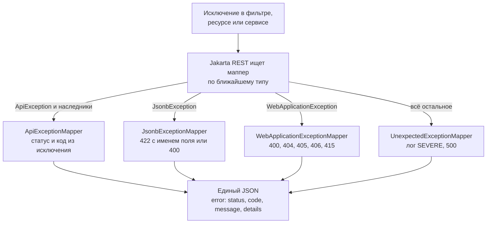

*Схема: четыре маппера покрывают четыре источника ошибок — код приложения, разбор JSON, сам Jakarta REST и непредвиденные сбои. Сколько бы ни было путей, клиент всегда получает тело одного формата, а стектрейс видит только лог сервера.*

> [!WARNING]
> **Подводный камень**
>
> `ExceptionMapper<Throwable>` подходит и к `WebApplicationException`, которыми Jakarta REST сообщает о неизвестном адресе (404) или неподходящем методе (405). Если частного маппера для них нет, «ближайшим» окажется маппер `Throwable`, и обычный 404 превратится в 500 с записью SEVERE в логе. Поэтому общий маппер почти всегда ставят в паре с маппером для `WebApplicationException`.

> [!NOTE]
> **В твоей работе**
>
> Файл: `src/main/java/ru/itmo/students/exception/ApiException.java`, строки 11–22
>
> ```java
> public abstract class ApiException extends RuntimeException {
>
>     private final int status;
>     private final String code;
>     private final List<ErrorDetail> details;
>
>     protected ApiException(int status, String code, String message, List<ErrorDetail> details) {
>         super(message);
>         ...
>     }
> ```
>
> Файл: `src/main/java/ru/itmo/students/exception/ApiExceptionMapper.java`, строки 13–28
>
> ```java
> @Provider
> public class ApiExceptionMapper implements ExceptionMapper<ApiException> {
>
>     @Override
>     public Response toResponse(ApiException e) {
>         ErrorResponse body = ErrorResponse.of(e.getStatus(), e.getCode(), e.getMessage(), e.getDetails());
>         Response.ResponseBuilder response = Response.status(e.getStatus())
>                 .type(MediaType.APPLICATION_JSON)
>                 .entity(body);
>
>         // Стандарт HTTP требует у ответа 401 заголовок со схемой входа
>         if (e.getStatus() == 401) {
>             response.header(HttpHeaders.WWW_AUTHENTICATE, "Bearer");
>         }
>         return response.build();
>     }
> }
> ```
>
> Статус живёт в самом исключении: шесть наследников `ApiException` задают его в конструкторе (`ConflictException` — 409, `DataValidationException` — 422 и т. д.), поэтому один маппер обслуживает их все, а новый вид ошибки добавляется одним классом без правки маппера. `ApiException` unchecked и абстрактный: бросить «просто ошибку API» без статуса нельзя. Через этот же маппер проходят исключения из фильтров безопасности: `UnauthorizedException` из `AuthenticationFilter` тоже становится 401 с `WWW-Authenticate`. Вероятный вопрос: «Что будет, если сервис бросит `IllegalStateException`?» — ответ: её поймает `UnexpectedExceptionMapper`, клиент получит 500.

### Единый формат и HTTP-статусы

Требование условия — ошибки «в едином формате» и HTTP-статусы «в соответствии с результатом». Единый формат нужен клиенту: фронтенд один раз пишет разбор ошибки и показывает сообщения возле нужных полей формы. В работе это `ErrorResponse` (перенесён из ЛР2):

```json
{"error": {"status": 422, "code": "VALIDATION_ERROR", "message": "Данные не прошли проверку",
           "details": [{"field": "check_out", "message": "Дата выселения должна быть позже даты заселения"}]}}
```

| Статус | Когда в работе | Источник |
|:--|:-----------|:------|
| 400 | нет тела, битый JSON, тело не объект | `InvalidRequestException`, `JsonbExceptionMapper`, `WebApplicationExceptionMapper` |
| 401 + `WWW-Authenticate: Bearer` | нет входа, поддельный или истёкший токен | `UnauthorizedException` |
| 403 | USER пытается удалить студента | `AccessDeniedException` |
| 404 | нет студента с таким ИСУ; нет такого адреса | `ResourceNotFoundException`; `WebApplicationException` |
| 405 + `Allow` | `PUT` на `/api/requests` | `WebApplicationException` |
| 406 / 415 | клиент не принимает JSON / прислал не JSON | `WebApplicationException` |
| 409 | ИСУ, логин или почта уже заняты | `ConflictException` |
| 422 | нарушены правила полей или дат, неизвестное поле, неверный тип | `DataValidationException`, `JsonbExceptionMapper` |
| 500 | всё непредвиденное | `UnexpectedExceptionMapper` |

Граница между **400 и 422** проходит по вопросу «удалось ли разобрать запрос». 400 — сервер не понял запрос: синтаксически битый JSON, массив вместо объекта, пустое тело. 422 (Unprocessable Content) — запрос разобран, но данные нарушают правила: ИСУ из пяти цифр, дата заселения в 1999 году. Разница в 401 и 403 — [вопрос 12](#q12).

### Валидация как источник ошибок

В работе 422 приходит с трёх уровней. Формат полей описан аннотациями Bean Validation на DTO (`@NotNull`, `@Pattern`, `@Size`), их проверяет `RequestValidator`: собирает *все* нарушения сразу, переводит имена полей в `snake_case` и бросает одно `DataValidationException` со списком `details`. Правила, которые зависят от нескольких полей или от текущей даты, — в сервисе: `checkDates` бросает `DataValidationException` для `check_in` или `check_out`. Уникальность проверяет сервис через `existsById` и отвечает 409. Последний рубеж — ограничения БД (`PRIMARY KEY`, `UNIQUE`), подробнее — [вопрос 8](#q8).

> [!CAUTION]
> **Расхождение с практикой**
>
> Нарушение ограничения БД в работе не переводится в `ConflictException`. При гонке двух одновременных созданий студента с одним ИСУ проверка `existsById` пропустит оба запроса, второй упадёт на `PRIMARY KEY` при фиксации, и это исключение JPA уйдёт в `UnexpectedExceptionMapper`: клиент получит 500 вместо 409. Исправление — перехватывать нарушение уникальности (SQLSTATE `23505`) и бросать `ConflictException`; разбор гонки — [вопрос 11](#q11).
>
> `JsonbExceptionMapper` достаёт имя поля регулярным выражением из текста сообщения Yasson (`"deserialize property '([A-Za-z_]+)'"`). Текст ошибки не является API библиотеки: при обновлении реализации JSON-B регулярка перестанет совпадать, и вместо 422 с полем придёт 400 без поля. Работает, но хрупко.
>
> Формат `{"error": {...}}` самописный. Для ошибок HTTP API есть стандарт RFC 9457 (Problem Details): тип `application/problem+json`, поля `type`, `title`, `status`, `detail`, `instance` и свои расширения. Формат взят из ЛР2 ради совместимости с готовым фронтендом, и это нормальное обоснование.

### Логирование ошибок

Клиенту — короткое сообщение без деталей, в лог сервера — всё, что нужно для разбора: что, где, с каким стектрейсом. Требование условия — логирование, «достаточное для анализа работы и возникающих ошибок». В работе используется стандартный `java.util.logging` с уровнями `SEVERE` (сбой, нужен разработчик), `WARNING` (подозрительное, но обработанное), `INFO` (штатные события), `FINE` и ниже (отладка). Ожидаемые ошибки вроде 404 или 422 — это нормальная работа API, поэтому стектрейс для них не пишут. Для 500 стектрейс нужен обязательно: исключение передаётся в логгер отдельным аргументом, а не склеивается со строкой (`"Ошибка: " + e` сохранит только текст). Пароли, токены и полные тела запросов в лог не пишут.

> [!NOTE]
> **В твоей работе**
>
> Файл: `src/main/java/ru/itmo/students/exception/UnexpectedExceptionMapper.java`, строки 22–29
>
> ```java
> @Override
> public Response toResponse(Throwable e) {
>     LOG.log(Level.SEVERE, "Необработанная ошибка", e);
>
>     ErrorResponse body = ErrorResponse.of(500, "INTERNAL_ERROR",
>             "Внутренняя ошибка сервера. Подробности записаны в лог сервера", List.of());
>     return Response.status(500).type(MediaType.APPLICATION_JSON).entity(body).build();
> }
> ```
>
> Стектрейс уходит в лог, клиенту — общий текст. Остальное логирование распределено по слоям: `RequestLogFilter` пишет одну строку на запрос (`GET /api/requests?page=1 -> 200 (12 мс, пользователь: admin)`), сервисы — `INFO` о создании и удалении, `AuthService` — `WARNING` о неудачном входе (строка 69, в лог попадает только логин, без пароля). В `server.xml` (строка 44) скрыто сообщение Liberty `FFDC1015I`. Механизм FFDC (First Failure Data Capture) сохраняет отчёт о каждом исключении, вышедшем из `@Transactional`-метода, в том числе о штатных 404 и 409, и засорял бы лог. Могут спросить, не прячет ли это настоящие ошибки. Нет: они проходят через `UnexpectedExceptionMapper` и пишутся на уровне `SEVERE`.

> [!TIP]
> **Могут спросить**
>
> **Почему `ApiException` наследует `RuntimeException`, а не `Exception`?** Иначе каждый метод сервиса и ресурса пришлось бы объявлять с `throws ApiException`, хотя обрабатывает его только маппер. К тому же `@Transactional` по умолчанию откатывает транзакцию только на unchecked-исключениях, а на 404 или 409 откат и нужен.
>
> **Чем `finally` отличается от try-with-resources?** `finally` — блок общего назначения, закрывать ресурс в нём нужно вручную, с проверкой на `null` и с риском, что исключение из `close()` затрёт исходное. Try-with-resources делает это автоматически, а исключение из `close()` прикрепляет к основному как suppressed.
>
> **Что получит клиент, если сломается сам `ExceptionMapper`?** По спецификации Jakarta REST исключение из маппера повторно не отображается: сервер сразу отвечает 500, уже не в JSON-формате работы. Поэтому мапперы делают максимально простыми, без обращений к БД и сложной логики.

## Вопрос 8. Реляционные базы данных. Таблицы, строки, столбцы, первичные и внешние ключи.

В ЛР2 студенты хранились в JSON-файле или в памяти процесса. Пока запросы идут по одному, этого хватает. Проблемы начинаются, когда два администратора одновременно правят список: файл перезаписывается целиком, и одна из правок теряется. Ничто не мешает записать студента без ФИО или с датой выселения раньше даты заселения. Чтобы найти студентов группы M3301, приходится читать весь файл. Если процесс упадёт посреди записи, файл останется наполовину записанным. **Реляционная СУБД** (в работе — PostgreSQL) решает эти задачи на своей стороне. Она обслуживает параллельный доступ, сама проверяет правила целостности, выполняет запросы на языке SQL и гарантирует, что набор изменений применится целиком или не применится вовсе (транзакции — [вопрос 11](#q11)). Условие прямо требует хранить данные в реляционной базе.

### Таблица, строка, столбец

Реляционная модель описывает данные как набор **отношений**. На практике отношение — это **таблица** с фиксированным набором именованных **столбцов** (атрибутов) и произвольным числом **строк** (кортежей). Каждый столбец имеет **тип** (домен), то есть множество допустимых значений. Одна строка таблицы `students` — один студент, один столбец — одно его свойство. Порядок строк в таблице не определён: если он нужен, его задают в запросе через `ORDER BY`.

| Теория | SQL / СУБД | Пример в работе |
|:--|:--|:-----------|
| Отношение | таблица | `students`, `users`, `refresh_tokens` |
| Кортеж | строка | студент `412345`, Иванов Иван Иванович |
| Атрибут | столбец | `group_name`, `check_in` |
| Домен | тип столбца | `VARCHAR(5)`, `DATE` |

Набор таблиц, их столбцов и ограничений называется **схемой**. Схему описывают на SQL командой `CREATE TABLE`:

```sql
CREATE TABLE students (
    isu_id     VARCHAR(6)   PRIMARY KEY,        -- номер ИСУ
    full_name  VARCHAR(100) NOT NULL,
    group_name VARCHAR(5)   NOT NULL,           -- "group" — зарезервированное слово SQL
    check_in   DATE         NOT NULL,
    check_out  DATE,                            -- NULL: ещё проживает
    is_foreign BOOLEAN      NOT NULL
);
```

В работе используются такие типы PostgreSQL. `VARCHAR(n)` — строка длиной не больше `n` символов. `DATE` — дата без времени, в Java ей соответствует `LocalDate`. `BOOLEAN` хранит истину или ложь. `TIMESTAMP` — дата со временем. `BIGSERIAL` — это `BIGINT` вместе с последовательностью, которая выдаёт следующее число при каждой вставке. Длина в `VARCHAR(n)` — уже ограничение: строку длиннее шести символов база в `isu_id` не запишет.

### NULL

`NULL` означает «значение неизвестно или отсутствует». Это не пустая строка и не ноль. В работе `check_out IS NULL` означает, что студент ещё живёт в общежитии. `NULL` ведёт себя особо: любое сравнение с ним, включая `NULL = NULL`, даёт не «истину», а «неизвестно», поэтому такая строка не попадает в выборку.

**Плохо:**

```sql
SELECT full_name FROM students WHERE check_out = NULL;   -- всегда пустой результат
```

**Хорошо:**

```sql
SELECT full_name FROM students WHERE check_out IS NULL;  -- все, кто проживает сейчас
```

Первый запрос синтаксически корректен, поэтому ошибка не видна сразу: база молча вернёт пустой список.

### Ограничения целостности

**Ограничение** (constraint) — правило, которое СУБД проверяет при каждой вставке и изменении. Строку, которая его нарушает, база отвергает с ошибкой.

| Ограничение | Что гарантирует | В схеме работы |
|:--|:----------|:-----------|
| `NOT NULL` | значение обязательно | почти все столбцы, кроме `check_out` |
| `UNIQUE` | нет двух строк с одинаковым значением | `users.username`, `users.email`, `refresh_tokens.jti` |
| `CHECK (условие)` | значение удовлетворяет условию | `role IN ('ADMIN', 'USER')` |
| `DEFAULT` | значение, если его не указали | `notes DEFAULT ''`, `revoked DEFAULT FALSE` |
| `PRIMARY KEY` | идентификатор строки | `isu_id`, `users.id` |
| `REFERENCES` | ссылка на существующую строку | `refresh_tokens.user_id` |

Проверки в Java (Bean Validation, правила в сервисе) дают клиенту понятное сообщение. Ограничения базы — последний рубеж: они срабатывают даже тогда, когда данные пришли в обход сервиса, например из ручного SQL, из другого приложения или при гонке двух запросов. Требование условия проверять «ограничения модели и уникальность» закрывают оба уровня вместе.

### Первичный ключ

**Первичный ключ** (primary key, PK) — столбец или набор столбцов, по которому строка однозначно находится. Он обязан быть уникальным и не может быть `NULL`. В таблице только один первичный ключ, а `UNIQUE`-столбцов может быть сколько угодно.

Ключ бывает двух видов. **Естественный** ключ — атрибут из предметной области, уникальный сам по себе: номер ИСУ. **Суррогатный** ключ — искусственный номер, который генерирует база (`users.id BIGSERIAL`) и который в предметной области ничего не значит.

| | Естественный (`isu_id`) | Суррогатный (`users.id`) |
|:--|:-----------|:-----------|
| Смысл | понятен людям, приходит из API | только техническая метка |
| Изменяемость | плохо, если значение может смениться | никогда не меняется |
| Лишний столбец | не нужен | нужен, а уникальность «настоящих» полей обеспечивает отдельный `UNIQUE` |
| Размер и скорость | зависит от данных | компактное число |

Естественный ключ годится, когда значение уникально, обязательно и неизменно. Номер ИСУ выдаётся студенту один раз и не переиспользуется, а API ЛР2 уже адресует студентов по нему (`/api/requests/412345`), поэтому ключ — ИСУ. Логин пользователя этим условиям не отвечает: его могут разрешить сменить, и тогда пришлось бы обновлять все ссылки на него в других таблицах. Поэтому у `users` суррогатный `id`, а `username` и `email` защищены ограничением `UNIQUE`.

### Внешний ключ

**Внешний ключ** (foreign key, FK) — столбец, значение которого обязано совпадать с первичным ключом строки в другой таблице (или быть `NULL`, если столбец это допускает). Так обеспечивается **ссылочная целостность**: токен не может принадлежать несуществующему пользователю.

```sql
-- у одного пользователя много refresh-токенов
user_id BIGINT NOT NULL REFERENCES users (id) ON DELETE CASCADE
```

Что делать с зависимыми строками при удалении родительской, определяет правило `ON DELETE`:

| Правило | При удалении пользователя |
|:--|:-----------|
| `NO ACTION` / `RESTRICT` (по умолчанию) | удаление запрещено, пока у него есть токены |
| `CASCADE` | его токены удаляются вместе с ним |
| `SET NULL` | у токенов `user_id` становится `NULL` (нужен столбец без `NOT NULL`) |

Токен без владельца бессмыслен, поэтому для `refresh_tokens` естественный выбор — `CASCADE`. Для гипотетической таблицы истории заселений `CASCADE` был бы опасен: удаление студента молча стёрло бы его прошлое. Виды связей, которые строятся на внешних ключах, разбираются в [вопросе 9](#q9).

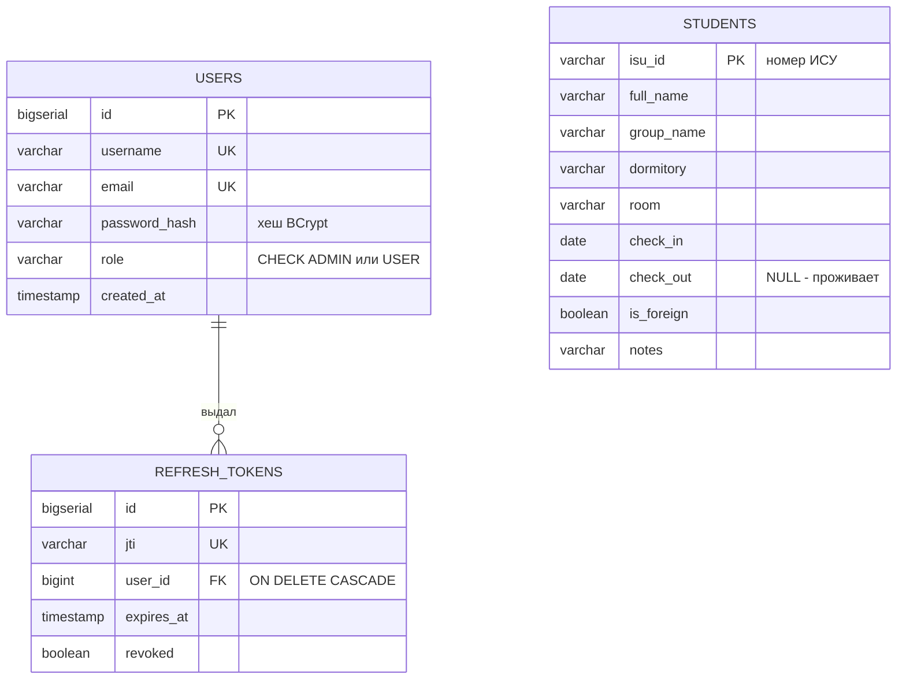

*Схема: в работе две независимые части. `students` ни на что не ссылается и использует естественный ключ. `users` и `refresh_tokens` связаны внешним ключом и используют суррогатные ключи; уникальность того, по чему их ищут (логин, почта, `jti`), обеспечивает `UNIQUE`.*

### Индексы и нормализация

**Индекс** — дополнительная структура (в PostgreSQL по умолчанию B-дерево), по которой строки находятся без полного просмотра таблицы. Для `PRIMARY KEY` и `UNIQUE` PostgreSQL создаёт индекс автоматически: иначе проверять уникальность было бы дорого. Индекс по столбцу, по которому часто фильтруют (`group_name`, `dormitory`), ускоряет чтение, но замедляет запись и занимает место. Создавать его стоит, когда таблица большая и запрос действительно медленный. Индекс по внешнему ключу PostgreSQL сам не создаёт.

**Нормализация** в минимальном виде означает: каждый факт хранится в одном месте. Если бы в каждой строке студента лежало полное название и адрес общежития, переименование корпуса пришлось бы вносить в сотни строк, и рано или поздно часть из них разошлась бы. Нормализованный вариант — таблица `dormitories` и внешний ключ на неё.

> [!NOTE]
> **В твоей работе**
>
> Файл: `src/main/resources/META-INF/sql/schema.sql`, строки 8–12
>
> ```sql
> -- Пользователи. Логин и почта уникальны, пароль — только хеш BCrypt (60 символов), роль — ADMIN или USER
> CREATE TABLE IF NOT EXISTS users (id BIGSERIAL PRIMARY KEY, username VARCHAR(32) NOT NULL UNIQUE, email VARCHAR(254) NOT NULL UNIQUE, password_hash VARCHAR(60) NOT NULL, role VARCHAR(10) NOT NULL CHECK (role IN ('ADMIN', 'USER')), created_at TIMESTAMP NOT NULL);
>
> -- Выданные refresh-токены. Внешний ключ user_id -> users.id: у одного пользователя много токенов (один-ко-многим)
> CREATE TABLE IF NOT EXISTS refresh_tokens (id BIGSERIAL PRIMARY KEY, jti VARCHAR(36) NOT NULL UNIQUE, user_id BIGINT NOT NULL REFERENCES users (id) ON DELETE CASCADE, expires_at TIMESTAMP NOT NULL, revoked BOOLEAN NOT NULL DEFAULT FALSE);
> ```
>
> Требование условия об уникальном имени и почте пользователя закреплено на уровне базы через `UNIQUE`, а не только проверкой в сервисе. Длины выбраны по смыслу: 254 символа — максимальная длина адреса почты, 60 — ровно длина хеша BCrypt (подробнее — [вопрос 15](#q15)). Каждая команда записана в одну строку, потому что EclipseLink читает скрипт построчно. PostgreSQL 16 запускается в Docker (`docker-compose.yml`), данные лежат в томе `db-data` и переживают перезапуск контейнера.
>
> Первичный ключ студента в Java-сущности объявлен без `@GeneratedValue`: ИСУ приходит от клиента, база его не генерирует.
>
> Файл: `src/main/java/ru/itmo/students/entity/Student.java`, строки 18–20
>
> ```java
> @Id
> @Column(name = "isu_id", length = 6)
> private String isuId;
> ```
>
> По этому месту обычно спрашивают, почему ИСУ — строка, а не число. Ответ: это идентификатор, а не величина, над ним не выполняют арифметику, а строковый тип сохраняет ведущие нули и формат «ровно 6 цифр». Как сущность отображается на таблицу — [вопрос 10](#q10).

> [!WARNING]
> **Подводный камень**
>
> Проверка «такой логин уже есть» в сервисе (`existsByUsername`, затем вставка) не заменяет `UNIQUE`. Два одновременных запроса могут оба пройти проверку, и спасает только ограничение базы. В работе вторая вставка упадёт на нём, но эта ошибка не переводится в 409 и дойдёт до клиента как 500 (подробнее — [вопрос 11](#q11) и [вопрос 7](#q7)). Ещё одна тонкость: `UNIQUE` в PostgreSQL чувствителен к регистру, и `Ivan@itmo.ru` с `ivan@itmo.ru` для базы разные значения. В работе почту и логин приводит к нижнему регистру `RegisterRequest`, то есть защита держится на Java-коде. На уровне базы то же даёт уникальный индекс по `lower(email)`.

> [!CAUTION]
> **Расхождение с практикой**
>
> Схема создаётся скриптом с `CREATE TABLE IF NOT EXISTS` при каждом старте, без системы миграций. Если добавить в `students` столбец, на существующей базе ничего не изменится: таблица уже есть, и команда пропускается. В реальных проектах схему ведут версионированными миграциями (Flyway, Liquibase): каждое изменение — отдельный скрипт, а база помнит, какие из них уже применены. На защите стоит сказать, что для учебной работы с одной версией схемы скрипта достаточно, и назвать Flyway как следующий шаг.
>
> Код общежития (`sg`, `alp`, `bel`, `len`, `msg`) хранится строкой без справочной таблицы и без `CHECK`. Допустимые значения проверяет только `@Pattern` в DTO, а `role` при этом защищена `CHECK`. Объяснение: модель перенесена из ЛР2 как есть. Нормализованный вариант — таблица `dormitories` и внешний ключ, минимальный — `CHECK (dormitory IN (...))`. Индексов под фильтры (`group_name`, `dormitory`) нет; на десятках демо-записей полный просмотр таблицы быстрее, чем работа с индексом.

> [!TIP]
> **Могут спросить**
>
> **Чем `PRIMARY KEY` отличается от `UNIQUE NOT NULL`?** Гарантии одинаковые: уникальность и обязательность. Но первичный ключ в таблице один, на него по умолчанию ссылаются внешние ключи, и ORM использует его как идентификатор сущности (`@Id`). `UNIQUE`-столбцов может быть несколько, и без `NOT NULL` они допускают несколько `NULL`.
>
> **Можно ли изменить первичный ключ строки?** Технически можно, но тогда придётся обновить все внешние ключи, которые на неё ссылаются (или объявить их с `ON UPDATE CASCADE`). Поэтому ключ выбирают неизменяемым. В работе ИСУ не меняется: `StudentMapper` не копирует его из тела запроса.
>
> **Что такое составной ключ?** Это первичный ключ из нескольких столбцов, уникальный только в сочетании. Типичный пример — таблица связи «многие-ко-многим», например `(isu_id, club_id)` в гипотетической таблице `student_clubs` ([вопрос 9](#q9)).

## Вопрос 9. Связи между сущностями в реляционной базе данных: один-к-одному, один-ко-многим, многие-ко-многим.

В реляционной базе каждая таблица описывает один вид объектов: студентов, пользователей, выданные токены. Но объекты связаны: у пользователя есть токены, у студента может быть пропуск, студент ходит в кружки. Если копировать данные одного объекта в строки другого (имя пользователя в каждую строку токена), появятся дубли, и при изменении в одном месте они разойдутся с остальными. Поэтому таблицы связывают ссылками: строка одной таблицы хранит первичный ключ строки другой. Такая ссылка называется **внешним ключом**, его устройство и `ON DELETE` разобраны в [вопросе 8](#q8). Здесь разберём, какие бывают связи и как каждая из них раскладывается на таблицы.

### Кардинальность и обязательность

**Кардинальность** связи показывает, со сколькими объектами с другой стороны может быть связан один объект. Вариантов три: один-к-одному (1:1), один-ко-многим (1:N), многие-ко-многим (N:M). Кроме того, у каждой стороны есть **обязательность**: может ли объект существовать без пары.

| Обозначение | Смысл | Пример |
|:--|:----------|:------|
| `1` | ровно один | у токена ровно один владелец |
| `0..1` | не больше одного | у студента пропуск может быть, а может и не быть |
| `0..*` | сколько угодно, в том числе ни одного | у пользователя может не быть ни одного токена |
| `1..*` | хотя бы один | в кружке должен быть хотя бы один участник |

В SQL обязательность «многих» к «одному» задаётся через `NOT NULL` на внешнем ключе. Условие «хотя бы один» (`1..*`) обычной схемой не выражается и проверяется в коде.

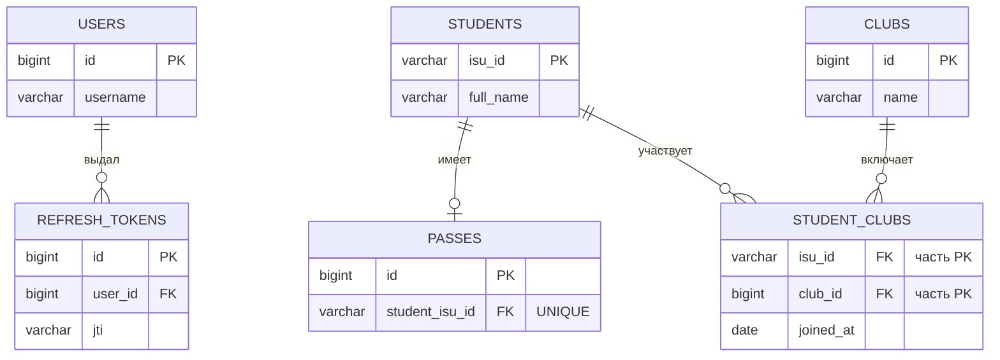

*Схема: три вида связей на одной предметной области. В работе реально есть только `USERS → REFRESH_TOKENS`, пропуска и кружки приведены для примера. Внешний ключ всегда лежит на той стороне, где «один объект ссылается на одного»: у токена, у пропуска, у строки таблицы связи. Связь N:M на схеме превращается в две связи 1:N.*

### Один-ко-многим

Это самая частая связь: один пользователь, много токенов (вход с телефона и с ноутбука). Внешний ключ ставится на стороне «многих». Каждый токен знает своего единственного владельца, поэтому одного столбца `user_id` ему достаточно. Если положить ключ на сторону «одного», пользователю пришлось бы хранить список идентификаторов токенов в одной ячейке, а так в реляционной модели не делают (см. «плохо / хорошо» ниже).

```sql
-- все действующие refresh-токены пользователя ivanov
SELECT t.jti, t.expires_at
FROM refresh_tokens t
JOIN users u ON u.id = t.user_id
WHERE u.username = 'ivanov' AND t.revoked = FALSE;
```

### Один-к-одному

Пусть у студента может быть не больше одного пропуска в общежитие, а пропуск всегда принадлежит одному студенту. Есть два способа это хранить. Первый: в `passes` хранится внешний ключ на студента с `UNIQUE`. Без `UNIQUE` получилась бы обычная связь 1:N, и у студента могло бы оказаться два пропуска. Второй: **общий первичный ключ**, когда первичный ключ пропуска одновременно служит внешним ключом на студента.

```sql
-- вариант 1: внешний ключ + UNIQUE
CREATE TABLE passes (id BIGSERIAL PRIMARY KEY, number VARCHAR(10) NOT NULL UNIQUE,
    student_isu_id VARCHAR(6) NOT NULL UNIQUE REFERENCES students (isu_id) ON DELETE CASCADE);
-- вариант 2: общий первичный ключ
CREATE TABLE passes (isu_id VARCHAR(6) PRIMARY KEY REFERENCES students (isu_id), number VARCHAR(10) NOT NULL);
```

Связь 1:1 можно было бы заменить столбцами в самой `students`. Отдельную таблицу заводят, когда у зависимой части своя жизнь: пропуск выдают не всем, его перевыпускают, или в нём есть поля, которые читают редко и не нужны в каждом запросе к студенту.

### Многие-ко-многим

Студент ходит в несколько кружков, в кружке много студентов. Положить внешний ключ на одну из сторон нельзя: ни у студента, ни у кружка нет «единственного» партнёра. Поэтому заводят **таблицу связи**: каждая её строка означает одну пару «студент — кружок».

**Плохо:**

```sql
-- список кружков строкой в ячейке
ALTER TABLE students ADD COLUMN clubs VARCHAR(200);   -- '3,7,12'
```

**Хорошо:**

```sql
CREATE TABLE student_clubs (
    isu_id    VARCHAR(6) NOT NULL REFERENCES students (isu_id) ON DELETE CASCADE,
    club_id   BIGINT     NOT NULL REFERENCES clubs (id) ON DELETE CASCADE,
    joined_at DATE       NOT NULL,                 -- атрибут самой связи
    PRIMARY KEY (isu_id, club_id)                  -- одна пара — одна строка
);
```

Строка `'3,7,12'` нарушает первую нормальную форму: значение в ячейке не атомарно. База не может проверить, что кружок 7 существует, не умеет по такому столбцу соединять таблицы и строить индекс. Чтобы убрать студента из кружка, приходится разбирать и собирать строку заново. В таблице связи всё это решается внешними ключами, а составной первичный ключ не даёт записать одну пару дважды.

Когда у связи появляются собственные данные (дата вступления, роль в кружке), таблица связи по сути становится самостоятельной сущностью «членство». В JPA её тогда описывают отдельным классом с двумя `@ManyToOne`, а не через `@ManyToMany`.

```sql
-- участники шахматного кружка
SELECT s.full_name, sc.joined_at
FROM students s
JOIN student_clubs sc ON sc.isu_id = s.isu_id
JOIN clubs c ON c.id = sc.club_id
WHERE c.name = 'Шахматы';
```

### Отображение в JPA

Механика ORM разобрана в [вопросе 10](#q10). Здесь только то, как описываются связи.

| Связь в БД | Аннотация на стороне с внешним ключом | Обратная сторона | Загрузка по умолчанию |
|:--|:-----------|:-----------|:--|
| 1:N | `@ManyToOne` + `@JoinColumn` | `@OneToMany(mappedBy = …)` | `EAGER` / `LAZY` |
| 1:1 | `@OneToOne` + `@JoinColumn(unique = true)` или `@MapsId` | `@OneToOne(mappedBy = …)` | `EAGER` |
| N:M | `@ManyToMany` + `@JoinTable` | `@ManyToMany(mappedBy = …)` | `LAZY` |

**Владелец связи** — сторона, чьё поле соответствует внешнему ключу (для N:M — сторона с `@JoinTable`). При записи JPA смотрит только на владельца: если добавить токен в список `user.getTokens()`, но не вызвать `token.setUser(user)`, в базе ничего не изменится. Связь бывает **однонаправленной** (поле есть только у одной сущности) и **двунаправленной** (у обеих). Обратная сторона нужна, только когда по ней действительно ходят в коде.

```java
@Entity
public class Student {
    @Id
    @Column(name = "isu_id", length = 6)
    private String isuId;

    @ManyToMany
    @JoinTable(name = "student_clubs",
            joinColumns = @JoinColumn(name = "isu_id"),
            inverseJoinColumns = @JoinColumn(name = "club_id"))
    private Set<Club> clubs = new HashSet<>();   // владелец связи — студент
}
```

**Плохо:**

```java
@OneToMany
private List<RefreshToken> tokens;   // нет mappedBy — JPA ждёт таблицу users_refresh_tokens
```

**Хорошо:**

```java
@OneToMany(mappedBy = "user")
private List<RefreshToken> tokens;   // связь хранится в refresh_tokens.user_id
```

Без `mappedBy` JPA считает `@OneToMany` отдельной однонаправленной связью и хранит её в таблице-посреднике. Получается, что одна и та же связь записана в двух местах.

`cascade` переносит операции `EntityManager` с родителя на связанные объекты: `persist` студента сохраняет и его новый пропуск. `orphanRemoval = true` удаляет из базы дочерний объект, который убрали из коллекции. Каскады ставят от целого к части (студент → пропуск), а не наоборот: каскадное удаление со стороны `@ManyToOne` удалило бы пользователя вместе с одним из его токенов.

> [!WARNING]
> **Подводный камень**
>
> Каскады JPA и `ON DELETE CASCADE` в базе — разные механизмы. Первый срабатывает только тогда, когда объект удаляют через `EntityManager`, и только для загруженных объектов. Второй срабатывает всегда, в том числе при ручном `DELETE` в `psql`. Если они настроены по-разному, поведение зависит от того, кто удаляет.

> [!NOTE]
> **В твоей работе**
>
> В работе всего одна связь: один-ко-многим `users → refresh_tokens`. Она появилась из-за требования продлевать сессию refresh-токенами: чтобы токен можно было отозвать, сервер хранит его `jti` и владельца. Студенты ни с чем не связаны, потому что модель перенесена из ЛР2, где каждый студент был одной плоской записью. Связей 1:1 и N:M в работе нет.
>
> Файл: `src/main/resources/META-INF/sql/schema.sql`, строка 12
>
> ```sql
> CREATE TABLE IF NOT EXISTS refresh_tokens (id BIGSERIAL PRIMARY KEY, jti VARCHAR(36) NOT NULL UNIQUE, user_id BIGINT NOT NULL REFERENCES users (id) ON DELETE CASCADE, expires_at TIMESTAMP NOT NULL, revoked BOOLEAN NOT NULL DEFAULT FALSE);
> ```
>
> Файл: `src/main/java/ru/itmo/students/entity/RefreshToken.java`, строки 31–34
>
> ```java
> // Внешний ключ user_id -> users.id
> @ManyToOne(optional = false)
> @JoinColumn(name = "user_id", nullable = false)
> private User user;
> ```
>
> `optional = false` и `NOT NULL` выражают одно и то же: токен без владельца не бывает. Связь однонаправленная, у `User` нет поля `tokens`. Код ходит только от токена к пользователю (`stored.getUser()` в `AuthService.refresh`), а все токены пользователя отзывает одним запросом, не загружая список:
>
> Файл: `src/main/java/ru/itmo/students/repository/RefreshTokenRepository.java`, строки 32–35
>
> ```java
> public void revokeAllOf(User user) {
>     em.createQuery("UPDATE RefreshToken t SET t.revoked = true WHERE t.user = :user")
>             .setParameter("user", user)
>             .executeUpdate();
> }
> ```
>
> В JPQL `t.user = :user` сравнивает сущности, а в SQL это превращается в `user_id = ?`. `fetch` у `@ManyToOne` не указан, поэтому действует `EAGER`: вместе с токеном всегда загружается пользователь. Здесь это безвредно, потому что токен читается по одному и пользователь нужен сразу. В цикле по многим токенам это дало бы лишние запросы (N+1, см. [вопрос 10](#q10)).

> [!CAUTION]
> **Расхождение с практикой**
>
> Общежитие студента хранится кодом-строкой (`dormitory VARCHAR(3)`, значения `sg`, `alp`, …), а не ссылкой на таблицу общежитий. Нормализованный вариант такой: таблица `dormitories (code PRIMARY KEY, name, address)` и внешний ключ `students.dormitory → dormitories.code`, то есть связь 1:N. Тогда база сама не даст записать несуществующее общежитие, а название и адрес хранятся в одном месте. На защите скажи, что модель перенесена из ЛР2 без изменений, допустимые коды проверяются в Java (`@Pattern`), а переход на справочник — это одна таблица и один внешний ключ.

> [!TIP]
> **Могут спросить**
>
> **Почему внешний ключ кладут на сторону «многих»?** На этой стороне у каждой строки ровно один партнёр, и одного столбца хватает. На стороне «одного» пришлось бы хранить список, а это нарушает атомарность значений: база не сможет проверить ссылки и соединять по ним таблицы.
>
> **Почему у `User` нет списка токенов?** Он нигде не нужен. Код переходит только от токена к пользователю, а массовый отзыв сделан одним `UPDATE`. Обратная сторона добавила бы ленивую коллекцию и обязанность синхронизировать обе стороны, ничего не дав взамен.
>
> **Что станет с токенами при удалении пользователя?** Их удалит сама база благодаря `ON DELETE CASCADE` на `refresh_tokens.user_id`. Каскада в JPA для этого нет, и он не нужен. Эндпоинта удаления пользователей в работе тоже нет.

## Вопрос 10. ORM: назначение, преимущества и особенности отображения объектов на реляционную модель.

В ЛР2 студенты лежали в JSON-файле, и прочитать их значило просто десериализовать список. В ЛР3 они лежат в таблице PostgreSQL, а код по-прежнему работает с объектами `Student`. Между ними нужен перевод, и вручную он выглядит так.

**Плохо:**

```java
// ручной JDBC: прочитать одного студента по ИСУ
try (Connection c = dataSource.getConnection();
     PreparedStatement ps = c.prepareStatement(
         "SELECT isu_id, full_name, group_name, check_in, check_out FROM students WHERE isu_id = ?")) {
    ps.setString(1, "412345");
    try (ResultSet rs = ps.executeQuery()) {
        if (!rs.next()) return null;
        Student s = new Student();
        s.setIsuId(rs.getString("isu_id"));
        s.setFullName(rs.getString("full_name"));
        s.setGroup(rs.getString("group_name"));
        s.setCheckIn(rs.getDate("check_in").toLocalDate());
        Date out = rs.getDate("check_out");               // NULL — ещё проживает
        s.setCheckOut(out == null ? null : out.toLocalDate());
        return s;
    }
}
```

**Хорошо:**

```java
Student s = em.find(Student.class, "412345");   // SQL и сборку объекта делает ORM
```

Дело не только в длине. При ручном JDBC каждое новое поле нужно добавить в каждый `SELECT`, `INSERT` и `UPDATE`. При изменении студента приходится самому помнить, какие поля поменялись. Имена колонок — строки, и опечатку в них компилятор не поймает. **ORM** (Object-Relational Mapping, объектно-реляционное отображение) берёт перевод на себя: один раз описываешь, как класс соответствует таблице, а SQL, сборку объектов и запись изменений библиотека делает сама.

### Объектно-реляционное несоответствие

Перевод нетривиален, потому что объекты и таблицы устроены по-разному. Это расхождение называют **объектно-реляционным несоответствием** (object-relational impedance mismatch).

| Аспект | В Java | В реляционной БД |
|:--|:----------|:----------|
| Идентичность | `a == b` (тот же объект) или `equals` | равенство первичного ключа |
| Связи | ссылка на объект, коллекция | внешний ключ, таблица связи |
| Навигация | `token.getUser().getEmail()` | `JOIN` в запросе |
| Наследование | `extends` | нет; эмулируется одной таблицей, таблицей на класс или соединением таблиц |
| Гранулярность | можно вложить объект (`Address` внутри `Student`) | только плоские колонки |
| Типы и пустота | `LocalDate`, `enum`, `boolean`, `null` у ссылок | `DATE`, `VARCHAR`, `BOOLEAN`, `NULL` у любой колонки |
| Имена | `checkIn`, `group` | `check_in`, `group_name` (`group` — ключевое слово SQL) |

ORM закрывает каждую строку таблицы своим механизмом: первичный ключ превращается в `@Id`, ссылки — в аннотации связей, а для наследования есть стратегии отображения. Связи между таблицами и их аннотации разобраны в [вопросе 9](#q9), здесь — всё остальное.

### JPA и её реализации

**JPA** (Jakarta Persistence, раньше Java Persistence API) — спецификация: набор аннотаций (`@Entity`, `@Id`, `@Column`), интерфейс `EntityManager`, язык запросов JPQL и правила жизненного цикла объектов. Кода, который ходит в базу, в спецификации нет — его дают **реализации** (провайдеры): Hibernate (стандарт де-факто в Spring Boot) и EclipseLink (эталонная реализация, встроенная в Open Liberty и GlassFish). Код пишется против `jakarta.persistence.*`, поэтому провайдера в теории можно сменить без переписывания. На практике у каждой реализации свои настройки (`eclipselink.*`, `hibernate.*`) и своё поведение в пограничных случаях.

Условие разрешает три технологии: Hibernate/JPA, EclipseLink/JPA и jOOQ. jOOQ — не ORM в этом смысле, а подход «сначала SQL»: по схеме БД он генерирует Java-классы, и запросы собираются типобезопасным DSL, близким к SQL. Объектов, которые сами отслеживают изменения, в нём нет. jOOQ удобен там, где много сложных отчётных запросов, а JPA — где преобладает CRUD над объектами предметной области. В работе выбран вариант Jakarta EE с EclipseLink: в `server.xml` включена фича `persistence-3.1`, и провайдер даёт сам сервер.

### Отображение сущности

Класс, который отображается на таблицу, — **сущность** (entity). К нему есть требования спецификации: аннотация `@Entity`, поле-идентификатор с `@Id`, публичный или защищённый конструктор без аргументов, класс и его сохраняемые поля не `final`. Конструктор нужен, потому что провайдер создаёт объекты рефлексией и только потом заполняет поля. Запрет на `final` нужен, потому что провайдер может подменять класс: Hibernate создаёт прокси-наследников, EclipseLink встраивает свой код в байт-код класса (**weaving**). По месту `@Id` провайдер выбирает способ доступа: если аннотация стоит на поле, он читает и пишет поля напрямую, минуя геттеры.

| Аннотация | Что задаёт |
|:--|:-----------|
| `@Entity`, `@Table(name = "students")` | класс — сущность; имя таблицы (по умолчанию совпадает с именем класса) |
| `@Id` | первичный ключ |
| `@GeneratedValue(strategy = IDENTITY)` | ключ выдаёт БД при `INSERT` (`BIGSERIAL`) |
| `@Column(name, nullable, length, unique)` | имя колонки и её свойства для генерации DDL |
| `@Enumerated(EnumType.STRING)` | хранить `enum` по имени, а не по номеру |
| `@Transient` | поле не сохраняется |
| `@ManyToOne`, `@OneToMany` и др. | связи — [вопрос 9](#q9) |

Типы `java.time` отображаются без дополнительных аннотаций: начиная с JPA 2.2, `LocalDate` ↔ `DATE`, `LocalDateTime` ↔ `TIMESTAMP`; `boolean` ↔ `BOOLEAN`, `String` ↔ `VARCHAR`.

> [!NOTE]
> **В твоей работе**
>
> Файл: `src/main/java/ru/itmo/students/entity/Student.java`, строки 14–40
>
> ```java
> @Entity
> @Table(name = "students")
> public class Student {
>
>     @Id
>     @Column(name = "isu_id", length = 6)
>     private String isuId;
>
>     @Column(name = "full_name", nullable = false, length = 100)
>     private String fullName;
>
>     // "group" — зарезервированное слово SQL, поэтому столбец называется group_name
>     @Column(name = "group_name", nullable = false, length = 5)
>     private String group;
>     ...
>     // null — студент ещё проживает
>     @Column(name = "check_out")
>     private LocalDate checkOut;
> ```
>
> На этом классе видны три особенности отображения. У `@Id` нет `@GeneratedValue`: ключ естественный, номер ИСУ приходит в запросе, а не выдаётся базой (у `User` наоборот, `IDENTITY`). В Java поле осталось `group`, как в JSON ЛР2, а колонка переименована, потому что `GROUP` — ключевое слово SQL. `null` в `checkOut` превращается в SQL `NULL` и означает «ещё проживает». Явного конструктора в классе нет, поэтому компилятор добавляет пустой конструктор по умолчанию, и требование JPA выполнено. Могут спросить: «Что будет, если добавить в `Student` конструктор с аргументами?» Пропадёт неявный конструктор без аргументов, и EclipseLink не сможет создавать объекты, так что пустой конструктор придётся объявить явно.

Перечисления — классическое место ошибки.

**Плохо:**

```java
@Enumerated(EnumType.ORDINAL)   // то же, что без @Enumerated: в БД пишется 0 или 1
private Role role;
```

**Хорошо:**

```java
@Enumerated(EnumType.STRING)    // в БД пишется 'ADMIN' или 'USER'
private Role role;
```

`ORDINAL` хранит номер константы в `enum`. Если кто-то добавит `MODERATOR` между `ADMIN` и `USER`, все существующие пользователи с номером 1 молча станут модераторами, и данные испортятся без единой ошибки. `STRING` устойчив к перестановке, читается в SQL и позволяет повесить `CHECK (role IN ('ADMIN','USER'))`, как сделано в `schema.sql` работы. `User.role` в работе объявлен именно так.

> [!WARNING]
> **Подводный камень**
>
> `@Column(nullable = false, length = 100)` — не валидация. Эти атрибуты используются только тогда, когда провайдер сам генерирует схему по аннотациям. Длинное имя от `nullable` и `length` не отбросится: его отклонит либо Bean Validation на DTO (`@Size`), либо ограничение в БД. В работе схема создаётся из SQL-скрипта, поэтому атрибуты `@Column` служат документацией. Если они разойдутся со `schema.sql`, источником правды будет скрипт.

### Persistence unit

Какие классы являются сущностями, с какой базой работать и как управлять транзакциями, описывает **persistence unit** в `META-INF/persistence.xml`.

> [!NOTE]
> **В твоей работе**
>
> Файл: `src/main/resources/META-INF/persistence.xml`, строки 7–21
>
> ```xml
> <persistence-unit name="students" transaction-type="JTA">
>     <jta-data-source>jdbc/studentsDS</jta-data-source>
>
>     <class>ru.itmo.students.entity.Student</class>
>     <class>ru.itmo.students.entity.User</class>
>     <class>ru.itmo.students.entity.RefreshToken</class>
>     <exclude-unlisted-classes>true</exclude-unlisted-classes>
>
>     <properties>
>         <property name="jakarta.persistence.schema-generation.database.action" value="create"/>
>         <property name="jakarta.persistence.schema-generation.create-source" value="script"/>
>         <property name="jakarta.persistence.schema-generation.create-script-source" value="META-INF/sql/schema.sql"/>
>         <property name="eclipselink.logging.level" value="WARNING"/>
>     </properties>
> </persistence-unit>
> ```
>
> `JTA` означает, что транзакциями управляет сервер, а код только размечает их `@Transactional` (подробнее — [вопрос 11](#q11)). Источник данных берётся по JNDI-имени `jdbc/studentsDS`, которое объявлено в `server.xml`, так что адреса и пароля БД в коде нет ([вопрос 16](#q16)). Схема создаётся не из аннотаций (`create-source=metadata`), а скриптом `schema.sql` с `CREATE TABLE IF NOT EXISTS`. Так в базе появляются `CHECK`, `ON DELETE CASCADE` и `DEFAULT`, которые аннотациями не выразить. Могут спросить: «Почему не `drop-and-create`?» Это режим разработки: он удаляет таблицы при каждом старте, и данные пропали бы.

### EntityManager и контекст персистентности

Через **`EntityManager`** код общается с ORM: `find` читает по ключу, `persist` делает новый объект сохраняемым, `remove` удаляет, `merge` возвращает отсоединённый объект под управление, `flush` немедленно отправляет накопленные изменения в БД, `createQuery` выполняет JPQL. В работе он внедряется в репозитории через `@PersistenceContext(unitName = "students")`.

За `EntityManager` стоит **контекст персистентности** — набор объектов, которыми ORM сейчас управляет. Внутри контекста на одну строку таблицы приходится ровно один объект. Повторный `find(Student.class, "412345")` в той же транзакции не идёт в базу и возвращает тот же экземпляр (**кэш первого уровня**). Так ORM решает проблему идентичности из таблицы выше. В Jakarta EE контекст, внедрённый через `@PersistenceContext`, по умолчанию живёт столько же, сколько транзакция JTA.

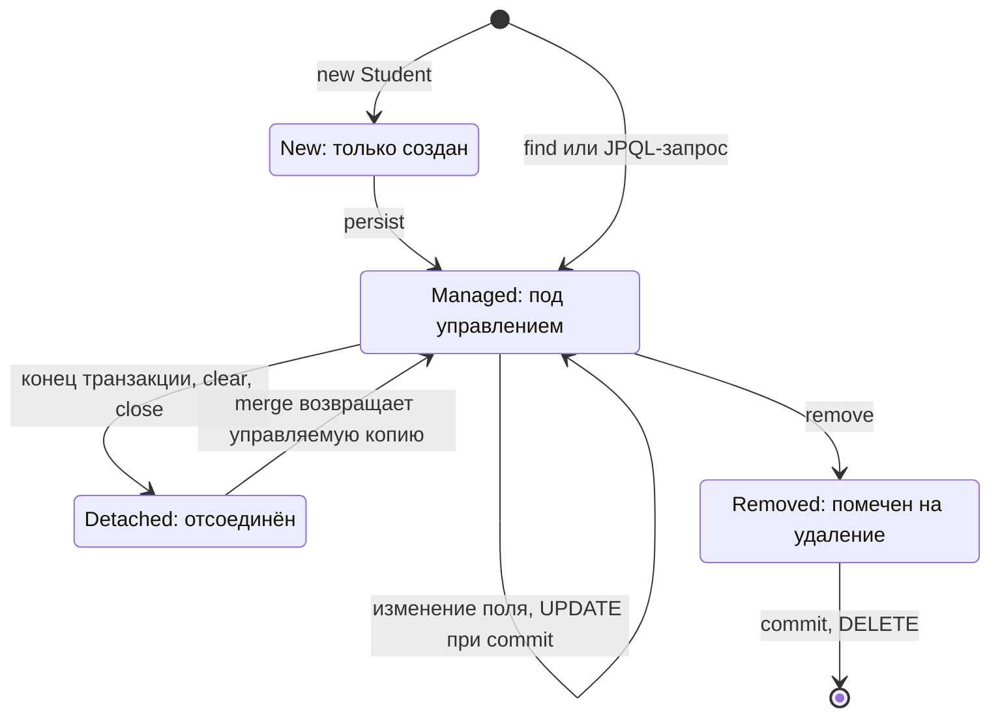

*Схема: SQL порождают переходы, а не вызовы сеттеров. `INSERT` и `DELETE` уходят в базу при `flush` или `commit`, а изменения управляемого объекта — там же, автоматически. У отсоединённого объекта менять поля бесполезно: база о них не узнает, пока объект не пройдёт через `merge`.*

Объект проходит четыре состояния **жизненного цикла**. **New** (transient) — обычный объект после `new`, ORM о нём не знает. **Managed** — объект в контексте, и все изменения его полей отслеживаются. **Detached** — объект с данными из базы, но контекст уже закрыт. **Removed** — объект помечен на удаление, `DELETE` выполнится при фиксации.

Отслеживание изменений называется **dirty checking**. При фиксации транзакции провайдер сравнивает каждый управляемый объект со снимком, сделанным при загрузке, и для изменённых выполняет `UPDATE`. Отсюда главное отличие от репозиториев «в стиле DAO»: метода `update` нет и он не нужен.

> [!NOTE]
> **В твоей работе**
>
> Файл: `src/main/java/ru/itmo/students/service/StudentService.java`, строки 71–84
>
> ```java
> @Transactional
> public StudentResponse replace(String isuId, StudentRequest request) {
>     ...
>     Student student = findOrThrow(isuId);
>     checkDates(request.checkIn(), request.checkOut());
>     StudentMapper.copyToEntity(request, student);
>
>     // Сущность «управляемая»: изменения полей сами запишутся в БД при завершении транзакции
>     LOG.info("Изменён студент " + isuId);
>     return StudentMapper.toResponse(student);
> }
> ```
>
> Ни `save`, ни `merge` здесь нет. `findOrThrow` внутри транзакции возвращает managed-объект, маппер меняет его поля, а `UPDATE` выполнится при выходе из метода, когда интерсептор `@Transactional` сделает commit. Без `@Transactional` код молча перестал бы сохранять изменения: объект оказался бы detached сразу после `find`.
>
> Файл: `src/main/java/ru/itmo/students/repository/UserRepository.java`, строки 37–41
>
> ```java
> public void save(User user) {
>     em.persist(user);
>     // id выдаёт сама БД (IDENTITY), поэтому INSERT выполняем сразу, чтобы id появился в объекте
>     em.flush();
> }
> ```
>
> При `IDENTITY` ключ появляется только после `INSERT`, а EclipseLink откладывает `INSERT` до фиксации. `flush` вызывает запись сразу, но транзакция при этом не завершается, и ошибка позже всё равно её откатит.

### Запросы: JPQL

Для выборок сложнее, чем «по ключу», в JPA есть **JPQL** — язык запросов, похожий на SQL, но оперирующий классами и полями Java: `SELECT s FROM Student s WHERE s.checkOut IS NULL`, а не `students` и `check_out`. Провайдер переводит JPQL в SQL конкретной СУБД. Значения передаются **именованными параметрами** (`:group`), и драйвер отправляет их отдельно от текста запроса.

**Плохо:**

```java
em.createQuery("SELECT s FROM Student s WHERE s.group = '" + group + "'", Student.class);
// group = "M3301' OR '1'='1" — и фильтр больше не фильтрует
```

**Хорошо:**

```java
em.createQuery("SELECT s FROM Student s WHERE s.group = :group", Student.class)
  .setParameter("group", group);   // значение никогда не становится частью текста запроса
```

Склеивание строк открывает дорогу инъекции: в JPQL она ограниченнее, чем в SQL, но всё равно позволяет менять смысл условия. Параметром нельзя передать имя поля или направление сортировки, поэтому для `ORDER BY` применяют белый список.

> [!NOTE]
> **В твоей работе**
>
> Файл: `src/main/java/ru/itmo/students/repository/StudentRepository.java`, строки 25–66
>
> ```java
> private static final Map<String, String> SORT_FIELDS = Map.of(
>         "isu_id", "s.isuId",
>         "full_name", "s.fullName",
>         ...
> public List<Student> find(StudentFilter filter) {
>     Map<String, Object> params = new HashMap<>();
>     String orderBy = SORT_FIELDS.get(filter.sort()) + ("desc".equals(filter.order()) ? " DESC" : " ASC");
>
>     // Второй ключ сортировки — ИСУ: порядок одинаковых значений не «прыгает» между страницами
>     String jpql = "SELECT s FROM Student s" + where(filter, params) + " ORDER BY " + orderBy + ", s.isuId";
>
>     TypedQuery<Student> query = em.createQuery(jpql, Student.class);
>     params.forEach(query::setParameter);
>     return query
>             .setFirstResult((filter.page() - 1) * filter.size())
>             .setMaxResults(filter.size())
>             .getResultList();
> }
> ```
>
> Это требование поиска, фильтрации, сортировки и пагинации. Запрос собирается строкой, но склеиваются только фиксированные фрагменты из кода: условия из `where(...)` с плейсхолдерами `:fullName`, `:group` и т. д. и поле сортировки из `SORT_FIELDS`. Значения от клиента попадают только в параметры. Пагинацию `setFirstResult`/`setMaxResults` EclipseLink переводит в `LIMIT … OFFSET …` для PostgreSQL. Второй ключ `s.isuId` нужен потому, что без однозначного порядка СУБД вправе возвращать студентов с одинаковой фамилией в разном порядке, и запись «переезжала» бы между страницами.

### Ленивая загрузка и N+1

Связанные объекты загружаются либо сразу (**EAGER**), либо при первом обращении (**LAZY**). Значения по умолчанию разобраны в [вопросе 9](#q9). Ленивая загрузка экономит запросы, но в цикле даёт **проблему N+1**: один запрос за списком и ещё по одному на связь каждого элемента. Например, при выводе 50 refresh-токенов с владельцами без `JOIN FETCH` получилось бы до 51 запроса. Лечится загрузкой связи тем же запросом: `SELECT t FROM RefreshToken t JOIN FETCH t.user`. В работе проблема не возникает. У `Student` связей нет вовсе, а `RefreshToken.user` (`@ManyToOne`, по умолчанию EAGER) читается по одному токену за раз. Так что ORM здесь не порождает скрытых запросов.

### Преимущества и цена

| Преимущества | Недостатки |
|:-----------|:-----------|
| нет шаблонного кода JDBC и ручной сборки объектов | SQL скрыт: легко получить N+1 или лишние запросы, не заметив их |
| автоматическая запись изменений (dirty checking) | нужно понимать жизненный цикл, иначе изменения теряются (detached) |
| кэш первого уровня, одна строка — один объект | сложные отчёты, оконные функции, массовые обновления удобнее на SQL |
| переносимость между СУБД, JPQL вместо диалекта | абстракция протекает: `flush` при `IDENTITY`, особенности провайдера |
| параметры запросов по умолчанию, меньше риска инъекции | накладные расходы на снимки и контекст при массовой обработке |

ORM хорошо подходит для CRUD над объектами предметной области, как в этой работе. На больших выборках и отчётах её дополняют обычным SQL: в JPA есть `createNativeQuery`, а bulk-`UPDATE` на JPQL, как `revokeAllOf` в `RefreshTokenRepository`, обходит контекст персистентности целиком.

> [!CAUTION]
> **Расхождение с практикой**
>
> Схема создаётся скриптом, а не инструментом миграций; чем это плохо и что ответить, разобрано в [вопросе 8](#q8). Со стороны ORM важно другое: выбор скрипта вместо генерации по аннотациям (`metadata`) осознанный, только так в базе появляются `CHECK` и `ON DELETE CASCADE`. Динамический JPQL собран строкой. Он безопасен, потому что значения параметризованы, а `ORDER BY` идёт из белого списка, но типобезопасный способ строить запросы с переменным набором условий — Criteria API. Наконец, `delete` делает физический `em.remove`, и история проживания пропадает. Условие этого не запрещает, альтернатива — мягкое удаление (флаг или `check_out`).

> [!TIP]
> **Могут спросить**
>
> **Чем `persist` отличается от `merge`?** `persist` делает управляемым сам переданный новый объект, а для уже существующей строки это ошибка. `merge` копирует состояние переданного (обычно отсоединённого) объекта в управляемый экземпляр и возвращает его. Сам аргумент остаётся detached, поэтому работать дальше нужно с результатом `merge`.
>
> **Когда SQL реально уходит в базу?** При `flush`: явном, перед JPQL-запросом (режим `AUTO`, чтобы запрос увидел несохранённые изменения) и при фиксации транзакции. До этого `persist` и изменения полей только накапливаются в контексте.
>
> **Почему в ответ API отдаётся `StudentResponse`, а не сама сущность?** Сущность привязана к схеме БД и жизненному циклу ORM: её сериализация может зацепить ленивые связи или служебные поля, а у `User` — `password_hash`. DTO фиксирует контракт API отдельно от таблицы, подробнее — [вопрос 6](#q6).

## Вопрос 11. Транзакции в базе данных. Основные свойства транзакций и их применение в backend-приложениях.

Когда клиент обменивает refresh-токен на новую пару, сервер делает две записи: помечает старый токен отозванным и сохраняет строку нового. Если между ними что-то упадёт (оборвётся соединение, сервер перезапустится, сработает ограничение БД), возможны два плохих исхода. Если старый токен отозван, а новый не записан, пользователя выбросит из системы. Если новый записан, а старый остался действующим, по одному refresh-токену можно получить две пары. Нужно, чтобы обе записи либо выполнились вместе, либо не выполнились вовсе. Для этого и существует **транзакция** — группа операций, которую база данных выполняет как одну неделимую.

### COMMIT и ROLLBACK

В SQL транзакцию открывают `BEGIN` и завершают одной из двух команд. `COMMIT` фиксирует все изменения, `ROLLBACK` отменяет их, как будто ничего не происходило.

```sql
BEGIN;
-- отзываем старый refresh-токен
UPDATE refresh_tokens SET revoked = TRUE WHERE jti = '6f1c...';
-- записываем новый
INSERT INTO refresh_tokens (jti, user_id, expires_at)
VALUES ('a93e...', 7, now() + interval '7 days');
COMMIT;   -- при ошибке на любом шаге — ROLLBACK, обе строки останутся как были
```

Если транзакцию не открыть явно, PostgreSQL выполняет каждую команду в отдельной транзакции (режим **autocommit**).

### Свойства ACID

Гарантии транзакции принято перечислять аббревиатурой **ACID**.

| Свойство | Что гарантирует | Пример на предметной области |
|:--|:-----------|:-----------|
| **Atomicity** — атомарность | выполняются все операции или ни одна | при ротации refresh-токена не бывает «старый отозван, новый не записан» |
| **Consistency** — согласованность | транзакция переводит БД из корректного состояния в корректное: все ограничения (`NOT NULL`, `UNIQUE`, `CHECK`, внешние ключи) выполнены после фиксации | вставка второго студента с ИСУ `412345` нарушит первичный ключ, и транзакция откатится целиком |
| **Isolation** — изолированность | параллельные транзакции не видят промежуточных состояний друг друга (насколько строго — зависит от уровня изоляции) | пока администратор правит студента, другой запрос не прочитает полузаписанные данные |
| **Durability** — долговечность | зафиксированное не теряется даже при сбое | после ответа `201 Created` студент не исчезнет при перезапуске PostgreSQL: запись уже попала в журнал WAL на диске |

Согласованность обеспечивают ограничения схемы (подробнее — [вопрос 8](#q8)), а остальные три свойства — механизмы самой СУБД: журнал, блокировки, версии строк.

### Уровни изоляции и аномалии

Полная изоляция означала бы выполнять транзакции строго по очереди, а это медленно. Поэтому стандарт SQL определяет четыре **уровня изоляции**: чем ниже уровень, тем больше параллельности и тем больше допустимых **аномалий**, то есть эффектов, которых не было бы при последовательном выполнении.

| Аномалия | Что происходит | Read Uncommitted | Read Committed | Repeatable Read | Serializable |
|:--|:----------|:-:|:-:|:-:|:-:|
| Грязное чтение | читаются незафиксированные изменения чужой транзакции | возможно (в PostgreSQL — нет) | нет | нет | нет |
| Неповторяемое чтение | повторный `SELECT` той же строки даёт другое значение | возможно | возможно | нет | нет |
| Фантомы | повторный запрос с условием возвращает другой набор строк | возможно | возможно | по стандарту возможно, в PostgreSQL нет | нет |
| Потерянное обновление | две транзакции читают одно значение, и вторая запись затирает первую | возможно | возможно | в PostgreSQL — ошибка сериализации | нет |

В PostgreSQL по умолчанию действует **Read Committed**: каждый запрос видит данные, зафиксированные к моменту его начала. В работе уровень не меняется, значит действует именно он. От потерянного обновления этот уровень не защищает, и в работе это проявляется (см. ниже).

### Транзакции в Jakarta EE: JTA и `@Transactional`

В приложении писать `BEGIN` и `COMMIT` вручную неудобно и рискованно: легко забыть откат в ветке с исключением. В Jakarta EE транзакциями управляет сервер приложений через **JTA** (Jakarta Transactions). Код только объявляет границы аннотацией `@Transactional` на методе CDI-бина. Перед вызовом метода интерсептор открывает транзакцию, после выхода фиксирует её, а при исключении откатывает. Как интерсептор оборачивает бин через прокси, разобрано в [вопросе 5](#q5).

Поведение при вызове из уже идущей транзакции задаёт атрибут `value` (`TxType`). По умолчанию стоит `REQUIRED`: присоединиться к текущей транзакции, а если её нет — открыть новую. `REQUIRES_NEW` приостанавливает внешнюю транзакцию и открывает свою (так пишут, например, журнал аудита, который должен сохраниться даже при откате основной операции). `MANDATORY` требует, чтобы транзакция уже была, `NOT_SUPPORTED` и `NEVER` выполняют метод вне транзакции.

**Правила отката** в Jakarta `@Transactional` такие: непроверяемое исключение (`RuntimeException`, `Error`) откатывает транзакцию, проверяемое — нет, транзакция фиксируется. Это меняют два атрибута: `rollbackOn` добавляет откат для указанных проверяемых исключений, `dontRollbackOn` отменяет откат для указанных непроверяемых. Если тип подходит под оба атрибута, побеждает `dontRollbackOn`. Все исключения работы наследуют `ApiException extends RuntimeException` (см. [вопрос 7](#q7)), поэтому любая ошибка из сервиса по умолчанию откатывает транзакцию.

> [!NOTE]
> **В твоей работе**
>
> Файл: `src/main/resources/META-INF/persistence.xml`, строки 6–8
>
> ```xml
> <!-- JTA: транзакциями управляет сервер, в коде достаточно @Transactional -->
> <persistence-unit name="students" transaction-type="JTA">
>     <jta-data-source>jdbc/studentsDS</jta-data-source>
> ```
>
> Файл: `src/main/java/ru/itmo/students/service/AuthService.java`, строки 82–94
>
> ```java
> @Transactional(dontRollbackOn = UnauthorizedException.class)
> public TokenResponse refresh(String token) {
>     RefreshToken stored = findRefreshToken(token);
>
>     if (stored.isRevoked()) {
>         refreshTokens.revokeAllOf(stored.getUser());
>         LOG.warning("Повторное использование refresh-токена, все токены отозваны: " + stored.getUser().getUsername());
>         throw new UnauthorizedException("INVALID_TOKEN", "Refresh-токен уже использован или отозван. Войдите заново");
>     }
>
>     stored.setRevoked(true);
>     return issueTokens(stored.getUser());
> }
> ```
>
> Здесь видны оба лица транзакции. В обычной ветке `setRevoked(true)` (изменение управляемой сущности, которое запишется при коммите, см. [вопрос 10](#q10)) и вставка нового токена в `issueTokens` фиксируются вместе, что и закрывает требование продлевать работу без повторного ввода пароля. В ветке повторного использования метод отзывает все токены пользователя и бросает `UnauthorizedException`. Это `RuntimeException`, и без `dontRollbackOn` интерсептор откатил бы `UPDATE` из `revokeAllOf`: клиент получил бы 401, а украденные токены остались бы действующими. С `dontRollbackOn` транзакция фиксируется, после чего исключение уходит в маппер и превращается в 401. Зачем вообще отзывать все токены, разобрано в [вопросе 13](#q13). Это место на защите спрашивают первым.

### Где проводить границы транзакции

Граница транзакции должна совпадать с **бизнес-операцией**: «создать студента», «обменять токен». Поэтому `@Transactional` ставят на методы сервиса. На репозитории граница слишком мелкая: два вызова репозитория окажутся в разных транзакциях, и атомарность потеряется. На ресурсе она слишком крупная: в транзакцию попадут разбор JSON и формирование ответа, и слой HTTP начнёт отвечать за данные.

Транзакцию стоит держать короткой. Пока она открыта, она занимает соединение из пула и удерживает блокировки изменённых строк: другие транзакции, пишущие те же строки, ждут. Внутрь транзакции не кладут сетевые вызовы, ожидание пользователя и тяжёлые вычисления. В работе к этому есть мелкое замечание: `login` и `register` помечены `@Transactional` и вычисляют BCrypt (сотни миллисекунд, см. [вопрос 15](#q15)) уже после первого запроса к БД, то есть с занятым соединением. На учебной нагрузке это незаметно.

Чтения, которым не нужна согласованность нескольких запросов, можно выполнять без транзакции. В работе так устроен `StudentService.find`: страница и `total` читаются двумя независимыми запросами, и при параллельной вставке `total` может разойтись со страницей на одну запись. Для списка это приемлемо.

> [!NOTE]
> **В твоей работе**
>
> Файл: `src/main/java/ru/itmo/students/service/StudentService.java`, строки 92–100
>
> ```java
> @Transactional
> public void loadDemoIfEmpty(List<StudentRequest> students) {
>     if (repository.countAll() > 0) {
>         return;
>     }
>     students.forEach(this::create);
>     ...
> }
> ```
>
> `create` тоже помечен `@Transactional`, но вызывается через `this`, в обход прокси, поэтому его аннотация здесь не действует. Работает внешняя транзакция `loadDemoIfEmpty`: все демо-студенты загружаются одной транзакцией, и ошибка на любом из них откатит всю загрузку. Поведение получилось правильным, но не благодаря аннотации на `create`. Если спросят, сработает ли `@Transactional(REQUIRES_NEW)` на `create` при таком вызове, ответ — нет.

### Гонка «проверить, потом вставить»

Самая частая ошибка с транзакциями — считать, что транзакция сама по себе защищает от параллельных запросов. На уровне Read Committed это не так.

**Плохо:**

```java
@Transactional
public StudentResponse create(StudentRequest request) {
    if (repository.existsById(request.isuId())) {          // оба запроса видят: ИСУ свободен
        throw new ConflictException("isu_id", "Студент уже есть");
    }
    repository.save(student);                              // оба пытаются вставить
    ...
}
```

**Хорошо:**

```java
@Transactional
public StudentResponse create(StudentRequest request) {
    ...
    try {
        repository.save(student);
        repository.flush();                                // INSERT сейчас, а не при коммите
    } catch (PersistenceException e) {
        if (isUniqueViolation(e)) {                        // SQLSTATE 23505 в PostgreSQL
            throw new ConflictException("isu_id", "Студент с ИСУ " + request.isuId() + " уже есть");
        }
        throw e;
    }
    ...
}
```

Два одновременных `POST` с ИСУ `412345` выполняют `existsById` до того, как кто-либо из них зафиксировал вставку, поэтому оба получают «нет такого». Такой шаблон называют **check-then-act**: между проверкой и действием состояние успевает измениться. Единственная надёжная проверка уникальности — ограничение `PRIMARY KEY`/`UNIQUE` в самой БД. Предварительную проверку можно оставить для понятного сообщения в обычном случае, но в гонке решает ограничение, и его нарушение нужно перевести в 409.

> [!CAUTION]
> **Расхождение с практикой**
>
> Требование проверять уникальность в работе закрыто именно шаблоном check-then-act: `existsById` в `StudentService.create`, `existsByUsername` и `existsByEmail` в `AuthService.createUser`. Ограничения в БД есть, поэтому дубль не запишется, но нарушение ограничения приходит как `PersistenceException` (у студентов — даже при коммите, уже за пределами метода) и попадает в `UnexpectedExceptionMapper`, то есть клиент получает 500 вместо 409. На защите: признать гонку, сказать, что целостность данных гарантирует БД, и назвать исправление — `flush` в `try` и перевод SQLSTATE 23505 в `ConflictException`.

### Потерянное обновление и блокировки

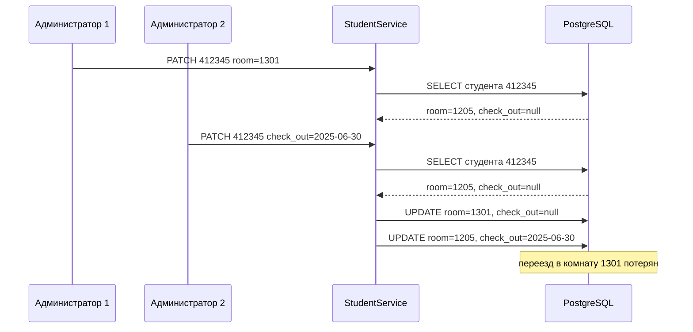

*Схема: каждый PATCH сливает свои изменения с прочитанной копией и записывает студента целиком, поэтому второй запрос возвращает старую комнату. С `@Version` второй `UPDATE ... WHERE version = 7` не найдёт строку (версия уже 8), и вместо молчаливой потери данных получится ошибка, которую можно отдать клиенту как 409.*

**Потерянное обновление** (lost update) возникает, когда две транзакции читают одну строку, обе вычисляют новое значение и обе пишут: вторая запись затирает первую. Против него есть два подхода.

**Оптимистическая блокировка** исходит из того, что конфликты редки. В сущность добавляют поле-версию, и JPA сама включает его в условие `UPDATE`:

```java
@Version
@Column(name = "version", nullable = false)
private long version;   // UPDATE students SET ..., version = 8 WHERE isu_id = ? AND version = 7
```

Если строку успели изменить, `UPDATE` затронет 0 строк, и JPA бросит `OptimisticLockException`. Его переводят в 409, а клиент перечитывает данные и повторяет правку. Блокировок нет, и читатели никого не ждут.

**Пессимистическая блокировка** исходит из того, что конфликты вероятны: строку блокируют уже при чтении, `em.find(Student.class, isuId, LockModeType.PESSIMISTIC_WRITE)` превращается в `SELECT ... FOR UPDATE`. Вторая транзакция ждёт, пока первая завершится, и читает уже новые данные. Подход надёжен для коротких операций с частыми конфликтами (счётчики, остатки), но держит блокировки и грозит взаимными блокировками (deadlock).

> [!CAUTION]
> **Расхождение с практикой**
>
> Требование частичного изменения выполнено, но в `StudentResource.patch` (строки 133–139, код — в [вопросе 6](#q6)) чтение (`service.get`, без транзакции) и запись (`service.replace`, своя транзакция) разнесены, а между ними — слияние в слое HTTP. Это ровно сценарий со схемы, и поля `@Version` у `Student` нет. Здесь есть тонкость: одна аннотация `@Version` эту дыру не закроет, потому что `replace` заново читает студента и сравнит версию, прочитанную уже внутри своей транзакции. Исправлений два. Первое — перенести весь PATCH (чтение, слияние, запись) в один `@Transactional`-метод сервиса и добавить `@Version`. Второе — передавать версию через API: `ETag` в ответе на GET и `If-Match` в PATCH, а при несовпадении отвечать `412 Precondition Failed`.

> [!WARNING]
> **Подводный камень**
>
> Ротация refresh-токена подвержена той же гонке. Два одновременных `refresh` с одним токеном на Read Committed оба прочитают `revoked = false`, оба пометят его отозванным и оба выдадут новые пары: обнаружение повторного использования не сработает. Надёжный вариант — условное обновление `UPDATE refresh_tokens SET revoked = TRUE WHERE jti = ? AND revoked = FALSE` с проверкой, что изменена ровно одна строка, либо `PESSIMISTIC_WRITE` при чтении токена. Клиент работы (`api.js`) не шлёт параллельных обновлений, но злоумышленник с украденным токеном может их послать.

> [!TIP]
> **Могут спросить**
>
> **Почему исключение в `refresh` не откатывает отзыв токенов, а в `create` откатывает вставку?** Оба исключения непроверяемые и по умолчанию вызывают откат. В `refresh` стоит `dontRollbackOn = UnauthorizedException.class`: при этом исключении транзакция фиксируется, и только потом исключение уходит дальше. В `create` такого атрибута нет, поэтому `ConflictException` или `DataValidationException` откатывают всё.
>
> **Чем Repeatable Read отличается от Serializable в PostgreSQL?** Repeatable Read даёт транзакции один снимок данных на всё время работы: повторные чтения и фантомы исключены, а попытка изменить строку, которую уже изменила параллельная транзакция, завершится ошибкой сериализации. Serializable дополнительно отслеживает зависимости между транзакциями и ловит аномалии, когда каждая проверяет условие, а потом обе пишут разные строки (write skew). За это приходится платить откатами, и приложение должно уметь повторить транзакцию.
>
> **Что будет, если убрать `@Transactional` с `replace`?** В JTA без транзакции `EntityManager` с областью транзакции отдаёт отсоединённую сущность, и изменения полей никто не запишет: метод вернёт новые данные, а в БД останутся старые. Dirty checking работает только для управляемых сущностей внутри транзакции (см. [вопрос 10](#q10)).

## Вопрос 12. Аутентификация и авторизация. Различия между ними.

API общежития открыт в сеть: список студентов могут читать все вошедшие пользователи, а заселять, править и удалять — только администратор. На каждый запрос сервер должен ответить на два разных вопроса: кто прислал запрос и можно ли ему делать то, что он просит. Первый вопрос решает аутентификация, второй — авторизация. Механизмы у них разные, ошибки разные, и клиент на эти ошибки реагирует по-разному, поэтому смешивать их нельзя.

### Три шага: идентификация, аутентификация, авторизация

**Идентификация** — субъект называет себя: передаёт логин `ivanov`. Это заявление, его никто ещё не проверил. **Аутентификация** — проверка этого заявления: пароль совпал с хешем в базе или подпись токена верна. Результат аутентификации — установленная личность (в Jakarta EE это **принципал**, `Principal`). **Авторизация** — решение, разрешено ли этой личности конкретное действие над конкретным ресурсом: `DELETE /api/requests/412345` — да или нет.

На вахте общежития то же самое: студент называет фамилию (идентификация), показывает пропуск с фотографией (аутентификация), вахтёр сверяется со списком и пускает в свой корпус, но не в кабинет коменданта (авторизация).

| | Аутентификация | Авторизация |
|:--|:-----------|:-----------|
| Вопрос | Кто ты? | Что тебе можно? |
| Чем подтверждается | пароль, подпись токена, сертификат | роли и правила доступа к ресурсу |
| Когда | при входе и на каждом запросе с токеном | на каждом запросе, после аутентификации |
| Результат | принципал: логин и роль | разрешить или отказать |
| Ошибка | 401 Unauthorized | 403 Forbidden |
| В работе | `AuthService.login`, `AuthenticationFilter` | `AuthorizationFilter`, `@RolesAllowed` |

Порядок всегда один: сначала аутентификация, потом авторизация. Решение «можно ли» опирается на ответ на «кто это»: пока личность не установлена, проверять её роль не на чем. Обратное не обязательно: решение может и не требовать личности. Вход и регистрация открыты всем (`@PermitAll`), и решение «пускать анонима» — тоже авторизация, просто без требования к принципалу.

> [!WARNING]
> **Подводный камень**
>
> Роль в токене — не результат авторизации, а только атрибут личности. При входе сервер ничего не «авторизует заранее»: он выдаёт токен, в котором записано, кто ты и какая у тебя роль. Решение «можно ли удалить студента» принимается на каждом запросе заново, по аннотациям конкретного метода.

### 401 против 403

Название статуса 401 Unauthorized сбивает с толку: по смыслу (RFC 9110) он означает «нет действительных учётных данных», то есть «не аутентифицирован». Ответ 401 обязан содержать заголовок `WWW-Authenticate` со схемой входа — в работе это `Bearer`. 403 Forbidden означает обратное: сервер знает, кто ты, но действие тебе запрещено, и повторный вход ничего не изменит.

| Сценарий | Ответ | Почему |
|:-----------|:--|:-----------|
| `GET /api/requests` без заголовка `Authorization` | 401 | метод требует роль, а принципала нет |
| Заголовок `Basic …` вместо `Bearer …` | 401 | не та схема аутентификации |
| Токен с поддельной подписью | 401 `INVALID_TOKEN` | подпись не сошлась |
| Истёкший access-токен | 401 `TOKEN_EXPIRED` | клиенту нужно обновить токен |
| Refresh-токен вместо access | 401 `INVALID_TOKEN` | не тот тип токена |
| USER делает `DELETE /api/requests/412345` | 403 | личность известна, роль не подходит |
| USER с истёкшим токеном делает `DELETE` | 401 | аутентификация не прошла, до проверки роли дело не дошло |
| ADMIN делает `DELETE /api/requests/412345` | 204 | разрешено |

Разница важна клиенту: на 401 он пробует обновить токен или отправляет на страницу входа, на 403 показывает «недостаточно прав» и ничего не повторяет.

**Плохо:**

```java
if (!security.isUserInRole("ADMIN")) {
    throw new UnauthorizedException("Нет доступа");   // 401 на чужую роль
}
```

**Хорошо:**

```java
if (security.getUserPrincipal() == null) {
    throw new UnauthorizedException("Нужно войти");   // 401: неизвестно, кто это
}
if (!security.isUserInRole("ADMIN")) {
    throw new AccessDeniedException("Недостаточно прав"); // 403: известно, но нельзя
}
```

В первом варианте клиент работы (`api.js`) на 401 обновит токены, повторит `DELETE`, снова получит 401 — новый токен несёт ту же роль USER — и выкинет пользователя на страницу входа. Пользователя разлогинят за попытку нажать кнопку, на которую у него нет прав.

### Способы аутентификации

Пароль проверяется один раз, при входе. Дальше на каждом запросе пользователь предъявляет то, что сервер выдал ему после входа: идентификатор сессии или токен.

| Способ | Что передаёт клиент | Состояние на сервере | Где уместен |
|:--|:-----------|:-----|:-----------|
| Сессия + cookie | `JSESSIONID` в cookie | хранилище сессий (stateful) | классические серверные веб-приложения |
| HTTP Basic | логин и пароль в каждом запросе | нет | внутренние сервисы, только по HTTPS |
| Bearer-токен (JWT) | подписанный токен в `Authorization` | нет (stateless) | REST API, SPA, мобильные клиенты |
| OAuth 2.0 / OpenID Connect | токен от внешнего провайдера | у провайдера | вход через сторонний сервис, единый вход |

**Stateful**-аутентификация хранит сессию на сервере: при нескольких экземплярах приложения нужно общее хранилище или «липкая» балансировка. **Stateless**-токен несёт данные о пользователе в себе, и любой экземпляр проверяет его по подписи, не обращаясь к базе. Платой за это становится отзыв: выданный access-токен действует до истечения срока, поэтому его делают короткоживущим и дополняют refresh-токеном. Устройство токена и ротация — [вопрос 13](#q13).

### Где проходит каждая фаза в работе

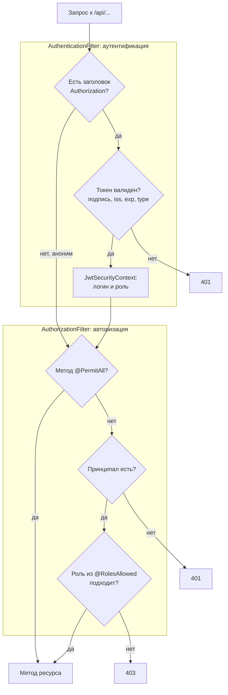

*Схема: 401 возникает в двух местах — при плохом токене в фильтре аутентификации и при отсутствии токена в фильтре авторизации. Анонимный запрос фильтр аутентификации пропускает намеренно: только авторизация знает, открыт ли вызываемый метод. 403 возможен лишь после успешной аутентификации.*

Первичная аутентификация по паролю — `POST /api/auth/login`, в ответ выдаётся пара токенов (требование выдавать после входа данные для доступа к защищённым ресурсам). Аутентификация каждого запроса — фильтр `AuthenticationFilter` с приоритетом `Priorities.AUTHENTICATION`; авторизация — `AuthorizationFilter` с приоритетом `Priorities.AUTHORIZATION`, который выполняется позже. Так закрыто требование разграничивать права непосредственно на backend. Как фильтр читает аннотации и строит матрицу ролей — [вопрос 14](#q14).

Результат аутентификации живёт в объекте `SecurityContext` запроса. Фильтр подменяет контекст на собственный `JwtSecurityContext`, и дальше любой код запроса спрашивает у него `getUserPrincipal()` и `isUserInRole(...)`, не разбирая токен повторно. Так работает `GET /api/auth/me`: метод получает `@Context SecurityContext` и по логину из него находит пользователя.

> [!NOTE]
> **В твоей работе**
>
> Файл: `src/main/java/ru/itmo/students/security/AuthenticationFilter.java`, строки 28–45
>
> ```java
> @Override
> public void filter(ContainerRequestContext request) {
>     String header = request.getHeaderString(HttpHeaders.AUTHORIZATION);
>
>     if (header == null) {
>         return;
>     }
>
>     if (!header.startsWith(BEARER_PREFIX)) {
>         throw new UnauthorizedException("Заголовок Authorization должен иметь вид: Bearer <access-токен>");
>     }
>
>     String token = header.substring(BEARER_PREFIX.length()).trim();
>     DecodedJWT jwt = jwtService.verify(token, TokenType.ACCESS);
>
>     boolean secure = request.getSecurityContext().isSecure();
>     request.setSecurityContext(new JwtSecurityContext(jwt.getSubject(), jwtService.getRole(jwt), secure));
> }
> ```
>
> Фильтр только устанавливает личность и ничего не запрещает: без заголовка запрос уходит дальше анонимным. Пришедший токен проверяется всегда; `verify` бросает `UnauthorizedException` с кодом `TOKEN_EXPIRED` или `INVALID_TOKEN`, а `ApiExceptionMapper` добавляет к любому 401 заголовок `WWW-Authenticate: Bearer`. Вероятный вопрос: «почему анонима не отсекают сразу здесь?» — потому что фильтр не знает, какой метод вызывается и открыт ли он; это знание есть только у авторизации.
>
> Файл: `src/main/java/ru/itmo/students/service/AuthService.java`, строки 61–71
>
> ```java
> @Transactional
> public TokenResponse login(LoginRequest request) {
>     User user = users.findByUsername(request.username())
>             .filter(found -> passwordHasher.matches(request.password(), found.getPasswordHash()))
>             .orElse(null);
>
>     // Одно сообщение и для чужого логина, и для неверного пароля: так нельзя узнать, какие логины существуют
>     if (user == null) {
>         LOG.warning("Неудачный вход: " + request.username());
>         throw new UnauthorizedException("Неверный логин или пароль");
>     }
> ```
>
> Разные сообщения «нет такого логина» и «неверный пароль» позволили бы **перечислить логины**: перебрать список и узнать, какие из них зарегистрированы. Неудачный вход пишется в лог с уровнем WARNING — по таким записям видно подбор пароля. Пароль в лог не попадает.

> [!CAUTION]
> **Расхождение с практикой**
>
> Условие называет вход «авторизацией»: «после успешной авторизации пользователь должен получать данные…», «для авторизации необходимо использовать JWT». В строгих терминах это аутентификация: JWT подтверждает личность и несёт роль, а авторизацией становится проверка этой роли в `AuthorizationFilter`. На защите стоит сказать, что в обиходе «авторизоваться» значит «войти», а в коде эти фазы разделены по разным фильтрам.
>
> Защита входа неполная. Ограничения числа попыток (rate limiting, временной блокировки учётной записи) нет — его стоит назвать следующим шагом. Для несуществующего логина BCrypt не вызывается, и ответ приходит заметно быстрее, так что логины можно перечислить по времени ответа, несмотря на одинаковое сообщение; разбор и исправление — [вопрос 15](#q15). Проверка токена и ролей написана своими фильтрами, а не стандартной фичей `mpJwt` Open Liberty — почему так и как это защищать, разобрано в [вопросе 14](#q14).

> [!TIP]
> **Могут спросить**
>
> **Почему 401 называется Unauthorized, если речь об аутентификации?** Так сложилось исторически в ранних RFC по HTTP. Современный RFC 9110 определяет 401 как отсутствие действительных учётных данных и требует заголовок `WWW-Authenticate`; запрет при известной личности — это 403.
>
> **Бывает ли авторизация без аутентификации?** Да, если правило разрешает доступ всем: `/api/auth/login` и `/api/auth/register` помечены `@PermitAll`, и `AuthorizationFilter` пропускает их без принципала. Решение принято, просто личность для него не нужна.
>
> **Что будет, если на `/api/auth/refresh` прислать просроченный access-токен в заголовке?** 401 `TOKEN_EXPIRED`: `AuthenticationFilter` глобальный и проверяет любой пришедший токен, даже на открытых адресах. Клиент работы (`api.js`) поэтому отправляет запрос обновления без заголовка `Authorization`.

## Вопрос 13. JWT: устройство токена, подпись, access- и refresh-токены.

После входа сервер должен как-то узнавать пользователя в каждом следующем запросе. Классический способ — сессия: сервер хранит у себя запись «сессия abc123 — пользователь ivanov_ii, роль USER», а клиент присылает только номер сессии. Тогда на каждый запрос сервер лезет в хранилище сессий, а при нескольких экземплярах приложения это хранилище должно быть общим. Токен решает задачу иначе: сервер один раз выдаёт клиенту документ «это ivanov_ii, роль USER, действителен до 08:15», заверенный подписью, и дальше проверяет только подпись и срок. Хранить ничего не нужно, проверка идёт без похода в БД. Это и есть **stateless-аутентификация** (сравнение с сессиями — в [вопросе 12](#q12)). **JWT** (JSON Web Token, RFC 7519) — стандартный формат такого документа.

### Из чего состоит токен

JWT — строка из трёх частей через точку: `header.payload.signature`.

```
eyJhbGciOiJIUzI1NiIsInR5cCI6IkpXVCJ9.eyJpc3MiOiJ3ZWJfbGFiXzMiLCJzdWIiOi...J9.Xk3...q8
```

Первые две части — JSON, закодированный **Base64URL**: это Base64, в котором `+` и `/` заменены на `-` и `_`, а `=` в конце отброшены, чтобы токен можно было без экранирования передать в URL и заголовке. Если раскодировать access-токен этой работы, получится:

```json
{ "alg": "HS256", "typ": "JWT" }
```

```json
{
  "iss": "web_lab_3",
  "sub": "ivanov_ii",
  "role": "USER",
  "type": "ACCESS",
  "iat": 1727769600,
  "exp": 1727770500
}
```

**Header** говорит, чем подписан токен. **Payload** содержит **claims** — утверждения о пользователе и самом токене. Время в них — секунды Unix: `exp` здесь на 900 секунд позже `iat`, то есть токен живёт 15 минут. Третья часть, **signature**, — подпись первых двух.

> [!WARNING]
> **Подводный камень**
>
> Base64URL — это кодирование, а не шифрование. Payload любой может прочитать без секрета, например на jwt.io. Подпись защищает токен от изменения, но не от чтения. Пароль, номер паспорта или хеш пароля в payload класть нельзя. Роль и логин — можно: это не секрет.

Стандарт определяет набор **зарегистрированных claims**. Все они необязательные, но если есть, библиотеки умеют их проверять.

| Claim | Смысл | В работе |
|:--|:----------|:------|
| `iss` | издатель токена | `web_lab_3`, проверяется |
| `sub` | субъект — о ком токен | логин пользователя |
| `aud` | для какого сервиса предназначен | нет |
| `exp` | момент истечения | 15 минут для access, 7 дней для refresh |
| `nbf` | не действителен раньше | нет |
| `iat` | момент выдачи | есть |
| `jti` | уникальный номер токена | только у refresh |

Свои claims добавлять можно. В работе их два: `role` (по нему `AuthorizationFilter` решает, пускать ли пользователя, см. [вопрос 14](#q14)) и `type` (`ACCESS` или `REFRESH`). Refresh-токен содержит `iss`, `sub`, `jti`, `type`, `iat`, `exp`, а роли в нём нет: доступ к API он не даёт.

### Подпись

Подпись считается от строки `base64url(header) + "." + base64url(payload)`. Если в payload поменять хотя бы символ (например, `"role": "USER"` на `"ADMIN"`), подпись перестанет сходиться, и сервер токен отвергнет. Алгоритмы бывают двух видов.

| | HMAC (HS256) | RSA / ECDSA (RS256, ES256) |
|:--|:-------|:-------|
| Ключ | один общий секрет | пара: приватный и публичный |
| Кто подписывает | владелец секрета | владелец приватного ключа |
| Кто проверяет | тоже владелец секрета | любой, у кого есть публичный ключ |
| Когда выбирают | токен выпускает и проверяет одно приложение | один сервис авторизации, много проверяющих сервисов |
| Риск | утечка секрета из любого проверяющего сервиса позволяет выпускать токены | проверяющие сервисы не могут подделать токен |

HS256 — это HMAC-SHA256: $\text{signature} = \text{HMAC-SHA256}(\text{secret},\ \text{header}.\text{payload})$. Стойкость определяется секретом. Короткий или словарный секрет перебирается офлайн: у злоумышленника есть токен, а значит, есть и пара «данные — подпись», по которой можно проверять догадки. Поэтому для HS256 нужен ключ не короче 256 бит.

Сервер при проверке обязан сделать всё следующее: проверить подпись своим ключом и своим алгоритмом, а не тем, что указан в header; проверить `exp` (и `nbf`, если есть); проверить `iss` и `aud`, если они используются; проверить, что токен нужного типа.

**Плохо:**

```java
// decode только раскодирует Base64URL — подпись не проверяется
DecodedJWT jwt = JWT.decode(token);
String role = jwt.getClaim("role").asString();   // роль написал сам клиент
```

**Хорошо:**

```java
// verifier собран под конкретный алгоритм и ключ, проверяет подпись, exp и iss
DecodedJWT jwt = verifier.verify(token);
String role = jwt.getClaim("role").asString();
```

`JWT.decode` годится только для отладки. Если по раскодированному токену принимать решения, любой клиент соберёт себе payload с `"role": "ADMIN"` и получит права администратора.

Известные атаки на JWT как раз эксплуатируют пропущенные проверки. **`alg: none`**: стандарт допускает неподписанные токены, и наивная библиотека, которая доверяет header, такой токен примет. **Подмена алгоритма**: сервер ждёт RS256, а атакующий присылает HS256 и подписывает токен публичным ключом сервера как HMAC-секретом. Защита от обеих атак — фиксировать алгоритм на стороне сервера. **Смешение типов**: если access и refresh подписаны одним ключом и ничем не различаются, долгоживущий refresh можно предъявить вместо access. Защита — claim типа или разные ключи.

> [!NOTE]
> **В твоей работе**
>
> Файл: `src/main/java/ru/itmo/students/security/JwtService.java`, строки 85–99
>
> ```java
> public DecodedJWT verify(String token, TokenType expectedType) {
>     DecodedJWT jwt;
>     try {
>         jwt = verifier.verify(token);
>     } catch (TokenExpiredException e) {
>         throw new UnauthorizedException("TOKEN_EXPIRED", "Срок действия токена истёк");
>     } catch (JWTVerificationException e) {
>         throw new UnauthorizedException("INVALID_TOKEN", "Токен недействителен");
>     }
>
>     if (!expectedType.name().equals(jwt.getClaim(TYPE_CLAIM).asString())) {
>         throw new UnauthorizedException("INVALID_TOKEN", "Неверный тип токена");
>     }
>     return jwt;
> }
> ```
>
> `verifier` создаётся в `init()` (строки 47–55) как `JWT.require(Algorithm.HMAC256(secret)).withIssuer(ISSUER)`. Алгоритм зафиксирован в коде, поэтому библиотека отвергнет токен с другим `alg`, в том числе с `none`. Тот же `init()` не даст приложению запуститься с секретом короче 32 байт. Истёкший токен даёт отдельный код `TOKEN_EXPIRED`: по нему клиент понимает, что надо обновить токен, а не отправлять пользователя на вход. Проверку `type` закрывает смешение типов: в коллекции Postman есть сценарий «refresh вместо access» с ответом 401. Секрет `JWT_SECRET` берётся из окружения, подробнее — в [вопросе 16](#q16). Здесь могут спросить, почему `exp` не проверяется вручную: это делает `verifier.verify`, а `TokenExpiredException` — подкласс `JWTVerificationException`, поэтому его `catch` стоит первым.

### Access и refresh: зачем два токена

Stateless-токен нельзя отозвать: пока не истёк `exp`, сервер его примет. Отсюда противоречие. Короткий срок жизни безопасен, но пользователя придётся постоянно просить ввести пароль. Длинный удобен, но украденный токен будет работать неделями. Пара токенов это противоречие снимает.

| | Access-токен | Refresh-токен |
|:--|:-------|:-------|
| Назначение | доступ к API | получение новой пары |
| Срок в работе | 15 минут (`JWT_ACCESS_MINUTES`) | 7 дней (`JWT_REFRESH_DAYS`) |
| Куда отправляется | в каждый запрос, `Authorization: Bearer …` | только на `/api/auth/refresh` и `/logout` |
| Проверка | только подпись и claims, без БД | подпись и строка в `refresh_tokens` |
| Отзыв | невозможен до истечения | флаг `revoked` в БД |
| Содержит роль | да | нет |

Access-токен ходит часто и живёт мало: если он утечёт, вред ограничен четвертью часа. Refresh-токен передаётся редко, только одному эндпоинту, и сервер ведёт его учёт, то есть делает именно для него то, от чего отказался ради stateless-проверки. Требование условия «продолжать работу без повторного ввода логина и пароля при истечении access-токена» выполняется именно так: клиент получает 401 `TOKEN_EXPIRED`, обменивает refresh на новую пару и повторяет запрос.

### Ротация и обнаружение повторного использования

**Ротация** означает, что каждый refresh-токен одноразовый: при обмене старый отзывается и выдаётся новый. Пользу это приносит в сочетании с **обнаружением повторного использования**. Если отозванный refresh-токен приходит снова, значит, им пользуются двое — законный клиент и тот, кто токен украл. Кто из них кто, сервер не знает, поэтому отзывает все токены пользователя, и обоим приходится входить заново, а злоумышленнику это сделать нечем.

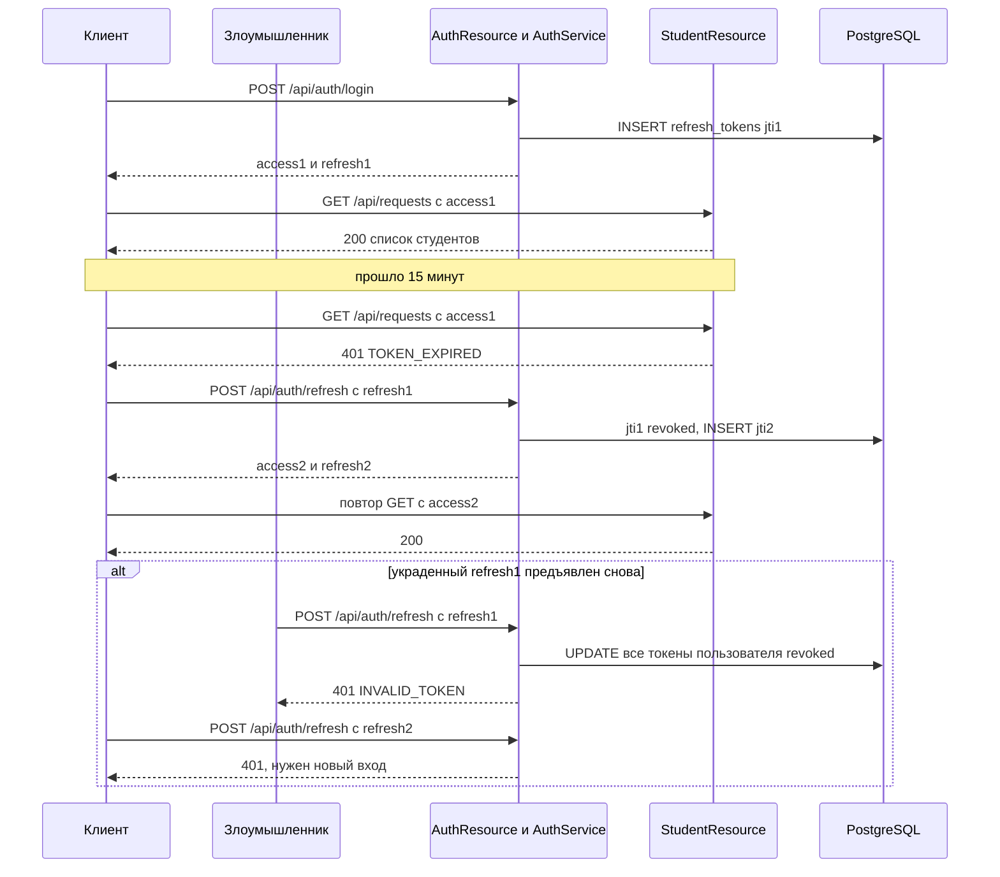

*Схема: при обращении к API база не нужна, она участвует только во входе и обмене refresh-токена. В ветке `alt` пострадавший тоже теряет сессию. Это осознанная плата: после повторного предъявления отозванного токена ни одной из выданных цепочек доверять нельзя.*

Сам JWT сервер не хранит: в `refresh_tokens` лежат только `jti`, владелец, срок и флаг `revoked`. Утечка этой таблицы не даёт готовых токенов, потому что без секрета подпись к `jti` не подобрать.

> [!NOTE]
> **В твоей работе**
>
> Файл: `src/main/java/ru/itmo/students/service/AuthService.java`, строки 82–94
>
> ```java
> @Transactional(dontRollbackOn = UnauthorizedException.class)
> public TokenResponse refresh(String token) {
>     RefreshToken stored = findRefreshToken(token);
>
>     if (stored.isRevoked()) {
>         refreshTokens.revokeAllOf(stored.getUser());
>         LOG.warning("Повторное использование refresh-токена, все токены отозваны: " + stored.getUser().getUsername());
>         throw new UnauthorizedException("INVALID_TOKEN", "Refresh-токен уже использован или отозван. Войдите заново");
>     }
>
>     stored.setRevoked(true);
>     return issueTokens(stored.getUser());
> }
> ```
>
> `findRefreshToken` сначала проверяет JWT с типом `REFRESH`, затем ищет строку по `jti`. `issueTokens` (строки 147–163) генерирует новый `jti` как `UUID.randomUUID()`, сохраняет строку и подписывает пару. Отзыв старого токена и запись нового выполняются в одной транзакции: либо пара выдана и старый токен погашен, либо не изменилось ничего. `dontRollbackOn` нужен потому, что метод бросает исключение, а отзыв всех токенов при этом должен сохраниться. Подробно — в [вопросе 11](#q11). Почти наверняка спросят: «Что будет, если убрать `dontRollbackOn`?» Ответ: `UnauthorizedException` — unchecked-исключение, транзакция откатится, `revokeAllOf` не применится, и украденная цепочка останется рабочей.

> [!WARNING]
> **Подводный камень**
>
> Два одновременных обмена одного и того же refresh-токена сервер работы не различает: на уровне изоляции Read Committed оба запроса могут прочитать `revoked = false` и оба получить новые пары, так что обнаружение повторного использования не сработает. Почему так происходит и как это исправить условным `UPDATE`, разобрано в [вопросе 11](#q11).

### Выход и отзыв

`logout` помечает refresh-токен как `revoked`. Access-токен при этом продолжает работать до своего `exp`: сервер его нигде не учитывает. Если нужен немедленный отзыв, есть три пути: очень короткий срок жизни access-токена, чёрный список `jti` access-токенов в быстром хранилище (Redis) или номер версии токенов у пользователя, который проверяется при каждом запросе. Последние два возвращают обращение к хранилищу на каждый запрос, то есть отчасти отменяют выигрыш stateless-проверки. Та же задержка касается роли: она записана в access-токен, поэтому её смена подействует не раньше чем через 15 минут (см. [вопрос 14](#q14)).

### Хранение на клиенте

У браузерного клиента два основных места для токенов. **`localStorage`** прост в работе: токен вручную кладётся в заголовок, но он доступен любому JavaScript на странице, и одна XSS-уязвимость выдаёт оба токена. **Cookie с флагами `HttpOnly; Secure; SameSite=Strict`** недоступна скриптам, браузер сам отправляет её на нужный путь. Взамен появляется риск CSRF и нужна настройка CORS. Частый компромисс: access-токен держать в памяти страницы, refresh — в `HttpOnly`-cookie с `Path=/api/auth`.

> [!NOTE]
> **В твоей работе**
>
> Файл: `src/main/webapp/js/api.js`, строки 57–68
>
> ```javascript
> // Обновление токенов по refresh-токену. Если два запроса одновременно получили 401,
> // обновление всё равно выполнится один раз: старый refresh-токен после обмена уже недействителен
> let refreshInProgress = null;
>
> function refreshTokens() {
>     if (refreshInProgress === null) {
>         refreshInProgress = doRefresh().finally(function () {
>             refreshInProgress = null;
>         });
>     }
>     return refreshInProgress;
> }
> ```
>
> Все запросы, получившие 401, ждут один общий `Promise`, и refresh отправляется один раз. Без этого ротация выбила бы пользователя: второй обмен попал бы на уже отозванный токен и сработало бы обнаружение повторного использования. `request()` (строки 89–100) повторяет исходный запрос один раз, а при повторном 401 очищает сессию и уводит на страницу входа. Токены хранятся в `localStorage` (`auth.js`, строки 8–12).

> [!CAUTION]
> **Расхождение с практикой**
>
> Первое: токены в `localStorage` уязвимы для XSS. Защищать это решение так: клиент учебный, без сторонних скриптов, а перенос refresh-токена в `HttpOnly`-cookie — следующий шаг, требующий настройки CSRF-защиты. Второе: HS256 без `aud` достаточен, пока токены выпускает и проверяет одно приложение. Если появятся другие сервисы, нужен RS256/ES256 с публичным ключом. Третье: access-токен не отзывается при выходе — это свойство stateless-подхода, а риск ограничен 15 минутами. Четвёртое: строки с истёкшими и отозванными refresh-токенами не удаляются и копятся. Решение — периодическая задача `DELETE FROM refresh_tokens WHERE expires_at < now()`.

> [!TIP]
> **Могут спросить**
>
> **Можно ли изменить payload, не зная секрета?** Изменить можно, но подпись перестанет сходиться, и `verifier.verify` бросит `SignatureVerificationException` — в работе это 401 `INVALID_TOKEN`. Пересчитать подпись без секрета нельзя: на этом и держится доверие к роли из токена.
>
> **Зачем refresh-токену `jti` и запись в БД, если он тоже JWT?** Подпись подтверждает только, что токен выпущен сервером, но не говорит, не отозван ли он. Запись по `jti` даёт отзыв при выходе и обнаружение повторного использования. Ради этого refresh-токен сознательно сделан stateful.
>
> **Что произойдёт при смене `JWT_SECRET`?** Все выданные токены, и access, и refresh, перестанут проходить проверку подписи, и всем пользователям придётся войти заново. Так экстренно гасят все сессии при утечке секрета. Плавная ротация требует поддержки нескольких ключей, обычно через claim `kid` в header.

## Вопрос 14. Ролевая модель доступа и защита серверных ресурсов.

Аутентификация отвечает на вопрос «кто прислал запрос» (подробно — [вопрос 12](#q12)). Следующий вопрос — что этому человеку можно. Если решать его прямо в коде, в каждом методе появится `if (!user.isAdmin()) return 403`. Такие проверки разбросаны по коду, их легко забыть в новом методе, а по коду трудно понять, у кого какие права. Нужна модель доступа: правило, по которому права выдаются, и одно место, где они проверяются до того, как запрос дойдёт до бизнес-логики.

### Модели доступа

| Модель | По чему принимается решение | Пример на общежитии | Где уместна |
|:--|:------|:------|:-----|
| **ACL** (Access Control List) | у каждого объекта свой список «субъект — права» | у карточки студента 412345: комендант Петров — запись | файловые системы, документы с индивидуальным доступом |
| **RBAC** (Role-Based Access Control) | по ролям субъекта | ADMIN меняет студентов, USER только читает | большинство бизнес-приложений |
| **ABAC** (Attribute-Based Access Control) | по атрибутам субъекта, объекта и окружения | комендант меняет только жильцов своего общежития и только в рабочее время | сложные политики, где ролей не хватает |

В **RBAC** между пользователем и правами появляется посредник — **роль**. Права (**разрешения**, permissions — «читать студентов», «удалять студентов») назначаются роли, а пользователю назначается роль. Когда сотрудник меняет должность, ему меняют одну роль, а не перебирают права по одному. В небольших системах роль сама служит набором прав, и код проверяет роль напрямую. В крупных код проверяет разрешение (`students:delete`), а соответствие «роль → разрешения» хранится в настройках.

### Роли работы и матрица доступа

Условие требует две роли. ADMIN может выполнять все операции со студентами, USER — только смотреть список и отдельного студента, а разграничение должно выполняться на backend. Удобнее всего представить права **матрицей доступа**: строки — операции, столбцы — роли.

| Операция | Аноним | USER | ADMIN |
|:------|:--|:--|:--|
| `GET /api/requests`, `QUERY /api/requests` | 401 | да | да |
| `GET /api/requests/{isu_id}` | 401 | да | да |
| `POST /api/requests` | 401 | 403 | да |
| `PUT`, `PATCH`, `DELETE /api/requests/{isu_id}` | 401 | 403 | да |
| `POST /api/auth/register`, `login`, `refresh`, `logout` | да | да | да |
| `GET /api/auth/me` | 401 | да | да |

Аноним получает 401: система не знает, кто он, и предлагает войти. USER на операции записи получает 403: система знает, кто он, но этой роли операция запрещена. Подробнее о разнице 401 и 403 — [вопрос 12](#q12).

### Наименьшие привилегии и запрет по умолчанию

**Принцип наименьших привилегий**: каждый получает минимум прав, достаточный для работы. Первое место, где его легко нарушить, — регистрация.

**Плохо:**

```java
public record RegisterRequest(String username, String email, String password, Role role) {}

User user = createUser(request, request.role());   // роль выбирает сам клиент
```

**Хорошо:**

```java
public record RegisterRequest(String username, String email, String password) {}   // поля роли нет

User user = createUser(request, Role.USER);   // роль назначает сервер
```

В первом варианте любой может отправить `"role": "ADMIN"` и стать администратором. Эта уязвимость называется **mass assignment**: клиент заполняет поле, которое не должен контролировать. Скрыть поле в форме на фронтенде мало, потому что запрос можно собрать вручную.

Второй принцип — **запрет по умолчанию** (default deny): закрыто всё, что не открыто явно. Если новый метод забыли разметить, лучше, чтобы он оказался недоступен, чем открыт всем. На практике класс ресурса закрывают целиком, а открытые методы помечают явно.

### Аннотации безопасности

Права удобно описывать декларативно, аннотациями из Jakarta Annotations (`jakarta.annotation.security`):

- `@RolesAllowed({"ADMIN"})` — доступ только у перечисленных ролей;
- `@PermitAll` — доступ у всех, в том числе без входа;
- `@DenyAll` — доступа нет ни у кого.

Аннотацию можно поставить на класс или на метод, и аннотация метода важнее аннотации класса. Сама она ничего не проверяет: её должен прочитать кто-то во время выполнения (механизм аннотаций и рефлексии — [вопрос 4](#q4)). Обычно это делает инфраструктура: контейнер Jakarta EE с включённой Jakarta Security, фича MicroProfile JWT (`mpJwt`) в Open Liberty или Spring Security с его `@PreAuthorize("hasRole('ADMIN')")` и `@Secured`.

> [!NOTE]
> **В твоей работе**
>
> Файл: `src/main/java/ru/itmo/students/resource/StudentResource.java`, строки 45–51, 91–94, 142–145
>
> ```java
> @Path("/requests")
> @Produces(MediaType.APPLICATION_JSON)
> @Consumes(MediaType.APPLICATION_JSON)
> @RolesAllowed({"USER", "ADMIN"})
> @Tag(name = "Студенты")
> @SecurityRequirement(name = "bearerAuth")
> public class StudentResource {
> ...
>     @POST
>     @RolesAllowed("ADMIN")
>     @Operation(summary = "Создать студента (только ADMIN)")
>     public Response create(StudentRequest request, @Context UriInfo uriInfo) {
> ...
>     @DELETE
>     @Path("/{isu_id}")
>     @RolesAllowed("ADMIN")
>     @Operation(summary = "Удалить студента (только ADMIN)")
> ```
>
> Класс закрыт для анонима: чтение доступно обеим ролям, а `POST`, `PUT`, `PATCH` и `DELETE` переопределяют это правило на уровне метода и сужают доступ до ADMIN. В `AuthResource` наоборот: класс открыт `@PermitAll`, а `/me` закрыт `@RolesAllowed({"USER", "ADMIN"})`. Регистрация всегда даёт USER: `AuthService.register` вызывает `createUser(request, Role.USER)` (строки 53–59), а в `RegisterRequest` поля роли нет. Если клиент всё же пришлёт `role`, строгий JSON-B (`jsonb.fail-on-unknown-properties` в `JsonConfig`) ответит 422 «Неизвестное поле», а не проигнорирует его молча. Администратор создаётся только из переменных окружения при старте (`createAdminIfMissing`).

### Фильтры Jakarta REST: где проходит проверка

В Jakarta REST сквозные проверки выполняют **фильтры**: классы, которые реализуют `ContainerRequestFilter` и помечены `@Provider`. Runtime вызывает их до метода ресурса. Порядок задаёт `@Priority`: меньшее число выполняется раньше. Константы `Priorities.AUTHENTICATION = 1000` и `Priorities.AUTHORIZATION = 2000` гарантируют, что сначала выясняется, кто пользователь, и только потом — что ему можно. Фильтр с `@PreMatching` выполняется ещё раньше, до выбора метода ресурса. Фильтру авторизации этот вариант не подходит: ему нужно знать, какой метод будет вызван, а это сообщает `ResourceInfo`, который появляется только после сопоставления запроса с методом.

Если фильтр бросает исключение, метод ресурса не вызывается, а исключение превращается в ответ обычным путём, через `ExceptionMapper` (подробнее — [вопрос 7](#q7)).

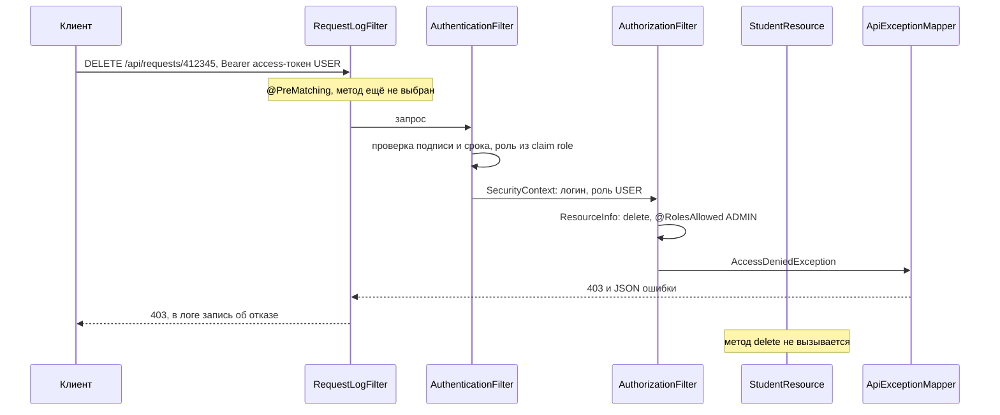

*Схема: запрет срабатывает до слоя ресурса и сервиса, поэтому USER не дойдёт до удаления, даже если в сервисе нет ни одной проверки роли. `RequestLogFilter` стоит и на входе, и на выходе, поэтому отказ попадает в серверный лог вместе с именем пользователя.*

> [!NOTE]
> **В твоей работе**
>
> Файл: `src/main/java/ru/itmo/students/security/AuthorizationFilter.java`, строки 34–68
>
> ```java
> public void filter(ContainerRequestContext request) {
>     Method method = resourceInfo.getResourceMethod();
>     Class<?> resourceClass = resourceInfo.getResourceClass();
>
>     if (method.isAnnotationPresent(PermitAll.class)) {
>         return;
>     }
>
>     RolesAllowed rolesAllowed = method.getAnnotation(RolesAllowed.class);
>     if (rolesAllowed == null) {
>         rolesAllowed = resourceClass.getAnnotation(RolesAllowed.class);
>     }
>
>     if (rolesAllowed == null && resourceClass.isAnnotationPresent(PermitAll.class)) {
>         return;
>     }
>
>     SecurityContext security = request.getSecurityContext();
>
>     if (security.getUserPrincipal() == null) {
>         throw new UnauthorizedException("Нужно войти: передайте заголовок Authorization: Bearer <access-токен>");
>     }
>     ...
>     for (String role : rolesAllowed.value()) {
>         if (security.isUserInRole(role)) {
>             return;
>         }
>     }
>
>     throw new AccessDeniedException("Недостаточно прав: операция доступна только ролям " + String.join(", ", rolesAllowed.value()));
> }
> ```
>
> Фильтр по шагам повторяет стандартную семантику: `@PermitAll` метода, затем `@RolesAllowed` метода, затем аннотации класса. Роль он берёт не из базы, а из `SecurityContext`, который на шаге раньше заполнил `AuthenticationFilter`, взяв claim `role` из access-токена. `JwtSecurityContext.isUserInRole` просто сравнивает строки (строки 28–31). Здесь ждут вопрос «почему роль не перечитывается из БД на каждом запросе». Ответ: так сохраняется stateless-проверка без похода в базу, но смена роли подействует только после истечения access-токена, то есть до 15 минут (подробнее — [вопрос 13](#q13)).

> [!WARNING]
> **Подводный камень**
>
> В этом фильтре метод без аннотаций в классе без аннотаций доступен любому вошедшему пользователю, в том числе USER (строки 57–59). Это запрет по умолчанию только для анонима, а не для ролей: если добавить новый ресурс и забыть `@RolesAllowed`, USER сможет в нём писать. Кроме того, фильтр не обрабатывает `@DenyAll`: метод с этой аннотацией будет открыт любому вошедшему. Строгий default deny — бросать 403, если аннотаций нет совсем.

> [!CAUTION]
> **Расхождение с практикой**
>
> Проверка JWT и ролей написана вручную, двумя фильтрами. Обычно её поручают платформе: в Open Liberty есть фича `mpJwt` (MicroProfile JWT), которая сама проверяет токен и исполняет `@RolesAllowed`, а в Jakarta EE есть Jakarta Security. В `server.xml` работы этих фич нет, поэтому `@RolesAllowed` действует только потому, что его читает собственный `AuthorizationFilter`. Если фильтр удалить, аннотации останутся, но защиты не будет. Защищать решение стоит так: в учебной работе видна вся механика (порядок фильтров, рефлексия, 401 и 403 в едином формате ошибок), а семантика аннотаций стандартная, поэтому переход на `mpJwt` не меняет разметку ресурсов. Второе слабое место — управления ролями нет: администратор берётся из `.env`, все остальные получают USER, повысить пользователя через API нельзя.

### Проверка на сервере, а не на клиенте

Фронтенд может прятать кнопки, но не может защищать данные: запрос в обход интерфейса отправляется через Postman, `curl` или консоль браузера. Поэтому скрытие кнопок — удобство для пользователя, а защита — только проверка на сервере.

> [!NOTE]
> **В твоей работе**
>
> Файл: `src/main/webapp/js/auth.js`, строки 33–38
>
> ```javascript
> // Роль нужна только чтобы спрятать лишние кнопки. Права всё равно проверяет сервер:
> // если USER вызовет удаление вручную, сервер ответит 403
> function isAdmin() {
>     const user = getCurrentUser();
>     return user !== null && user.role === "ADMIN";
> }
> ```
>
> Элементы с классом `admin-only` скрываются для USER. В коллекции Postman папка «3. Студенты — USER» содержит запросы «USER: создать — запрещено», «USER: изменить — запрещено» и «USER: удалить — запрещено». Они показывают, что сервер отвечает 403 и без интерфейса. Это закрывает требование условия о демонстрации работы пользователей с разными ролями.

### Защита ресурсов шире ролей

Роль отвечает на вопрос «можно ли этой группе такую операцию», но не на вопрос «можно ли этому пользователю этот конкретный объект». Если бы студент мог видеть только свою карточку, запрос `GET /api/requests/412346` от студента 412345 пропустила бы любая проверка ролей. Такая уязвимость называется **IDOR** (Insecure Direct Object Reference), и закрывает её проверка владения в сервисе: `isuId` записи сравнивается с пользователем из токена. В этой работе она не нужна: студенты — общий справочник, а не личные данные пользователей.

К защите ресурсов относится и остальное. Значения в JPQL передаются только параметрами, а поля сортировки берутся из белого списка, что защищает от инъекций ([вопрос 10](#q10)). Токены ходят в заголовке, поэтому в продакшене нужен HTTPS. В `server.xml` работы задано `httpsPort="-1"`: это допустимо для локального запуска, а в продакшене TLS обычно включают на обратном прокси. CORS настраивают, только если фронтенд живёт на другом домене. Здесь клиент раздаётся тем же сервером, поэтому CORS не нужен.

> [!TIP]
> **Могут спросить**
>
> **Почему роли проверяются в фильтре, а не в сервисе?** Проверка роли — сквозная задача, одинаковая для всех методов. В фильтре она выполняется до вызова ресурса, а права видны прямо в разметке ресурса. Сервис при этом остаётся независимым от HTTP. Проверки, которые зависят от данных (владение записью), всё равно делают в сервисе.
>
> **Как добавить роль MODERATOR, которой разрешён только PATCH?** Нужно добавить значение в `enum Role`, расширить `CHECK (role IN (...))` в `schema.sql` и указать `@RolesAllowed({"ADMIN", "MODERATOR"})` на `patch`. Если таких ролей станет много, лучше перейти к разрешениям: проверять `students:patch`, а соответствие ролей и разрешений хранить отдельно.
>
> **Почему `AuthorizationFilter` не помечен `@PreMatching`?** До сопоставления запроса с методом неизвестно, какой метод будет вызван, и `ResourceInfo` пуст. Значит, аннотации `@RolesAllowed` прочитать неоткуда. `@PreMatching` подходит для логирования, которому метод не нужен.

## Вопрос 15. Хеширование паролей. Назначение соли и применение алгоритмов типа BCrypt.

Серверу нужно проверить, что при входе пользователь ввёл тот же пароль, что и при регистрации. Самое простое решение — хранить пароль как есть в `users` и сравнивать строки. Но база рано или поздно утекает: через резервную копию, SQL-инъекцию, доступ бывшего сотрудника. Утёкшая таблица с паролями в открытом виде опасна не только для этой системы. Люди повторяют один и тот же пароль на разных сайтах, поэтому пароль от учёта студентов общежития часто подходит и к почте. Отсюда требование условия: пароли не хранятся в открытом виде. Сервер должен уметь проверить пароль, но не должен уметь его восстановить.

### Хеширование, а не шифрование

**Шифрование** обратимо: у кого есть ключ, тот получит исходный текст. Ключ хранится на том же сервере, что и база, и при взломе утечёт вместе с ней. Для паролей обратимость не нужна вообще: серверу никогда не требуется показывать пароль, ему достаточно сравнить.

**Хеш-функция** превращает строку любой длины в значение фиксированной длины, и обратного преобразования у неё нет. При регистрации сервер сохраняет `hash(пароль)`. При входе он вычисляет `hash(введённый пароль)` и сравнивает результат с сохранённым значением. Совпали хеши — совпали и пароли (с пренебрежимо малой вероятностью ошибки).

### Почему быстрые хеши не годятся

MD5, SHA-1 и SHA-256 спроектированы быстрыми: они нужны для контрольных сумм и подписи больших файлов. Атакующему, у которого на руках таблица хешей, обратное преобразование и не требуется: он перебирает кандидатов (словари утёкших паролей, их вариации) и хеширует каждого. Одна видеокарта вычисляет миллиарды SHA-256 в секунду, так что любой восьмисимвольный пароль из словаря находится за секунды.

**Плохо:**

```java
// SHA-256 без соли: быстро и одинаково для одинаковых паролей
String hash = HexFormat.of().formatHex(
        MessageDigest.getInstance("SHA-256")
                .digest(password.getBytes(StandardCharsets.UTF_8)));
user.setPasswordHash(hash);
```

**Хорошо:**

```java
// BCrypt: случайная соль внутри хеша, стоимость 12
user.setPasswordHash(BCrypt.hashpw(password, BCrypt.gensalt(12)));
```

В первом варианте две беды. Хеш вычисляется за наносекунды, поэтому перебор дёшев. Кроме того, у всех, кто выбрал пароль `qwerty123`, хеш одинаковый. Для такой схемы существуют **радужные таблицы**: заранее посчитанные соответствия «хеш → пароль» для миллиардов популярных паролей. Взлом сводится к поиску в таблице.

### Соль

**Соль** — случайное значение, уникальное для каждого пароля. Хешируется не пароль, а пароль вместе с солью, и соль сохраняется рядом с хешем в открытом виде. Секретность соли не нужна, её работа в другом:

- у двух студентов с паролем `qwerty123` получаются разные хеши, и по таблице не видно, что пароли совпадают;
- радужные таблицы бесполезны: считать их пришлось бы заново под каждую соль, то есть под каждого пользователя;
- атакующий не может перебирать пароли сразу для всей таблицы, каждый хеш приходится ломать отдельно.

От перебора одного конкретного хеша соль не защищает: её значение известно, и подставить её к кандидатам ничего не стоит. Перебор замедляет только медленная функция, о ней — ниже.

Иногда к соли добавляют **перец** — общий секрет, который хранится вне базы (в переменной окружения или менеджере секретов) и подмешивается к каждому паролю, обычно через HMAC перед медленным хешированием. Если утекла только база, а сервер — нет, перебор без перца невозможен. Цена — сложность ротации: при смене перца старые хеши перестают проверяться. В этой работе перца нет, и для учебной системы это нормально.

### BCrypt и другие медленные функции

Для паролей используют специальные **адаптивные** функции. Они намеренно медленные, и их стоимость задаётся параметром, который можно поднимать вместе с ростом мощности железа. В BCrypt этот параметр называется **cost**: число раундов дорогого расширения ключа равно $2^{cost}$. Каждая единица cost удваивает время, так что при cost 12 один хеш стоит в $2^{12} = 4096$ раз больше, чем при cost 0. Для пользователя это сотни миллисекунд при входе, для атакующего — тысячи попыток в секунду на видеокарте вместо миллиардов. Cost выбирают так, чтобы на сервере один хеш занимал примерно 100–300 мс. Сейчас обычны значения 10–12.

Результат BCrypt — строка из 60 символов, в которую упаковано всё нужное для проверки:

```
$2a$12$R9h/cIPz0gi.URNNX3kh2OPST9/PgBkqquzi.Ss7KIUgO2t0jWMUW
 \/ \/ \____________________/\_____________________________/
 |  cost  соль, 22 символа      хеш, 31 символ
 версия алгоритма
```

Соль (16 случайных байт) и cost хранятся прямо в строке, поэтому отдельный столбец для соли не нужен, а `VARCHAR(60)` вмещает всё. При входе `checkpw` разбирает сохранённую строку, берёт из неё соль и cost, хеширует введённый пароль с теми же параметрами и сравнивает результаты.

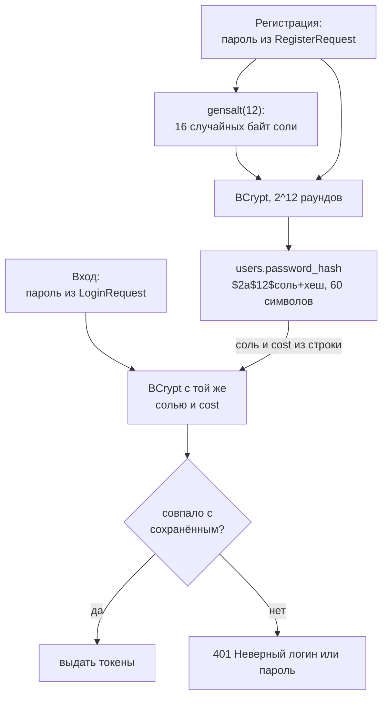

*Схема: при входе не нужно ничего, кроме строки из `password_hash`. Строка описывает сама себя, поэтому хеши с разным cost могут лежать в одной таблице и проверяются одним и тем же кодом. Именно это позволяет со временем поднимать cost.*

BCrypt — не единственный вариант:

| Алгоритм | Что настраивается | Особенность |
|:--|:----|:-----------|
| PBKDF2 | число итераций HMAC-SHA256 (OWASP: от 600 000) | стандарт NIST/FIPS, но память не нагружает и хорошо параллелится на GPU |
| BCrypt | cost (OWASP: от 10) | проверен временем, есть в любом языке; пароль ограничен 72 байтами |
| scrypt | CPU, память, параллелизм | требует много памяти, что дорого для GPU и ASIC |
| Argon2id | память, итерации, параллелизм | победитель Password Hashing Competition, первый выбор по рекомендации OWASP |

Для новых проектов OWASP советует Argon2id, BCrypt остаётся допустимым выбором. Главное отличие в том, что scrypt и Argon2 требуют много памяти: видеокарта с тысячами ядер не может запустить столько же параллельных попыток, потому что на каждую не хватает памяти.

> [!WARNING]
> **Подводный камень**
>
> BCrypt учитывает только первые 72 байта пароля, остальное молча отбрасывает. Два длинных пароля с общим началом дадут одинаковый хеш. Ограничение задано в байтах, а не в символах: в UTF-8 кириллическая буква занимает 2 байта, поэтому русская парольная фраза упирается в предел уже на 36 символах.

### Проверка и повышение стоимости

Сравнивать хеши лучше за постоянное время, то есть без выхода на первом несовпадающем символе. Библиотеки BCrypt делают это сами, поэтому писать своё сравнение строк поверх `hashpw` не нужно, достаточно вызвать `checkpw`. Важнее другой источник утечки по времени: вызывается ли BCrypt вообще. Если для несуществующего логина сервер отвечает за 1 мс, а для существующего с неверным паролем — за 250 мс, по времени ответа видно, какие логины зарегистрированы. Это разобрано на примере работы ниже.

Когда cost пора поднимать, пароли не сбрасывают. После успешного входа сервер знает пароль в открытом виде. Если cost в сохранённом хеше ниже текущего, сервер перехеширует пароль с новым cost и обновляет `password_hash`. Активные пользователи переезжают на новую стоимость незаметно для себя.

Что касается правил для самого пароля, длина важнее сложности. NIST SP 800-63B требует минимум 8 символов, разрешает длинные парольные фразы и рекомендует проверять пароль по спискам утёкших, а не требовать обязательных классов символов.

> [!NOTE]
> **В твоей работе**
>
> Файл: `src/main/java/ru/itmo/students/security/PasswordHasher.java`, строки 11–24
>
> ```java
> @ApplicationScoped
> public class PasswordHasher {
>
>     // Стоимость 12: 2^12 раундов. Чем больше, тем медленнее перебор паролей
>     private static final int COST = 12;
>
>     public String hash(String password) {
>         return BCrypt.hashpw(password, BCrypt.gensalt(COST));
>     }
>
>     public boolean matches(String password, String hash) {
>         return BCrypt.checkpw(password, hash);
>     }
> }
> ```
>
> Это требование «пароли не хранятся в открытом виде». Библиотека `jbcrypt` создаёт соль в `gensalt`, а хеш формата `$2a$12$…` ложится в `password_hash VARCHAR(60)` (`schema.sql`, `entity/User.java`). Хеширование вынесено в отдельный бин: сервис не знает, какой алгоритм используется, и замена на Argon2 затронет один класс. Правда, старые хеши BCrypt тогда тоже придётся уметь проверять.
>
> Файл: `src/main/java/ru/itmo/students/service/AuthService.java`, строки 119–136
>
> ```java
> private User createUser(RegisterRequest request, Role role) {
>     if (request.password().getBytes(StandardCharsets.UTF_8).length > BCRYPT_MAX_BYTES) {
>         throw new DataValidationException("password", "Пароль слишком длинный: не больше 72 байт (около 36 русских букв)");
>     }
>     ...
>     user.setPasswordHash(passwordHasher.hash(request.password()));
>     ...
>     users.save(user);
> ```
>
> `RegisterRequest` разрешает пароль до 64 символов, а 64 кириллические буквы — это 128 байт. Поэтому длину в байтах сервис проверяет отдельно и возвращает 422, а не позволяет BCrypt молча отрезать хвост. Хеш наружу не уходит: в `UserResponse` есть только `id`, `username`, `email` и `role`, а в лог при неудачном входе пишется только логин. Вероятный вопрос преподавателя — «где здесь соль?». Ответ: внутри строки хеша, её сгенерировал `gensalt`.

> [!CAUTION]
> **Расхождение с практикой**
>
> Сообщение при входе одинаковое для чужого логина и для неверного пароля, но время ответа разное (`AuthService.java`, строки 63–65): если логина нет, `filter` не вызывается и BCrypt не работает, поэтому ответ приходит на сотни миллисекунд быстрее. Исправление — хешировать всегда, при необходимости с подставным хешем:
>
> ```java
> // подставной хеш с тем же cost, считается один раз при старте
> String hash = found.map(User::getPasswordHash).orElse(dummyHash);
> boolean ok = passwordHasher.matches(request.password(), hash); // BCrypt вызывается всегда
> if (found.isEmpty() || !ok) throw new UnauthorizedException("Неверный логин или пароль");
> ```
>
> На защите стоит признать эту утечку и сказать, что регистрация всё равно раскрывает занятость логина ответом 409. Обычный компромисс — ограничение числа попыток входа, о нём в [вопросе 12](#q12). Ещё два момента. Правило «хотя бы буква и цифра» в `RegisterRequest` расходится с NIST, который не рекомендует обязательные классы символов, но так требуют многие учебные условия. Библиотека `jbcrypt` 0.4 давно не обновлялась; она корректна, но в новых проектах обычно берут Spring Security Crypto, Password4j или реализацию Argon2.

> [!TIP]
> **Могут спросить**
>
> **Почему бы не зашифровать пароли AES?** Ключ шифрования живёт на том же сервере и утечёт вместе с базой, после чего все пароли расшифруются разом. Кроме того, восстанавливать пароль серверу не нужно никогда, а возможность прочитать пароли — лишний риск, в том числе со стороны администраторов.
>
> **Зачем соль, если её хранят открыто?** Её задача — уникальность, а не секретность. Соль делает хеши одинаковых паролей разными, обесценивает радужные таблицы и заставляет ломать каждый хеш отдельно. Медленным перебор делает cost, а не соль.
>
> **Как поднять cost, если пользователи уже зарегистрированы?** Изменить константу для новых хешей. Старые продолжат проверяться, потому что cost записан в самой строке хеша. При успешном входе хеш с устаревшим cost можно пересчитать: в этот момент пароль известен.

## Вопрос 16. Хранение конфигурации, секретов и параметров окружения в backend-приложении.

Одно и то же приложение запускается в разных местах: на ноутбуке разработчика, на тестовом стенде, в продакшене. Код у всех копий одинаковый, а адрес базы, пароль к ней, порт, срок жизни токенов различаются. Если всё это вписать в код, под каждое окружение придётся собирать свою версию, а пароль от продакшен-базы окажется в git у всех, кто может читать репозиторий. Поэтому всё, что зависит от окружения, отделяют от кода и передают приложению при запуске.

### Что считать конфигурацией

**Конфигурация окружения** — параметры, которые меняются между запусками одной и той же сборки. То, что одинаково везде (список фич сервера, состав persistence unit, правила валидации), остаётся частью приложения, даже если лежит в XML. Особая часть конфигурации — **секреты**: значения, знание которых даёт доступ или права. Их не только выносят из кода, но и хранят так, чтобы их не видели лишние люди и они не попадали в логи.

| Параметр в работе | Зависит от окружения | Секрет |
|:--|:--|:--|
| `HTTP_PORT` | да | нет |
| `DB_HOST`, `DB_PORT`, `DB_NAME` | да | нет |
| `DB_USER`, `DB_PASSWORD` | да | да |
| `JWT_SECRET` | да | да: кто его знает, выпустит токен ADMIN |
| `JWT_ACCESS_MINUTES`, `JWT_REFRESH_DAYS` | да | нет |
| `ADMIN_USERNAME`, `ADMIN_EMAIL`, `ADMIN_PASSWORD` | да | пароль — да |
| `DEMO_DATA` | да | нет |
| фичи в `server.xml`, `persistence.xml` | нет | нет |

### Почему не в коде

Методология **12-factor app** формулирует это так: конфигурация хранится в окружении, а одна и та же сборка без изменений разворачивается куда угодно. Проверка простая: можно ли прямо сейчас открыть репозиторий публично и ничего не скомпрометировать.

**Плохо:**

```java
// секрет вшит в байт-код и в историю git
private final Algorithm algorithm = Algorithm.HMAC256("my-super-secret-key-for-dorm-app");
```

**Хорошо:**

```java
// значение приходит из окружения при старте
@Inject
@ConfigProperty(name = "JWT_SECRET")
String secret;
```

В первом варианте секрет одинаков на всех стендах, его знает каждый, у кого есть доступ к коду или к WAR (строку легко достать из `.class`), а смена секрета требует пересборки. Во втором код вообще не знает значения.

### `.env` и `.env.example`

Для локального запуска переменные окружения удобно держать в файле **`.env`** — строки `КЛЮЧ=значение`. Сам `.env` с настоящими паролями в git не попадает: он перечислен в `.gitignore`. Вместо него в репозиторий кладут **`.env.example`** — тот же набор ключей с безопасными примерами и комментариями. Это документация: новый человек видит, какие параметры нужны для запуска, копирует файл и подставляет свои значения. Именно этого требует условие: конфигурация, зависящая от окружения, вынесена за пределы кода, а `.env.example` показывает, какие параметры требуются.

> [!NOTE]
> **В твоей работе**
>
> Файл: `.env.example`, строки 8–29 (значения секретов заменены на `***`)
>
> ```properties
> # База данных PostgreSQL (docker compose создаёт её с этими именем, логином и паролем)
> DB_HOST=localhost
> DB_PORT=5432
> DB_NAME=***
> DB_USER=***
> DB_PASSWORD=***
>
> # Секрет для подписи JWT — случайная строка не короче 32 символов.
> ...
> JWT_SECRET=***
> JWT_ACCESS_MINUTES=15
> JWT_REFRESH_DAYS=7
> ...
> ADMIN_PASSWORD=***
> ...
> DEMO_DATA=true
> ```
>
> В `.gitignore` (строки 4–5) стоит `.env` с комментарием «в git только .env.example». Один файл `.env` читают два потребителя: docker compose (создаёт базу) и Open Liberty (запускает приложение), поэтому логин и пароль БД у них гарантированно совпадают. Могут спросить, что будет, если `.env` нет: compose подставит пустые строки, а приложение не стартует — `JWT_SECRET` и `ADMIN_*` не имеют значений по умолчанию.

### Как значения доходят до приложения

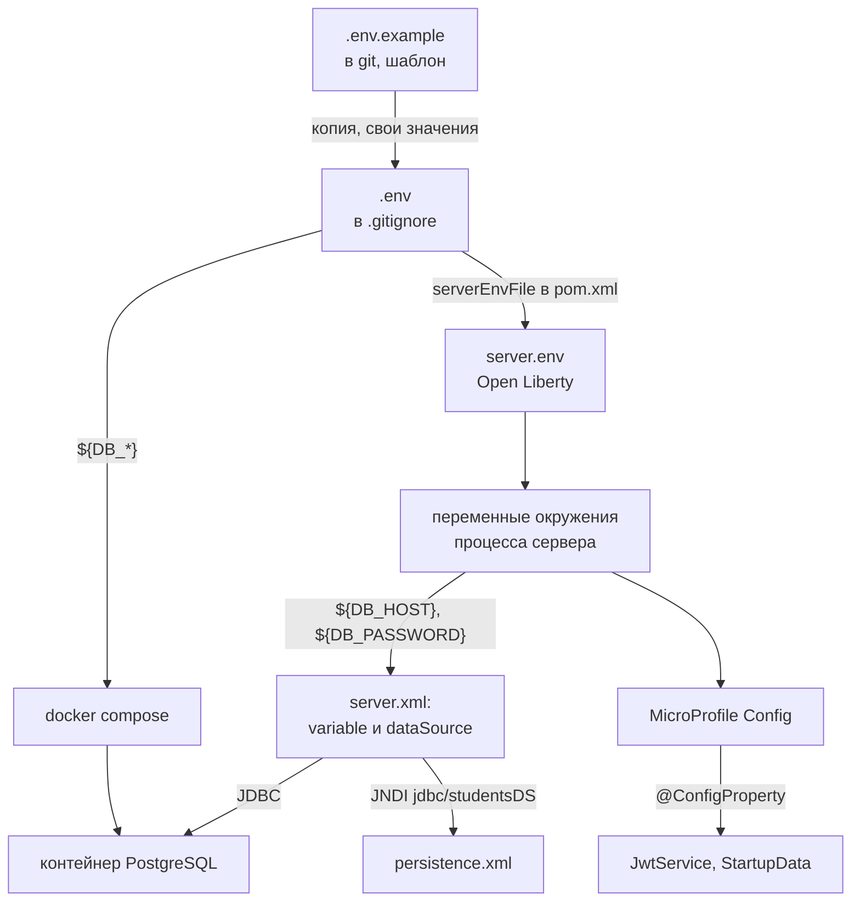

*Схема: у конфигурации два пути внутрь приложения. Параметры БД разрешает сам сервер в `server.xml` и отдаёт коду готовый пул соединений по имени — Java-код пароля базы не видит вообще. Параметры, нужные бизнес-логике (секрет и сроки JWT, администратор), идут через MicroProfile Config прямо в поля бинов.*

`liberty-maven-plugin` копирует `.env` в `server.env` сервера (`pom.xml`, строка 74: `<serverEnvFile>${project.basedir}/.env</serverEnvFile>`), и Liberty при старте превращает его строки в переменные окружения процесса. В `server.xml` переменные подставляются через `${…}`:

Файл: `src/main/liberty/config/server.xml`, строки 16–22 и 32–36 (значения по умолчанию для учётных данных заменены на `***`)

```xml
<!-- Значения по умолчанию. Переменная окружения с тем же именем (из .env) их заменяет -->
<variable name="HTTP_PORT" defaultValue="8080"/>
<variable name="DB_HOST" defaultValue="localhost"/>
...
<variable name="DB_USER" defaultValue="***"/>
<variable name="DB_PASSWORD" defaultValue="***"/>
...
<dataSource id="studentsDS" jndiName="jdbc/studentsDS">
    <jdbcDriver libraryRef="postgresLib"/>
    <properties.postgresql serverName="${DB_HOST}" portNumber="${DB_PORT}" databaseName="${DB_NAME}"
                           user="${DB_USER}" password="${DB_PASSWORD}"/>
</dataSource>
```

Приложение ссылается только на имя источника данных: в `persistence.xml` стоит `<jta-data-source>jdbc/studentsDS</jta-data-source>`. Это классический приём Jakarta EE: подключение к БД — ресурс сервера, найденный через **JNDI**, а не строка подключения в коде.

### MicroProfile Config

**MicroProfile Config** — стандартный API, который собирает настройки из нескольких **источников конфигурации** и внедряет их в бины через `@Inject @ConfigProperty`. Аннотация работает как квалификатор CDI (механизм — в [вопросе 5](#q5)). Источники упорядочены по приоритету (ordinal), при совпадении ключа побеждает старший:

| Источник | Ordinal по умолчанию |
|:--|:--|
| системные свойства JVM (`-DJWT_SECRET=…`) | 400 |
| переменные окружения | 300 |
| `META-INF/microprofile-config.properties` в приложении | 100 |

Отсюда типичная схема: безопасные значения по умолчанию лежат в приложении, а окружение их перекрывает. В работе файла `microprofile-config.properties` нет: значения по умолчанию заданы прямо в аннотации (`defaultValue = "15"`). Config сам преобразует строку в тип поля (`long accessMinutes`, `boolean demoData`); если преобразование невозможно, приложение не развернётся. Ключ `jwt.secret` тоже нашёл бы переменную `JWT_SECRET`: для окружения точки заменяются на `_`, а регистр поднимается.

В Spring Boot та же идея устроена иначе: `application.yml` с подстановками `${JWT_SECRET}`, `@Value` или типизированный `@ConfigurationProperties`, профили (`application-prod.yml`) и похожий порядок источников, где переменные окружения перекрывают файл. Подробнее о различиях платформ — [вопрос 2](#q2).

### Fail-fast: плохая конфигурация ломает запуск, а не первый запрос

Ошибка в настройке должна обнаруживаться при старте, а не в момент, когда пользователь первым пытается войти. Если у `@ConfigProperty` нет `defaultValue` и значение не найдено, MicroProfile Config прерывает развёртывание. Но отсутствие значения — не единственная ошибка: секрет может оказаться слишком коротким.

> [!NOTE]
> **В твоей работе**
>
> Файл: `src/main/java/ru/itmo/students/security/JwtService.java`, строки 47–55
>
> ```java
> @PostConstruct
> void init() {
>     // HS256 требует ключ не короче 256 бит = 32 байта
>     if (secret.getBytes(StandardCharsets.UTF_8).length < 32) {
>         throw new IllegalStateException("JWT_SECRET должен быть не короче 32 символов");
>     }
>     algorithm = Algorithm.HMAC256(secret);
>     verifier = JWT.require(algorithm).withIssuer(ISSUER).build();
> }
> ```
>
> `@ApplicationScoped`-бин создаётся лениво, при первом вызове, поэтому сама по себе эта проверка сработала бы только на первом логине. `StartupData.onStart` (строки 64–67) на событии старта вызывает `jwtService.getAccessTtl()` — бин создаётся сразу, и с коротким секретом сервер не поднимается. Там же `createAdmin` (строки 81–91) прогоняет `ADMIN_*` через Bean Validation и бросает `IllegalStateException`, если пароль администратора из `.env` не проходит правила регистрации. Почему бин создаётся лениво и зачем этот вызов, разобрано в [вопросе 5](#q5).

### Секреты в продакшене

`.env`-файл — удобство для разработки. На серверах секреты передаёт инфраструктура: переменные окружения задаются в CI/CD или оркестраторе, используются Docker secrets и Kubernetes Secrets (монтируются файлами), специализированные хранилища — HashiCorp Vault, AWS Secrets Manager, Yandex Lockbox. Они дают разграничение доступа, журнал обращений и ротацию.

**Ротация** секрета JWT имеет цену: все выданные токены, подписанные старым ключом, становятся недействительными, и пользователям приходится входить заново. Чтобы ротировать без этого, сервер какое-то время принимает два ключа, а в заголовке токена указывает `kid` — идентификатор ключа (подробнее о подписи — [вопрос 13](#q13)). Секреты не пишутся в логи: в работе `StartupData` при ошибке старта советует проверить `DB_*` и `ADMIN_*`, но не печатает их значения. Уровень логирования (`consoleLogLevel="INFO"` в `server.xml`) — тоже настройка, но одинаковая для всех окружений, поэтому она в файле сервера, а не в `.env`.

> [!WARNING]
> **Подводный камень**
>
> Если секрет хоть раз попал в коммит, удаление файла не помогает: значение остаётся в истории git и в чужих клонах. Единственное надёжное действие — считать секрет скомпрометированным и сменить его. И второе: переменные окружения — не сейф. Их видно в `docker inspect`, в `/proc/<pid>/environ`, они наследуются дочерними процессами и иногда попадают в отчёты об ошибках; поэтому в продакшене секреты чаще монтируют файлами или читают из хранилища.

> [!CAUTION]
> **Расхождение с практикой**
>
> В `server.xml` у `DB_USER` и `DB_PASSWORD` есть `defaultValue`, а в переменных коллекции Postman — пароль администратора по умолчанию. Формально это учётные данные в репозитории. Защищать так: это демо-значения для локальной базы в Docker, которой нет снаружи; в любом другом окружении переменные окружения их перекрывают. Строже было бы убрать значения по умолчанию у секретов, как это сделано для `JWT_SECRET`: без него приложение не стартует, и это правильное поведение.

> [!TIP]
> **Могут спросить**
>
> **Чем `.env` отличается от `.env.example`?** `.env` содержит реальные значения для конкретной машины и исключён из git. `.env.example` лежит в репозитории, перечисляет все нужные ключи с безопасными примерами и служит документацией для запуска.
>
> **Почему у `JWT_ACCESS_MINUTES` есть значение по умолчанию, а у `JWT_SECRET` нет?** Срок жизни токена имеет разумное общее значение, и его отсутствие ничего не ломает. Общего безопасного секрета не существует: значение по умолчанию означало бы, что все копии приложения подписывают токены одним известным ключом.
>
> **Где в коде пароль от базы данных?** Нигде. Liberty собирает пул соединений из `server.xml` и переменных окружения, а приложение получает его по JNDI-имени `jdbc/studentsDS` из `persistence.xml`.

***

Учебник подготовлен к защите лабораторной работы по её условию и репозиторию; примеры кода иллюстрируют принципы и не являются готовым решением задания.
